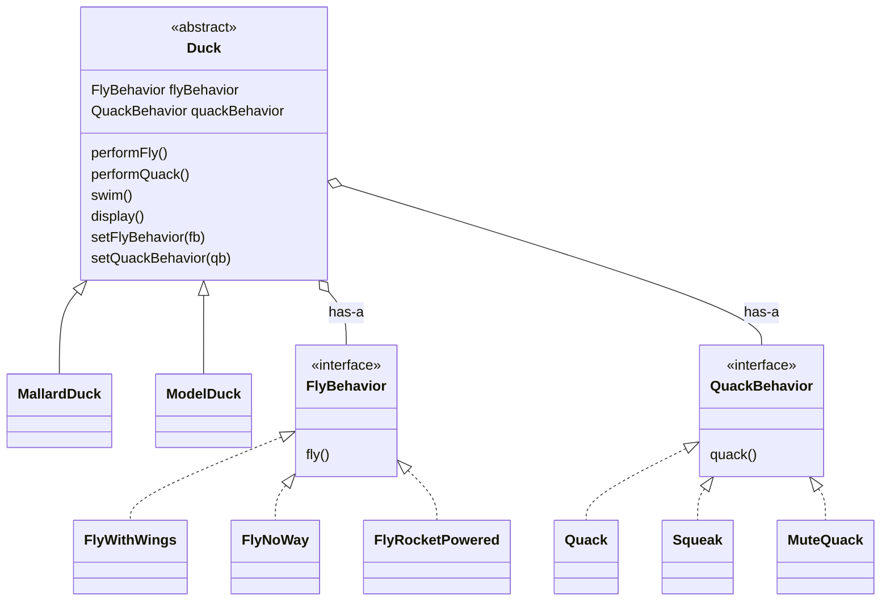
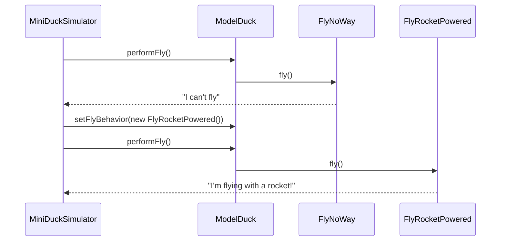

---
tags:
  - design-patterns/strategy
  - head-first
date: 2026-11-21
chapter: 1
source: "Head First Design Patterns, 2nd ed., pp. 1-36 (Ch. 1 Intro to Design Patterns)"
---

# Chapter 1: Intro to Design Patterns and Strategy

Reader: knows Java and basic OOP (classes, interfaces, polymorphism), new to design patterns. Code lives in [java/](java/Duck.java); the pattern summary and Java/Python/C++ table are in [README.md](README.md).

> [!abstract] In a nutshell
> **Strategy pulls a changing behavior out into its own family of classes behind an interface, and the host object holds one of them and delegates to it.**
>
> | Item | Summary |
> |---|---|
> | Intent | Define a family of algorithms, encapsulate each one, make them interchangeable |
> | Key idea | HAS-A a behavior object instead of IS-A subclass with its own copy of the behavior |
> | Use when | Behavior varies across subclasses, or must change at runtime |
>
> Inheritance gave reuse but broke under change; composition gives reuse and flexibility.

## The problem: SimUDuck (pp. 2-8)

SimUDuck is a duck pond game. A `Duck` superclass has `quack()`, `swim()`, `display()`; `MallardDuck` and `RedheadDuck` extend it. Executives want flying ducks.

Joe adds `fly()` to `Duck`. Every subclass now flies, including `RubberDuck`: rubber ducks fly across the screen at the shareholder demo. The book's lesson: *a localized update to the code caused a non-local side effect*.

| Attempt | Why it fails |
|---|---|
| Add `fly()` to the superclass | Gives flying to ALL ducks, including rubber ones |
| Override `fly()` / `quack()` to do nothing in `RubberDuck`, `DecoyDuck` | Every new subclass needs a check; the spec changes every six months |
| `Flyable` and `Quackable` interfaces | No flying subclass shares code, so the same fly code is duplicated (the book jokes: 48 flying subclasses to edit) |

> [!question] Q1 · Which are real disadvantages of using inheritance for duck behavior? (book's exercise, p. 38)
> A. duplicated code, B. runtime changes are hard, C. can't make ducks dance, D. hard to know all duck behaviors, E. ducks can't fly and quack together, F. changes unintentionally affect other ducks.
>
> > [!success] Answer
> > A, B, D and F. C and E are not caused by inheritance.

## Principles introduced

> [!quote] Design Principle 1 (p. 12)
> *Identify the aspects of your application that vary and separate them from what stays the same.*

Take the parts that vary and encapsulate them, so you can change them without touching the parts that stay the same. Here `fly()` and `quack()` vary, so they leave `Duck`.

> [!quote] Design Principle 2 (p. 14)
> *Program to an interface, not an implementation.*

"Interface" means "supertype": it can be a Java interface or an abstract class (p. 15). Declare `Animal a = new Dog()`, not `Dog d = new Dog()`.

> [!quote] Design Principle 3 (p. 23)
> *Favor composition over inheritance.*

HAS-A can be better than IS-A: a duck gets behavior by being composed with a behavior object, which also lets you change it at runtime.

## Structure



Notice two arrow kinds: `Duck` subclasses are IS-A (extends), `Duck` to the behaviors is HAS-A, and behavior classes IMPLEMENT their interface. `Duck` stays a class (not an interface) so subclasses still share `swim()` and the fields (p. 18).

### Delegation at run time



The duck never knows which fly algorithm it uses; it only asks the object in `flyBehavior`.

## Pattern definition

> [!quote] The Strategy Pattern (p. 24)
> *Defines a family of algorithms, encapsulates each one, and makes them interchangeable. Strategy lets the algorithm vary independently from clients that use it.*

| Pattern role | Here | File |
|---|---|---|
| Context (the host) | `Duck`, also `DuckCall` | [Duck.java](java/Duck.java), [DuckCall.java](java/DuckCall.java) |
| Strategy interface | `FlyBehavior`, `QuackBehavior` | [FlyBehavior.java](java/FlyBehavior.java), [QuackBehavior.java](java/QuackBehavior.java) |
| Concrete strategies | fly: wings, none, rocket | [FlyWithWings.java](java/FlyWithWings.java), [FlyNoWay.java](java/FlyNoWay.java), [FlyRocketPowered.java](java/FlyRocketPowered.java) |
| | quack: real, squeak, mute | [Quack.java](java/Quack.java), [Squeak.java](java/Squeak.java), [MuteQuack.java](java/MuteQuack.java) |
| Concrete contexts | ducks choosing strategies | [MallardDuck.java](java/MallardDuck.java), [ModelDuck.java](java/ModelDuck.java) |
| Client | demo with runtime swap | [MiniDuckSimulator.java](java/MiniDuckSimulator.java) |

## Key code

The context only delegates, and setters allow swapping:

```java
public void performFly() { flyBehavior.fly(); }
public void setFlyBehavior(FlyBehavior fb) { flyBehavior = fb; }
```

`ModelDuck` starts grounded and gets a rocket later:

```java
public ModelDuck() { this.flyBehavior = new FlyNoWay(); this.quackBehavior = new Quack(); }
// client: model.setFlyBehavior(new FlyRocketPowered());
```

Repo detail: the book's `Duck()` constructor is empty, but this repo's `Duck()` defaults to `FlyWithWings` and `Quack`, so `MallardDuck` needs no constructor. Expected output of the demo: `Quack`/`I'm flying!!` style lines, then `I can't fly`, then `I'm flying with a rocket!` (p. 21).

**Language differences** (full table in [README.md](README.md)):

- Java: `interface`, garbage-collected references.
- Python: `abc.ABC` with `@abstractmethod`; no override keyword.
- C++: pure virtual class plus a `virtual` destructor; the duck owns its strategy via `std::unique_ptr` and setters use `std::move`.
- All three print the same output.

## Key points and tradeoffs

- **Reuse without baggage.** Other objects can reuse behaviors: a `DuckCall` is not a `Duck` but uses `QuackBehavior` (p. 17, [DuckCall.java](java/DuckCall.java)).
- **Open for new behavior.** Rocket flying = one new class implementing `FlyBehavior`. No `Duck` code changes.
- **Runtime change** through setters, impossible when the algorithm is baked into a subclass.
- **Cost:** more classes and objects, and the client (or constructor) must know which strategies exist and pick one.
- **Known flaw, left open on purpose:** `new Quack()` in a constructor is still coding to an implementation. The book says later patterns fix it, though runtime swapping still works (p. 19).
- A behavior class can still have state; it is just a class whose job is a behavior (p. 18).

Book's design puzzle (p. 36): a game where `Character` (abstract) HAS-A `WeaponBehavior` (interface) with `useWeapon()`; `King`, `Queen`, `Knight`, `Troll` extend `Character`, and `Sword`/`Knife`/`BowAndArrow`/`Axe` behaviors implement it. `setWeapon()` belongs in `Character`.

## Why patterns at all (pp. 28-34)

- Knowing OO basics does not make you a good OO designer; patterns are proven experience, *discovered, not invented*.
- Patterns do not give you code, they give general solutions you adapt. Libraries and frameworks are implementations; patterns are higher level.
- A **shared vocabulary** says more with less: "we use Strategy for duck behavior" tells a teammate the behavior is encapsulated, extensible, even swappable at runtime. It keeps discussions at the design level.
- Most patterns address *change*; most let one part of a system vary independently of the rest.
- Beware "pattern fever": do not use patterns for Hello World.

## Toolbox (p. 32)

| Category | Added so far |
|---|---|
| OO basics | Abstraction, encapsulation, polymorphism, inheritance (assumed known) |
| OO principles | Encapsulate what varies; favor composition over inheritance; program to interfaces, not implementations |
| OO patterns | **Strategy**: family of algorithms, encapsulated, interchangeable |

## Common mistakes

| Mistake | What happens | Fix |
|---|---|---|
| Putting varying behavior in the superclass | Subclasses inherit behavior they should not have (flying rubber ducks) | Extract the variation into strategy classes |
| Fixing it with `Flyable` interfaces only | Code duplication in every implementer | Share behavior in a strategy class, compose it |
| Declaring a field as `FlyWithWings` | Cannot swap strategies | Declare it as `FlyBehavior` |
| No setter for the strategy | Behavior fixed after construction | Add `setFlyBehavior` and similar |
| Forgetting to set a strategy (book's empty `Duck()` constructor) | `NullPointerException` in `performFly()` | Set defaults in the base constructor, as this repo does, or in each subclass |
| Treating "interface" as only the Java keyword | Rejects abstract classes needlessly | Think "supertype" |

## Check yourself

> [!question] Q1 · Why does `Duck` call `performFly()` rather than keep a `fly()` method?
>
> > [!success] Answer
> > `fly()` would imply the duck implements flying. `performFly()` delegates to `flyBehavior.fly()`, so the algorithm lives in a replaceable object (p. 20).

> [!question] Q2 · You need rocket-powered flying and a non-duck that quacks. What changes?
>
> > [!success] Answer
> > Add `FlyRocketPowered implements FlyBehavior`; no `Duck` code changes. A `DuckCall` can hold a `QuackBehavior` (p. 17).

> [!question] Q3 · Why is `Duck` still an abstract class, not an interface?
>
> > [!success] Answer
> > What varies was removed, so subclasses can safely inherit the common parts (`swim()`, behavior fields) from `Duck` (p. 18).

> [!question] Q4 · Which principle does the constructor `flyBehavior = new FlyWithWings()` bend, and why is flexibility not lost?
>
> > [!success] Answer
> > "Program to an interface": it names a concrete class. The field is still typed `FlyBehavior`, so a setter can replace it later.

## Related

Next: [[chap2-observer-notes]].