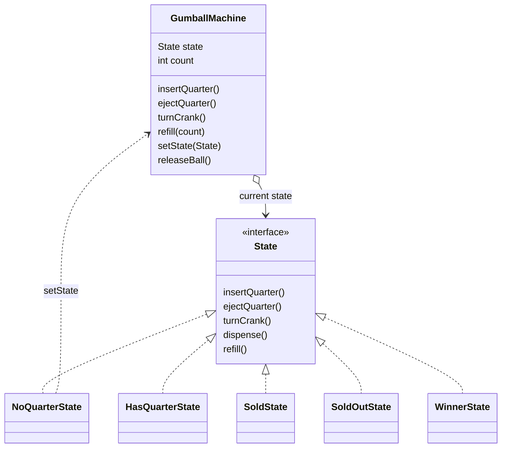
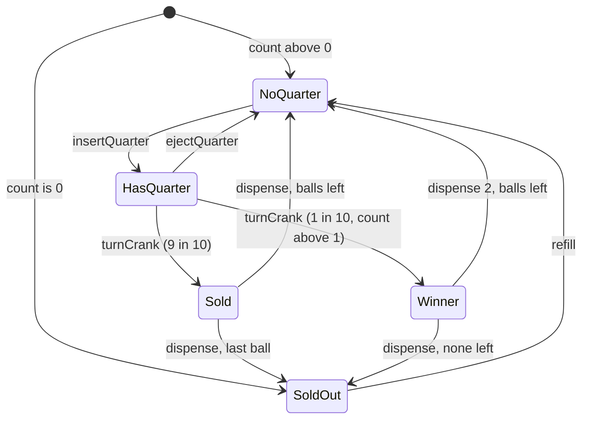
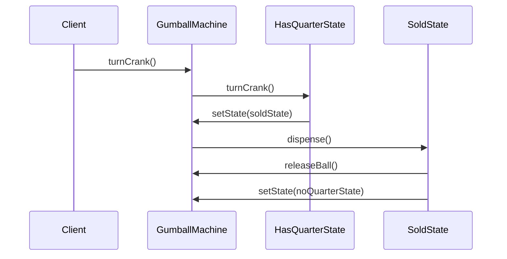

---
tags:
  - design-patterns/state
  - head-first
date: 2026-11-21
chapter: 10
source: "Head First Design Patterns, 2nd ed., printed pp. 381-424"
---

# Chapter 10: State Pattern (Gumball Machine)

> [!abstract] In a nutshell
> **Put each state's behavior in its own class, and let the object delegate every action to its current state object.**
>
> | Item | Summary |
> |---|---|
> | Intent | Allow an object to alter its behavior when its internal state changes. The object will appear to change its class (p. 406) |
> | Key idea | Context holds a `State` reference. Actions are forwarded to it. States swap the reference to move the machine along |
> | Use when | One object behaves differently per state and you have big `if/else` or `switch` blocks on a state variable |
>
> This replaces conditionals on a state field with polymorphism.

## The problem

Mighty Gumball wants a controller for a candy machine.

It has four states (No Quarter, Has Quarter, Sold, Sold Out) and four actions: insert quarter, eject quarter, turn crank, dispense. Dispense is internal, so only three are public (p. 384).

The naive version keeps `int state` plus constants like `HAS_QUARTER`. **Every action method** is an `if/else` chain over all states ([GumballMachine.java](java/GumballMachine.java)). That works for 4 states x 4 actions.

The change request is a "1 in 10" game.

In it, 10% of cranks give two gumballs.

It needs a new `WINNER` state, a new branch in **every** method, and a messier `turnCrank()` (p. 392). The book's verdict (all six boxes ticked, p. 421):

- Violates open/closed.
- Not very object-oriented.
- Transitions are buried in conditionals.
- Nothing that varies is encapsulated.
- New code is likely to break working code.

## Principles at work

The two engineers reason their way to the pattern (p. 393):

- **Encapsulate what varies**: localize each state's behavior so "if we make changes to one state, we don't run the risk of messing up the other code".
- **Favor composition**: the machine delegates to the state object it holds.
- **Open/closed**: adding a state means adding a class and tweaking a few transitions.

The book's three-step recipe (p. 394): define a `State` interface with a method per action, write one class per state, then delete the conditionals and delegate.

## Structure

> [!quote] State Pattern (p. 406)
> The State Pattern allows an object to alter its behavior when its internal state changes. The object will appear to change its class.

"Appears to change its class" means a client sees wildly different behavior, as if from another class. In reality the machine only points at a different state object (composition).



`GumballMachine` is the Context. Each state keeps a back-reference to it and calls `setState()` to transition.

The book's generic diagram is `Context.request()` delegating to `State.handle()`, with `ConcreteStateA/B` (p. 406).

### Lifecycle of the machine



Notice that the transition choice (`NoQuarter` or `SoldOut`) depends on the runtime `count`. That is why the states, not the context, decide it.

### One call, step by step



`turnCrank()` calls `state.turnCrank()` and then `state.dispense()`. Notice that `dispense()` runs on the **new** state, because `setState` already swapped it.

## How the code maps

| Role | File |
|---|---|
| Before: int state and if/else | [GumballMachine.java](java/GumballMachine.java) |
| Context (after) | [GumballMachine2.java](java/GumballMachine2.java) |
| State interface | [State.java](java/State.java) |
| Concrete states | [NoQuarterState.java](java/NoQuarterState.java), [HasQuarterState.java](java/HasQuarterState.java), [SoldState.java](java/SoldState.java), [SoldOutState.java](java/SoldOutState.java), [WinnerState.java](java/WinnerState.java) |
| Demos | [GumballMachineTestDrive.java](java/GumballMachineTestDrive.java), [GumballMachineTestDrive2.java](java/GumballMachineTestDrive2.java) |

The context shrinks to one-line delegation:

```java
public void insertQuarter() { state.insertQuarter(); }
public void turnCrank()     { state.turnCrank(); state.dispense(); }
void setState(State state)  { this.state = state; }   // package-private: only states drive transitions
```

A state both acts and transitions:

```java
// HasQuarterState.turnCrank()
int winner = randomWinner.nextInt(10);
if (winner == 0 && gumballMachine.getCount() > 1) setState(winnerState);
else setState(soldState);
```

The `count > 1` guard exists because a winner needs two balls.

- **Java**: `GumballMachine2` creates one object per state and reuses them. `refill()` was added last: the `State` interface gained `refill()`. Only `SoldOutState` acts on it (moves to `NoQuarterState`). Others are empty (p. 424).
- **Python and C++**: inject a `RandomSource` so runs are reproducible. C++ uses `unique_ptr` for owned states and a raw pointer for the current one.
- Full comparison table: [README.md](README.md).

## Key points and tradeoffs

| Aspect | Notes |
|---|---|
| Pros | Behavior localized per state. Conditionals removed. States explicit and map to the diagram. New states are new classes (WinnerState took one class plus a `HasQuarterState` tweak) |
| Cons | More classes (p. 408). Transitions inside states couple states to each other. `SoldState` and `WinnerState` duplicate error messages |
| Transitions in Context vs states | Fixed transitions fit the Context. Dynamic ones (depends on `count`) fit the states. This decides which classes stay closed for modification (p. 408) |
| Sharing states | States can be shared across Context instances (for example as static instances) if they hold no per-context data. Then pass the context into each handler (p. 408) |
| Clients and states | Clients never talk to states directly. The Context manages them |
| Interface vs abstract class | Abstract class lets you add methods and default "error" behavior without breaking states (pp. 408, 413) |

The book's own "sanity check" ideas (p. 413): abstract base class for shared error messages, avoid calling `dispense()` when the crank failed (return a boolean or throw), consider moving transitions to the context, and share state instances.

### State vs Strategy

Same class diagram, different intent (p. 407 and Fireside Chat, pp. 414-415).

| | State | Strategy |
|---|---|---|
| Who picks the object | The Context itself, as it moves between states | Usually the client, often once |
| Intent | Behavior changes as internal state changes | Plug in an interchangeable algorithm |
| Transitions | Well-defined set, built in | None required |
| Client awareness | Knows little about the state objects | Chooses the strategy |
| Replaces | Lots of conditionals in the Context | Subclassing for behavior |

Template Method (chapter 8) differs again: subclasses decide steps of an algorithm (p. 418).

## Toolbox recap

- **OO basics**: abstraction, encapsulation, polymorphism, inheritance.
- **Principles**: no new ones this chapter (p. 419).
- **Pattern added**: State.
- Bullets to remember (p. 419): a state is a full class, not an int. The Context delegates to its current state. Transitions may live in states or Context. Expect more classes. States may be shared.

## Common mistakes

| Mistake | What happens | Fix |
|---|---|---|
| Keep an `int state` and add State classes anyway | Both mechanisms drift out of sync | The state is only the object reference |
| Create a new state object on every transition | Allocation churn, and counters stored in a state get lost | Create all states once in the context, as `GumballMachine2` does |
| Let clients call `setState()` | The Context loses control of its own state | Keep `setState` package-private or internal |
| Forget `refill()` or a new action on `State` | Compile error in every concrete state | Add it to the interface, empty where it does not apply |
| Hardcode `new SoldState(...)` inside states | States depend on each other's constructors | Use the context getters like `getSoldState()` |
| Treat State and Strategy as the same because the diagrams match | Wrong tool: a client-picked algorithm modeled as a self-transitioning machine | Ask who changes the object and why |

## Check yourself

> [!question] Q1 · The machine starts in `HasQuarterState` with 1 gumball left and the crank is turned. Can the winner branch fire?
>
> > [!success] Answer
> > No. The guard is `winner == 0 && count > 1`. With 1 ball left it always goes to `SoldState`, since a winner needs two balls.

> [!question] Q2 · You add a `MaintenanceState`. Which files must change, and which stay the same?
>
> > [!success] Answer
> > Add the class, a field and getter in `GumballMachine2`, and whichever existing states transition into it. The other actions and the context delegation methods stay unchanged. That is open/closed.

> [!question] Q3 · Why does `turnCrank()` still call `dispense()` when the crank failed, and what is the cost?
>
> > [!success] Answer
> > The context cannot know whether the crank succeeded. The call is harmless because the non-sold states print "No gumball dispensed" or similar. The cost is a pointless call. The book suggests returning a boolean or using exceptions.

> [!question] Q4 · A teammate says "State and Strategy are the same pattern". How do you respond?
>
> > [!success] Answer
> > Structurally yes, but intent differs. In State the context moves itself through a defined set of states. In Strategy the client typically picks one behavior and keeps it. State replaces conditionals, Strategy replaces subclassing.

> [!question] Q5 · Should `WinnerState` logic be folded into `SoldState` to remove duplication?
>
> > [!success] Answer
> > It is a tradeoff. You would save code, but one class would then represent two states and have two responsibilities (single responsibility). If the promotion ends, you would edit `SoldState`. The book leaves it as a design decision (p. 412).

## Related

Previous: [[chap9-iterator-composite-notes]]. Next: [[chap11-proxy-notes]]. Compare with [[chap1-strategy-notes]] and [[chap8-template-method-notes]].
