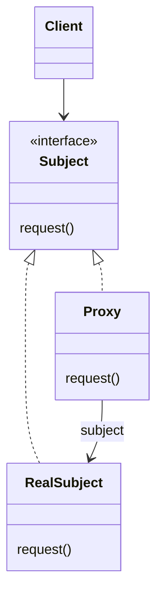
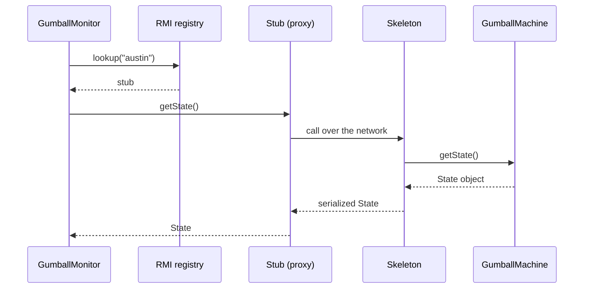
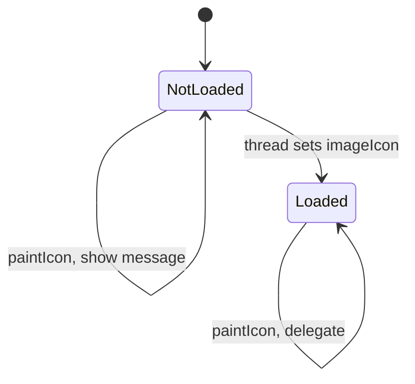
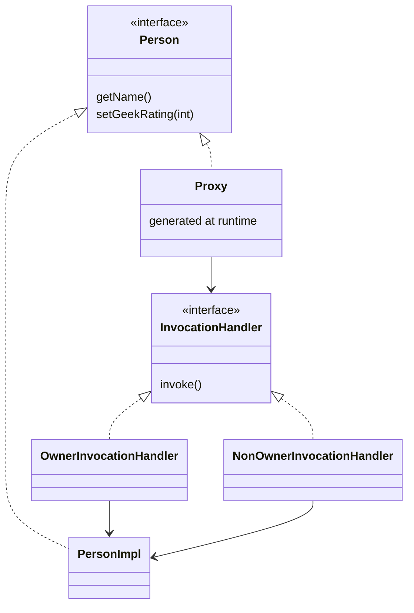

---
tags:
  - design-patterns/proxy
  - head-first
date: 2026-11-21
chapter: 11
source: "Head First Design Patterns, 2nd ed., pp. 425-492 (Ch. 11 Controlling Object Access)"
---

# Chapter 11: Proxy Pattern

Reader: knows Java and basic OOP, has met interfaces and the State pattern. Code is in [java/](java/GumballMonitor.java). The pattern summary and the Java/Python/C++ table are in [README.md](README.md), so they are not repeated here.

> [!abstract] In a nutshell
> **A proxy implements the same interface as another object and stands in front of it, so it can decide whether, when and how a call reaches the real object.**
>
> | Item | Summary |
> |---|---|
> | Intent | "Provide a surrogate or placeholder for another object to control access to it" (p. 455) |
> | Key idea | Proxy and RealSubject share one `Subject` interface, so the client cannot tell them apart |
> | Use when | The real object is remote, expensive to create, or needs access rules |

## The problem

Mighty Gumball's CEO wants a report of each machine's location, gumball count and state (pp. 426-428).

- The team adds `getLocation()` and writes `GumballMonitor`, which calls `getLocation()`, `getCount()` and `getState()`.
- It works, but only in the same JVM as the machine (a JVM is one running Java process with its own heap).
- The CEO wanted to monitor machines **remotely** (p. 428).

Two obvious fixes are poor:

- Rewrite the monitor to do its own networking: the monitor now mixes reporting with socket code.
- Subclass `GumballMachine`: a subclass still runs in the local heap, so it cannot reach an object on another heap.

The book's idea is to leave `GumballMonitor` alone and hand it a **proxy**: an object that looks like a `GumballMachine` but forwards calls over the network.

> [!note] Principles at work
> No new principle is added in this chapter (p. 485). The pattern leans on "Program to interfaces, not implementations": the monitor works with an interface, so a proxy can replace the real thing.

## Structure



Notice that the client depends only on `Subject`. The proxy holds a reference to the real subject and may create or destroy it (p. 456).

## Three proxies in this chapter

| Variant | What it controls | Chapter example |
|---|---|---|
| Remote | Access to an object in another JVM | `GumballMachine` seen through an RMI stub |
| Virtual | Access to an object that is expensive to create | `ImageProxy` for an album cover |
| Protection | Access based on the caller's rights | `Person` via owner and non-owner handlers |

### 1. Remote proxy (RMI)

A remote proxy is a **local representative of a remote object** (p. 430). You call a local method on it, and it forwards the call.

- RMI (Remote Method Invocation, Java's built-in remote call system) builds the plumbing.
- Its client-side helper is the **stub**, and its server-side helper is the **skeleton**.
- Today the stub is itself a `java.lang.reflect.Proxy` (p. 440).

Steps to make a remote service (pp. 437-439):

1. Write a remote interface that `extends Remote`. Every method declares `throws RemoteException`.
2. Make all arguments and return values primitives or `Serializable`.
3. Write the implementation. It extends `UnicastRemoteObject` and its constructor declares `RemoteException`.
4. Start `rmiregistry`, then register the service with `Naming.rebind(name, service)`. The registry stores the stub.
5. The client calls `Naming.lookup(url)`, casts the result to the remote interface, and calls methods on it.



Two details are easy to forget:

- `State` must be `Serializable`, because it is a return value. Each state holds a back-reference to the machine, so that field is marked `transient` to keep the whole machine out of the serialized data (p. 447).
- Remote calls can fail, so the monitor must catch `RemoteException`. The book asks whether remote calls should be fully transparent and hints the answer is no (p. 431).

### 2. Virtual proxy (album covers)

A virtual proxy represents an object that is expensive to create (p. 457).

- It often delays creation until needed.
- It stands in before and while the real object is built.
- After that it delegates.

`ImageProxy implements Icon`:

- While `imageIcon` is `null`, it draws "Loading album cover, please wait..." and starts one background thread, guarded by `retrieving`.
- The placeholder width is 800 until the image arrives.
- When the thread finishes, it sets `imageIcon` and calls `repaint()`.
- From then on `paintIcon()` delegates to the real `ImageIcon`.



> [!tip] Design puzzle (p. 486)
> `ImageProxy` has two states hidden in `if` statements. The book's answer is the State pattern: `ImageNotLoaded` and `ImageLoaded`, starting in `ImageNotLoaded`. See [[chap10-state-pattern-notes]].

### 3. Protection proxy (dynamic proxy)

Problem (p. 472): in the matchmaking service, anyone can call any `Person` method. Elroy's interests were changed by others, and people inflated their own geek rating.

Fix: wrap each `Person` in one of two proxies.

| Caller | `get*` | `setGeekRating` | other `set*` |
|---|---|---|---|
| Owner (own profile) | allowed | **denied** | allowed |
| Non-owner (someone else) | allowed | allowed | **denied** |

Java's `java.lang.reflect.Proxy` creates the proxy class at runtime (a **dynamic proxy**). You write only an `InvocationHandler`.

- Every call on the proxy, whatever its name, reaches the handler's single `invoke(proxy, method, args)` method (p. 475).
- The handler checks `method.getName()`.
- It then forwards with `method.invoke(person, args)` or throws `IllegalAccessException`.



The book's test run (p. 480), with Joe's rating at 7:

- The owner proxy refuses `setGeekRating(10)`, so the rating stays 7.
- The non-owner proxy refuses `setInterests`.
- The non-owner proxy accepts `setGeekRating(3)`, and the running average becomes 5.

> [!note] Why "dynamic"?
> The proxy is dynamic because its **class** is created at runtime from the interfaces you pass, not because the handler is set at runtime (p. 480). `newProxyInstance` accepts interfaces only, never classes.

## How the code maps

| Role | Remote | Virtual | Protection |
|---|---|---|---|
| Subject | [GumballMachineRemote.java](java/GumballMachineRemote.java) | `Icon` (Swing) | [Person.java](java/protection-proxy/Person.java) |
| RealSubject | [GumballMachine.java](java/GumballMachine.java) | `ImageIcon` | [PersonImpl.java](java/protection-proxy/PersonImpl.java) |
| Proxy | RMI stub (generated) | [ImageProxy.java](java/virtual-proxy/ImageProxy.java) | `Proxy` made in [MatchMakingTestDrive.java](java/protection-proxy/MatchMakingTestDrive.java) |
| Handler or helper | RMI skeleton | background thread | [OwnerInvocationHandler.java](java/protection-proxy/OwnerInvocationHandler.java), [NonOwnerInvocationHandler.java](java/protection-proxy/NonOwnerInvocationHandler.java) |
| Client | [GumballMonitor.java](java/GumballMonitor.java) | [ImageComponent.java](java/virtual-proxy/ImageComponent.java) | `MatchMakingTestDrive.drive()` |

The monitor depends on the interface, not on `GumballMachine`:

```java
public class GumballMonitor {
    GumballMachineRemote machine;           // interface, so a stub fits
    public void report() {
        try { /* getLocation(), getCount(), getState() */ }
        catch (RemoteException e) { e.printStackTrace(); }
    }
}
```

The one line that builds a dynamic proxy:

```java
Proxy.newProxyInstance(person.getClass().getClassLoader(),
        person.getClass().getInterfaces(), handler);
```

Java vs Python vs C++, in brief (details in [README.md](README.md)):

- Python builds a dynamic proxy with `__getattr__`, which returns a closure per method name.
- C++ has no reflection, so `PersonProxy` is written by hand and forwards to an `InvocationHandler`.
- Python and C++ simulate RMI in one process with an in-process `Naming` registry and a real stub class.
- The virtual proxy replaces Swing and threads with a console and a simulated "download" that finishes after 2 ticks.

## Key points and tradeoffs

| Good | Cost |
|---|---|
| Client code stays unchanged, since the interface is the same | More classes and objects in the design (p. 485) |
| Network, lazy loading or security lives in one place | A remote call can fail, so `RemoteException` leaks into the client |
| Dynamic proxies need no hand-written proxy class | Handler logic keyed on method names is easy to get wrong |

### Look-alikes

All of these wrap an object. They differ in purpose.

| Pattern | What it does to the wrapped object |
|---|---|
| Proxy | Controls access, same interface |
| Decorator | Adds behavior, same interface |
| Adapter | Changes the interface |
| Facade | Simplifies a group of objects |

The fireside chat (pp. 467-468) adds three points:

- A proxy often does not wrap anything. A remote subject lives elsewhere, and a virtual proxy's subject may not exist yet.
- A proxy may create its subject. A decorator never does.
- Stacking ten decorators is normal. Wrapping a subject ten times in proxies signals a design problem.

Other variants from the "Proxy Zoo" (pp. 482-483):

| Variant | Job |
|---|---|
| Firewall | Guards network resources from bad clients |
| Smart reference | Adds actions on each reference, such as counting |
| Caching | Stores results of expensive operations |
| Synchronization | Safe access from several threads |
| Complexity hiding (facade proxy) | Hides a complex set of classes and controls access |
| Copy-on-write | Delays copying until a client needs it |

To make clients get a proxy, return it from a factory (p. 466).

## Toolbox recap (p. 485)

- **OO basics:** abstraction, encapsulation, polymorphism, inheritance.
- **Principles:** nothing new this chapter.
- **Pattern added:** Proxy.
- **Summary points:** remote, virtual and protection proxies control access; many other variants exist; Proxy and Decorator look alike but differ in purpose; Java can build a dynamic proxy on demand.

## Common mistakes

| Mistake | What happens | Fix |
|---|---|---|
| Start the service before `rmiregistry` | `Naming.rebind` fails | Start the registry first |
| Return a non-`Serializable` type from a remote method | Fails only at runtime | Make it `Serializable` (`State` here) |
| Serialize the state's back-reference to the machine | Whole machine is shipped | Mark the field `transient` |
| Treat a proxy as a decorator | Added behavior hides the access-control job | Ask: does it add behavior or control access? |
| Return `null` for unknown methods in a handler | Silent no-op | Deny or throw explicitly |

## Check yourself

> [!question] Q1 · Why can `GumballMonitor` stay almost unchanged when it goes remote?
>
> > [!success] Answer
> > It now uses the `GumballMachineRemote` interface, and the RMI stub implements that interface. The monitor cannot tell a stub from a local machine. Only the `RemoteException` handling is new.

> [!question] Q2 · A virtual proxy for an image always creates a new `ImageIcon`. What would a caching proxy change?
>
> > [!success] Answer
> > It would keep previously created objects and return the cached one when possible. The book calls this a specialised virtual proxy (p. 466).

> [!question] Q3 · In the dynamic proxy, which class implements `Person`, and what does the handler do?
>
> > [!success] Answer
> > The class generated by `Proxy.newProxyInstance` implements `Person`. The handler does not implement `Person`. It receives every call in `invoke()`, then forwards or refuses it.

> [!question] Q4 · An owner proxy and a non-owner proxy both wrap Joe. Why is one `PersonImpl` enough?
>
> > [!success] Answer
> > The proxies hold the access rules, and the real object holds the data. Each proxy takes the same `PersonImpl` in its handler's constructor.

## Related

Previous: [[chap10-state-pattern-notes]]. Next: [[chap12-compound-notes]].
