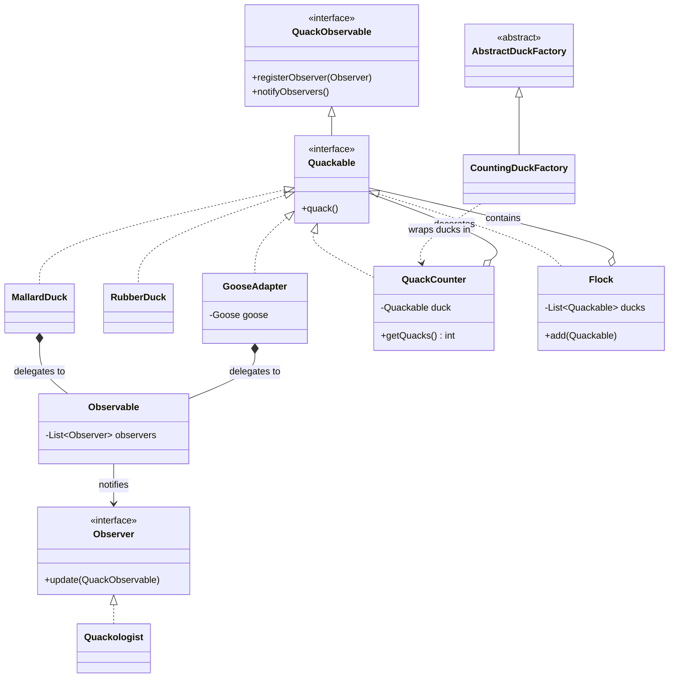
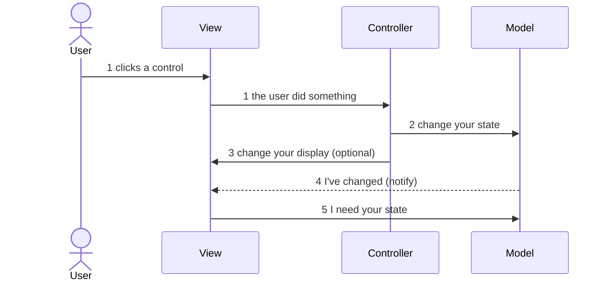
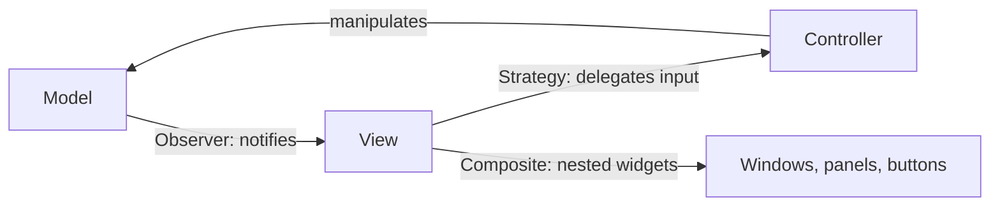
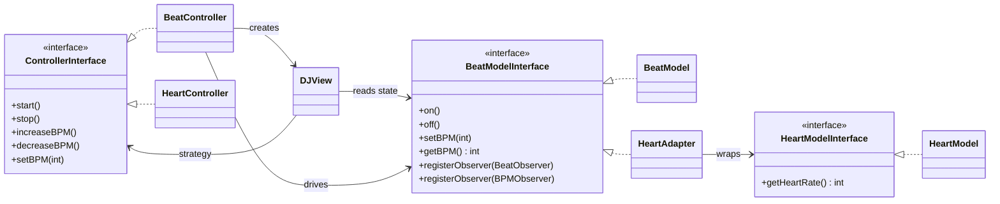

---
tags:
  - design-patterns/compound-pattern
  - design-patterns/model-view-controller
  - head-first
date: 2026-11-21
chapter: 12
source: "Head First Design Patterns, 2nd ed., printed pp. 493-562"
---

# Chapter 12: Compound Patterns

Reader: a Java developer who knows basic OOP and the earlier patterns (Adapter, Decorator, Abstract Factory, Composite, Observer, Strategy). Code is in [java/](java/), with [python/](python/) and [cpp/](cpp/) ports.

> [!abstract] In a nutshell
> **A compound pattern is a set of patterns that together solve a recurring, general problem. Model-View-Controller (MVC) is the classic one: Observer + Strategy + Composite.**
>
> | Item | Idea |
> |---|---|
> | Patterns working together | Several patterns in one design (the duck simulator). Not a compound pattern. |
> | Compound pattern | Patterns packaged to solve a *general* problem (MVC). |
> | MVC intent | Keep data and logic (model), display (view) and input handling (controller) apart and loosely coupled. |
> | Use when | A UI shows data that changes and may need several views or swappable input behaviour. |
>
> Learn MVC by spotting its three patterns, not top-down.

## Two definitions to remember

> [!quote] Book wording (p. 494, p. 545)
> "Patterns are often used together and combined within the same design solution."
>
> "A compound pattern combines two or more patterns into a solution that solves a recurring or general problem."

The FAQ (p. 516) says the duck simulator is **not** a compound pattern, just patterns cooperating. The simulator is also "forced and artificial": never pick patterns for their own sake. Sometimes plain OO principles are enough.

## Part 1: The duck simulator, one pattern per problem

The book rebuilds SimUDuck from scratch. Every step adds a pattern because a new request arrives.

| Step | Request | Pattern | Class |
|---|---|---|---|
| 1 | Geese must act like ducks | Adapter | `GooseAdapter` wraps `Goose`, `quack()` calls `honk()` |
| 2 | Count quacks without editing ducks | Decorator | `QuackCounter` wraps a `Quackable` |
| 3 | Rangers forget to wrap ducks | Abstract Factory | `CountingDuckFactory` returns already-wrapped ducks |
| 4 | Manage ducks as groups and sub-groups | Composite | `Flock` is a `Quackable` holding `Quackable`s |
| 5 | Watch individual quacks live | Observer | `QuackObservable`, `Observable`, `Observer`, `Quackologist` |

Flock's loop over its children also uses Iterator (the book's "sneaked in" pattern, p. 507). That makes six patterns in all.

### Structure



Notice that the adapter, decorator and composite all implement `Quackable`. That is why the simulator can treat any of them as "a duck". The full diagram is in [duck-simulator-class-diagram.md](java/duck-simulator-class-diagram.md).

### How the code maps

| Role | File |
|---|---|
| Common interface | [Quackable.java](java/Quackable.java), [QuackObservable.java](java/QuackObservable.java) |
| Concrete ducks | [MallardDuck.java](java/MallardDuck.java), [RedheadDuck.java](java/RedheadDuck.java), [DuckCall.java](java/DuckCall.java), [RubberDuck.java](java/RubberDuck.java) |
| Adapter | [GooseAdapter.java](java/GooseAdapter.java) |
| Decorator | [QuackCounter.java](java/QuackCounter.java) |
| Abstract Factory | [AbstractDuckFactory.java](java/AbstractDuckFactory.java), [DuckFactory.java](java/DuckFactory.java), [CountingDuckFactory.java](java/CountingDuckFactory.java) |
| Composite | [Flock.java](java/Flock.java) |
| Observer | [Observable.java](java/Observable.java), [Observer.java](java/Observer.java), [Quackologist.java](java/Quackologist.java) |
| Client | [DuckSimulator.java](java/DuckSimulator.java) |

### Decisions worth remembering

**Observer through a helper.** Each duck owns an `Observable` and delegates to it, so the registration code is written once. The helper passes the *duck* (not itself) to `update()`, so observers know who quacked.

```java
// QuackCounter: decorator forwards observer calls to the wrapped duck
public void quack() { duck.quack(); numberOfQuacks++; }
public void registerObserver(Observer o) { duck.registerObserver(o); }
```

**Observing a composite.** `Flock.registerObserver()` registers the observer on every child, recursively. `Flock.notifyObservers()` is deliberately empty because each leaf duck notifies for itself when it quacks. (Both were Sharpen-your-pencil answers, pp. 546-547.)

**Counting.** `QuackCounter` uses a `static` counter, so one total covers all counted ducks. `GooseAdapter` is not decorated, so honks are not counted. Book output: 7 counted quacks for one run of the whole flock (p. 516), and 11 after also running the mallard flock a second time (p. 509).

**Safety versus transparency (p. 509).** Only `Flock` has `add()`, not `Quackable`. You cannot add to a duck (safe), but clients must know which `Quackable` is a `Flock` (less transparent). In the Composite chapter the choice was the other way round.

**Geese factory (p. 548).** Possible answers: add `createGooseDuck()` to the existing factories, or write a separate goose factory.

> [!example] Trace of one `quack()` on the outer flock
> `flockOfDucks.quack()` calls each child. A `QuackCounter`-wrapped mallard runs the real `quack()`, which prints and calls `notifyObservers()`. Then the counter adds 1. `Quackologist.update()` prints "Mallard Duck just quacked." The goose prints "Honk" and notifies, but nothing counts it.

## Part 2: Model-View-Controller

### The three roles

| Part | Job | Knows about |
|---|---|---|
| Model | Holds all data, state and application logic. Notifies observers when state changes. | Nothing about views or controllers |
| View | Presents the model. Pulls the state it shows from the model. | Model (to read), controller (to delegate input) |
| Controller | Interprets user input and manipulates the model. May also tell the view to change (e.g. disable a menu item). | Model and view |

The book's metaphor: an Oreo, with the view on top, the model underneath and the "creamy controller" in the middle (p. 520).

### The five-step flow



Notice that step 4 goes from model to view through Observer, so the model never holds a concrete view.

### MVC is three patterns



| Pattern | Where | Payoff |
|---|---|---|
| Observer | Model notifies views and controllers | Model stays independent. Several views can watch one model. |
| Strategy | The controller is the view's strategy | Swap controllers to change behaviour without touching the view. |
| Composite | The view is nested components (window, panel, button) | Update the top component and the rest follow. |

Why not put control logic in the view? It would give the view two jobs (UI and control logic) and tie it to the model, so you could not reuse the view with another model (p. 525).

### The DJ example (BeatModel, DJView, BeatController)

The book builds a beat-per-minute tool: a model that plays a beat at a given BPM, a view that shows the BPM and a pulsing bar, and a controller that handles Start, Stop, `<<`, `>>` and Set.



| Role | File |
|---|---|
| Model + interface | [BeatModel.java](java/mvc/BeatModel.java), [BeatModelInterface.java](java/mvc/BeatModelInterface.java) |
| Two observer types | [BeatObserver.java](java/mvc/BeatObserver.java) (every beat), [BPMObserver.java](java/mvc/BPMObserver.java) (BPM changed) |
| View | [DJView.java](java/mvc/DJView.java), [BeatBar.java](java/mvc/BeatBar.java) |
| Controller (strategy) | [ControllerInterface.java](java/mvc/ControllerInterface.java), [BeatController.java](java/mvc/BeatController.java) |
| Adapter reuse | [HeartAdapter.java](java/mvc/HeartAdapter.java), [HeartController.java](java/mvc/HeartController.java), [HeartModel.java](java/mvc/HeartModel.java) |
| Entry points | [DJTestDrive.java](java/mvc/DJTestDrive.java), [HeartTestDrive.java](java/mvc/HeartTestDrive.java) |

Points to remember from the code:

- `BeatController`'s constructor creates the `DJView` and passes itself and the model. The view registers as both `BeatObserver` and `BPMObserver` in its constructor.
- The controller makes the decisions: `start()` calls `model.on()` and then disables Start and enables Stop on the view. The view only knows how to enable and disable items.
- `increaseBPM()` is the controller reading `getBPM()` and calling `setBPM(bpm + 1)`. The view then updates itself through `updateBPM()` (via the model's notification), not because the controller told it to.
- The model is split into two observer lists so a view can subscribe only to the events it cares about.
- `BeatController` never runs application logic. It translates actions. The logic (timing, beat generation) lives in the model (p. 543).

### Reusing the view with a heart: Adapter

`HeartModel` has `getHeartRate()` instead of `getBPM()`, and already supports both observer types. `HeartAdapter` implements `BeatModelInterface`:

```java
public int getBPM() { return heart.getHeartRate(); }  // translation
public void setBPM(int bpm) { }                        // no-op: you can't set a heart
public void registerObserver(BeatObserver o) { heart.registerObserver(o); } // pass through
```

`HeartController` wraps the model in `new HeartAdapter(model)` for the view, disables both menu items, and makes the control methods no-ops. The same `DJView` now shows a heart rate. Adapting a model to an existing view and controller is a common MVC technique (p. 540).

## Java vs Python vs C++

The patterns carry over unchanged. The ports differ in ownership (C++ uses `weak_ptr` observers to avoid cycles), overloaded `registerObserver` (Python needs two names), and the Swing, sound and threads replaced by a manual clock. See the [README](README.md#java-vs-python-vs-c-in-this-chapter) for the full table.

## Key points and trade-offs

| Topic | Takeaway |
|---|---|
| Observer in MVC | Keeps the model ignorant of views. Push or pull both work. The book pulls (the view asks the model), and notes push has the downsides from the Observer chapter (p. 543). |
| Controller as observer | Allowed. Useful when model state affects controls, such as enabled menu items (p. 525). |
| Controllers per view | Usually one controller per view at runtime. One controller class may serve many views (p. 543). |
| Controller vs Mediator | The controller acts somewhat like a Mediator, but MVC is defined by Observer, Strategy and Composite (p. 543). |
| View access to model | The simple code lets the view call model setters. To expose only a subset, use an adapter that narrows the interface (p. 543). |
| Model and State | "State of the model" means general state, not the State pattern. |
| Web | MVC is adapted to the web (thin client or single page app). Mapping of M, V, C to client and server varies by framework (p. 544). |

### Look-alikes

| Pair | Difference |
|---|---|
| Adapter vs Decorator vs Composite in the simulator | All three implement `Quackable`. Adapter changes the interface, Decorator adds behaviour, Composite groups many. |
| Several patterns vs compound pattern | A compound pattern is a reusable, named combination for a general problem (MVC). The duck simulator is an exercise. |

## Tools for your toolbox

- **OO basics:** abstraction, encapsulation, polymorphism, inheritance.
- **Principles (all kept):** encapsulate what varies; favor composition over inheritance; program to interfaces, not implementations; loose coupling between interacting objects; open for extension, closed for modification; depend on abstractions; only talk to your friends; don't call us, we'll call you; one reason to change.
- **Patterns:** Proxy was listed from the previous chapter. The new category is **Compound Patterns**, with MVC as the example.
- **Bullet points:** MVC = Observer + Strategy + Composite. The controller is the view's strategy. Adapter reuses a new model with an existing view. MVC has web variants.

## Common mistakes

| Mistake | What happens | Fix |
|---|---|---|
| Treating "patterns used together" as a compound pattern | Confusion about what MVC is | Compound = reusable combination for a general problem |
| Forcing every pattern into a design | Overkill, harder to follow | Apply patterns only where they solve a real problem |
| Forgetting to wrap with the decorator | Quacks go uncounted | Create ducks only through `CountingDuckFactory` |
| Making `Flock.notifyObservers()` notify | Duplicate or wrong notifications | Register on children, let each leaf notify itself |
| Putting control logic in the view | View tied to model, no reuse | Delegate to a controller |
| Putting application logic in the controller | Logic is not reusable across controllers | Keep logic in the model, only translation in the controller |
| Letting the model reference a concrete view | Model coupled to UI | Model depends only on observer interfaces |

## Check yourself

> [!question] Q1 · Why does `Flock.registerObserver()` loop over its children while `Flock.notifyObservers()` does nothing?
>
> > [!success] Answer
> > Observers want to hear about individual ducks. Registering on every child (recursively through sub-flocks) means each leaf notifies for itself when it quacks, so the flock has nothing to notify. If the flock also notified, observers would get extra calls that name the flock, not the duck.

> [!question] Q2 · Where would you add a goose that must also be counted, and what changes?
>
> > [!success] Answer
> > Wrap it: `new QuackCounter(new GooseAdapter(new Goose()))`, ideally via a factory method `createGooseDuck()`. The decorator and the adapter both implement `Quackable`, so they stack. Nothing in the simulator changes.

> [!question] Q3 · The view needs a new behaviour for the same user actions, such as read-only mode. Which MVC pattern lets you do this and which classes change?
>
> > [!success] Answer
> > Strategy. Write a new class implementing `ControllerInterface` and pass it to `DJView`. `DJView` and the model stay unchanged. `HeartController` is the book's example: same view, no-op actions.

> [!question] Q4 · Why does `HeartAdapter.setBPM()` do nothing, and what does that cost?
>
> > [!success] Answer
> > A heart cannot be set, so the adapter leaves the method empty rather than faking behaviour. The cost is that the `<<`, `>>` and Set controls still appear but have no effect. The book notes the view could be changed to disable them (p. 542).

> [!question] Q5 · Is a controller that updates the view's menu items a violation of "model is independent of the view"?
>
> > [!success] Answer
> > No. The independence rule is about the *model*. The controller is allowed to know both. Here `BeatController` knows which menu items fit the model state, while the view only knows how to toggle them.

## Related

Previous: [[chap11-proxy-notes]]. Revisits: [[chap1-strategy-notes]], [[chap2-observer-notes]], [[chap3-decorator-notes]], [[chap4-factory-notes]], [[chap7-adaptive-notes]], [[chap9-iterator-composite-notes]]. Next chapter (13) covers patterns in the real world.
