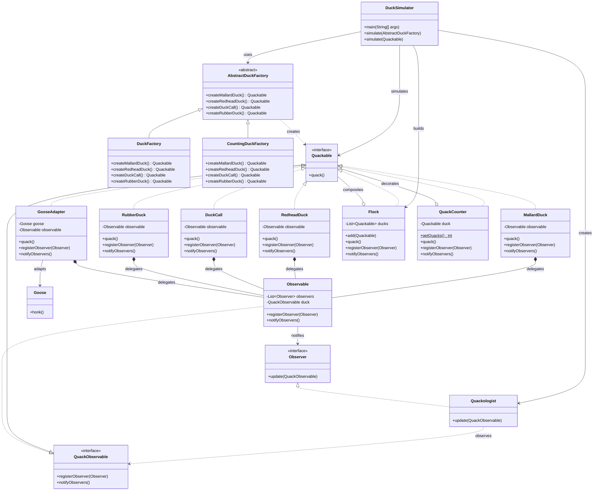

# Duck Simulator — Compound Patterns Class Diagram

A bird’s-eye view of the Chapter 12 duck simulator: **Abstract Factory**, **Decorator**, **Adapter**, **Composite**, and **Observer** packed into one design.

## Mermaid class diagram

## Patterns in this design

| Pattern              | Role in the simulator                                                                               |
| -------------------- | --------------------------------------------------------------------------------------------------- |
| **Abstract Factory** | `AbstractDuckFactory` / `DuckFactory` / `CountingDuckFactory` create families of `Quackable`s       |
| **Decorator**        | `QuackCounter` wraps ducks to count quacks                                                          |
| **Adapter**          | `GooseAdapter` makes a `Goose` look like a `Quackable`                                              |
| **Composite**        | `Flock` treats a collection of `Quackable`s as one `Quackable`                                      |
| **Observer**         | `QuackObservable` / `Observable` / `Observer` / `Quackologist` track individual quacks in real time |

## Product families

- **DuckFactory** — plain ducks (no counting)
- **CountingDuckFactory** — ducks wrapped in `QuackCounter` decorators

The simulator only depends on `AbstractDuckFactory` and `Quackable`; it never cares which concrete duck or decorator it got.

## Quackable variants

All implement `Quackable` (and therefore `QuackObservable`):

- **Ducks:** `MallardDuck`, `RedheadDuck`, `DuckCall`, `RubberDuck`
- **Adapter:** `GooseAdapter` (wraps `Goose`)
- **Composite:** `Flock` (holds other `Quackable`s, including nested flocks)
- **Decorator:** `QuackCounter` (adds counting behavior)

Each duck composes an `Observable` helper and delegates `registerObserver` / `notifyObservers` to it. `QuackCounter` and `Flock` forward registration to their children/wrapped duck so observers hear every leaf quack.
