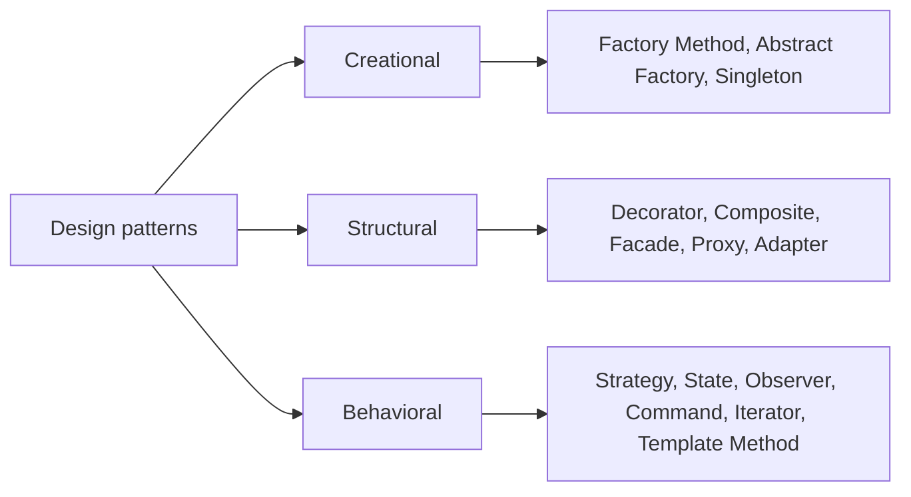
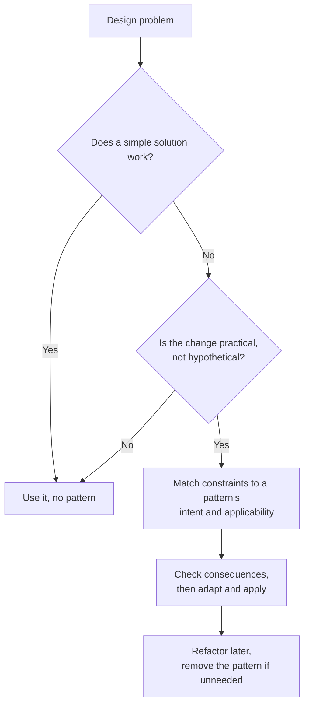

---
tags:
  - design-patterns/patterns-in-the-real-world
  - design-patterns/catalog
  - design-patterns/anti-pattern
  - head-first
date: 2026-11-21
chapter: 13
source: "Head First Design Patterns, 2nd ed., printed pp. 563-596"
---

# Chapter 13: Patterns in the Real World

Reader: a Java developer who knows OO basics and has met the book's patterns, and wants to recall how patterns are defined, catalogued, classified and used wisely. This chapter has no code. It is about thinking, vocabulary and judgment.

> [!abstract] In a nutshell
> **A pattern is a named, proven solution to a recurring problem in a context. Use it when a real need appears, never just to use it.**
>
> | Topic | Key point |
> |---|---|
> | Definition | "A Pattern is a solution to a problem in a context." (p. 565) |
> | Catalog | Each pattern is documented with a fixed template (name, intent, structure, consequences, ...) |
> | Categories | Creational, Structural, Behavioral (by purpose); Class vs Object (by mechanism) |
> | Anti-pattern | A recurring bad solution that looks attractive; documented so you avoid it |
> | Using patterns | Keep it simple, let patterns emerge, remove them when not needed |
>
> The biggest lasting benefit is the shared vocabulary, more than any single design.

## What a pattern really is

The common definition has three parts:

| Part | Meaning | Iterator example |
|---|---|---|
| Context | The recurring situation where the pattern applies | You have a collection of objects |
| Problem | The goal, plus the constraints on it | Step through them without exposing the implementation |
| Solution | A general design anyone can apply | Encapsulate the iteration in a separate class |

Pattern writers call the goal and the constraints **forces**. A solution is only a pattern when it balances both sides.

### Why "locked keys, break the window" is not a pattern

The book builds a fake pattern (problem: get to work on time; context: keys locked in the car; solution: break the window and drive). It fits the three-part definition, yet fails (p. 566):

- It is not a **recurring** problem, and the solution is too costly to reuse.
- You cannot easily hand the description to someone else for their own problem.
- It has **no name**, so it cannot join a shared vocabulary.

So the three-part definition is necessary but not sufficient. Real patterns live in catalogs that add much more.

> [!tip] Patterns are guidelines
> You may adapt a pattern's structure to fit your design, as with design principles. Document how yours differs from the classic form so others can still recognise it.

## Pattern catalogs

A catalog describes a set of related patterns and how they relate. The first and most definitive one is the Gang of Four (GoF) book, *Design Patterns: Elements of Reusable Object-Oriented Software* (Gamma, Helm, Johnson, Vlissides). It lists 23 fundamental patterns.

Other catalogs cover domains such as enterprise or concurrent systems.

Every entry follows a template:

| Section | What it tells you |
|---|---|
| Name | The handle for shared vocabulary |
| Classification | Category (see below) |
| Intent | Short statement of what the pattern does |
| Motivation | A concrete scenario showing the problem and the fix |
| Applicability | Situations where it can be applied |
| Structure | Class diagram |
| Participants | Classes and objects, with their roles |
| Collaborations | How participants work together |
| Consequences | Good and bad effects of using it |
| Implementation, Sample Code | Techniques and gotchas, code fragments |
| Known Uses | Real systems that use it |
| Related Patterns | How it differs from or combines with others, for example State vs Strategy |

How to use a catalog (Jim's workflow, pp. 568-569):

1. Learn the patterns and their relationships up front.
2. When you have a problem, check **Motivation** and **Applicability** for a match.
3. Read **Consequences** to avoid unintended effects.
4. Read **Structure** and **Participants**, then fit the pattern into your design.
5. Read **Implementation** and **Sample Code** for gotchas.

## Organizing patterns

Classification narrows your search and lets you compare patterns inside a group. The GoF scheme sorts by **purpose**:

| Category | Concern | Patterns |
|---|---|---|
| Creational | Object instantiation; decouple the client from the objects it creates | Singleton, Builder, Prototype, Abstract Factory, Factory Method |
| Structural | Compose classes or objects into larger structures | Decorator, Composite, Facade, Proxy, Flyweight, Bridge, Adapter |
| Behavioral | How classes and objects interact and share responsibility | Template Method, Visitor, Mediator, Iterator, Command, Memento, Interpreter, Observer, Chain of Responsibility, State, Strategy |

Builder, Prototype, Flyweight, Bridge, Visitor, Mediator, Memento, Interpreter and Chain of Responsibility are not taught in the chapters; the book gives an overview in the Appendix (p. 576).

A second axis is **class vs object** (p. 577):

| Kind | Relationship | When fixed | Members |
|---|---|---|---|
| Class patterns | Inheritance | Compile time | Template Method, Factory Method, Adapter, Interpreter |
| Object patterns | Composition | Runtime, so more flexible | Everything else (most patterns) |

> [!warning] Categories are fuzzy
> Many patterns seem to fit more than one category. Decorator is *structural* in the GoF scheme even though it adds behavior: it focuses on composing objects by wrapping, not on how objects communicate. The intent of a pattern is often the key to its category. Use categories when they help, and know the patterns and their relationships regardless.

## Thinking in patterns

| Advice | In short |
|---|---|
| Keep it simple (KISS) | The goal is simplicity, not "how do I apply a pattern here?" |
| Not a magic bullet | You must still think through consequences for the rest of the design |
| Know when you need one | Only when you are sure a simple solution will not do |
| Exception: expected variation | Use a pattern when parts of the system will likely vary, but for practical change, not hypothetical change |
| Refactoring time | Code full of conditionals may signal State; concrete dependencies may call for Factory |
| Remove patterns | When the flexibility planned for is not needed, a simpler design is better |
| If you don't need it now, don't do it now | Hypothetical flexibility only adds complexity |

Patterns have a downside: extra classes, extra layers (complexity and some inefficiency), and sometimes plain overkill. Start from design principles and let patterns emerge.

### Your mind on patterns (p. 583)

| Stage | Attitude | Lesson |
|---|---|---|
| Beginner | "I need a pattern for Hello World." Uses patterns everywhere | More patterns does not mean a better design |
| Intermediate | "Maybe I need a Singleton here." Sees where they are needed, forces some | Patterns can be adapted when the classic form does not fit |
| Zen | "This is a natural place for Decorator." | Thinks in principles and tradeoffs, sees related patterns, stays a beginner mind |

## Shared vocabulary

Saying "I used Observer" conveys a whole design: succinct, precise and complete. Describing the same design from scratch ("a broadcast class that keeps its listeners...") is incomplete, confusing and time-consuming. Share the vocabulary:

- in design meetings, to stay "in the design" longer;
- in conversations with other developers;
- in architecture documents, to write less and say more;
- in code comments and class or method names;
- in talks to interested groups (a brown-bag lunch, a user group).

## Anti-patterns

An **anti-pattern** shows how to go from a problem to a *bad* solution, so others can avoid it. It tells you why the bad solution is attractive, why it hurts in the long term, and which patterns to consider instead. Types include development, OO, organizational and domain-specific anti-patterns.

Example from the chapter (p. 593), **Golden Hammer**:

| Field | Content |
|---|---|
| Problem | You must pick technologies and believe one must dominate the architecture |
| Forces | Team knows one technology, others look risky, familiar tech is easy to estimate |
| Supposed solution | Use the familiar technology everywhere, even where it is clearly inappropriate |
| Refactored solution | Educate and train the team on new solutions |
| Example | Web companies maintaining homegrown caches when open source alternatives exist |

## Becoming a pattern writer, and where patterns apply

- Patterns are **discovered**, not created. Most "new" patterns are variants of existing ones.
- **Rule of Three**: it is a pattern only after it has been applied in real solutions at least three times.
- Steps: do your homework on existing patterns, reflect on your recurring solutions, write them down using a template, then have others try them and refine.
- The Gang of Four are Gamma, Helm, Johnson and Vlissides. The idea came from architect **Christopher Alexander** (*The Timeless Way of Building*, *A Pattern Language*).
- GoF advice (p. 587): patterns are tools, not rules; go for simplicity; shoot for practical extensibility; there are more patterns beyond the GoF book.

The Patterns Zoo shows that patterns exist in many domains:

| Domain | Concerns |
|---|---|
| Architectural | Buildings, towns, cities (where patterns began) |
| Application | System-level architecture, such as multitier systems (MVC is mentioned here) |
| Domain-specific | Concurrent or real-time systems, enterprise computing |
| Business process | Interaction among businesses, customers and data |
| Organizational | Structure and practice of human organizations |
| User interface | Designing interactive programs |

Resources named: the Portland Patterns Repository (c2.com), the Hillside Group (hillside.net), conferences such as PLoP and OOPSLA/SPLASH.

## Who does what (recap exercise)

| Pattern | One-line job |
|---|---|
| Decorator | Wraps an object to provide new behavior |
| State | Encapsulates state-based behaviors, delegates to switch between them |
| Iterator | Traverses a collection without exposing its implementation |
| Facade | Simplifies the interface of a set of classes |
| Strategy | Encapsulates interchangeable behaviors, delegates to choose one |
| Proxy | Wraps an object to control access to it |
| Factory Method | Subclasses decide which concrete classes to create |
| Adapter | Wraps an object and provides a different interface to it |
| Observer | Notifies objects when state changes |
| Template Method | Subclasses decide how to implement steps in an algorithm |
| Composite | Clients treat collections and individual objects uniformly |
| Singleton | Ensures one and only one object is created |
| Abstract Factory | Creates families of objects without specifying concrete classes |
| Command | Encapsulates a request as an object |

## Toolbox for this chapter

- **OO basics:** abstraction, encapsulation, polymorphism, inheritance.
- **Principles (all nine from the book):** encapsulate what varies; favor composition over inheritance; program to interfaces; loose coupling; open-closed; depend on abstractions; only talk to your friends; Hollywood principle; one reason to change.
- **New this chapter:** no new pattern. Added tools are the pattern vocabulary, catalogs, categories and judgment about when to apply them.

## Common mistakes

| Mistake | What happens | Fix |
|---|---|---|
| Reaching for a pattern first | Over-engineered code with extra classes and layers | Start from principles and the simplest solution; let patterns emerge |
| Building for hypothetical change | Complexity for flexibility never used | Only support change you practically expect |
| Treating a pattern as a rigid law | Awkward fit, or a bad design | Adapt it, and document the difference |
| Judging a pattern by its category alone | Wrong pick (for example, Decorator seen as behavioral) | Compare intent and consequences, not just the label |
| Calling any working fix a "pattern" | Unreusable one-offs (the car-window example) | Needs recurrence, a name, and reuse by others (Rule of Three) |
| Keeping a pattern that is no longer needed | Ongoing complexity | Remove it when a simpler design works |

## Check yourself

> [!question] Q1 · A teammate says "it has a problem, a context and a solution, so it must be a pattern." What is missing?
>
> > [!success] Answer
> > The three parts are necessary but not enough. A pattern must also solve a recurring problem, be general enough for others to apply to their own cases, and have a name for shared vocabulary. Catalogs add intent, consequences and related patterns on top.

> [!question] Q2 · You have a small app with one report format that may someday need three. Do you add Strategy now?
>
> > [!success] Answer
> > Probably not. The chapter says to avoid hypothetical change: "If you don't need it now, don't do it now". Add the pattern when a real need to vary appears. Refactoring time is a good moment to introduce it.

> [!question] Q3 · Why is Decorator "structural" when it adds behavior?
>
> > [!success] Answer
> > The GoF classification looks at focus. Decorator composes objects by wrapping them to gain new functionality, whereas behavioral patterns focus on communication between objects. Categories are fuzzy, so use the intent as the guide.

> [!question] Q4 · Why document anti-patterns, and what must a good one include?
>
> > [!success] Answer
> > Avoiding a recurring bad solution is as valuable as finding a good one. A good anti-pattern explains why the bad solution is attractive, why it is bad in the long term, and which patterns can be used to refactor it.

> [!question] Q5 · Which is more valuable in a design review, naming the pattern or explaining the code line by line?
>
> > [!success] Answer
> > Naming it. The pattern name carries the whole design in a succinct, precise and complete way, keeps the team out of implementation details, and prevents misunderstandings.

## Related

Previous: [[chap12-compound-notes]]. The Appendix covers the patterns not taught in the chapters.
