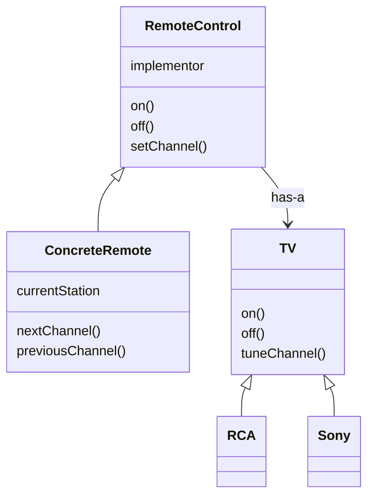
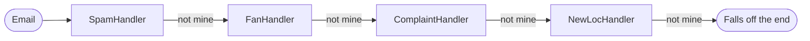
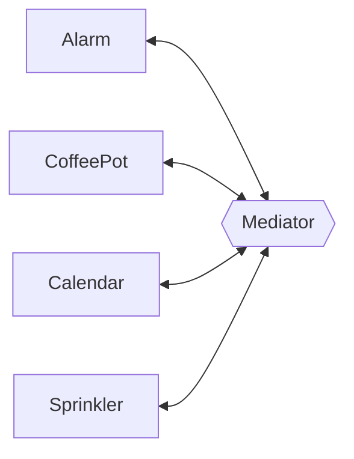
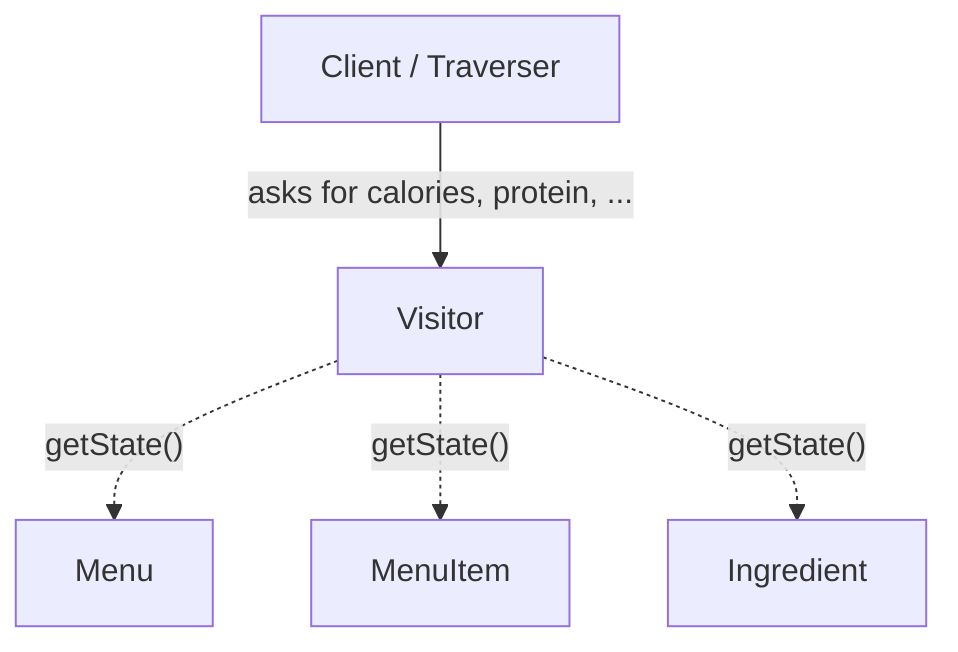

---
tags:
  - design-patterns/bridge
  - design-patterns/builder
  - design-patterns/chain-of-responsibility
  - design-patterns/flyweight
  - design-patterns/interpreter
  - design-patterns/mediator
  - design-patterns/memento
  - design-patterns/prototype
  - design-patterns/visitor
  - head-first
date: 2026-11-21
chapter: 14
source: "Head First Design Patterns 2nd ed., Appendix: Leftover Patterns, printed pp. 597-616"
---

# Chapter 14 Appendix: the leftover GoF patterns

Reader: knows Java and basic OOP, knows the main patterns from chapters 1-12 (Strategy, Observer, Composite, Iterator and so on). This chapter has no repo code, so the notes cover ideas only.

> [!abstract] In a nutshell
> **Nine official GoF patterns that are used less often than the rest. Know the one-line intent so you can recognise the problem when it shows up.**
>
> | Pattern | Intent (book wording, short) | Key idea |
> |---|---|---|
> | Bridge | Vary the abstraction and the implementation | Two separate hierarchies joined by a has-a link |
> | Builder | Build a product in steps | Client drives a builder, then asks for the result |
> | Chain of Responsibility | Give more than one object a chance to handle a request | Handlers linked by successor, first one that can, handles |
> | Flyweight | One instance stands for many virtual instances | Keep state outside the shared object |
> | Interpreter | Build an interpreter for a language | One class per grammar rule |
> | Mediator | Centralize communication between related objects | Objects talk only to the mediator |
> | Memento | Return an object to a previous state | Saved state held in a separate opaque object |
> | Prototype | Create objects by copying existing ones | Client clones without knowing the concrete class |
> | Visitor | Add operations to a composite without changing it | Visitor walks the structure and collects state |
>
> The book's aim is a high-level idea of each, not mastery (p. 597).

## Bridge (pp. 598-599)

**Intent:** "vary not only your implementations, but also your abstractions."

**Problem:** TV remote controls. One remote abstraction, one implementation per TV model (RCA, Sony). Plain inheritance (`RCAControl`, `SonyControl` extend `RemoteControl`) lets you vary only the TV side. The remote's UI will keep changing too, and you cannot vary both inside one hierarchy.

**Idea:** put the abstraction and the implementation in separate hierarchies. The link between them is the "bridge".



- `RemoteControl` methods are written in terms of the implementor: `implementor.tuneChannel(channel)`.
- `ConcreteRemote` is written in terms of the abstraction: `setChannel(currentStation + 1)`.
- Pro: both sides extend independently; changes to concrete abstractions do not affect the client.
- Con: more complexity. Typical use: graphics and windowing systems on many platforms.

## Builder (pp. 600-601)

**Intent:** "encapsulate the construction of a product and allow it to be constructed in steps."

**Problem:** a Patternsland vacation planner. A vacation has several days, and each day has any mix of hotel, tickets, meals, special events. You need a flexible structure and a multistep creation process, without mixing the two.

**Idea:** same spirit as Iterator: hide the internal representation behind an object. The client calls an abstract builder step by step, then fetches the product.

```text
builder.buildDay(date);
builder.addHotel(date, "Grand Facadian");
builder.addTickets("Patterns on Ice");
Planner yourPlanner = builder.getVacationPlanner();
```

- Roles: `Client` -> `AbstractBuilder` (`buildDay`, `addHotel`, `addReservation`, `addSpecialEvent`, `addTickets`, `getVacationPlanner`) <- `VacationBuilder` (holds the `vacation` composite).
- Pro: hides product internals; products can be swapped behind the abstract interface; multistep, unlike a one-shot factory.
- Con: the client needs more domain knowledge than with a Factory. Often used for composites.

## Chain of Responsibility (pp. 602-603)

**Intent:** "give more than one object a chance to handle a request."

**Problem:** Mighty Gumball gets fan mail (to the CEO), complaints (legal), new-location requests (business development) and spam (delete). Detectors already exist; you need a design that routes the mail.

**Idea:** each handler either handles the request or passes it to its successor.



- Class view: `Handler` has a `successor` and `handleRequest()`; the four handlers subclass it.
- Pro: sender and receiver are decoupled; add, remove or reorder handlers at runtime.
- Con: handling is not guaranteed (add a catch-all handler if needed); hard to observe and debug. Used for mouse and keyboard events in windowing systems.

## Flyweight (pp. 604-605)

**Intent:** use it "when one instance of a class can be used to provide many virtual instances."

**Problem:** a landscape app where each `Tree` object holds its own `xCoord`, `yCoord`, `age`. A client planting huge groves finds the app sluggish.

**Idea:** one state-free `Tree` with `display(x, y, age)`. A `TreeManager` keeps all state in an array, one row per virtual tree.

- Pro: fewer objects, so less memory; state is centralised.
- Con: the virtual instances can no longer behave independently of each other. Use it when many instances can be controlled identically.

## Interpreter (pp. 606-607)

**Intent:** "build an interpreter for a language." (Some knowledge of formal grammars helps, but is not required.)

**Problem:** a Duck Simulator language for children, such as `right; while (daylight) fly; quack;`. The grammar:

```text
expression ::= <command> | <sequence> | <repetition>
sequence   ::= <expression> ';' <expression>
command    ::= right | quack | fly
repetition ::= while '(' <variable> ')' <expression>
variable   ::= [A-Z,a-z]+
```

**Idea:** one class per rule, with a direct mapping from grammar to classes. Each has `interpret(context)`, where the context holds the program input. Classes: `Expression`, `Sequence` (`expression1`, `expression2`), `Repetition` (`variable`, `expression`), `Variable`, `RightCommand`, `QuackCommand`, `FlyCommand`.

- Pro: easy to implement and extend the language; extra methods give pretty-printing or validation.
- Con: cumbersome with many rules, so a parser or compiler generator is better then. Choose it when the grammar is simple and simplicity beats efficiency.

## Mediator (pp. 608-609)

**Intent:** "centralize complex communications and control between related objects."

**Problem:** Bob's smart home. `Alarm`, `CoffeePot`, `Calendar`, `Sprinkler` each hold rules that reference the others ("no coffee on weekends", "sprinkler off before the shower"). Every new rule touches several objects and nobody knows where a rule lives.

**Idea:** appliances only tell the mediator when their state changes and respond to its requests. All control logic lives in the mediator.



- Pro: appliances are decoupled and reusable; control logic is in one place; fewer kinds of messages.
- Con: without care, the mediator itself becomes overly complex. Common for coordinating GUI components.

## Memento (pp. 610-611)

**Intent:** "return an object to one of its previous states", for example undo.

**Problem:** a role-playing game where players lose days of progress when the character dies. You need to save game state, but the state is complicated and nobody else should be able to break it.

**Idea:** two goals: save the key object's state, and keep its encapsulation. By the Single Responsibility Principle, keep the saved state in a separate Memento object.

- Roles: `MasterGameObject` has `getCurrentState()` and `restoreState(saved)`. `GameMemento` holds `savedGameState`. The `Client` stores the saved object but cannot read its data.
- Pro: keeps cohesion, keeps data encapsulated, easy recovery.
- Con: saving and restoring can be slow. In Java, consider Serialization.

## Prototype (pp. 612-613)

**Intent:** use it "when creating an instance of a given class is either expensive or complicated."

**Problem:** a game that needs endless monsters that change with the landscape. Putting all creation detail in constructors is not cohesive. You want one place that holds the instantiation details, decoupled from the code that needs the instances.

**Idea:** make new instances by copying existing ones. In Java that is usually `clone()`, or deserialization for deep copies. The client does not know which concrete class it gets.

```text
MonsterMaker.makeRandomMonster()
  -> MonsterRegistry.getMonster()   // finds right monster, returns correctMonster.clone()
```

- Types: `Monster` interface, implemented by `WellKnownMonster` and `DynamicPlayerGeneratedMonster`.
- Pro: hides creation complexity; client can create objects of unknown type; copying can be cheaper than constructing.
- Con: copying an object can itself be complicated.

## Visitor (pp. 614-615)

**Intent:** use it "when you want to add capabilities to a composite of objects and encapsulation is not important."

**Problem:** diners want nutrition info (`getHealthRating`, `getCalories`, `getProtein`, `getCarbs`) per menu item and per ingredient. Lou's plan adds those methods to every class. Mel objects: every new method must be added in several places, and adding a recipes class means three places.

**Idea:** a Traverser guides a Visitor through the composite (`Menu`, `MenuItem`, `Ingredient`). Each composite class only exposes `getState()`. The visitor collects state, then the client asks it for results. New functionality means changing only the visitor.



- Pro: add operations without touching the composite; operation code is centralised.
- Con: breaks the composite classes' encapsulation; traversal is involved, so changing the composite structure is harder.

## Look-alikes and when to pick what

| Need | Pick | Not |
|---|---|---|
| Two things vary: abstraction and implementation | Bridge | plain inheritance |
| Many-step construction of a composite | Builder | one-shot Factory |
| Several candidates, first match handles | Chain of Responsibility | one big if/else in the sender |
| Thousands of near-identical objects | Flyweight | per-object state |
| Tangled many-to-many object talk | Mediator | direct references (Observer is for one-to-many notification) |
| Undo or restore | Memento | exposing internals |
| Costly or complex creation | Prototype | constructors full of detail |
| New operations over a composite | Visitor | methods in every class |

> [!note] Tools for your toolbox
> The chapter adds no new OO basics or principles (it only restates Single Responsibility for Memento). Patterns added: the nine above.

## Common mistakes

| Mistake | What happens | Fix |
|---|---|---|
| Using Bridge when only one side varies | Extra classes and indirection for nothing | Plain inheritance or Strategy |
| Chain with no catch-all | Request silently falls off the end | Add a final default handler |
| Flyweight when instances must differ in behaviour | Cannot behave independently | Keep separate objects |
| Mediator absorbing every rule | A giant god object | Split mediators by area |
| Letting the client read the Memento | Breaks encapsulation | Keep the saved state opaque |
| Shallow `clone()` of mutable parts | Copies share state | Deep copy or deserialization |
| Visitor on a structure that changes often | Every structure change ripples into visitors | Prefer methods on the classes |

## Check yourself

> [!question] Q1 · Why does Bridge need two hierarchies rather than `RCAControl` and `SonyControl` subclasses?
>
> > [!success] Answer
> > Subclassing only varies the TV side. When the remote UI changes you would have to touch every per-TV subclass. Two hierarchies let `ConcreteRemote` evolve and new TVs appear independently.

> [!question] Q2 · Both Mediator and Chain of Responsibility reduce coupling. What is the difference?
>
> > [!success] Answer
> > Chain decouples a sender from several possible receivers, and one handler in sequence handles the request. Mediator centralises two-way interaction among peers so they never reference each other.

> [!question] Q3 · Visitor "breaks encapsulation". Why is that acceptable, and when is it not?
>
> > [!success] Answer
> > The visitor needs to read each node's state through `getState()`, so internals are exposed. It is fine when new operations matter more than hiding data, and a poor fit when encapsulation is important or the structure changes often.

> [!question] Q4 · A game spawns thousands of identical trees and a few unique monsters. Which patterns fit each?
>
> > [!success] Answer
> > Trees fit Flyweight: share one state-free object, keep coordinates and age outside. Monsters fit Prototype: clone a registered template so the client does not need the concrete class.

## Related

Previous: [[chap12-compound-notes]]
