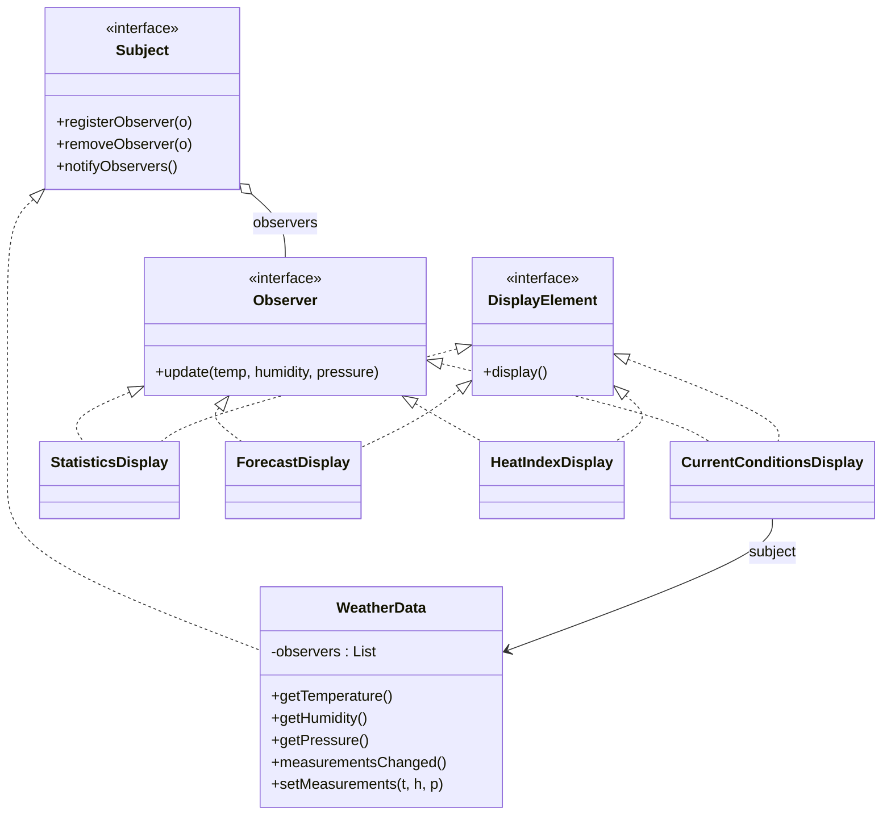
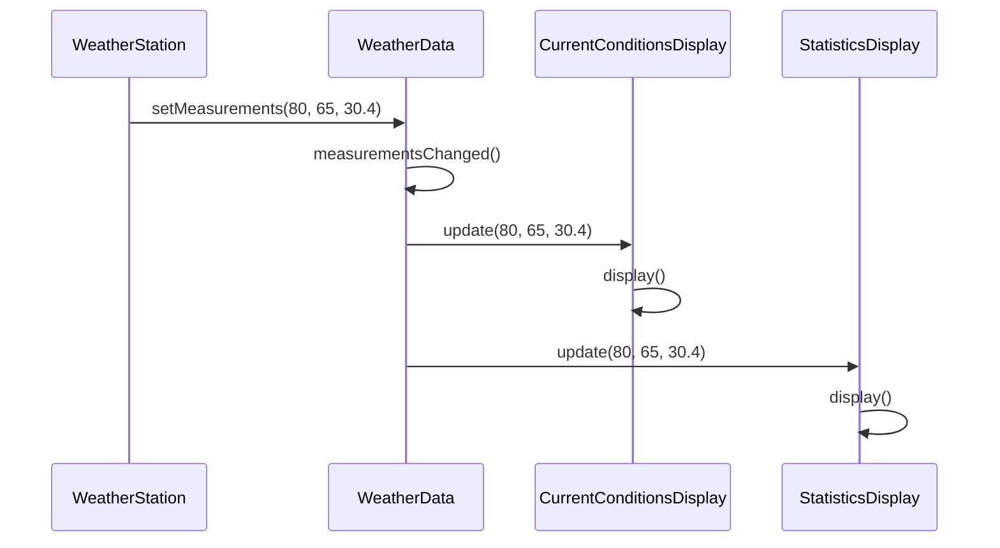

---
tags:
  - design-patterns/observer
  - head-first
date: 2026-11-21
chapter: 2
source: "Head First Design Patterns 2nd ed., printed pp. 37-78"
---

# Chapter 2: Observer Pattern

Reader: a Java developer who knows interfaces and basic OOP, and wants the substance of the chapter without re-reading it. Pattern summary and the Java/Python/C++ comparison live in [README.md](README.md); this note does not repeat them.

> [!abstract] In a nutshell
> **One object (the subject) owns some state; any number of observers register with it and are told automatically when that state changes.**
>
> | Item | Summary |
> |---|---|
> | Intent | One-to-many dependency: when one object changes state, all its dependents are notified and updated automatically |
> | Key idea | The subject only knows "this thing implements `Observer`", so it stays loosely coupled |
> | Use when | Many objects must follow one object's state, and the set of followers changes at runtime |
>
> Think newspaper subscription: publisher = subject, subscribers = observers (book p. 44).

## The problem (Weather-O-Rama)

Weather-O-Rama supplies a `WeatherData` class with `getTemperature()`, `getHumidity()`, `getPressure()` and an empty `measurementsChanged()`. We must update three displays (current conditions, statistics, forecast) whenever it fires, and other developers must be able to plug in their own displays.

The naive first attempt fills `measurementsChanged()` with direct calls:

```java
currentConditionsDisplay.update(temp, humidity, pressure);
statisticsDisplay.update(temp, humidity, pressure);
forecastDisplay.update(temp, humidity, pressure);
```

> [!example] Sharpen your pencil: what is wrong with this? (answers, p. 75)
> | Statement | Applies? |
> |---|---|
> | A. Coding to concrete implementations, not interfaces | yes |
> | B. Every new display means editing this code | yes |
> | C. No way to add or remove displays at runtime | yes |
> | D. Displays share no common interface | no, they all have `update()` |
> | E. The part that changes is not encapsulated | yes |
> | F. Violates encapsulation of `WeatherData` | no |

The varying part is "which displays exist", and it is hard-coded. The Observer pattern pulls that part out.

## Definition and principle

> [!quote] The Observer Pattern
> "defines a one-to-many dependency between objects so that when one object changes state, all of its dependents are notified and updated automatically." (p. 51)

> [!quote] New design principle
> "Strive for loosely coupled designs between objects that interact." (p. 54)

Loose coupling means two objects can interact while knowing very little about each other. The pattern achieves it in these ways (p. 54):

- The subject knows only that an observer implements `Observer`.
- Observers can be added, replaced or removed at any time, at runtime.
- New observer types never require changing the subject.
- Subject and observers can be reused independently.
- Changing one side does not break the other, as long as the interfaces are honoured.

## Structure



Notice that `DisplayElement` is separate from `Observer`: "can be notified" and "can render itself" are independent roles, so each display implements both. A third-party display just implements both interfaces.

A display registers itself in its constructor. A single update then flows like this:



## How the code maps

| Role | File (Java push model) |
|---|---|
| Subject interface | [Subject.java](java/Subject.java) |
| Observer interface | [Observer.java](java/Observer.java) |
| Concrete subject | [WeatherData.java](java/WeatherData.java) |
| Concrete observers | [CurrentConditionsDisplay.java](java/CurrentConditionsDisplay.java), [StatisticsDisplay.java](java/StatisticsDisplay.java), [ForecastDisplay.java](java/ForecastDisplay.java), [HeatIndexDisplay.java](java/HeatIndexDisplay.java) |
| Display role | [DisplayElement.java](java/DisplayElement.java) |
| Client / test harness | [WeatherStation.java](java/WeatherStation.java) |
| Pull variant | [java/pull/](java/pull/) |
| Observer in Swing | [SwingObserverExample.java](java/SwingObserverExample.java) |

The subject's whole job is a list plus a loop:

```java
public void notifyObservers() {
    for (Observer observer : observers) {
        observer.update(temperature, humidity, pressure);
    }
}
```

An observer registers itself and keeps the subject reference so it could unregister later (p. 60):

```java
public CurrentConditionsDisplay(WeatherData weatherData) {
    this.weatherData = weatherData;
    weatherData.registerObserver(this);
}
```

Language differences (details in [README.md](README.md)):

- Java and Python keep strong references in a list. C++ stores `weak_ptr`s so the subject does not own its observers.
- C++ cannot get a `shared_ptr` to `this` in a constructor, so displays use a `static create()` factory.
- Java throws `ConcurrentModificationException` if an observer unregisters during the loop. Python and C++ iterate over a copy.
- The repo's Java files are the original; `WeatherStation` also removes `currentDisplay` after update 3 to show unsubscribing.

## Push vs pull

The book stages this as a fireside chat (pp. 63-64): the subject prefers push (one call, everything included), observers prefer pull (take only what you need).

| | Push | Pull |
|---|---|---|
| Observer signature | `update(float t, float h, float p)` | `update()` |
| Who gets the data | Subject sends all of it | Observer calls the subject's getters |
| Adding wind speed | Change every `update()` in every observer | Add one getter; only interested observers change |
| Cost | Observers receive values they ignore | Subject must expose public getters (more of its state is open) |

The book calls pull "more correct" (Bullet Points, p. 72), though push vs pull is "an implementation detail". Pull version, from [java/pull/CurrentConditionsDisplay.java](java/pull/CurrentConditionsDisplay.java):

```java
public void update() {
    this.temperature = weatherData.getTemperature();
    this.humidity = weatherData.getHumidity();
    display();
}
```

This is why observers keep the `weatherData` reference: pull needs it every time, not just at registration.

## Observer in the wild

- **Swing**: `JButton` is the subject, `ActionListener`s are observers, registered with `addActionListener()`. The callback is `actionPerformed()` instead of `update()`.
- **Lambdas**: `ActionListener` has one method, so a lambda is the observer: `button.addActionListener(event -> ...)` (p. 67).
- **Others**: JavaBeans `PropertyChangeListener`, RxJava, RMI, Cocoa/Swift key-value observing, JavaScript events, Java's Flow API.
- **`java.util.Observable`/`Observer`**: deprecated in Java 9. People prefer writing the pattern themselves or want something more robust (p. 68). This repo does not use them.
- **Ordering**: do not depend on notification order; the JDK developers advise against it (p. 68). The repo happens to notify in registration order.

## Tradeoffs and look-alikes

| Point | Detail |
|---|---|
| Pro | Add or remove observers at runtime without touching the subject; observers are reusable |
| Pro | Cleaner than many objects controlling the same data: one owner of state |
| Con (push) | Signature churn when state grows |
| Con (pull) | Subject must expose getters |
| Con | No guaranteed order |
| Publish-Subscribe | Related but "more complex": subscribers pick message types and are further decoupled from publishers; common in middleware (p. 52) |
| MVC | Book promises to revisit Observer there; calling `display()` inside `update()` is only fine for a small example (p. 60) |

A single object can be both: Lori from the headhunter skit is an observer of the headhunter and a subject for her own call list (p. 50).

## Toolbox for this chapter

- **OO basics:** abstraction, encapsulation, inheritance, polymorphism.
- **Principles:** encapsulate what varies; favor composition over inheritance; program to interfaces, not implementations; **new: strive for loosely coupled designs between objects that interact**.
- **Pattern added:** Observer.

How Observer applies the earlier principles (Design Principle Challenge, p. 75):

| Principle | Where it shows up |
|---|---|
| Encapsulate what varies | The subject's state and the number and types of observers vary; observers change without changing the subject |
| Program to an interface | Subject holds `Observer` references; observers register through `Subject` |
| Favor composition | Observers are composed into the subject at runtime, not through an inheritance tree |

## Common mistakes

| Mistake | What happens | Fix |
|---|---|---|
| Subject calls concrete displays directly | Every new display edits the subject; no runtime add/remove | Hold a `List<Observer>` and loop |
| Forgetting `registerObserver(this)` | Display is built but never updates | Register in the constructor or from the client |
| Not unregistering a finished observer | Subject keeps it alive and keeps notifying it (leak in Java) | Call `removeObserver`; keep the subject reference |
| Unregistering inside `update()` while looping | `ConcurrentModificationException` in Java | Iterate a copy, or defer the removal |
| Relying on notification order | Breaks when the implementation changes | Make each observer independent |
| Pushing every field to every observer | Each new field changes all `update()` signatures | Prefer pull, or send an event object |

## Check yourself

> [!question] Q1 · Wind speed is added to `WeatherData`. How many classes change under push, and how many under pull?
>
> > [!success] Answer
> > Push: `Observer`, `WeatherData.notifyObservers()` and every concrete display, because the `update()` signature changes. Pull: only `WeatherData` gains a `getWindSpeed()`; displays that want wind speed call it, the rest stay untouched.

> [!question] Q2 · `StatisticsDisplay` and `ForecastDisplay` both need history. Where does that history live, and why is the subject unaffected?
>
> > [!success] Answer
> > In the observers (`tempSum`, `numReadings`, `lastPressure`). The subject only holds the latest values and pushes them. Each observer decides what to remember, which is why observers are independent of each other.

> [!question] Q3 · Why does `Observer` not extend or include `DisplayElement`?
>
> > [!success] Answer
> > Observing and displaying are separate responsibilities. A non-visual observer (logger, alarm) should not be forced to implement `display()`, and the subject should only know the notification contract.

> [!question] Q4 · `removeObserver(currentDisplay)` is called after update 3. What does the repo output show for update 4, and what does that prove?
>
> > [!success] Answer
> > The other displays still print, but no "Current conditions" line appears. The subject simply no longer has it in its list, so runtime unsubscribing works without any change to the subject's code.

> [!question] Q5 · Why is a lambda a valid Swing observer?
>
> > [!success] Answer
> > `ActionListener` has a single method, `actionPerformed()`. A lambda with a matching signature is a function object implementing it, so it satisfies the "implements the observer interface" requirement.

## Related

Previous: [[chap1-strategy-notes]]. Next: [[chap3-decorator-notes]]. Code and comparison: [README.md](README.md).
