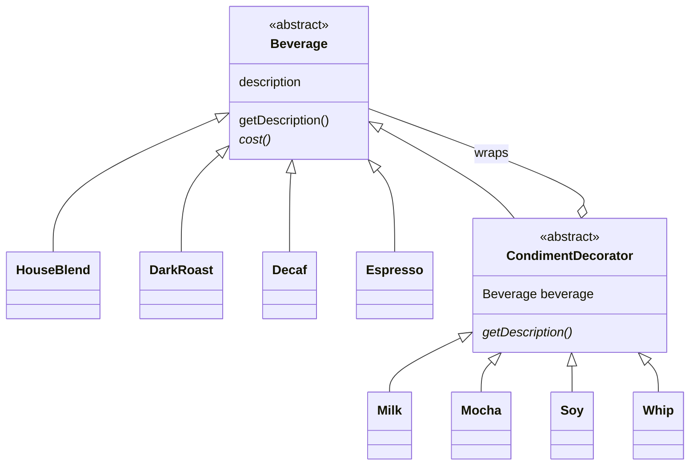
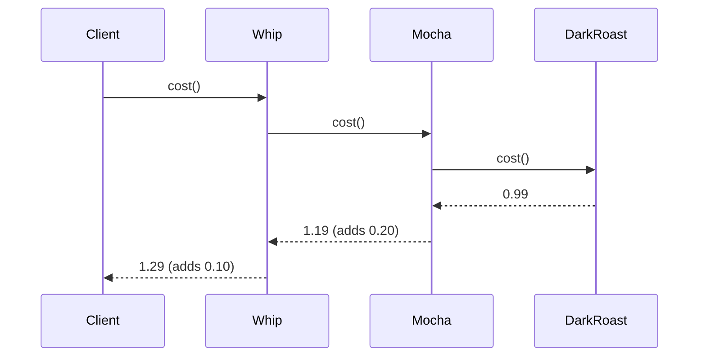
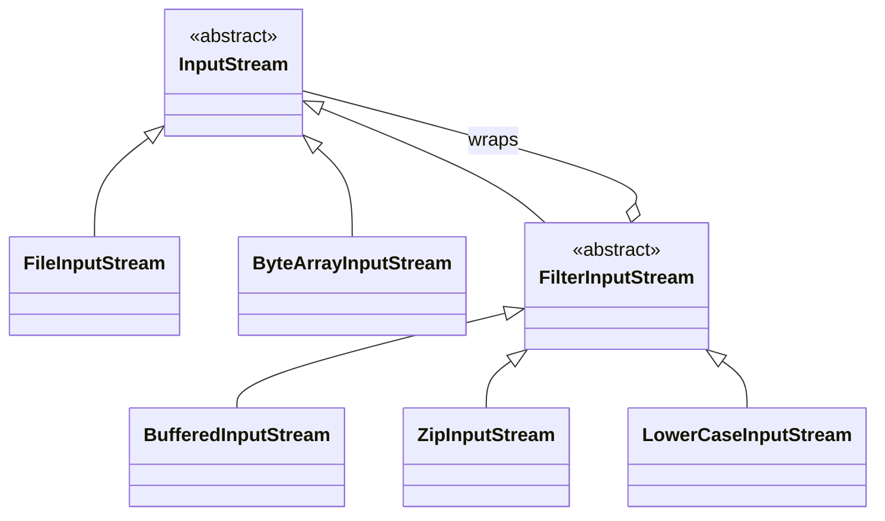

---
tags:
  - design-patterns/decorator
  - head-first
date: 2026-11-21
chapter: 3
source: "Head First Design Patterns, 2nd ed., pp. 79-108"
---

# Chapter 3: Decorator Pattern (Starbuzz Coffee)

> [!abstract] In a nutshell
> **Wrap an object in other objects of the same type, so each wrapper adds behaviour at runtime without touching existing classes.**
>
> | Item | Summary |
> |---|---|
> | Intent | Attach extra responsibilities to an object dynamically; a flexible alternative to subclassing |
> | Key idea | A decorator **is-a** component (same type) and **has-a** component (the wrapped object) |
> | Use when | Many optional add-ons combine freely, and subclass-per-combination would explode |
> | New principle | Open-Closed: open for extension, closed for modification |
>
> The client keeps calling `cost()`; the call travels inward through the wrappers and the prices add up on the way back.

Reader assumed: knows Java classes, abstract classes and polymorphism. Pattern background is in [README.md](README.md) (summary, Java vs Python vs C++ table).

## The problem: class explosion

Starbuzz sells coffees (`HouseBlend`, `DarkRoast`, `Decaf`, `Espresso`) plus condiments (steamed milk, soy, mocha, whip), each with a price. Two naive designs fail.

| Attempt | What it does | Why it breaks (book p. 84) |
|---|---|---|
| One subclass per combination | `HouseBlendWithMilkAndMocha`, ... | Class explosion. A price change touches many classes; a new condiment multiplies them |
| Condiment booleans in `Beverage` (`hasMilk()`, `hasSoy()`...) | Base `cost()` adds condiment prices; subclasses call `super.cost()` | New condiment means editing `Beverage`. Tea inherits `hasWhip()` it should not have. No way to order a **double mocha** |

> [!warning] You might think
> "Instance variables in the superclass fix it." They only move the problem: every change still edits existing code, which breaks the Open-Closed Principle below.

**Inheritance fixes behaviour at compile time, and all subclasses share it.** Composition lets you choose behaviour at runtime, and new behaviour is new code, not edited code (Guru dialogue, p. 85).

## Principle introduced

> [!quote] Open-Closed Principle (p. 86)
> *Classes should be open for extension, but closed for modification.*

- Open: anyone can extend with new behaviour.
- Closed: code that is already correct and tested stays unchanged.
- Do not apply it everywhere. It adds abstraction and complexity, so spend it on areas likely to change (p. 87).
- Reinforces: *favor composition over inheritance*.

## The pattern

> [!quote] Definition (p. 91)
> The Decorator Pattern attaches additional responsibilities to an object dynamically. Decorators provide a flexible alternative to subclassing for extending functionality.

What the book says is true of every decorator (p. 90):

- Same supertype as the object it decorates, so it can stand in for it.
- You can stack any number of them, at any time at runtime.
- It adds behaviour before and/or after delegating to the wrapped object.



Notice that `CondimentDecorator` both extends `Beverage` (type matching) and holds a `Beverage` (composition).

> [!note] Inheritance or composition?
> Decorators inherit only to get the **type**, not behaviour. The behaviour comes from composing objects (p. 93). The book used an abstract class because Starbuzz already had one; an interface would also work.

### How a call flows: DarkRoast + Mocha + Whip



Numbers are from the book (p. 90). `getDescription()` works the same way: wrapped description plus `", Mocha"`.

## Work it by hand

"Double mocha soy latte with whip" = `HouseBlend`, then `Soy`, `Mocha`, `Mocha`, `Whip` (book exercise, p. 107):

| Layer (outer to inner) | Own price | Running total on the way back |
|---|---|---|
| `HouseBlend` (innermost, answers first) | 0.89 | 0.89 |
| `Soy` | 0.15 | 1.04 |
| `Mocha` (second) | 0.20 | 1.24 |
| `Mocha` (first) | 0.20 | 1.44 |
| `Whip` (outermost, answers last) | 0.10 | **1.54** |

> [!caution] Common mistake
> Calling `cost()` on an inner decorator, such as the `Soy`, gives 1.04 and silently drops Mocha and Whip. Always keep and use the **outermost** reference (p. 99).

## How the code maps

Java is the original; see [README.md](README.md) for run commands and the full language comparison.

| Role | Class | File |
|---|---|---|
| Component | `Beverage` | [Beverage.java](java/Beverage.java) |
| Concrete components | `HouseBlend`, `DarkRoast`, `Decaf`, `Expresso` | [HouseBlend.java](java/HouseBlend.java), [DarkRoast.java](java/DarkRoast.java), [Decaf.java](java/Decaf.java), [Expresso.java](java/Expresso.java) |
| Decorator base | `CondimentDecorator` | [CondimentDecorator.java](java/CondimentDecorator.java) |
| Concrete decorators | `Mocha`, `Soy`, `Whip` | [Mocha.java](java/Mocha.java), [Soy.java](java/Soy.java), [Whip.java](java/Whip.java) |
| Client | wraps drinks in `main` | [StarbuzzCoffee.java](java/StarbuzzCoffee.java) |
| `java.io` example | `LowerCaseInputStream` | [LowerCaseInputStream.java](java/LowerCaseInputStream.java), [InputTest.java](java/InputTest.java) |

A concrete decorator delegates, then adds its own part:

```java
public class Mocha extends CondimentDecorator {
    public Mocha(Beverage beverage) { this.beverage = beverage; }
    public String getDescription() { return beverage.getDescription() + ", Mocha"; }
    public double cost() { return 0.20 + beverage.cost(); }
}
```

The client stacks them by re-assigning the variable:

```java
Beverage b = new DarkRoast();
b = new Mocha(b);
b = new Mocha(b);
b = new Whip(b);   // b.cost() runs the whole chain
```

Notes on this repo:

- Python and C++ follow the same structure. In C++ each decorator owns its wrapped drink through `std::unique_ptr`.
- The repo's `Beverage` also keeps the book's first-attempt `hasMilk()`-style flags, which all return `false` in decorators and are not used by the pattern.
- The spelling `Expresso` is the repo's; the book writes `Espresso`.
- Python and C++ re-create `FilterInputStream` because their standard libraries have no equivalent.

### Size exercise (book p. 108)

Sizes (tall, grande, venti) make `Soy` cost 10, 15 or 20 cents.

The solution adds `getSize()` to `CondimentDecorator` so it forwards to the wrapped drink. The size then propagates through every layer to the concrete beverage. In the repo, see `Soy.cost()` and `CondimentDecorator.getSize()`.

### Real-world decorator: `java.io` (p. 100-103)



| Pattern role | `java.io` class |
|---|---|
| Component | `InputStream` |
| Concrete components | `FileInputStream`, `ByteArrayInputStream`... |
| Abstract decorator | `FilterInputStream` |
| Concrete decorators | `BufferedInputStream`, `ZipInputStream`, your own |

The book's `LowerCaseInputStream` extends `FilterInputStream` and overrides the `read()` methods to lower-case each byte.

The book test wraps it as `new LowerCaseInputStream(new BufferedInputStream(new FileInputStream("test.txt")))`.

The repo's [InputTest.java](java/InputTest.java) skips the buffer layer. Input `I know the Decorator Pattern therefore I RULE!` prints in lower case. Output streams and `Reader`/`Writer` follow the same design.

## Trade-offs

| Advantage | Disadvantage |
|---|---|
| Add behaviour without editing existing classes (OCP) | Many small classes and objects; `java.io` is hard to read at first |
| Mix and match any combination at runtime | Code that checks the **concrete** type (`instanceof HouseBlend`) breaks once the object is wrapped |
| Decorators are transparent if the client uses only the component type | Building a decorated object is verbose; the book points to Factory and Builder to hide it (ch. 4, appendix) |
| New behaviour is new code only | Easy to hold a reference to an inner decorator by mistake |

Peeking into the chain is a smell. Printing `"Whip, Double Mocha"` from `"Mocha, Whip, Mocha"` pushes a decorator beyond its intent, though a special parsing decorator could do it (p. 99).

### Look-alikes

| Pattern | Difference |
|---|---|
| Subclassing | Behaviour fixed at compile time and shared by all subclasses; decorators combine per object at runtime |
| Observer (ch. 2) | Also extends behaviour without changing the subject (the book's other OCP example). Observer notifies; Decorator wraps and alters a call |
| Strategy (ch. 1) | Swaps one behaviour inside an object by composition; Decorator stacks several wrappers around an object |

## Toolbox after this chapter

- **OO basics:** abstraction, encapsulation, polymorphism, inheritance (unchanged from earlier chapters).
- **OO principles:** encapsulate what varies; favor composition over inheritance; program to interfaces, not implementations; strive for loosely coupled designs; **new:** classes should be open for extension but closed for modification.
- **OO patterns:** Strategy, Observer, **Decorator**: attach additional responsibilities to an object dynamically; a flexible alternative to subclassing.

## Common mistakes

| Mistake | What happens | Fix |
|---|---|---|
| Keeping the inner decorator reference | Order loses outer condiments and their cost | Always call the outermost reference |
| Decorator that is not the component's type | Cannot be passed where a `Beverage` is expected | Extend or implement the component type |
| Forgetting to override `getDescription()` | Receipt shows only the base drink | Abstract in the decorator base forces every decorator to implement it |
| Testing `instanceof HouseBlend` for a discount | Fails once the drink is wrapped | Code to `Beverage`, not concrete classes |
| Applying decorators for every variation | Many tiny classes, hard to follow | Use it where combinations really vary |

## Check yourself

> [!question] Q1 · The decorator extends `Beverage`, yet the book says it favours composition over inheritance. Where is each used?
>
> > [!success] Answer
> > Inheritance gives the decorator the same type as the component, so it can replace it. Composition (the held `Beverage`) supplies the behaviour, because each decorator delegates to the wrapped object and adds its part.

> [!question] Q2 · Starbuzz adds a new condiment, caramel. What changes in this design, and what does not?
>
> > [!success] Answer
> > Add one `Caramel` class extending `CondimentDecorator`. `Beverage`, the other condiments and the client stay unchanged. That is open for extension, closed for modification.

> [!question] Q3 · Why can `Whip(Mocha(DarkRoast))` be passed to a method taking a `Beverage`?
>
> > [!success] Answer
> > `Whip` is-a `CondimentDecorator`, which is-a `Beverage`. The caller sees only the `Beverage` type, so the wrapping is transparent.

> [!question] Q4 · A discount rule says `if (drink instanceof HouseBlend) discount()`. After adding decorators it never fires. Why, and what are your options?
>
> > [!success] Answer
> > The outer object is a decorator, not a `HouseBlend`. Either put the rule on the abstract type (for example a flag or method on `Beverage`), or reconsider using decorators here (p. 99).

> [!question] Q5 · Why does `Soy.cost()` use `beverage.getSize()` rather than a size field of its own?
>
> > [!success] Answer
> > The size belongs to the base drink. Forwarding `getSize()` through every layer means any stack of decorators still reports the size set on the drink inside.

## Related

Previous: [[chap2-observer-notes]] · Next: [[chap4-factory-notes]] (Factory and Builder hide the wrapping steps) · Chapter summary: [README.md](README.md)
