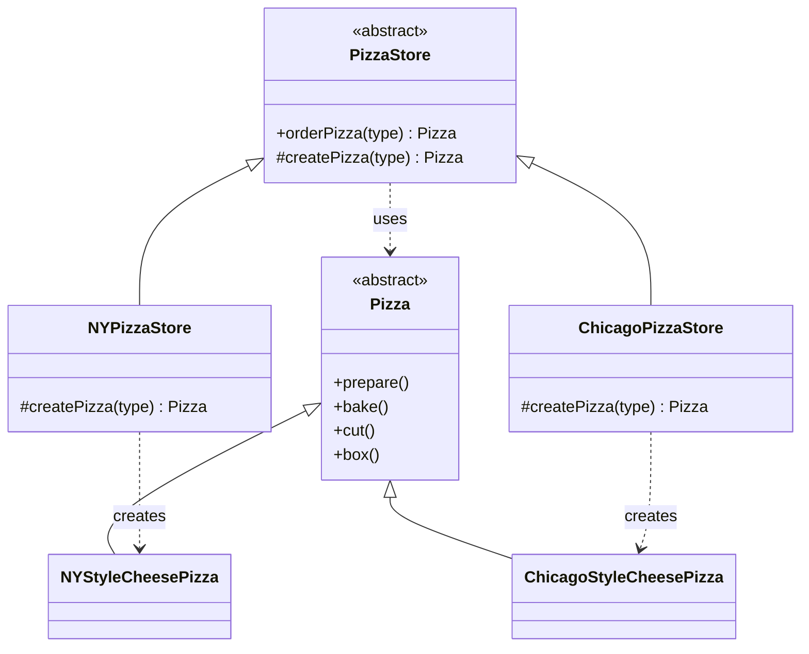
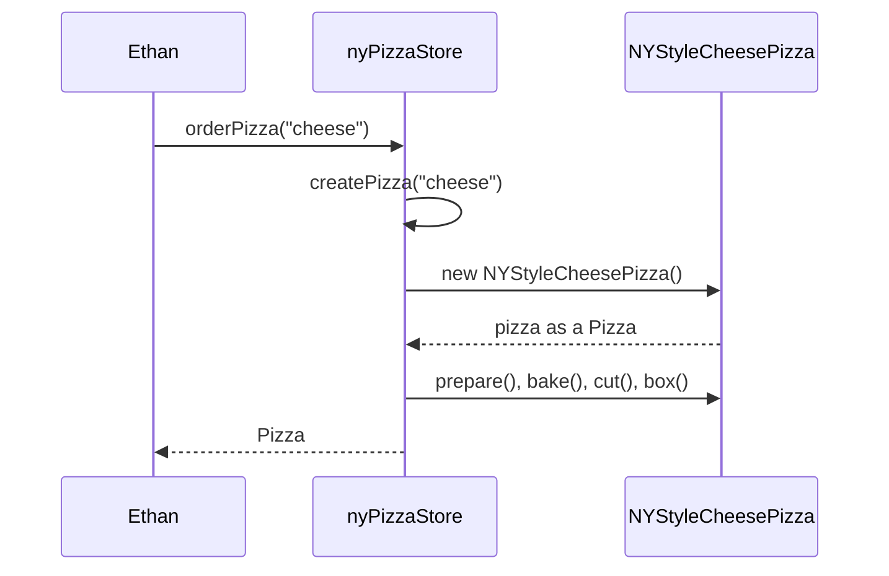
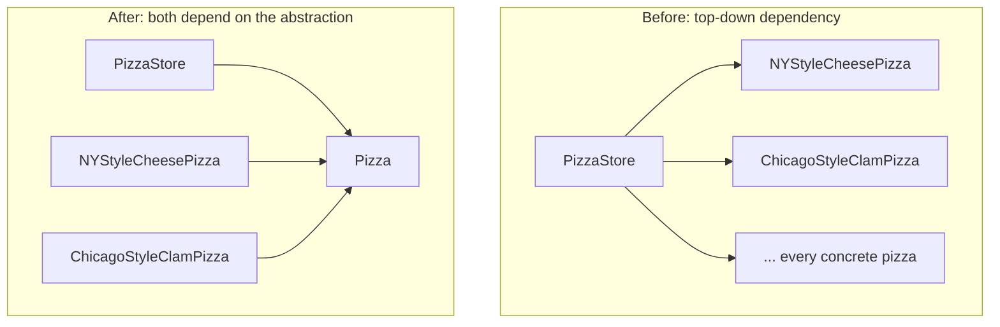
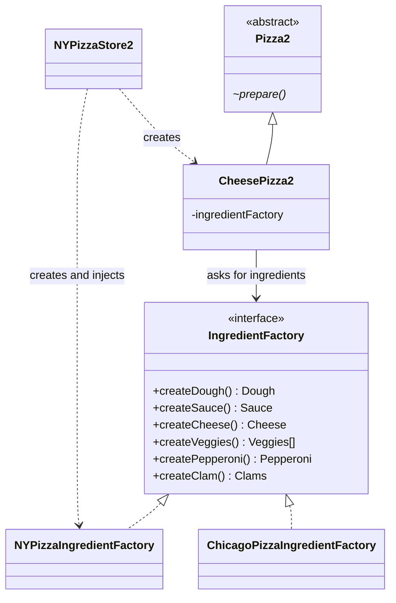

---
tags:
  - design-patterns/factory-method
  - design-patterns/abstract-factory
  - head-first
date: 2026-11-21
chapter: 4
source: "Head First Design Patterns, 2nd ed., ch. 4, printed pp. 109-168"
---

# Chapter 4: Factory Method and Abstract Factory

*Reader: knows Java and basic OOP, has met Strategy and Decorator, wants the chapter's substance fast.* Code runs from [java/](java/); the per-language pattern summary and the Java vs Python vs C++ table live in [README.md](README.md).

> [!abstract] In a nutshell
> **`new` ties you to a concrete class, so move creation out of the code that uses the object. Factory Method does it with inheritance, Abstract Factory with composition.**
>
> | | Factory Method | Abstract Factory |
> |---|---|---|
> | Intent | Let subclasses decide which class to instantiate | Create families of related objects without naming concrete classes |
> | Key idea | Abstract `createPizza()` in the creator | Factory interface with one `create` method per product |
> | Mechanism | Inheritance | Object composition |
> | Use when | You do not know the concrete classes ahead of time | Products must belong together (NY dough + NY sauce) |
>
> Both serve the new principle: depend on abstractions, not concrete classes.

## Why it exists

The book's rule of thumb: "When you see `new`, think concrete" (p. 110).

- `new` is not evil. The problem is **change**.
- Code full of `if/else` over concrete classes is reopened whenever the classes change, so it is not closed for modification (p. 111).

Story: an Objectville pizza shop.

1. `orderPizza(String type)` picks a concrete pizza with `if/else`, then runs `prepare(), bake(), cut(), box()`.
2. Menu changes (add Clam and Veggie, drop Greek) force edits in that method (p. 113).
3. Apply the first principle: separate **what varies** (which pizza to create) from **what stays the same** (prepare, bake, cut, box).

### Step 1: Simple Factory (a warm-up)

Move the `if/else` into `SimplePizzaFactory.createPizza(type)`. `PizzaStore` receives the factory in its constructor and calls it.

- The book calls this an idiom, not a pattern: "Head First Honorable Mention" (p. 117).
- A **static factory** needs no object, but cannot be subclassed to change behaviour (p. 115).

### Step 2: why that is not enough

Franchises in New York, Chicago and California each want a regional style. With one factory object per region, franchisees reused the factory but invented their own baking, skipped cutting and used third-party boxes (p. 119).

You want one fixed process **and** regional freedom. That is Factory Method.

> [!quote] Design principle (p. 139)
> *Depend upon abstractions. Do not depend upon concrete classes.*

## Factory Method

> [!quote] Definition (p. 134)
> The Factory Method Pattern defines an interface for creating an object, but lets subclasses decide which class to instantiate. Factory Method lets a class defer instantiation to subclasses.

Put `createPizza()` back inside `PizzaStore` as an **abstract** method. `orderPizza()` stays in the base class and calls it. Each regional store subclass implements `createPizza()`.



- The creator hierarchy (stores) and product hierarchy (pizzas) run in parallel (p. 132).
- Adding California means one new store plus its four pizza classes (p. 165).

### Roles

| Role | Book name | Repo class |
|---|---|---|
| Creator (abstract) | `PizzaStore` | [PizzaStore.java](java/PizzaStore.java) |
| Factory method | `createPizza()` | abstract in `PizzaStore`, implemented below |
| Concrete creators | `NYPizzaStore`, `ChicagoPizzaStore` | [NYStylePizzaStore.java](java/NYStylePizzaStore.java), [CaliforniaStylePizzaStore.java](java/CaliforniaStylePizzaStore.java) |
| Product (abstract) | `Pizza` | [Pizza.java](java/Pizza.java) |
| Concrete products | `NYStyleCheesePizza`, ... | [NYStyleCheesePizza.java](java/NYStyleCheesePizza.java), [ChicagoStyleCheesePizza.java](java/ChicagoStyleCheesePizza.java) |
| Warm-up (Simple Factory) | `SimplePizzaFactory` | [SamplePizzaFactory.java](java/SamplePizzaFactory.java) (unused by any entry point) |
| "Before" picture | very dependent store | [DependentPizzaStore.java](java/DependentPizzaStore.java) |

The repo spells some names differently from the book (`NYStylePizzaStore` for `NYPizzaStore`, `SamplePizzaFactory` for `SimplePizzaFactory`).

```java
public abstract class PizzaStore {
    public Pizza orderPizza(String type) {
        Pizza pizza = createPizza(type);   // subclass decides the concrete class
        pizza.prepare(); pizza.bake(); pizza.cut(); pizza.box();
        return pizza;
    }
    abstract Pizza createPizza(String type);   // the factory method
}
```

### How an order flows



- `orderPizza()` lives in the abstract class, so it cannot know the concrete pizza. It is decoupled.
- Subclasses do not "decide" at run time. **You** decided by choosing the store; the subclass then determines the product (pp. 122, 134).

### Product detail worth remembering

- `Pizza` holds `name`, `dough`, `sauce` as strings and `toppings` as a list, and implements `prepare/bake/cut/box` (p. 128).
- Chicago cheese pizza overrides `cut()` to cut squares (p. 129). This is the only behavioural difference besides ingredients.
- Run `PizzaShop`: both stores run the same steps and print different names and cut messages.

## Dependency Inversion Principle

Book exercise: the very dependent store in [DependentPizzaStore.java](java/DependentPizzaStore.java) creates every concrete pizza itself.

| Case | Concrete classes it depends on |
|---|---|
| Book version, NY and Chicago, 4 types each | **8** (book answer, p. 166) |
| Add California (4 more) | **12** (book answer, p. 166) |

Every new pizza adds a dependency. Replace it with Factory Method and both the store and the pizzas depend only on `Pizza`.



- **High-level component**: a class whose behaviour is defined using other (low-level) components. `PizzaStore` is high-level, the pizzas are low-level (p. 139).
- DIP is stronger than "program to an interface": **both** high and low level should depend on abstractions.
- **Inversion**: the arrows from store to pizzas flip, and the low-level pizzas now point up at the abstraction. The thinking flips too: start from the `Pizza` abstraction, not from the store (pp. 141-142).

Guidelines to **strive for**, not obey always (p. 143):

| Guideline | Why |
|---|---|
| No variable should hold a reference to a concrete class | `new` binds you to it; use a factory |
| No class should derive from a concrete class | You would depend on it |
| No method should override an implemented method of a base class | The base was not a real abstraction |

> [!tip] Pragmatism
> Instantiating `String` breaks the guidelines and is fine, because `String` is very unlikely to change (p. 143). Use factories for classes likely to change.

## Abstract Factory

Next problem: franchises cut costs with cheaper ingredients (p. 144).

Regions differ (red sauce in New York is not red sauce in Chicago). So each region needs a **family** of ingredients: dough, sauce, cheese, veggies, pepperoni, clams (p. 145).

> [!quote] Definition (p. 156)
> The Abstract Factory Pattern provides an interface for creating families of related or dependent objects without specifying their concrete classes.



### What changed

1. One factory interface, one `create` method per ingredient. Each region implements the whole family: NY gets `ThinCrustDough`, `MarinaraSauce`, `ReggianoCheese`, `FreshClams`; Chicago gets `ThickCrustDough`, `PlumTomatoSauce`, `MozzarellaCheese`, `FrozenClams`. `SlicedPepperoni` is shared (pp. 147-148).
2. `Pizza.prepare()` becomes abstract. Each pizza collects its ingredients from the factory it holds.
3. The store creates the regional factory and passes it to each pizza.
4. The per-region pizza classes disappear. `CheesePizza` is the same for all regions, and only the factory differs (p. 150).

```java
// ClamPizza2.prepare(): the pizza never names a regional class
dough = ingredientFactory.createDough();
sauce = ingredientFactory.createSauce();
cheese = ingredientFactory.createCheese();
clams = ingredientFactory.createClam();   // fresh in NY, frozen in Chicago
```

### How the code maps

| Role | Book name | Repo class |
|---|---|---|
| Abstract factory | `PizzaIngredientFactory` | [IngredientFactory.java](java/IngredientFactory.java) |
| Concrete factories | NY / Chicago | [NYPizzaIngredientFactory.java](java/NYPizzaIngredientFactory.java), [ChicagoPizzaIngredientFactory.java](java/ChicagoPizzaIngredientFactory.java) |
| Abstract products | `Dough`, `Sauce`, `Cheese`, `Veggies`, `Pepperoni`, `Clams` | [Dough.java](java/Dough.java), [Sauce.java](java/Sauce.java), [Clams.java](java/Clams.java), ... |
| Concrete products | `ThinCrustDough`, `FreshClams`, ... | [ThinCrustDough.java](java/ThinCrustDough.java), [FrozenClams.java](java/FrozenClams.java), ... |
| Client (product) | `Pizza` and subclasses | [Pizza2.java](java/Pizza2.java), [CheesePizza2.java](java/CheesePizza2.java), [ClamPizza2.java](java/ClamPizza2.java) |
| Client (creator) | `NYPizzaStore` | [PizzaStore2.java](java/PizzaStore2.java), [NYPizzaStore2.java](java/NYPizzaStore2.java) |
| Demo | | [PizzaShop2.java](java/PizzaShop2.java) |

The repo adds `2` to class names so the Abstract Factory version can sit beside the Factory Method version. Note that Abstract Factory **uses** Factory Method: `PizzaStore2.createPizza()` is still the factory method.

### Java vs Python vs C++ (short)

- Java returns `null` for an unknown type, and Python returns `None`. Both fail later when `prepare()` is called on it.
- C++ returns `std::unique_ptr<Pizza>` (the caller owns the pizza) and shares the factory with `std::shared_ptr`.
- C++ needs virtual destructors on every base class, and gives each marker interface a `toString()`.
- Python factors the duplicated NY/Chicago `if/else` into one helper.

Full table: [README.md](README.md).

## Factory Method vs Abstract Factory

| | Factory Method | Abstract Factory |
|---|---|---|
| Creates | One product (often parameterised, as here) | A family of related products |
| Relies on | Inheritance: extend the creator | Composition: pass a factory object in |
| Interface size | One method | One method per product |
| Adding a product | New subclasses, creator untouched | **Interface must change**, and so must every concrete factory (p. 159) |
| Creator also has | Code that uses the product (`orderPizza`) | Methods that only create products |

- Abstract Factory methods are often implemented as factory methods (p. 158).
- Factory Method is useful even with a single concrete creator, because product and use stay decoupled (p. 135).
- The factory method need not be abstract. A default implementation is allowed (p. 135).
- Factory Method vs Simple Factory: the factory is a subclass that plugs into a framework (`orderPizza`), not a one-shot helper object. Simple Factory cannot vary the product through subclassing (p. 135).

**Advantages:** creation code is in one place, clients depend on abstractions, new products or regions need no change to client code.
**Costs:** more classes and parallel hierarchies, and a parameter as a `String` is not type-safe. A bad name such as "CalmPizza" is a runtime error. Fix with enums, constants or parameter objects (p. 135).

## Common mistakes

| Mistake | What happens | Fix |
|---|---|---|
| Treating `SimplePizzaFactory` as the Factory Method pattern | You get no framework and no subclass variation | Simple Factory is an object you compose. Factory Method is an abstract method you subclass |
| Letting franchises vary the whole process | Skipped steps, wrong boxes (p. 119) | Keep `orderPizza()` in the base class; vary only `createPizza()` |
| Saying subclasses "decide" at run time | Misreads the pattern | The choice is which subclass you instantiate |
| Using Abstract Factory for one product | Large interface for no benefit | Use Factory Method |
| Adding a product to an Abstract Factory casually | Every concrete factory breaks | Plan the family up front, or accept the change |
| Chasing zero `new` everywhere | Over-engineering | Apply DIP where change is likely, not to `String` |
| Not handling an unknown type | `null` pizza, then `NullPointerException` in `orderPizza()` | Validate input or throw in `createPizza()` |

## Check yourself

> [!question] Q1 · `orderPizza()` never uses `new`, yet it creates pizzas. Where is the concrete class chosen, and when?
>
> > [!success] Answer
> > In the subclass's `createPizza()`, called from `orderPizza()`. The real decision happens when you pick `NYPizzaStore` or `ChicagoPizzaStore` to instantiate. `orderPizza()` only sees `Pizza`.

> [!question] Q2 · Franchise owners can change nothing about baking but can change pizza style. Which pattern element enforces this, and how could you make it stricter?
>
> > [!success] Answer
> > `orderPizza()` is defined once in `PizzaStore`, and only the abstract `createPizza()` is left to subclasses. The book notes you could make `orderPizza()` `final` to enforce it (p. 121).

> [!question] Q3 · You add a `createSalami()` method to the ingredient factory. What breaks, and why does Factory Method not have this problem?
>
> > [!success] Answer
> > Every concrete factory (NY, Chicago, any future one) must implement it, because the interface changed. Factory Method has one creation method, so adding a product means adding a product subclass, not changing the creator interface (p. 159).

> [!question] Q4 · A class `ReportPrinter` calls `new PdfExporter()` directly. Does it break DIP, and should you fix it?
>
> > [!success] Answer
> > Yes, it holds a reference to a concrete class. Fix it only if exporters are likely to change or multiply (then use a factory method or an injected abstraction). If it is stable, like `String`, the book says it is acceptable (p. 143).

> [!question] Q5 · In the Abstract Factory version, why does the repo need only one `CheesePizza2` but the Factory Method version needed `NYStyleCheesePizza` and `ChicagoStyleCheesePizza`?
>
> > [!success] Answer
> > The two old pizzas differed only in ingredients, so the ingredient factory now carries the regional difference and the pizza class is shared (p. 150).

## Toolbox recap (p. 162)

- **OO basics:** abstraction, encapsulation, polymorphism, inheritance.
- **Principles:** encapsulate what varies; favor composition over inheritance; program to interfaces, not implementations; strive for loosely coupled designs; open for extension but closed for modification; **new: depend on abstractions, do not depend on concrete classes.**
- **Patterns added:** Factory Method, Abstract Factory (Simple Factory is only an idiom).

## Related

Previous: [[chap3-decorator-notes]] · Next: [[chap5-singleton-notes]] · `orderPizza()` is also a Template Method shape: [[chap8-template-method-notes]]
