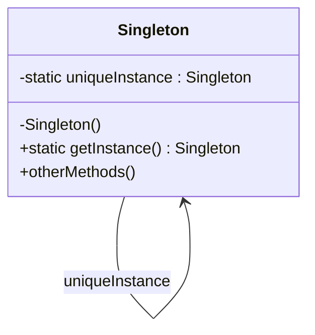
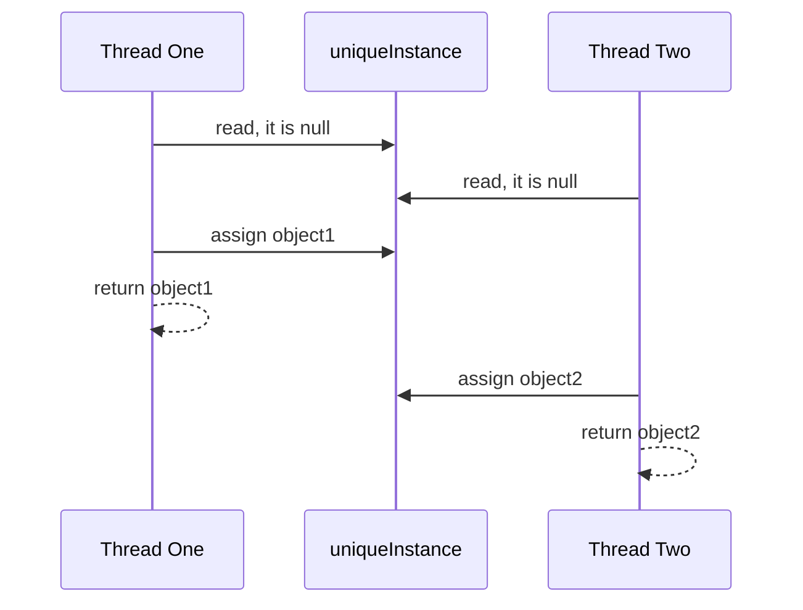
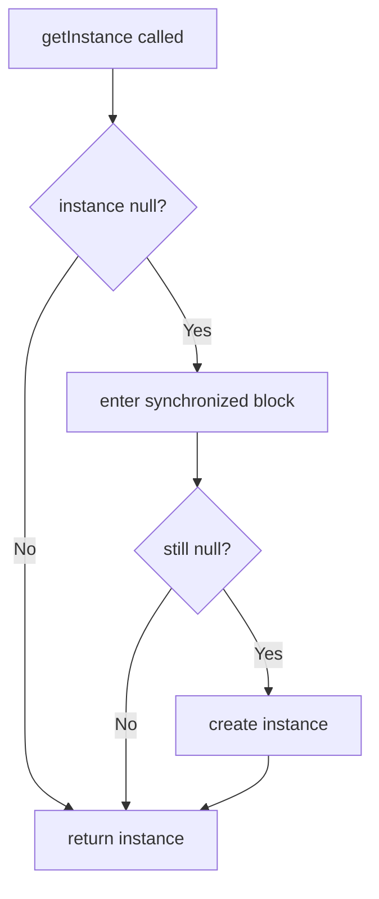

---
tags:
  - design-patterns/singleton
  - head-first
date: 2026-11-21
chapter: 5
source: "Head First Design Patterns, 2nd ed., printed pp. 169-190"
---

# Chapter 5: The Singleton Pattern

Reader: a Java developer who knows classes, `static` and access modifiers, and needs the substance of the chapter fast. Code is in [java/](java/Singleton.java); the Java vs Python vs C++ table is in [README.md](README.md) and is not repeated here.

> [!abstract] In a nutshell
> **Singleton lets a class create exactly one instance of itself and hands that instance out through a global access point. The pattern is easy to draw and hard to get right under threads.**
>
> | Item | Answer |
> |---|---|
> | Intent | "Ensure a class has only one instance, and provide a global point of access to it" (p. 177) |
> | Key idea | private constructor + `static` field + `static getInstance()` |
> | Use when | exactly one is needed: thread pool, cache, dialog, preferences or registry, logger, device driver (p. 170) |
> | Modern Java default | a one-constant `enum` |

## The problem

Choc-O-Holic's `ChocolateBoiler` guards against bad states (p. 175).

- Fill only when empty.
- Boil only when full and unboiled.
- Drain only when boiled.

That protection only works if there is **one** boiler object. Two instances would each hold their own `empty`/`boiled` flags and could, for example, drain 500 gallons of unboiled mixture.

A global variable would give shared access, but two problems remain:

- It cannot stop a second `new`. It gives access, not uniqueness.
- It is created at start-up. If the object is expensive and never used, that is waste. Singleton can create it lazily (p. 170).

The book builds the pattern in steps (pp. 171-173):

1. A **private constructor** means nobody outside can call `new`. But then nobody can ever get an instance.
2. A **static method** belongs to the class, so it can be called without an instance and can reach the private constructor.
3. Combine them, and add a **static field** so the method creates the object only once.

## Structure

The class diagram has a single class (p. 177).



Notice that `Singleton` is still a normal class with its own data and methods; it just also manages its single instance (p. 177).

```java
public static synchronized Singleton getInstance() {
    if (uniqueInstance == null) {          // lazy instantiation
        uniqueInstance = new Singleton();
    }
    return uniqueInstance;
}
```

## Why the classic version breaks: threads

The classic `getInstance()` (without `synchronized`) has a check-then-act gap. Two threads can both see `null` before either assigns (BE the JVM, p. 188):



Two boilers exist, and `fill()` can start while the other boiler is still boiling.

## Four ways to make it thread-safe

| Option | How | Cost / catch |
|---|---|---|
| 1. Synchronize `getInstance()` | add `synchronized` | Simple and always correct. Locks on **every** call, though it is only needed the first time. Can slow a method by a factor of 100 (p. 181) |
| 2. Eager instance | `private static Singleton uniqueInstance = new Singleton();` | JVM creates it at class load, before any thread uses it. Not lazy, so wasteful if never used |
| 3. Double-checked locking | check, then `synchronized (Singleton.class)`, check again; field must be `volatile` | Locks only on first creation. Broken before Java 5 (p. 182). More code |
| 4. `enum` | `enum Singleton { UNIQUE_INSTANCE; }` | Solves threading, class-loading, reflection and serialization issues (p. 185). Cannot extend another class |

Double-checked locking, as in [ChocolateBoiler.java](java/ChocolateBoiler.java):

```java
private static volatile ChocolateBoiler uniqueInstance;
...
if (uniqueInstance == null) {                       // 1st check, no lock
    synchronized (ChocolateBoiler.class) {
        if (uniqueInstance == null) {               // 2nd check, inside lock
            uniqueInstance = new ChocolateBoiler();
        }
    }
}
```

`volatile` stops other threads from seeing a half-built object.



For the boiler the book picks option 1.

- No performance concern, so the simple, guaranteed fix wins.
- Eager would also work, since the boiler is always used.
- Double-checked locking is overkill and needs Java 5+ (p. 190).

## How the code maps

| Role | File |
|---|---|
| Classic lazy, `synchronized` Singleton | [Singleton.java](java/Singleton.java), test [SingletonTest.java](java/SingletonTest.java) |
| Boiler: double-checked locking + `synchronized` methods | [ChocolateBoiler.java](java/ChocolateBoiler.java), test [ChocolateBoilerTest.java](java/ChocolateBoilerTest.java) |
| Enum Singleton | [SingletonEnum.java](java/SingletonEnum.java), [ChocoholicEnum.java](java/ChocoholicEnum.java) |
| Enum clients | [SingletonEnumTest.java](java/SingletonEnumTest.java), [Chocoholic.java](java/Chocoholic.java) |

The boiler's `fill/boil/drain` are also `synchronized`. Thread-safe creation does not make the object's own state changes thread-safe.

Java vs Python vs C++, in short:

- **Python:** a `threading.Lock` in a classmethod, and the constructor privacy is only by convention.
- **C++:** a function-local `static` (Meyers singleton) is thread-safe since C++11, so hand-written locking is unnecessary.
- **Extras:** the Python and C++ folders add a thread demo that Java lacks.

Full table: [README.md](README.md).

## Trade-offs and look-alikes

| Point | Detail |
|---|---|
| Plus | one instance guaranteed; lazy creation; global access |
| Minus: coupling | everything depending on it is tightly coupled to that concrete class; violates "strive for loosely coupled designs" (p. 184) |
| Minus: responsibility | manages its instance **and** does its real job, which stretches the Single Responsibility Principle (p. 184) |
| Minus: subclassing | a private constructor blocks `extends`; making it `protected` breaks uniqueness, and subclasses would share one static field. A registry would be needed (p. 184) |
| vs global variable | a global gives access but cannot limit instances, and is created eagerly (p. 184) |
| vs all-`static` class | works for self-contained classes, but static initialization order bugs get messy (p. 184) |
| Class loaders | each class loader has its own namespace, so two loaders can produce two instances (p. 184) |

Use sparingly: many Singletons are a design smell (p. 184).

## Toolbox

- **OO basics:** abstraction, encapsulation, polymorphism, inheritance (no new ones).
- **Principles:** the six from earlier chapters (encapsulate what varies, composition over inheritance, program to interfaces, loose coupling, open-closed, depend on abstractions). Singleton adds none and bends loose coupling.
- **New pattern:** Singleton, a way to create unique objects.

## Common mistakes

| Mistake | What happens | Fix |
|---|---|---|
| Lazy `getInstance()` with no synchronization | two threads create two instances (the boiler spill) | synchronize, go eager, DCL, or enum |
| DCL without `volatile`, or on Java 1.4 or earlier | a thread sees a half-built object | use `volatile` on Java 5+, or another option |
| Public or package-visible constructor | anyone can call `new` | make it `private` |
| Assuming "one instance" holds across class loaders | one per loader | keep the class in one loader |
| Thinking thread-safe creation protects the object's state | races in `fill()`/`drain()` | `synchronized` instance methods |

## Check yourself

> [!question] Q1 · Why must DCL check for `null` twice?
>
> > [!success] Answer
> > The first check avoids locking once the instance exists (the fast path). Two threads can pass it together; the second check, inside the lock, ensures only the first creates the object.

> [!question] Q2 · Why is the book's recommendation for the boiler the plain `synchronized` method?
>
> > [!success] Answer
> > The boiler has no performance concern, and `synchronized` is simple and guaranteed. Eager would work as well; DCL is overkill and needs Java 5+ (p. 190).

> [!question] Q3 · An enum Singleton is thread-safe, but when would you not use it?
>
> > [!success] Answer
> > When you need lazy creation with a parent class: an enum cannot extend another class. Otherwise it is the simplest option (p. 185).

> [!question] Q4 · A teammate makes the constructor `protected` so tests can subclass it. What breaks?
>
> > [!success] Answer
> > Other classes in the package or subclasses can instantiate it, so uniqueness is lost. Subclasses would also share the one static field.

## Related

Previous: [[chap4-factory-notes]] · Next: [[chap6-command-notes]]
