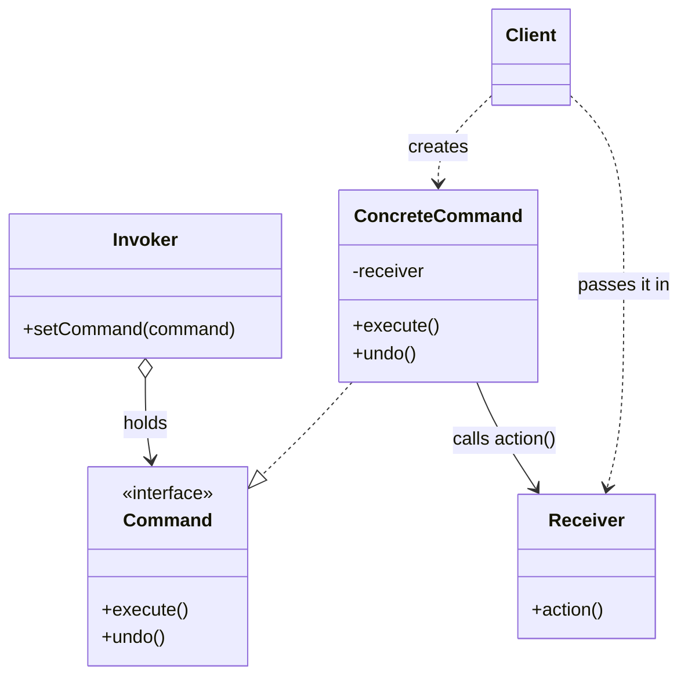
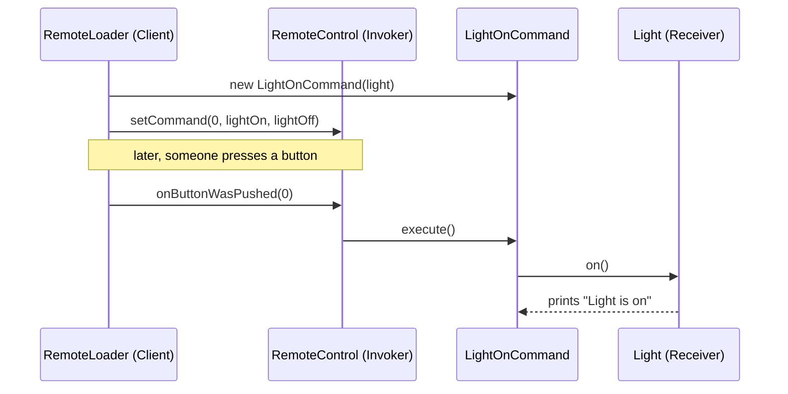
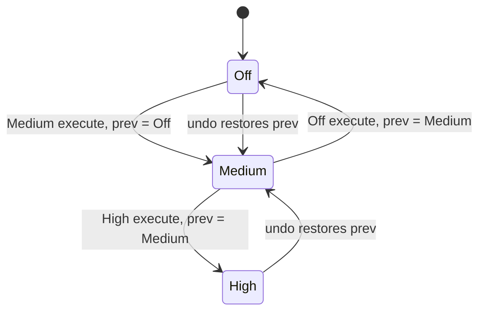

---
tags:
  - design-patterns/command
  - head-first
date: 2026-11-21
chapter: 6
source: "Head First Design Patterns, 2nd ed., pp. 191-236"
---

# Chapter 6: The Command Pattern

*Reader: knows Java and basic OOP (interfaces, composition), wants the chapter's substance fast.*

> [!abstract] In a nutshell
> **Wrap a request ("this receiver, do these actions") in an object with one method, so the code that triggers it never learns who does the work.**
>
> | Item | Summary |
> |---|---|
> | Intent | Decouple the object making a request from the object that performs it |
> | Key idea | A `Command` object binds a receiver to actions and exposes `execute()` |
> | Use when | Slots/buttons hold swappable actions, you need undo, macros, queues or logs |
>
> Once a request is an object, you can store it, pass it, replay it and reverse it.

## The problem

Home Automation or Bust, Inc. wants a remote with 7 programmable slots, an on and off button per slot, and one global undo (p. 192-193). The vendor classes share no interface: `Light.on()`, `Hottub.jetsOn()`, `TV.setInputChannel()`, `Sprinkler.waterOn()`, and more will come (p. 194).

- Naive design: `if (slot1 == Light) light.on(); else if (slot1 == Hottub) hottub.jetsOn() ...`.
- It fails because every new vendor class forces edits to the remote, risking bugs (p. 195).
- The team's split, in Mary's words: a **separation of concerns**. The remote interprets button presses and makes requests; it knows nothing about home automation.

**Principles at work** (listed in the toolbox, p. 233): *encapsulate what varies* (here, the request itself), *program to interfaces*, *strive for loosely coupled designs*, *classes open for extension, closed for modification*.

> [!quote] Definition (p. 206)
> The Command Pattern encapsulates a request as an object, thereby letting you parameterize other objects with different requests, queue or log requests, and support undoable operations.

## The Diner analogy

The book maps a diner onto the pattern (p. 197-202). Memorise the mapping, it is the fastest way to keep the roles straight.

| Diner | Command Pattern | Responsibility |
|---|---|---|
| Customer | Client | Creates the command (order) and sets its receiver |
| Order slip | Command | One method (`orderUp()` / `execute()`), holds the receiver |
| Waitress | Invoker | Takes slips, calls `orderUp()`; does not read them |
| Short-order cook | Receiver | Actually knows how to make the meal |
| `takeOrder()` | `setCommand()` | Loads a command into the invoker |

Notice that the Waitress and Cook never talk: the slip is the only link.

## Structure



Notice that `Invoker` points only at `Command`. The receiver is bound inside the concrete command, so the invoker never sees it.

Runtime order, using the remote:



## How the code maps

| Role | Class | File |
|---|---|---|
| Command | `Command` (`execute`, `undo`) | [Command.java](java/Command.java) |
| Concrete command | `LightOnCommand`, `StereoOnWithCDCommand`, ... | [LightOnCommand.java](java/LightOnCommand.java), [StereoOnWithCDCommand.java](java/StereoOnWithCDCommand.java) |
| Receiver | `Light`, `CeilingFan`, `Stereo`, `GarageDoor` | [Light.java](java/Light.java), [Stereo.java](java/Stereo.java) |
| Invoker (1 slot) | `SimpleRemoteControl` | [SimpleRemoteControl.java](java/SimpleRemoteControl.java) |
| Invoker (7 slots + undo) | `RemoteControl` | [RemoteControl.java](java/RemoteControl.java) |
| Client | `RemoteLoader` | [RemoteLoader.java](java/RemoteLoader.java) |
| Null object | `NoCommand` | [NoCommand.java](java/NoCommand.java) |
| Macro | `MacroCommand` | [MacroCommand.java](java/MacroCommand.java) |
| Lambda command | `LambdaCommand` | [LambdaCommand.java](java/LambdaCommand.java) |

The whole pattern in two snippets: the invoker's side and the command's side.

```java
// RemoteControl: remember it, then run it (undo support)
public void onButtonWasPushed(int slot) {
    undoCommand = onCommands[slot];
    onCommands[slot].execute();
}
// LightOnCommand
public void execute() { light.on(); }
public void undo()    { light.off(); }
```

Language notes (full table in [README.md](README.md)):

- Python uses an `abc.ABC` interface and a shared base class for the fan-speed commands; lambdas are single-expression, so multi-step actions need a nested `def`.
- C++ holds receivers and commands in `std::shared_ptr` because one command sits in both a slot and a macro, and uses `std::function<void()>` for lambda commands.
- C++ has no portable class-name reflection, so each command overrides `name()` for the slot printout that Java does with `getClass().getName()`.

## Beyond the basics

### NoCommand (null object)

A command that does nothing fills every empty slot (and the undo slot), so the remote never writes `if (cmd != null)` (p. 214). The book calls it a *null object*: a surrogate for "no meaningful object", which removes null handling from the client. Pressing undo first is then harmless.

### Undo

`undo()` mirrors `execute()`. The remote stores the **last executed command** and calls its `undo()` (p. 219).

| Case | How `undo()` works |
|---|---|
| Light on/off | Call the opposite action (`on` undoes `off`) |
| Ceiling fan (stateful) | `execute()` saves `prevSpeed = getSpeed()` first; `undo()` restores it |
| Macro | Undo each command in **reverse** order |

Fan trace from the book (p. 223-224): medium, off, undo gives medium again; then high, undo gives medium.



Only the last command is remembered. For multi-level undo, keep a **stack** of executed commands and pop on each undo (p. 228).

### Macro command

A `MacroCommand` is itself a `Command` holding a `Command[]`. `execute()` loops forward; `undo()` loops backward (exercise solution, p. 236). Party mode needs no remote change: build `partyOn` and `partyOff` arrays, wrap each in a macro, and `setCommand(6, ...)`. Why reverse? The last action must be reversed first, like unwinding a stack.

### Queues, logs, and Swing

- **Queue** (p. 229): commands go on a job queue, a fixed pool of threads takes one, calls `execute()`, discards it. The queue never knows what the job does. Fits schedulers, thread pools, job queues.
- **Log** (p. 230): add `store()` and `load()` to `Command`; persist each command as it runs, and after a crash reload and re-`execute()` them in order. Fits spreadsheets or databases that checkpoint rarely. Pointless for a remote.
- **Swing** (p. 231-232): `ActionListener` is a Command interface. Button is the Invoker, `AngelListener`/`DevilListener` are concrete commands, the code that wires them is the Client, and `System` is the Receiver.

### Lambdas

If `Command` has exactly **one** abstract method, a lambda can be the command, so the concrete classes can go (p. 216): `setCommand(0, () -> light.on(), () -> light.off())`. The book says classes drop from 22 to 9. Here `Command` has two methods (`execute`, `undo`), so the repo's `LambdaCommand` wraps two `Runnable`s instead.

## Trade-offs

| Advantage | Cost |
|---|---|
| Invoker and receiver fully decoupled | One small class per action (the "class explosion") |
| Invokers parameterized at runtime, even swapped dynamically | Extra indirection for simple calls |
| Undo, macros, queues, logging come almost free | Undo needs saved state, which can be tricky |
| New vendor device = new command only, remote unchanged | "Smart" commands doing the work themselves lose the decoupling (p. 228) |

A "smart" command that implements the logic itself is allowed, but you lose receiver parameterization (p. 228).

## Toolbox (p. 233)

| Category | Added or reinforced |
|---|---|
| OO basics | abstraction, encapsulation, polymorphism, inheritance |
| OO principles | Encapsulate what varies; favor composition over inheritance; program to interfaces; loose coupling; open-closed; depend on abstractions |
| New pattern | **Command**: encapsulates a request as an object; parameterize clients, queue or log requests, support undo |

The book's bullet points: Command decouples requester from performer; the command object binds receiver plus actions; invokers can be parameterized dynamically; undo restores the state before the last `execute()`; macros are a simple extension; smart commands are common; logging and transactions are other uses.

## Common mistakes

| Mistake | What happens | Fix |
|---|---|---|
| Invoker holds a `Light`/`Stereo` reference | Coupling returns; new devices need remote edits | Invoker stores only `Command` |
| `undo()` without saving prior state in `execute()` | Fan goes to a wrong speed; only works for stateless on/off | Save `prevSpeed` before changing the receiver |
| Macro undo iterates forward | Dependent actions reverse in the wrong order | Loop from the last command to the first |
| Leave empty slots `null` | `NullPointerException` on button press | Fill with `NoCommand` |
| Expect one `undoCommand` to give multi-step undo | Only the last action reverses | Keep a stack of commands |

## Check yourself

> [!question] Q1 · The remote's `undoCommand` points to the last command. Why must `RemoteControl` set it in the button methods and not in `Command`?
>
> > [!success] Answer
> > Undo history is the invoker's concern, not the command's. A command only knows how to reverse itself. The invoker decides which one ran last, and in `RemoteControl` that is recorded in `onButtonWasPushed` and `offButtonWasPushed`.

> [!question] Q2 · `RemoteLoader` builds party mode as a `MacroCommand` over five commands. Why not write a `PartyCommand` class?
>
> > [!success] Answer
> > `PartyCommand` hard-codes its contents. `MacroCommand` takes any `Command[]` at runtime, so you can build many macros with no new class (p. 228).

> [!question] Q3 · Slot 3 holds `CeilingFanHighCommand`. The fan is on low, you press the on button, then undo. What is the final speed, and what if you press undo twice?
>
> > [!success] Answer
> > Press on: `prevSpeed = LOW`, fan goes high. Undo: fan returns to low. Second undo calls `undo()` again with the same saved `prevSpeed`, so the fan stays low. Undo here is not a history.

> [!question] Q4 · Identify the roles when a user clicks a Swing `JButton` with an `ActionListener`.
>
> > [!success] Answer
> > Invoker: the button. Command interface: `ActionListener` (`actionPerformed` is `execute`). Concrete commands: your listener classes. Client: the setup code calling `addActionListener`. Receiver: whatever the listener acts on, such as `System` (p. 232).

> [!question] Q5 · Why would a Java lambda not work directly as the `Command` in this chapter's undo-enabled version?
>
> > [!success] Answer
> > A lambda needs an interface with a single abstract method. After `undo()` is added there are two. Hence the repo's `LambdaCommand` takes two `Runnable`s.

## Related

Previous: [[chap5-singleton-notes]] · Next: [[chap7-adaptive-notes]] · Pattern summary and language comparison: [README.md](README.md)
