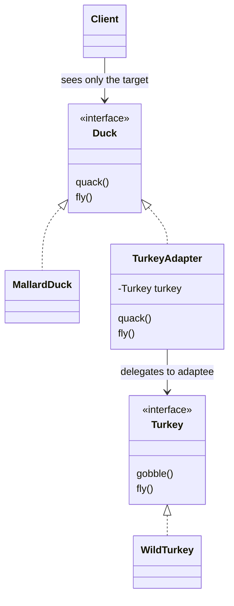
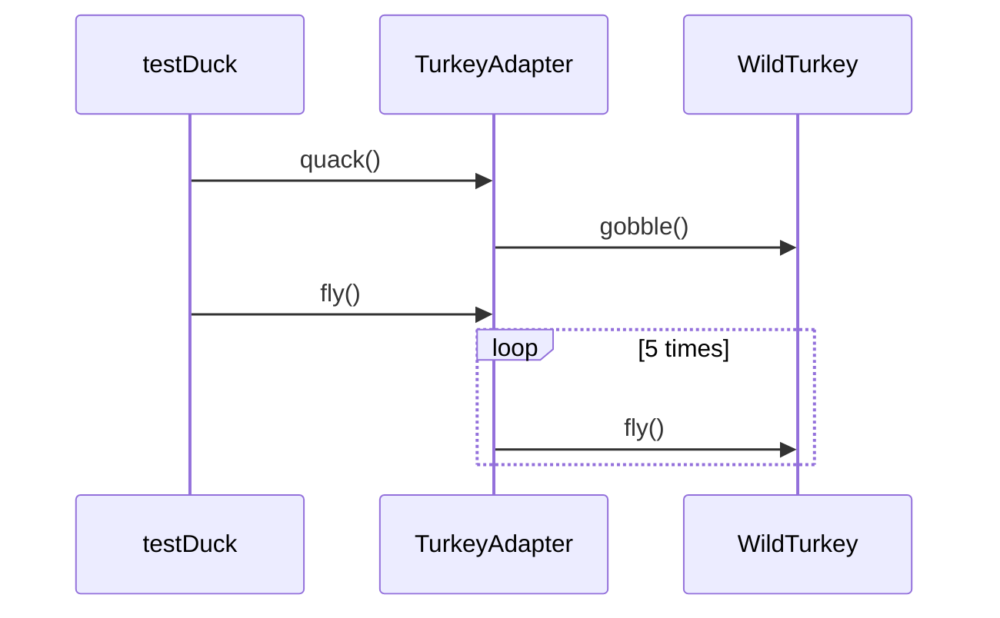
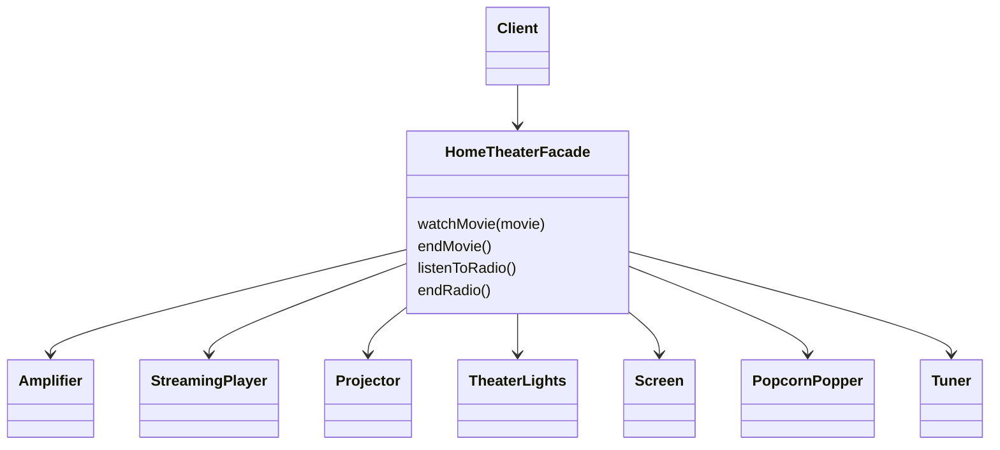

---
tags:
  - design-patterns/adapter
  - design-patterns/facade
  - head-first
date: 2026-11-21
chapter: 7
source: "Head First Design Patterns, 2nd ed., printed pp. 237-276 (Ch. 7, Being Adaptive)"
---

# Chapter 7: Adapter and Facade

Reader: a Java developer who knows interfaces and composition. This note is a quick revision of the chapter. For the pattern summary and the Java / Python / C++ table, see [README.md](README.md).

> [!abstract] In a nutshell
> **Adapter changes an interface into the one a client expects. Facade hides a messy subsystem behind one simple interface. Both wrap objects; they differ in intent.**
>
> | | Adapter | Facade |
> |---|---|---|
> | Intent | Convert one interface into another | Simplify a subsystem |
> | Key idea | Implement the target interface, delegate to the adaptee | Compose the subsystem, expose a few high-level methods |
> | Use when | An existing class has the wrong interface | A set of classes is hard to use or too tightly coupled to the client |
>
> The chapter also adds one principle: **Principle of Least Knowledge** (talk only to your friends).

## 1. The problem

You must use a class (for example a new vendor library) whose interface does not match your code.

You cannot edit the vendor class, and you do not want to rewrite your own code. So you write one new class between them.

The real-world picture is a travel power adapter. The wall outlet, the adapter and the laptop plug are the adaptee, the adapter and the target.

Chapter 3 wrapped objects to **add behaviour** (Decorator). Here we wrap objects to **change or simplify the interface**.

## 2. Adapter

> [!quote] Definition
> **The Adapter Pattern** converts the interface of a class into another interface the clients expect. Adapter lets classes work together that couldn't otherwise because of incompatible interfaces.

The book's example: you are short of `Duck` objects and want to use `Turkey` objects in their place.



Roles: `Duck` is the **Target**, `Turkey` is the **Adaptee**, `TurkeyAdapter` is the **Adapter**.

How a call flows:

1. The client calls a method on the adapter, using the target interface.
2. The adapter translates it into one or more calls on the adaptee.
3. The client gets the result and never knows an adapter is there.



Notice that the client and the adaptee never know each other. That is the decoupling.

### Mapping the code

| Role | File |
|---|---|
| Target | [Duck.java](java/Duck.java) |
| Adaptee | [Turkey.java](java/Turkey.java), [WildTurkey.java](java/WildTurkey.java) |
| Adapter | [TurkeyAdapter.java](java/TurkeyAdapter.java) |
| Client | [DuckTestDrive.java](java/DuckTestDrive.java) |
| Reverse adapter (exercise) | [DuckAdapter.java](java/DuckAdapter.java), [TurkeyTestDrive.java](java/TurkeyTestDrive.java) |
| Real API: Enumeration to Iterator | [EnumerationIterator.java](java/EnumerationIterator.java) |
| Exercise: Iterator to Enumeration | [IteratorEnumeration.java](java/IteratorEnumeration.java) |

```java
public void quack() { turkey.gobble(); }          // simple translation
public void fly() {                                // a turkey only hops,
    for (int i = 0; i < 5; i++) turkey.fly();      // so call it 5 times
}
```

Translation is not always one-to-one. `fly()` has the same name on both interfaces but needs five calls to match a duck's range.

### Two harder cases

- **A method with no equivalent.** `Iterator` has `remove()`, `Enumeration` does not. `EnumerationIterator.remove()` throws `UnsupportedOperationException`. The adapter is imperfect, so clients must be careful and the adapter well documented.
- **The reverse adapter.** The book's `DuckAdapter` calls `duck.fly()` only about one time in five (`rand.nextInt(5) == 0`), because ducks fly much further. The repo's version loops five times instead. Both are valid; the point is that you choose a mapping.

### Object adapter vs class adapter

| | Object adapter | Class adapter |
|---|---|---|
| Mechanism | Composition: holds an adaptee | Multiple inheritance: extends Target and Adaptee |
| Java? | Yes (this chapter) | No, Java lacks multiple inheritance |
| Strength | Works with the adaptee and any of its subclasses | Does not re-implement the whole adaptee; can override its behaviour |
| Weakness | More delegating code | Tied to one concrete adaptee class |

You may also build a **two-way adapter** that implements both interfaces, so old and new code can use the same object.

## 3. Facade

The scenario: a home theater with a streaming player, projector, amplifier, screen, lights, tuner and popcorn popper. Watching a movie by hand is 13 steps over 7 classes.

Turning it all off is the same work in reverse, and listening to the radio is another long routine.

> [!quote] Definition
> **The Facade Pattern** provides a unified interface to a set of interfaces in a subsystem. Facade defines a higher-level interface that makes the subsystem easier to use.



The facade holds each component in an instance variable (composition) and delegates in the right order.

| Role | File |
|---|---|
| Facade | [HomeTheaterFacade.java](java/facade/HomeTheaterFacade.java) |
| Subsystem | [Amplifier.java](java/facade/Amplifier.java), [Projector.java](java/facade/Projector.java), [StreamingPlayer.java](java/facade/StreamingPlayer.java), [TheaterLights.java](java/facade/TheaterLights.java), [Screen.java](java/facade/Screen.java), [PopcornPopper.java](java/facade/PopcornPopper.java), [Tuner.java](java/facade/Tuner.java) |
| Client | [HomeTheaterTestDrive.java](java/facade/HomeTheaterTestDrive.java) |

```java
homeTheater.watchMovie("Raiders of the Lost Ark");  // 13 low-level calls hidden
homeTheater.endMovie();                              // reverse sequence
```

Facts worth remembering:

- The facade does **not** encapsulate the subsystem. Clients that need low-level control can still call the components directly.
- A facade may add its own logic (it knows the popper must be on before it can pop).
- A subsystem can have more than one facade.
- The client depends only on the facade, so upgrading the components changes the facade, not the client.

## 4. Principle of Least Knowledge

> [!quote] Design Principle
> *Principle of Least Knowledge: talk only to your immediate friends.*

It is the same idea as the Law of Demeter. It stops changes in one class from rippling through many coupled classes.

Inside a method, call only methods of:

1. the object itself,
2. objects passed in as parameters,
3. objects the method creates,
4. the object's components (anything held in an instance variable).

Never call methods on an object **returned** by another call.

```java
// Violates: knows House, WeatherStation and Thermometer
return station.getThermometer().getTemperature();

// Obeys: Station answers for its own thermometer
return station.getTemperature();
```

The book's `Car` shows all four legal targets (component `engine`, created `Doors`, parameter `key`, local method). The repo version, [Car.java](java/leastknowledge/Car.java), keeps `Engine`, `Wheels` and `Doors` private, so clients only call `Car`.

Costs: you write more small wrapper methods, which can add complexity and hurt performance. It is guidance, not a law, so weigh it against other trade-offs. The book's own example of a violation: `System.out.println()`.

The facade fits here: the client has only one friend, `HomeTheaterFacade`.

## 5. Look-alikes compared

| Pattern | Wraps | Interface | Intent |
|---|---|---|---|
| Decorator | one object | **same** | Add responsibility |
| Adapter | one or more objects | **changed** to what the client expects | Convert |
| Facade | many objects (a subsystem) | **simplified** | Simplify and decouple |

The number of wrapped classes does **not** tell Adapter from Facade.

Intent does. An adapter can wrap several adaptees; a facade can wrap one class.

## 6. Toolbox for this chapter

- **OO basics:** abstraction, encapsulation, polymorphism, inheritance.
- **Principles:** encapsulate what varies; favour composition over inheritance; program to interfaces; loose coupling; open-closed; depend on abstractions; **new: talk only to your friends**.
- **Patterns added:** **Adapter** (convert an interface) and **Facade** (simplify a subsystem).

Java vs Python vs C++:

- Target type: Java `interface`, Python `ABC`, C++ abstract class.
- C++ adapter holds the adaptee through `shared_ptr` (or `unique_ptr` when it owns it).
- Python's `_name` privacy is only a convention.
- Full table: [README.md](README.md#java-vs-python-vs-c-in-this-chapter).

## Common mistakes

| Mistake | What happens | Fix |
|---|---|---|
| Hiding a facade-style sequence in an "adapter" | The pattern's intent is lost; readers misjudge the design | Ask: convert an interface (Adapter) or simplify a subsystem (Facade)? |
| Ignoring methods with no equivalent | Silent wrong behaviour | Throw `UnsupportedOperationException` and document it |
| Mapping `fly()` one-to-one | The adapter behaves unlike the target | Decide what equivalent behaviour means (the loop of 5 calls) |
| Treating a facade as a wall | Advanced users are blocked | Leave the subsystem reachable |
| "Fixing" `a.getB().c()` with a pass-through helper | The coupling is still there | Add a method on `a` that does the work |
| Chaining calls on returned objects everywhere | Changes cascade through many classes | Delegate through the object you already know |

## Check yourself

> [!question] Q1 · Why is a decorator not "just an adapter"?
>
> > [!success] Answer
> > Both wrap an object, but a decorator keeps the interface and adds behaviour. An adapter always changes the interface and is mostly a pass-through translation.

> [!question] Q2 · A class wraps six classes and gives clients one `start()` method. Adapter or Facade?
>
> > [!success] Answer
> > Facade, because its goal is to simplify. Wrapping many classes does not make it an adapter. If it instead made them match an existing interface the client was coded against, it would be an adapter.

> [!question] Q3 · `Iterator.remove()` has no `Enumeration` counterpart. Why does `EnumerationIterator` throw rather than do nothing?
>
> > [!success] Answer
> > Doing nothing would hide a failed removal. The `Iterator` contract allows `UnsupportedOperationException`, so throwing is honest and legal. The book calls this an imperfect adapter that clients must watch for.

> [!question] Q4 · Does the second `House.getTemp()` in the book (with `getTempHelper(thermometer)`) obey least knowledge?
>
> > [!success] Answer
> > The book says it technically does not violate the principle, but admits it looks like hacking around it. The object still got a thermometer from `station`, so the coupling remains.

> [!question] Q5 · A client calls `watchMovie()` but your upgraded projector has a new API. What changes?
>
> > [!success] Answer
> > Only `HomeTheaterFacade`. The client knows just the facade, which is the decoupling benefit.

## Related

Previous: [[chap6-command-notes]] · Next: [[chap8-template-method-notes]] · Pattern summary: [README.md](README.md)
