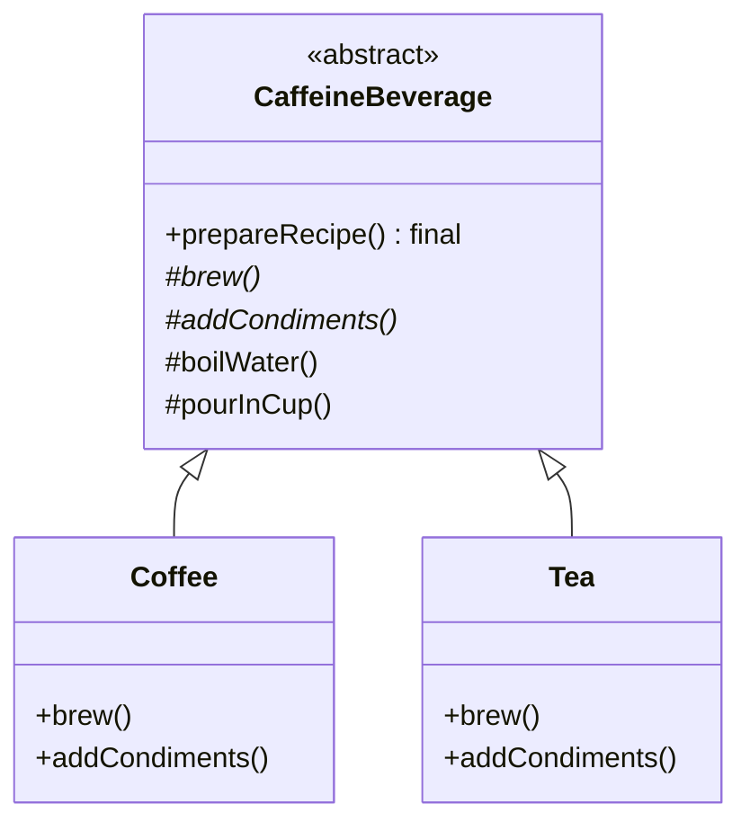
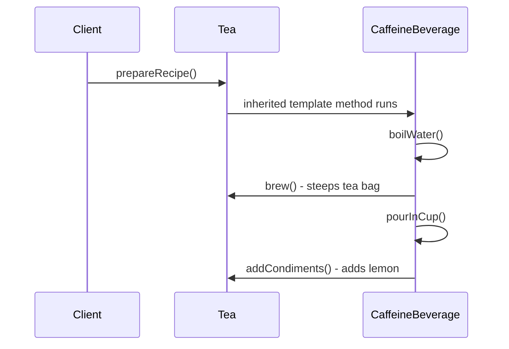
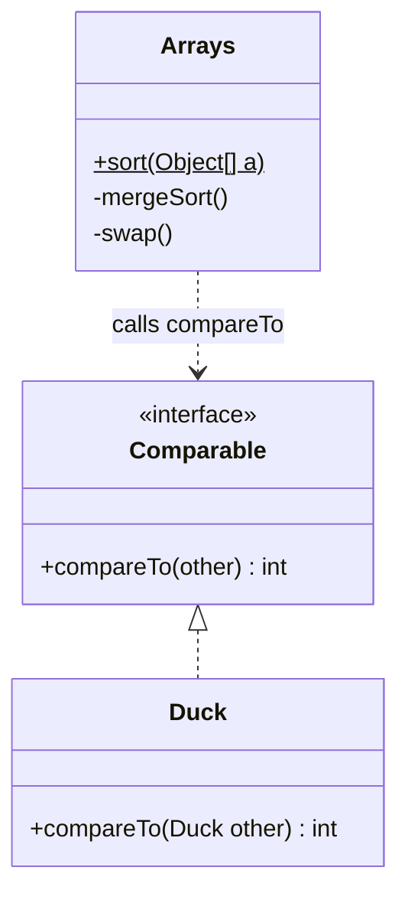

---
tags:
  - design-patterns/template-method
  - head-first
date: 2026-11-21
chapter: 8
source: "Head First Design Patterns, 2nd ed., printed pp. 277-316"
---

# Chapter 8: Template Method Pattern

Reader: a Java developer who knows classes, inheritance and abstract methods, and wants the chapter's substance fast. Code lives in [java/](java/); the language comparison lives in [README.md](README.md).

> [!abstract] In a nutshell
> **Put the fixed steps of an algorithm in one `final` method of an abstract base class, and let subclasses fill in only the steps that vary.**
>
> | Item | Summary |
> |---|---|
> | Intent | Define the skeleton of an algorithm in a method, deferring some steps to subclasses |
> | Key idea | The base class controls the order ("Don't call us, we'll call you"); subclasses only supply steps |
> | Use when | Several classes share the same algorithm shape and differ in a few steps |
> | Tool | Inheritance (Strategy does the same job with composition) |
>
> Remember three kinds of step: abstract (must override), concrete (shared), hook (optional override).

## Why it exists

Starbuzz baristas follow two recipes (p. 278):

| Step | Coffee | Tea |
|---|---|---|
| 1 | Boil water | Boil water |
| 2 | Brew coffee grinds | Steep tea bag |
| 3 | Pour in cup | Pour in cup |
| 4 | Add sugar and milk | Add lemon |

The naive `Coffee` and `Tea` classes each had their own `prepareRecipe()`, and `boilWater()` and `pourInCup()` were copied word for word.

The book's first fix moves only those two methods into a `CaffeineBeverage` superclass. That helps, but the recipe order is still duplicated, so the subclasses "run the show" (p. 290).

The second step: notice that the algorithm is the same and only steps 2 and 4 differ. Rename them to the generic `brew()` and `addCondiments()`, and move the whole `prepareRecipe()` up.

> [!quote] Definition (p. 291)
> The Template Method Pattern defines the skeleton of an algorithm in a method, deferring some steps to subclasses. Template Method lets subclasses redefine certain steps of an algorithm without changing the algorithm's structure.

## Structure



`prepareRecipe()` is the template method. It is a template because each algorithm step is a method call.

The generic names in the book's diagram are `AbstractClass`, `templateMethod()`, `primitiveOperation1/2()` and `ConcreteClass` (p. 291).

How a call runs (book "Behind the Scenes", p. 289): the client calls the template method, which calls back into the subclass.



Notice that control flows from base class to subclass, never the reverse.

### Three kinds of step (pp. 292-293)

| Kind | In the base class | Subclass | Example |
|---|---|---|---|
| Abstract (primitive) operation | declared `abstract` | must implement | `brew()`, `addCondiments()` |
| Concrete operation | implemented, may be `final` | may reuse | `boilWater()`, `pourInCup()` |
| Hook | empty or default body | may override | `customerWantsCondiments()` returns `true` |

## Hooks

A hook is declared in the abstract class with an empty or default body, so a subclass may "hook into" the algorithm or ignore it (p. 294). Uses named by the book (p. 297):

- make a step optional (the beverage example);
- let a subclass react just before or after a step, for example a `justReorderedList()` hook that redisplays a list;
- let the subclass decide whether part of the algorithm runs at all.

Abstract method or hook? (p. 297)

- Abstract: a subclass **must** supply the step.
- Hook: the step is optional.

```java
// CaffeineBeverageWithHook.java: the hook gates a step
final void prepareRecipe() {
    boilWater(); brew(); pourInCup();
    if (customerWantsCondiments()) { addCondiments(); }
}
boolean customerWantsCondiments() { return true; }   // default hook
```

`CoffeeWithHook` and `TeaWithHook` override the hook to ask the user on stdin.

## How the code maps

| Role | File |
|---|---|
| Abstract class and template method | [CaffieneBeverage.java](java/CaffieneBeverage.java) (the typo is kept across the repo) |
| Concrete classes | [Coffee.java](java/Coffee.java), [Tea.java](java/Tea.java) |
| Template with a hook | [CaffeineBeverageWithHook.java](java/CaffeineBeverageWithHook.java) |
| Hook overridden | [CoffeeWithHook.java](java/CoffeeWithHook.java), [TeaWithHook.java](java/TeaWithHook.java) |
| Client | [BeverageTestDrive.java](java/BeverageTestDrive.java) |
| Template method in the wild | [Duck.java](java/Duck.java), [DuckSortTestDrive.java](java/DuckSortTestDrive.java) |
| Hook in the wild | [MyFrame.java](java/MyFrame.java) |
| Abstract methods in the wild | [MyStringList.java](java/MyStringList.java), [MyStringListTestDrive.java](java/MyStringListTestDrive.java) |

Java vs Python vs C++ (full table in [README.md](README.md)):

- Java uses `final` on the template method. Python's `@typing.final` is only checked by type checkers. C++ uses a non-virtual public method.
- Steps and hooks are `protected virtual` in C++, so callers cannot invoke them directly.
- C++ needs `std::stable_sort` to match Java's stable sort for ducks; Python's `list.sort()` is stable.
- The repo's `MyFrame` is simulated in Python and C++ (no GUI).

## Template Method in the wild (pp. 301-309)

The book's lesson: real code rarely matches the textbook, so recognize variations.



| Example | Template (fixed algorithm) | Step the user supplies |
|---|---|---|
| `Arrays.sort()` | merge sort loop, `swap()` | `Comparable.compareTo()` on your type |
| `AbstractList` | `subList()` | `get()` and `size()` (plus `set()` to make it writable) |
| `JFrame` | screen update algorithm | `paint()` hook, empty by default |
| `InputStream` | `read(byte[], int, int)` | abstract `read()` |

`Arrays.sort()` is static, so there is no subclassing. Arrays cannot be subclassed, and one sort should work for every array, so the missing step comes from the items through `Comparable` (p. 307).

Weights in [DuckSortTestDrive.java](java/DuckSortTestDrive.java): Dewey, Louie and Huey all weigh 2, and they come out in their original order because the sort is stable.

## Hollywood Principle

> [!quote] The Hollywood Principle (p. 298)
> Don't call us, we'll call you.

It prevents **dependency rot**: high-level components depend on low-level ones, which depend back on high-level ones, until no one can follow the design.

Low-level components may hook in, but high-level components decide when and how they are called. A low-level component may still call upward through inheritance; the book only warns against explicit circular dependencies (p. 300).

Hollywood vs Dependency Inversion: both aim at decoupling.

- DIP is the broader rule: depend on abstractions.
- Hollywood is a framework technique: low-level parts plug in without depending on the layers above (p. 300).

Other patterns that use it: Factory Method and Observer (p. 299).

## Compared with look-alikes

| Pattern | Mechanism | Who owns the algorithm | Flexibility |
|---|---|---|---|
| Template Method | Inheritance | Base class defines structure, subclasses fill steps | Fixed at compile time; fewer objects, no duplicated code |
| Strategy | Composition | Each strategy object is a **complete** algorithm | Swappable at runtime; more objects |
| Factory Method | Inheritance (specialization of Template Method) | Subclass decides which class to create | A primitive operation creates and returns an object |

Fireside chat (pp. 310-311):

- Template Method claims more control and no duplicated code (shared code sits in the superclass).
- Strategy claims more flexibility (runtime swap) and fewer dependencies, since it runs the whole algorithm itself.

Tie-breaker for sort: `Arrays.sort()` leaves a **missing** piece (`compareTo`) rather than being a whole swappable algorithm, so it is Template Method in spirit (p. 307).

## Tradeoffs

| Advantages | Disadvantages |
|---|---|
| Algorithm lives in one place; changes happen once | Relies on inheritance, so it is less flexible than composition |
| Subclasses reuse the shared code | Subclasses depend on the base class's steps |
| Good for frameworks: base class controls the flow | Many abstract steps make subclasses a chore; the book says to avoid over-granular steps, at the cost of flexibility (p. 297) |
| New variants need only a couple of methods | Easy to misuse hooks and weaken the fixed order |

## Toolbox (p. 313)

| Group | Items |
|---|---|
| OO basics | abstraction, encapsulation, polymorphism, inheritance |
| New principle | Don't call us, we'll call you |
| Earlier principles | Encapsulate what varies; favor composition over inheritance; program to interfaces; loose coupling; open-closed; depend on abstractions; talk only to your friends |
| New pattern | Template Method |

## Common mistakes

| Mistake | What happens | Fix |
|---|---|---|
| Template method not `final` | A subclass reorders or skips steps, breaking the algorithm | Declare it `final` (p. 291) |
| Making an optional step abstract | Every subclass must write an empty method | Make it a hook with a default |
| Making a mandatory step a hook | A subclass silently forgets it | Make it abstract |
| Putting the step order in each subclass | Duplication returns and the algorithm is spread out again | Keep one fixed order in the base class; vary only the steps |
| Too many fine-grained abstract steps | Subclasses become a big chore to write | Coarser steps, or hooks for optional ones (p. 297) |
| Treating `Arrays.sort()` as "not Template Method" because there is no subclass | Missing a real, common usage | Look for an algorithm with a missing piece, however supplied |

## Check yourself

> [!question] Q1 · `CaffeineBeverage` has `final void prepareRecipe()`. What breaks if `final` is removed?
>
> > [!success] Answer
> > Nothing fails to compile, but a subclass could override `prepareRecipe()` and change the order or drop a step. The pattern's guarantee ("without changing the algorithm's structure") is lost.

> [!question] Q2 · You need an optional "add whipped cream" step. Abstract method or hook? Why?
>
> > [!success] Answer
> > A hook, for example `boolean wantsWhip() { return false; }` with the base class calling `addWhip()` only when true. Abstract would force `Tea` to implement a step it never uses.

> [!question] Q3 · Why is `Arrays.sort()` still considered Template Method with no subclass?
>
> > [!success] Answer
> > The sort algorithm is incomplete: it needs `compareTo()` from the element type. The call goes from the framework to your code. Arrays cannot be subclassed, so the designers used a static method plus the `Comparable` interface.

> [!question] Q4 · When would you pick Strategy over Template Method for the beverage recipe?
>
> > [!success] Answer
> > When the algorithm must change at runtime, or one object needs different whole algorithms over its lifetime. Strategy swaps a complete algorithm object; Template Method fixes the choice when you pick the subclass.

> [!question] Q5 · Where does the Hollywood Principle show up in `MyFrame`?
>
> > [!success] Answer
> > You never call `paint()`. The toolkit's screen update calls it when it needs to draw, and `MyFrame` only supplies the hook body.

## Related

Previous: [[chap7-adaptive-notes]]. Next: [[chap9-iterator-composite-notes]].
