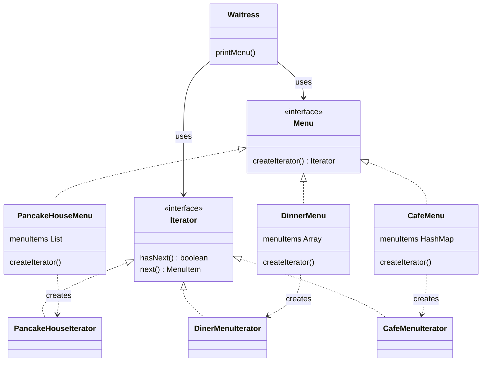
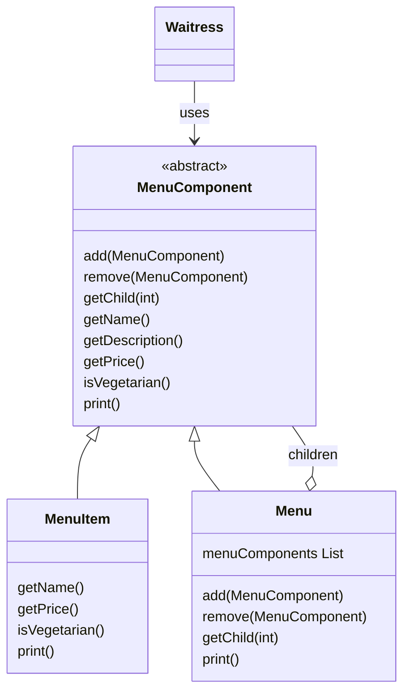
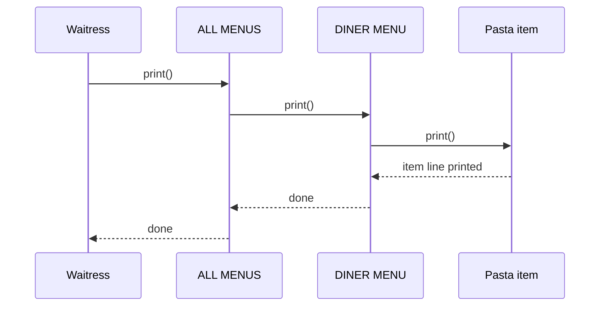

---
tags:
  - design-patterns/iterator
  - design-patterns/composite
  - head-first
date: 2026-11-21
chapter: 9
source: "Head First Design Patterns, 2nd ed., printed pp. 317-380"
---

# Chapter 9: Iterator and Composite Patterns

Reader: a Java developer who knows interfaces, `ArrayList` and recursion, and wants the chapter's substance fast. Code lives in [java/](java/); the Java vs Python vs C++ comparison lives in [README.md](README.md).

> [!abstract] In a nutshell
> **Iterator hides how a collection stores things; Composite lets you treat one item and a whole tree of items with the same calls.**
>
> | Item | Iterator | Composite |
> |---|---|---|
> | Intent | Access the elements of an aggregate sequentially without exposing its representation | Compose objects into trees of part-whole hierarchies; treat parts and wholes uniformly |
> | Key idea | Move traversal out of the collection into an iterator object | Leaf and node share one interface; a node forwards a call to its children |
> | Use when | Clients must walk collections of different shapes | Data is naturally a tree (menus, submenus, items) |
> | Principle | Single Responsibility | Trades SRP for transparency |
>
> Iterator solved "many collection types". Composite solved "menus inside menus", which iterators alone could not.

## The scenario

Objectville Diner and Objectville Pancake House merge (p. 318). Both use the same `MenuItem` (name, description, vegetarian flag, price), but store the menu differently, and neither chef will rewrite his code.

| Menu | Storage | Accessor |
|---|---|---|
| Pancake House (Lou) | `ArrayList<MenuItem>` | `getMenuItems()` returns the list |
| Diner (Mel) | `MenuItem[]` with a max of 6 | `getMenuItems()` returns the array |

The Java-enabled Waitress must print menus, print vegetarian items and check one item (p. 322).

### Why the first attempt fails

Calling `getMenuItems()` on each menu returns two different types, so `printMenu()` needs one loop per type (p. 323).

The book's "Sharpen your pencil" answers (p. 377): A, C, D and E apply.

- A: coded to concrete menu classes, not an interface.
- C: switching a menu to a hash table means editing the Waitress.
- D: the Waitress must know each menu's internal collection, which breaks encapsulation.
- E: duplicate loops, and a third menu means a third loop.

B (a "Java Waitress API") and F ("MXML") are distractors.

## Iterator: encapsulate the iteration

Book's reasoning: "encapsulate what varies" (p. 325). What varies is how you step through the collection (`get(i)` on a list, `items[i]` on an array).

Wrap that in an object with two methods, and the loop is identical everywhere.

```java
Iterator iterator = menu.createIterator();
while (iterator.hasNext()) {
    MenuItem item = iterator.next();   // same code for list, array, map
}
```

> [!note] Official definition (p. 338)
> **The Iterator Pattern** provides a way to access the elements of an aggregate object sequentially without exposing its underlying representation.

Two effects:

- The client writes polymorphic code that works with any aggregate.
- Traversal belongs to the iterator, not the aggregate, so the aggregate stays simple.

**Collection** and **aggregate** both mean "a group of objects", whatever the storage (p. 327).

### Structure



Notice that the Waitress knows only `Menu` and `Iterator`. Each concrete menu creates the iterator that fits its own storage, which is a Factory Method (the book's Brain Power hint, p. 339: "a subclass decides which object to create").

### How it evolved in the chapter

| Step | Change | Result (page) |
|---|---|---|
| 1 | Own `Iterator` interface, plus `DinerMenuIterator` for the array | One loop in `Waitress`; chefs only add `createIterator()` (pp. 328-332) |
| 2 | Add a common `Menu` interface (only `createIterator()`) | Waitress no longer depends on concrete menus (p. 336) |
| 3 | Switch to `java.util.Iterator` | `ArrayList` already has `iterator()`, so `PancakeHouseMenuIterator` is deleted (p. 335) |
| 4 | Add `CafeMenu` (a `HashMap`) | Return `menuItems.values().iterator()`; one more `createIterator()` call in the Waitress (p. 348) |

> [!warning] Java arrays are not Iterable
> `Iterable` enables the enhanced for loop and `forEach`. `ArrayList` is `Iterable`; an array is not, so `printMenu(Iterable<MenuItem>)` fails to compile for the Diner (p. 345). That is why `DinerMenuIterator` is still hand-written.

`remove()` is optional on `java.util.Iterator`. If a menu should not allow it, throw `UnsupportedOperationException` (p. 334).

Q&A from p. 342: iterators here are **external** (the client calls `next()`; an internal iterator takes an operation and loops itself), and iterators imply no ordering, so never assume one for a `HashMap`.

## Single Responsibility Principle

> [!note] Design principle (p. 340)
> *A class should have only one reason to change.*

If an aggregate also handled iteration, it would change when the collection changes and when the way of iterating changes: two reasons. Giving traversal to the iterator keeps one responsibility per class.

**Cohesion** measures how closely a class supports one purpose; SRP-following classes tend to have high cohesion (p. 340).

## From Iterator to Composite

With three menus the Waitress still makes three `createIterator()` calls, so every new menu means editing her (p. 355, an Open Closed violation). A `List<Menu>` fixes that (p. 356).

Then the Diner wants a **dessert submenu** inside its menu. A `MenuItem[]` cannot hold a menu, so the list approach breaks (p. 357). The book decides to rework the design. It needs:

- a **tree** for menus, submenus and items;
- traversal at least as convenient as iterators;
- flexible traversal: just the dessert menu, or the whole Diner menu including it (p. 358).

## Composite: one interface for leaf and node

> [!note] Official definition (p. 360)
> **The Composite Pattern** allows you to compose objects into tree structures to represent part-whole hierarchies. Composite lets clients treat individual objects and compositions of objects uniformly.

Terms: a **node** (composite) has children; a **leaf** has none. Menus are nodes, `MenuItem`s are leaves. Calling an operation on the root applies it to the whole tree; calling it on a leaf applies to one part.



Notice the `Menu` to `MenuComponent` link: a node holds components, and each may be another node. That is the recursion.

### The key trick: recursive print()

A first `Menu.print()` that only printed its own name was wrong: a composite's `print()` must print everything it contains (p. 367). The fix is to delegate; each child prints itself, and a sub-menu starts its own loop.

```java
public void print() {                       // Menu2.print()
    System.out.println(getName() + ", " + getDescription());
    for (MenuComponent c : menuComponents) {
        c.print();                          // item prints itself, menu recurses
    }
}
```

The Waitress shrinks to `allMenus.print()` (p. 368).



### Safe default methods

`MenuComponent` gives every method a default that throws `UnsupportedOperationException`. A leaf overrides only what makes sense (no `add`), a `Menu` skips `getPrice()` and `isVegetarian()` (p. 364).

## How the code maps

Two test drives: `MenuTestDrive` (Iterator version) and `MenuTestDrive2` (Composite version).

| Role | Iterator version | Composite version |
|---|---|---|
| Client | [Waitress.java](java/Waitress.java) | [Waitress2.java](java/Waitress2.java) |
| Aggregate interface / Component | [Menu.java](java/Menu.java) | [MenuComponent.java](java/MenuComponent.java) |
| Concrete aggregates / Composite | [PancakeHouseMenu.java](java/PancakeHouseMenu.java), [DinnerMenu.java](java/DinnerMenu.java), [CafeMenu.java](java/CafeMenu.java) | [Menu2.java](java/Menu2.java) |
| Iterator interface | [Iterator.java](java/Iterator.java) | not used |
| Concrete iterators | [PancakeHouseIterator.java](java/PancakeHouseIterator.java), [DinerMenuIterator.java](java/DinerMenuIterator.java), [CafeMenuIterator.java](java/CafeMenuIterator.java) | not used |
| Leaf item | [MenuItem.java](java/MenuItem.java) | [MenuItem2.java](java/MenuItem2.java) |
| Entry point | [MenuTestDrive.java](java/MenuTestDrive.java) | [MenuTestDrive2.java](java/MenuTestDrive2.java) |

Two repo details differ from the book text:

- The repo uses its **own** `Iterator` interface (no `remove()`), not `java.util.Iterator`. `CafeMenuIterator` wraps `items.values().iterator()` to adapt Java's iterator to it.
- `DinerMenuIterator.hasNext()` also checks `items[position] != null`, because the array is pre-allocated and unused slots are `null`.

The `Alternating*` iterators are the book's Code Magnets exercise (step by 2); the test drives do not use them.

Python adds `__iter__`/`__next__` so `for item in menu` works; C++ iterators hold non-owning pointers, so the menu must outlive them; `CafeMenu` order depends on Java's `HashMap` hashing, which Python and C++ replay with a helper. Details: [README.md](README.md).

## Key points and tradeoffs

| | Iterator | Composite |
|---|---|---|
| Gains | Client decoupled from storage; one loop for all; aggregate stays simple | Client ignores leaf vs node; one call acts on a whole tree; no `if` type checks |
| Costs | One extra class per storage type (unless the library provides one) | Component interface is "too wide" for leaves; wrong calls fail at runtime |
| Watch for | Do not assume order; `remove()` is optional | Child order, parent pointers, caching (below) |

### Transparency vs safety (p. 371)

Composite puts child management and leaf operations in one `Component`. The book says it **trades Single Responsibility for transparency**: the client cannot tell leaf from node.

The price is lost **safety**: a client may call `add()` on a leaf. The safer alternative uses separate interfaces and casts in the client, which loses transparency. Both are still Composite (pp. 372-373).

Implementation issues from the interview (pp. 372-373):

| Issue | Idea |
|---|---|
| Nonsense method on a leaf | Do nothing, return null/false, or throw; or pick defaults that make sense (a leaf's `getChild()` could mean "no children") |
| Parent pointers | Make traversal and deleting a child easier |
| Ordering of children | Needs a more careful add/remove and traversal scheme |
| Caching | Store results of costly whole-tree computations |

### Look-alikes

Iterator and Composite differ from Adapter (changes an interface) and Facade (simplifies the interface of a group of classes); the book's matching exercise is on p. 375.

The two cooperate: the enhanced for loop inside `Menu.print()` uses an iterator behind the scenes (p. 367). Composite is a new design for the menus, not a transformed iterator (p. 362).

## Tools for your toolbox (p. 376)

- **OO basics:** abstraction, encapsulation, polymorphism, inheritance.
- **Principles so far:** encapsulate what varies; favour composition over inheritance; program to interfaces; loose coupling; open-closed; depend on abstractions; only talk to your friends; Hollywood principle; **new: a class should have only one reason to change.**
- **New patterns:** **Iterator** (sequential access without exposing representation) and **Composite** (tree of part-whole hierarchies, uniform treatment).

## Common mistakes

| Mistake | What happens | Fix |
|---|---|---|
| Exposing `getMenuItems()` after adding iterators | Clients still see the storage; encapsulation is lost | Delete it; expose only `createIterator()` |
| Menu `print()` prints only its own header | Sub-menus and items never print | Loop over children and call `print()` on each |
| Calling `add()` on a leaf or `getPrice()` on a menu | `UnsupportedOperationException` | Know which type you hold, or use the safer design |
| Putting traversal methods inside the aggregate | Class has two reasons to change | Keep traversal in an iterator |

## Check yourself

> [!question] Q1 · The Waitress depends only on `Menu` and `Iterator`. What exactly must a new menu (say, a `LinkedList`) provide, and does the Waitress change?
>
> > [!success] Answer
> > It must implement `Menu` with `createIterator()` and return an iterator whose `hasNext()`/`next()` walk its storage. The Waitress has no change in its loop, because it never sees the storage; only the list of menus it receives grows.

> [!question] Q2 · Why can't the dessert submenu simply be added to the Diner's `MenuItem[]`?
>
> > [!success] Answer
> > The array holds `MenuItem` only, and a menu is not a `MenuItem`. Composite fixes this by making both extend `MenuComponent`, so one container type can hold either.

> [!question] Q3 · In `Menu2.print()`, what stops the recursion?
>
> > [!success] Answer
> > Leaves. `MenuItem2.print()` prints its own line and calls nothing further. Each `Menu2` keeps recursing only while it has child menus.

> [!question] Q4 · Composite seems to break Single Responsibility. Defend or reject that.
>
> > [!success] Answer
> > The book accepts it as a tradeoff: `MenuComponent` manages children and also holds item operations, in exchange for transparency (clients treat leaf and node the same). The cost is safety, since nonsense calls fail at runtime. A split-interface design regains safety but needs casts in clients.

## Related

Previous: [[chap8-template-method-notes]]. Next: [[chap10-state-pattern-notes]].
