# C++ Interview Questions & Answers — The Complete Notes Guide

A complete walkthrough of the C++ interview questions from `c++ interview questions.txt`, answered from scratch — no prior C++ knowledge assumed. Every question includes a plain-English explanation, most include a small runnable code example, and diagrams (Mermaid) are used wherever a picture explains a concept faster than words: the compilation pipeline, the vtable/dynamic-dispatch mechanism, the diamond problem, smart-pointer ownership, the STL container landscape, hash-table collisions, tree vs. heap shapes, and thread synchronization.

This guide covers core C++ language mechanics, the full Object-Oriented Programming toolkit (classes, inheritance, polymorphism, operator overloading), the Standard Template Library (every major container, iterator category, and algorithm family), classic data structures and their complexities, multithreading, and modern C++11 through C++23 features.

**How to use this guide:** read it top to bottom if you're studying from scratch, or jump to a topic using the table of contents below. Questions are numbered to match `c++ interview questions.txt`.

---

## The C++ Standard Template Library (STL) — Quick Reference

Every one of these is covered in detail later in this guide (linked in the **Q#** column). Use this table as a cheat sheet to quickly recall what each container is, how it's implemented, and its time complexity — then jump to the full answer for the details.

### Sequence containers — linear, position-based

| Container | Header | Underlying structure | Access | Insert/Erase | Notes | Q# |
|---|---|---|---|---|---|---|
| `array` | `<array>` | Fixed-size, stack-allocated array | O(1) | N/A (fixed size) | Compile-time size, zero overhead vs. C array | [Q171](#171-what-is-stdarray-and-how-is-it-different-from-a-c-style-array) |
| `vector` | `<vector>` | Dynamic, contiguous array | O(1) | Back: amortized O(1); middle: O(n) | The default general-purpose container | [Q172](#172-what-is-stdvector-and-how-does-it-grow-internally) |
| `deque` | `<deque>` | Chunked array (blocks + index map) | O(1) | Both ends: amortized O(1); middle: O(n) | Efficient push/pop at *both* ends | [Q175](#175-what-is-stddeque-and-how-is-it-different-from-stdvector) |
| `list` | `<list>` | Doubly-linked list | O(n) | O(1) anywhere (given an iterator) | No random access; stable iterators | [Q176](#176-what-is-stdlist-and-when-would-you-use-it-over-a-vector) |
| `forward_list` | `<forward_list>` | Singly-linked list | O(n) | O(1) anywhere (given an iterator) | Forward-only, minimal memory overhead | [Q177](#177-what-is-stdforward_list) |

### Associative containers — sorted, tree-based (Red-Black Tree)

| Container | Header | Unique keys? | Ordered? | Lookup/Insert/Erase | Q# |
|---|---|---|---|---|---|
| `set` | `<set>` | Yes | Yes (sorted) | O(log n) | [Q179](#179-what-is-stdset-and-how-is-it-implemented-internally) |
| `multiset` | `<set>` | No (duplicates allowed) | Yes (sorted) | O(log n) | [Q180](#180-what-is-stdmultiset) |
| `map` | `<map>` | Yes (unique keys) | Yes (sorted by key) | O(log n) | [Q181](#181-what-is-stdmap-and-how-is-it-implemented-internally) |
| `multimap` | `<map>` | No (duplicate keys allowed) | Yes (sorted by key) | O(log n) | [Q182](#182-what-is-stdmultimap) |
| `flat_map` (C++23) | `<flat_map>` | Yes | Yes (sorted) | Lookup O(log n); Insert/Erase O(n) | [Q188](#188-what-is-stdflat_map-c23) |
| `flat_set` (C++23) | `<flat_set>` | Yes | Yes (sorted) | Lookup O(log n); Insert/Erase O(n) | [Q188](#188-what-is-stdflat_map-c23) |

### Unordered (hash-table-based) associative containers

| Container | Header | Unique keys? | Ordered? | Average / Worst-case | Q# |
|---|---|---|---|---|---|
| `unordered_set` | `<unordered_set>` | Yes | No | O(1) / O(n) | [Q184](#184-what-is-stdunordered_set-and-how-does-it-handle-collisions) |
| `unordered_multiset` | `<unordered_set>` | No | No | O(1) / O(n) | [Q186](#186-what-is-stdunordered_multimap-stdunordered_multiset) |
| `unordered_map` | `<unordered_map>` | Yes (unique keys) | No | O(1) / O(n) | [Q183](#183-what-is-the-difference-between-map-and-unordered_map) |
| `unordered_multimap` | `<unordered_map>` | No (duplicate keys) | No | O(1) / O(n) | [Q186](#186-what-is-stdunordered_multimap-stdunordered_multiset) |

### Container adapters — restricted interfaces over another container

| Adapter | Header | Default underlying container | Access pattern | Push/Pop | Q# |
|---|---|---|---|---|---|
| `stack` | `<stack>` | `deque` | LIFO — top only | O(1) | [Q189](#189-what-is-stdstack-and-what-is-its-underlying-container) |
| `queue` | `<queue>` | `deque` | FIFO — front/back only | O(1) | [Q190](#190-what-is-stdqueue) |
| `priority_queue` | `<queue>` | `vector` (as a binary heap) | Always-sorted top (max by default) | O(log n) | [Q191](#191-what-is-stdpriority_queue-and-how-is-it-implemented) |

**Rule-of-thumb picker:**
- Need index-based random access + fast iteration? → **`vector`** (default choice)
- Need fast push/pop at *both* ends? → **`deque`**
- Need O(1) insert/erase in the middle, given an iterator? → **`list`**
- Need fast key lookup, don't care about order? → **`unordered_map`** / **`unordered_set`**
- Need sorted keys or range queries (`lower_bound`/`upper_bound`)? → **`map`** / **`set`**
- Need LIFO / FIFO / always-know-the-max discipline? → **`stack`** / **`queue`** / **`priority_queue`**

---

- **[The C++ Standard Template Library (STL) — Quick Reference](#the-c-standard-template-library-stl-quick-reference)**
  - [Sequence containers — linear, position-based](#sequence-containers-linear-position-based)
  - [Associative containers — sorted, tree-based (Red-Black Tree)](#associative-containers-sorted-tree-based-red-black-tree)
  - [Unordered (hash-table-based) associative containers](#unordered-hash-table-based-associative-containers)
  - [Container adapters — restricted interfaces over another container](#container-adapters-restricted-interfaces-over-another-container)
- **[C++ Language Basics](#c-language-basics)**
  - [1. What is C++ and how did it evolve from C?](#1-what-is-c-and-how-did-it-evolve-from-c)
  - [2. What are the key differences between C and C++?](#2-what-are-the-key-differences-between-c-and-c)
  - [3. What is the compilation process in C++? (preprocessing, compilation, assembly, linking)](#3-what-is-the-compilation-process-in-c-preprocessing-compilation-assembly-linking)
  - [4. What is a translation unit?](#4-what-is-a-translation-unit)
  - [5. What is the difference between declaration and definition?](#5-what-is-the-difference-between-declaration-and-definition)
  - [6. What is the role of the linker in C++?](#6-what-is-the-role-of-the-linker-in-c)
  - [7. What is a header file and why do we use header guards?](#7-what-is-a-header-file-and-why-do-we-use-header-guards)
  - [8. What is the difference between #include <file> and #include "file"?](#8-what-is-the-difference-between-include-file-and-include-file)
  - [9. What is a namespace in C++ and why is it used?](#9-what-is-a-namespace-in-c-and-why-is-it-used)
  - [10. What is the using namespace std; statement and why is it discouraged in header files?](#10-what-is-the-using-namespace-std-statement-and-why-is-it-discouraged-in-header-files)
  - [11. What are the important differences between C++ and Java?](#11-what-are-the-important-differences-between-c-and-java)
  - [12. What are the different data types in C++?](#12-what-are-the-different-data-types-in-c)
  - [13. What is the difference between int, short, long, and long long?](#13-what-is-the-difference-between-int-short-long-and-long-long)
  - [14. What is the auto keyword and how does type deduction work?](#14-what-is-the-auto-keyword-and-how-does-type-deduction-work)
  - [15. What is the difference between signed and unsigned types?](#15-what-is-the-difference-between-signed-and-unsigned-types)
- **[Casting & Type Conversion](#casting-type-conversion)**
  - [16. What is type casting in C++?](#16-what-is-type-casting-in-c)
  - [17. What is implicit (automatic) type conversion?](#17-what-is-implicit-automatic-type-conversion)
  - [18. What is explicit type conversion?](#18-what-is-explicit-type-conversion)
  - [19. What is static_cast and when do you use it?](#19-what-is-static_cast-and-when-do-you-use-it)
  - [20. What is dynamic_cast and when do you use it?](#20-what-is-dynamic_cast-and-when-do-you-use-it)
  - [21. What is const_cast and when do you use it?](#21-what-is-const_cast-and-when-do-you-use-it)
  - [22. What is reinterpret_cast and when do you use it?](#22-what-is-reinterpret_cast-and-when-do-you-use-it)
  - [23. What are the differences between C-style casts and C++-style casts?](#23-what-are-the-differences-between-c-style-casts-and-c-style-casts)
  - [24. What is RTTI (Run-Time Type Information)?](#24-what-is-rtti-run-time-type-information)
  - [25. What is the typeid operator?](#25-what-is-the-typeid-operator)
- **[Strings](#strings)**
  - [26. What is the difference between C-style strings and std::string?](#26-what-is-the-difference-between-c-style-strings-and-stdstring)
  - [27. What are the common member functions of std::string?](#27-what-are-the-common-member-functions-of-stdstring)
  - [28. How do you concatenate strings in C++?](#28-how-do-you-concatenate-strings-in-c)
  - [29. Why should you be careful with std::string concatenation in loops?](#29-why-should-you-be-careful-with-stdstring-concatenation-in-loops)
  - [30. What is Small String Optimization (SSO)?](#30-what-is-small-string-optimization-sso)
  - [31. How do you convert a string to a number and vice versa in C++?](#31-how-do-you-convert-a-string-to-a-number-and-vice-versa-in-c)
  - [32. What is std::string_view and why was it introduced?](#32-what-is-stdstring_view-and-why-was-it-introduced)
  - [33. How do you compare two strings in C++?](#33-how-do-you-compare-two-strings-in-c)
  - [34. What is the difference between std::string and char*?](#34-what-is-the-difference-between-stdstring-and-char)
- **[Object Oriented Programming Basics](#object-oriented-programming-basics)**
  - [35. What is a class?](#35-what-is-a-class)
  - [36. What is an object?](#36-what-is-an-object)
  - [37. What is the difference between a class and a struct in C++?](#37-what-is-the-difference-between-a-class-and-a-struct-in-c)
  - [38. What is encapsulation?](#38-what-is-encapsulation)
  - [39. What is the this pointer?](#39-what-is-the-this-pointer)
  - [40. What are member functions and data members?](#40-what-are-member-functions-and-data-members)
  - [41. What is a member initializer list, and why is it preferred over assignment in the constructor body?](#41-what-is-a-member-initializer-list-and-why-is-it-preferred-over-assignment-in-the-constructor-body)
  - [42. What is method overloading?](#42-what-is-method-overloading)
  - [43. What is operator overloading?](#43-what-is-operator-overloading)
  - [44. What is the scope resolution operator :: used for?](#44-what-is-the-scope-resolution-operator-used-for)
  - [45. What are static members of a class?](#45-what-are-static-members-of-a-class)
  - [46. What is a static member function, and how does it differ from an instance member function?](#46-what-is-a-static-member-function-and-how-does-it-differ-from-an-instance-member-function)
  - [47. What is a friend function?](#47-what-is-a-friend-function)
  - [48. What is a friend class?](#48-what-is-a-friend-class)
  - [49. What is a nested (inner) class?](#49-what-is-a-nested-inner-class)
  - [50. What is an anonymous/unnamed namespace, and how is it different from static at file scope?](#50-what-is-an-anonymousunnamed-namespace-and-how-is-it-different-from-static-at-file-scope)
- **[Constructors & Destructors](#constructors-destructors)**
  - [51. What is a constructor?](#51-what-is-a-constructor)
  - [52. What is a default constructor?](#52-what-is-a-default-constructor)
  - [53. What is a parameterized constructor?](#53-what-is-a-parameterized-constructor)
  - [54. What is a copy constructor, and when is it called?](#54-what-is-a-copy-constructor-and-when-is-it-called)
  - [55. What is the difference between a shallow copy and a deep copy?](#55-what-is-the-difference-between-a-shallow-copy-and-a-deep-copy)
  - [56. What is a move constructor?](#56-what-is-a-move-constructor)
  - [57. What is a destructor, and when is it called?](#57-what-is-a-destructor-and-when-is-it-called)
  - [58. Can a destructor be virtual? Why is a virtual destructor important?](#58-can-a-destructor-be-virtual-why-is-a-virtual-destructor-important)
  - [59. What is the Rule of Three?](#59-what-is-the-rule-of-three)
  - [60. What is the Rule of Five?](#60-what-is-the-rule-of-five)
  - [61. What is the Rule of Zero?](#61-what-is-the-rule-of-zero)
  - [62. What is a delegating constructor?](#62-what-is-a-delegating-constructor)
  - [63. What is an explicit constructor, and why use the explicit keyword?](#63-what-is-an-explicit-constructor-and-why-use-the-explicit-keyword)
  - [64. What is a copy assignment operator, and when is it invoked?](#64-what-is-a-copy-assignment-operator-and-when-is-it-invoked)
  - [65. What is a move assignment operator?](#65-what-is-a-move-assignment-operator)
  - [66. What happens if you don't define a copy constructor, destructor, or assignment operator?](#66-what-happens-if-you-dont-define-a-copy-constructor-destructor-or-assignment-operator)
  - [67. What is the order of constructor and destructor calls in an inheritance hierarchy?](#67-what-is-the-order-of-constructor-and-destructor-calls-in-an-inheritance-hierarchy)
  - [68. Can a constructor call another constructor of the same class directly?](#68-can-a-constructor-call-another-constructor-of-the-same-class-directly)
  - [69. What is a private constructor used for?](#69-what-is-a-private-constructor-used-for)
- **[Operator Overloading](#operator-overloading)**
  - [70. What operators can be overloaded in C++, and which cannot?](#70-what-operators-can-be-overloaded-in-c-and-which-cannot)
  - [71. How do you overload the + operator for a custom class?](#71-how-do-you-overload-the-operator-for-a-custom-class)
  - [72. What is the difference between overloading an operator as a member function vs a friend function?](#72-what-is-the-difference-between-overloading-an-operator-as-a-member-function-vs-a-friend-function)
  - [73. How do you overload the assignment operator (=)?](#73-how-do-you-overload-the-assignment-operator)
  - [74. How do you overload the stream insertion (<<) and extraction (>>) operators?](#74-how-do-you-overload-the-stream-insertion-and-extraction-operators)
  - [75. How do you overload the [] (subscript) operator?](#75-how-do-you-overload-the-subscript-operator)
  - [76. How do you overload the () (function call) operator, and what is a functor?](#76-how-do-you-overload-the-function-call-operator-and-what-is-a-functor)
  - [77. What is operator overloading ambiguity, and how do you avoid it?](#77-what-is-operator-overloading-ambiguity-and-how-do-you-avoid-it)
- **[Inheritance](#inheritance)**
  - [78. What is inheritance in C++?](#78-what-is-inheritance-in-c)
  - [79. What are the types of inheritance in C++?](#79-what-are-the-types-of-inheritance-in-c)
  - [80. What is single inheritance?](#80-what-is-single-inheritance)
  - [81. What is multiple inheritance?](#81-what-is-multiple-inheritance)
  - [82. What is multilevel inheritance?](#82-what-is-multilevel-inheritance)
  - [83. What is hierarchical inheritance?](#83-what-is-hierarchical-inheritance)
  - [84. What is hybrid inheritance?](#84-what-is-hybrid-inheritance)
  - [85. What is the diamond problem, and how does C++ solve it?](#85-what-is-the-diamond-problem-and-how-does-c-solve-it)
  - [86. What is virtual inheritance?](#86-what-is-virtual-inheritance)
  - [87. What are public, private, and protected inheritance?](#87-what-are-public-private-and-protected-inheritance)
  - [88. Can a derived class access private members of the base class?](#88-can-a-derived-class-access-private-members-of-the-base-class)
  - [89. What is object slicing?](#89-what-is-object-slicing)
  - [90. How do you call a base class constructor from a derived class?](#90-how-do-you-call-a-base-class-constructor-from-a-derived-class)
  - [91. Can a base class reference/pointer hold a derived class object, and vice versa?](#91-can-a-base-class-referencepointer-hold-a-derived-class-object-and-vice-versa)
- **[Polymorphism & Virtual Functions](#polymorphism-virtual-functions)**
  - [92. What is polymorphism?](#92-what-is-polymorphism)
  - [93. What is compile-time (static) polymorphism vs runtime (dynamic) polymorphism?](#93-what-is-compile-time-static-polymorphism-vs-runtime-dynamic-polymorphism)
  - [94. What is a virtual function?](#94-what-is-a-virtual-function)
  - [95. What is function overriding?](#95-what-is-function-overriding)
  - [96. What is the difference between overloading and overriding?](#96-what-is-the-difference-between-overloading-and-overriding)
  - [97. What is a pure virtual function?](#97-what-is-a-pure-virtual-function)
  - [98. What is an abstract class in C++?](#98-what-is-an-abstract-class-in-c)
  - [99. What is an interface in C++ (and how is it simulated)?](#99-what-is-an-interface-in-c-and-how-is-it-simulated)
  - [100. What is a virtual table (vtable) and vptr?](#100-what-is-a-virtual-table-vtable-and-vptr)
  - [101. How does dynamic dispatch work internally in C++?](#101-how-does-dynamic-dispatch-work-internally-in-c)
  - [102. What is the override keyword used for?](#102-what-is-the-override-keyword-used-for)
  - [103. What is the final keyword used for?](#103-what-is-the-final-keyword-used-for)
  - [104. Why can't constructors be virtual?](#104-why-cant-constructors-be-virtual)
  - [105. Why is it important to have a virtual destructor in a base class?](#105-why-is-it-important-to-have-a-virtual-destructor-in-a-base-class)
  - [106. What happens if you call a virtual function from a constructor or destructor?](#106-what-happens-if-you-call-a-virtual-function-from-a-constructor-or-destructor)
  - [107. What is a covariant return type?](#107-what-is-a-covariant-return-type)
- **[Access Modifiers & Const Correctness](#access-modifiers-const-correctness)**
  - [108. What are the access specifiers in C++?](#108-what-are-the-access-specifiers-in-c)
  - [109. What is the default access specifier for a class and a struct?](#109-what-is-the-default-access-specifier-for-a-class-and-a-struct)
  - [110. What is a const member function?](#110-what-is-a-const-member-function)
  - [111. What is a const object, and what can it call?](#111-what-is-a-const-object-and-what-can-it-call)
  - [112. What is the difference between a const pointer and a pointer to const?](#112-what-is-the-difference-between-a-const-pointer-and-a-pointer-to-const)
  - [113. What is the mutable keyword used for?](#113-what-is-the-mutable-keyword-used-for)
  - [114. What is constexpr, and how is it different from const?](#114-what-is-constexpr-and-how-is-it-different-from-const)
  - [115. What is consteval and constinit (C++20)?](#115-what-is-consteval-and-constinit-c20)
- **[Pointers, References & Memory Management](#pointers-references-memory-management)**
  - [116. What is a pointer?](#116-what-is-a-pointer)
  - [117. What is a reference?](#117-what-is-a-reference)
  - [118. What is the difference between a pointer and a reference?](#118-what-is-the-difference-between-a-pointer-and-a-reference)
  - [119. What is a null pointer, and what is nullptr?](#119-what-is-a-null-pointer-and-what-is-nullptr)
  - [120. What is a dangling pointer?](#120-what-is-a-dangling-pointer)
  - [121. What is a wild pointer?](#121-what-is-a-wild-pointer)
  - [122. What is a void pointer?](#122-what-is-a-void-pointer)
  - [123. What is pointer arithmetic?](#123-what-is-pointer-arithmetic)
  - [124. What is the difference between new/delete and malloc/free?](#124-what-is-the-difference-between-newdelete-and-mallocfree)
  - [125. What is a memory leak, and how do you avoid one?](#125-what-is-a-memory-leak-and-how-do-you-avoid-one)
  - [126. What is the difference between stack and heap memory?](#126-what-is-the-difference-between-stack-and-heap-memory)
  - [127. What are smart pointers, and why were they introduced?](#127-what-are-smart-pointers-and-why-were-they-introduced)
  - [128. What is std::unique_ptr?](#128-what-is-stdunique_ptr)
  - [129. What is std::shared_ptr, and how does reference counting work?](#129-what-is-stdshared_ptr-and-how-does-reference-counting-work)
  - [130. What is std::weak_ptr, and what problem does it solve?](#130-what-is-stdweak_ptr-and-what-problem-does-it-solve)
  - [131. What is a circular reference in shared_ptr, and how does weak_ptr fix it?](#131-what-is-a-circular-reference-in-shared_ptr-and-how-does-weak_ptr-fix-it)
  - [132. What is std::auto_ptr, and why was it deprecated?](#132-what-is-stdauto_ptr-and-why-was-it-deprecated)
  - [133. What is RAII (Resource Acquisition Is Initialization)?](#133-what-is-raii-resource-acquisition-is-initialization)
  - [134. What is a double pointer (pointer to pointer)?](#134-what-is-a-double-pointer-pointer-to-pointer)
  - [135. What is a function pointer?](#135-what-is-a-function-pointer)
  - [136. What is the difference between deep copy and shallow copy in the context of pointers?](#136-what-is-the-difference-between-deep-copy-and-shallow-copy-in-the-context-of-pointers)
- **[Templates & Generic Programming](#templates-generic-programming)**
  - [137. What are templates in C++?](#137-what-are-templates-in-c)
  - [138. What is a function template?](#138-what-is-a-function-template)
  - [139. What is a class template?](#139-what-is-a-class-template)
  - [140. What is template specialization?](#140-what-is-template-specialization)
  - [141. What is partial template specialization?](#141-what-is-partial-template-specialization)
  - [142. What are variadic templates?](#142-what-are-variadic-templates)
  - [143. What is SFINAE?](#143-what-is-sfinae)
  - [144. What are C++20 Concepts, and how do they improve on SFINAE?](#144-what-are-c20-concepts-and-how-do-they-improve-on-sfinae)
  - [145. What is the difference between C++ templates and Java generics?](#145-what-is-the-difference-between-c-templates-and-java-generics)
  - [146. What is a template parameter pack?](#146-what-is-a-template-parameter-pack)
  - [147. What is CRTP (Curiously Recurring Template Pattern)?](#147-what-is-crtp-curiously-recurring-template-pattern)
  - [148. What is template metaprogramming?](#148-what-is-template-metaprogramming)
- **[Exception Handling](#exception-handling)**
  - [149. Why is exception handling important?](#149-why-is-exception-handling-important)
  - [150. What are try, catch, and throw?](#150-what-are-try-catch-and-throw)
  - [151. What is the exception hierarchy in C++ (std::exception)?](#151-what-is-the-exception-hierarchy-in-c-stdexception)
  - [152. How do you create a custom exception class?](#152-how-do-you-create-a-custom-exception-class)
  - [153. What is the difference between catching by value, pointer, and reference?](#153-what-is-the-difference-between-catching-by-value-pointer-and-reference)
  - [154. What is stack unwinding?](#154-what-is-stack-unwinding)
  - [155. What is a noexcept specifier, and why does it matter?](#155-what-is-a-noexcept-specifier-and-why-does-it-matter)
  - [156. What happens if an exception is thrown from a destructor?](#156-what-happens-if-an-exception-is-thrown-from-a-destructor)
  - [157. Does C++ have checked exceptions like Java?](#157-does-c-have-checked-exceptions-like-java)
  - [158. What is the use of catch(...)?](#158-what-is-the-use-of-catch)
  - [159. What are exception handling best practices in C++?](#159-what-are-exception-handling-best-practices-in-c)
  - [160. What is std::terminate and when is it called?](#160-what-is-stdterminate-and-when-is-it-called)
- **[Preprocessor & Compilation](#preprocessor-compilation)**
  - [161. What is the preprocessor, and what does it do?](#161-what-is-the-preprocessor-and-what-does-it-do)
  - [162. What is a macro, and what are its pitfalls?](#162-what-is-a-macro-and-what-are-its-pitfalls)
  - [163. What is the difference between a macro and an inline function?](#163-what-is-the-difference-between-a-macro-and-an-inline-function)
  - [164. What is #pragma once vs traditional include guards?](#164-what-is-pragma-once-vs-traditional-include-guards)
  - [165. What is conditional compilation?](#165-what-is-conditional-compilation)
  - [166. What are storage classes in C++ (auto, register, static, extern, thread_local)?](#166-what-are-storage-classes-in-c-auto-register-static-extern-thread_local)
  - [167. What is the difference between declaration and definition of a variable using extern?](#167-what-is-the-difference-between-declaration-and-definition-of-a-variable-using-extern)
  - [168. What is name mangling, and why does C++ need extern "C"?](#168-what-is-name-mangling-and-why-does-c-need-extern-c)
- **[STL Overview & Sequence Containers](#stl-overview-sequence-containers)**
  - [169. What is the Standard Template Library (STL)? What are its components?](#169-what-is-the-standard-template-library-stl-what-are-its-components)
  - [170. What are the main categories of STL containers?](#170-what-are-the-main-categories-of-stl-containers)
  - [171. What is std::array, and how is it different from a C-style array?](#171-what-is-stdarray-and-how-is-it-different-from-a-c-style-array)
  - [172. What is std::vector, and how does it grow internally?](#172-what-is-stdvector-and-how-does-it-grow-internally)
  - [173. What is the difference between size() and capacity() of a vector?](#173-what-is-the-difference-between-size-and-capacity-of-a-vector)
  - [174. What happens during vector reallocation, and why can it invalidate iterators?](#174-what-happens-during-vector-reallocation-and-why-can-it-invalidate-iterators)
  - [175. What is std::deque, and how is it different from std::vector?](#175-what-is-stddeque-and-how-is-it-different-from-stdvector)
  - [176. What is std::list, and when would you use it over a vector?](#176-what-is-stdlist-and-when-would-you-use-it-over-a-vector)
  - [177. What is std::forward_list?](#177-what-is-stdforward_list)
  - [178. Compare vector, list, and deque in terms of performance.](#178-compare-vector-list-and-deque-in-terms-of-performance)
- **[STL Associative & Unordered Containers](#stl-associative-unordered-containers)**
  - [179. What is std::set, and how is it implemented internally?](#179-what-is-stdset-and-how-is-it-implemented-internally)
  - [180. What is std::multiset?](#180-what-is-stdmultiset)
  - [181. What is std::map, and how is it implemented internally?](#181-what-is-stdmap-and-how-is-it-implemented-internally)
  - [182. What is std::multimap?](#182-what-is-stdmultimap)
  - [183. What is the difference between map and unordered_map?](#183-what-is-the-difference-between-map-and-unordered_map)
  - [184. What is std::unordered_set, and how does it handle collisions?](#184-what-is-stdunordered_set-and-how-does-it-handle-collisions)
  - [185. What is load factor and rehashing in unordered containers?](#185-what-is-load-factor-and-rehashing-in-unordered-containers)
  - [186. What is std::unordered_multimap / std::unordered_multiset?](#186-what-is-stdunordered_multimap-stdunordered_multiset)
  - [187. When would you prefer map over unordered_map, and vice versa?](#187-when-would-you-prefer-map-over-unordered_map-and-vice-versa)
  - [188. What is std::flat_map (C++23)?](#188-what-is-stdflat_map-c23)
- **[STL Container Adapters](#stl-container-adapters)**
  - [189. What is std::stack, and what is its underlying container?](#189-what-is-stdstack-and-what-is-its-underlying-container)
  - [190. What is std::queue?](#190-what-is-stdqueue)
  - [191. What is std::priority_queue, and how is it implemented?](#191-what-is-stdpriority_queue-and-how-is-it-implemented)
  - [192. How do you implement a min-heap using priority_queue?](#192-how-do-you-implement-a-min-heap-using-priority_queue)
- **[STL Iterators](#stl-iterators)**
  - [193. What is an iterator in C++?](#193-what-is-an-iterator-in-c)
  - [194. What are the categories of iterators (input, output, forward, bidirectional, random access)?](#194-what-are-the-categories-of-iterators-input-output-forward-bidirectional-random-access)
  - [195. What is the difference between begin()/end() and cbegin()/cend()?](#195-what-is-the-difference-between-beginend-and-cbegincend)
  - [196. What is a reverse iterator?](#196-what-is-a-reverse-iterator)
  - [197. What is iterator invalidation?](#197-what-is-iterator-invalidation)
  - [198. What is the difference between an iterator and a pointer?](#198-what-is-the-difference-between-an-iterator-and-a-pointer)
  - [199. What are insert iterators (back_inserter, front_inserter, inserter)?](#199-what-are-insert-iterators-back_inserter-front_inserter-inserter)
- **[STL Algorithms](#stl-algorithms)**
  - [200. What is the <algorithm> header, and what kinds of algorithms does it provide?](#200-what-is-the-algorithm-header-and-what-kinds-of-algorithms-does-it-provide)
  - [201. How does std::sort work internally, and what is its time complexity?](#201-how-does-stdsort-work-internally-and-what-is-its-time-complexity)
  - [202. What is the difference between std::sort and std::stable_sort?](#202-what-is-the-difference-between-stdsort-and-stdstable_sort)
  - [203. What is std::find, and what is its complexity?](#203-what-is-stdfind-and-what-is-its-complexity)
  - [204. What is the difference between std::binary_search, std::lower_bound, and std::upper_bound?](#204-what-is-the-difference-between-stdbinary_search-stdlower_bound-and-stdupper_bound)
  - [205. What is std::accumulate, and where is it defined?](#205-what-is-stdaccumulate-and-where-is-it-defined)
  - [206. What is std::transform?](#206-what-is-stdtransform)
  - [207. What is std::for_each?](#207-what-is-stdfor_each)
  - [208. What is the difference between std::remove and container erase (the erase-remove idiom)?](#208-what-is-the-difference-between-stdremove-and-container-erase-the-erase-remove-idiom)
  - [209. What is std::unique, and why must the range be sorted first?](#209-what-is-stdunique-and-why-must-the-range-be-sorted-first)
  - [210. What are C++20 Ranges, and how do they improve on classic algorithms?](#210-what-are-c20-ranges-and-how-do-they-improve-on-classic-algorithms)
- **[Functors, Lambdas & std::function](#functors-lambdas-stdfunction)**
  - [211. What is a functor (function object)?](#211-what-is-a-functor-function-object)
  - [212. What is a lambda expression in C++?](#212-what-is-a-lambda-expression-in-c)
  - [213. What is the syntax of a lambda expression, and what does the capture clause do?](#213-what-is-the-syntax-of-a-lambda-expression-and-what-does-the-capture-clause-do)
  - [214. What is the difference between capturing by value and by reference in a lambda?](#214-what-is-the-difference-between-capturing-by-value-and-by-reference-in-a-lambda)
  - [215. What is a generic (templated) lambda?](#215-what-is-a-generic-templated-lambda)
  - [216. What is std::function, and how is it different from a function pointer?](#216-what-is-stdfunction-and-how-is-it-different-from-a-function-pointer)
  - [217. What is std::bind?](#217-what-is-stdbind)
  - [218. What are the standard functors like std::less, std::greater, std::plus?](#218-what-are-the-standard-functors-like-stdless-stdgreater-stdplus)
- **[Data Structures & Complexity](#data-structures-complexity)**
  - [219. What is Big-O notation, and why does it matter in interviews?](#219-what-is-big-o-notation-and-why-does-it-matter-in-interviews)
  - [220. What is the difference between an array and a linked list?](#220-what-is-the-difference-between-an-array-and-a-linked-list)
  - [221. What is a singly linked list vs a doubly linked list vs a circular linked list?](#221-what-is-a-singly-linked-list-vs-a-doubly-linked-list-vs-a-circular-linked-list)
  - [222. How do you reverse a singly linked list?](#222-how-do-you-reverse-a-singly-linked-list)
  - [223. What is a stack, and what are its common applications?](#223-what-is-a-stack-and-what-are-its-common-applications)
  - [224. What is a queue, and what are its common applications?](#224-what-is-a-queue-and-what-are-its-common-applications)
  - [225. What is a circular queue?](#225-what-is-a-circular-queue)
  - [226. What is a binary tree?](#226-what-is-a-binary-tree)
  - [227. What is a binary search tree (BST), and what are its time complexities?](#227-what-is-a-binary-search-tree-bst-and-what-are-its-time-complexities)
  - [228. What is a balanced tree (AVL, Red-Black Tree)? Why does std::map use a Red-Black Tree?](#228-what-is-a-balanced-tree-avl-red-black-tree-why-does-stdmap-use-a-red-black-tree)
  - [229. What is a heap, and how is it different from a BST?](#229-what-is-a-heap-and-how-is-it-different-from-a-bst)
  - [230. What is a graph, and what are the common ways to represent one?](#230-what-is-a-graph-and-what-are-the-common-ways-to-represent-one)
  - [231. What is BFS vs DFS?](#231-what-is-bfs-vs-dfs)
  - [232. What is a hash table, and how does it achieve O(1) average lookup?](#232-what-is-a-hash-table-and-how-does-it-achieve-o1-average-lookup)
  - [233. How do hash tables handle collisions (chaining vs open addressing)?](#233-how-do-hash-tables-handle-collisions-chaining-vs-open-addressing)
  - [234. What is a trie, and where is it used?](#234-what-is-a-trie-and-where-is-it-used)
  - [235. What is the difference between linear search and binary search?](#235-what-is-the-difference-between-linear-search-and-binary-search)
  - [236. What is dynamic programming, and how is it different from plain recursion?](#236-what-is-dynamic-programming-and-how-is-it-different-from-plain-recursion)
- **[Multithreading & Concurrency](#multithreading-concurrency)**
  - [237. What is the need for multithreading in C++?](#237-what-is-the-need-for-multithreading-in-c)
  - [238. How do you create a thread using std::thread?](#238-how-do-you-create-a-thread-using-stdthread)
  - [239. What is the difference between join() and detach()?](#239-what-is-the-difference-between-join-and-detach)
  - [240. What is a race condition?](#240-what-is-a-race-condition)
  - [241. What is std::mutex, and how do you use it?](#241-what-is-stdmutex-and-how-do-you-use-it)
  - [242. What is std::lock_guard vs std::unique_lock?](#242-what-is-stdlock_guard-vs-stdunique_lock)
  - [243. What is a deadlock, and how do you avoid it?](#243-what-is-a-deadlock-and-how-do-you-avoid-it)
  - [244. What is std::condition_variable, and how is it used for thread synchronization?](#244-what-is-stdcondition_variable-and-how-is-it-used-for-thread-synchronization)
  - [245. What is std::atomic?](#245-what-is-stdatomic)
  - [246. What is std::async, and what is a std::future?](#246-what-is-stdasync-and-what-is-a-stdfuture)
  - [247. What is the difference between concurrency and parallelism?](#247-what-is-the-difference-between-concurrency-and-parallelism)
  - [248. What is false sharing?](#248-what-is-false-sharing)
- **[Modern C++ (11/14/17/20/23)](#modern-c-1114172023)**
  - [249. What are the major features introduced in C++11?](#249-what-are-the-major-features-introduced-in-c11)
  - [250. What are rvalue references, and what problem do they solve?](#250-what-are-rvalue-references-and-what-problem-do-they-solve)
  - [251. What is move semantics, and how is it different from copying?](#251-what-is-move-semantics-and-how-is-it-different-from-copying)
  - [252. What is std::move, and what does it actually do?](#252-what-is-stdmove-and-what-does-it-actually-do)
  - [253. What is perfect forwarding, and what is std::forward?](#253-what-is-perfect-forwarding-and-what-is-stdforward)
  - [254. What are structured bindings (C++17)?](#254-what-are-structured-bindings-c17)
  - [255. What is if constexpr (C++17), and how is it different from a normal if?](#255-what-is-if-constexpr-c17-and-how-is-it-different-from-a-normal-if)
  - [256. What are C++20 Concepts?](#256-what-are-c20-concepts)
  - [257. What are C++20 Coroutines?](#257-what-are-c20-coroutines)
  - [258. What are C++20 Modules, and how do they improve on header files?](#258-what-are-c20-modules-and-how-do-they-improve-on-header-files)
  - [259. What is std::optional, and what problem does it solve?](#259-what-is-stdoptional-and-what-problem-does-it-solve)
  - [260. What is std::variant, and how is it different from a union?](#260-what-is-stdvariant-and-how-is-it-different-from-a-union)
  - [261. What is std::any?](#261-what-is-stdany)
  - [262. What are the major features introduced in C++23?](#262-what-are-the-major-features-introduced-in-c23)
- **[Miscellaneous](#miscellaneous)**
  - [263. What is undefined behavior, and can you give examples?](#263-what-is-undefined-behavior-and-can-you-give-examples)
  - [264. What is the difference between the . and -> operators?](#264-what-is-the-difference-between-the-and---operators)
  - [265. What is the difference between sizeof and strlen?](#265-what-is-the-difference-between-sizeof-and-strlen)
  - [266. What is the difference between pass-by-value, pass-by-reference, and pass-by-pointer?](#266-what-is-the-difference-between-pass-by-value-pass-by-reference-and-pass-by-pointer)
  - [267. What is Return Value Optimization (RVO) / Copy Elision?](#267-what-is-return-value-optimization-rvo-copy-elision)
  - [268. What is the difference between a compiler error and a linker error?](#268-what-is-the-difference-between-a-compiler-error-and-a-linker-error)
  - [269. What is ABI (Application Binary Interface) compatibility?](#269-what-is-abi-application-binary-interface-compatibility)
  - [270. What is the difference between #define and const/constexpr?](#270-what-is-the-difference-between-define-and-constconstexpr)
  - [271. What is the "static initialization order fiasco"?](#271-what-is-the-static-initialization-order-fiasco)
---

## C++ Language Basics

### 1. What is C++ and how did it evolve from C?

C++ was created by **Bjarne Stroustrup** at Bell Labs, starting in 1979 as "C with Classes." It was designed as a superset of C that added object-oriented features (classes, inheritance, polymorphism) while keeping C's low-level control over memory and hardware. The name "C++" is itself a pun — `++` is C's increment operator, implying "one step beyond C."

Over time it grew far past OOP: templates and generic programming (1990s), the STL, and then a new major standard roughly every 3 years since C++11 (C++11, 14, 17, 20, 23, 26) adding move semantics, lambdas, smart pointers, concepts, coroutines, and modules.

- **C**: procedural, no classes, manual memory management, minimal standard library.
- **C++**: multi-paradigm (procedural + OOP + generic + functional-ish), classes/templates/STL, still allows manual memory management, but modern C++ favors RAII and smart pointers over raw `new`/`delete`.

### 2. What are the key differences between C and C++?

| | C | C++ |
|---|---|---|
| Paradigm | Procedural | Procedural + OOP + Generic |
| Classes/Objects | No | Yes |
| Function overloading | No | Yes |
| Templates/Generics | No | Yes (templates) |
| Exception handling | No (error codes) | Yes (`try`/`catch`/`throw`) |
| Standard Library | libc only | STL (containers, algorithms, iterators) + libc |
| `new`/`delete` | No (`malloc`/`free` only) | Yes, plus `malloc`/`free` for compatibility |
| Namespaces | No | Yes |
| References | No (pointers only) | Yes (`&`) |
| `struct` | Only data, no member functions | Can have member functions, constructors, access specifiers |
| Strictness | Looser type checking | Stricter type checking |

C++ is (mostly) a superset of C — nearly all valid C code compiles as C++, with a handful of exceptions (e.g., C allows implicit `int` return and implicit `void*` → `T*` conversion; C++ does not).

### 3. What is the compilation process in C++? (preprocessing, compilation, assembly, linking)

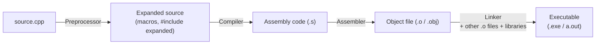

1. **Preprocessing** — the preprocessor expands `#include`, `#define` macros, and resolves `#ifdef`/`#pragma` directives, producing pure C++ source text with no directives left.
2. **Compilation** — the compiler translates the preprocessed source into assembly code for the target architecture, after lexing/parsing and semantic checks (type checking, template instantiation).
3. **Assembly** — the assembler converts assembly into machine code, producing an object file (`.o`/`.obj`) containing binary code plus a symbol table (unresolved references to functions/variables defined elsewhere).
4. **Linking** — the linker combines all object files and libraries, resolves symbol references across files, and produces the final executable (or shared library).

### 4. What is a translation unit?

A **translation unit** is a single `.cpp` source file *after* preprocessing — i.e., the source file with all its `#include`d headers textually pasted in and all macros expanded. The compiler compiles one translation unit at a time, independently. This is why each `.cpp` file needs its own `#include`s for anything it uses, and why the **One Definition Rule (ODR)** applies per-program across translation units (a non-inline function/variable may be *defined* in exactly one translation unit).

### 5. What is the difference between declaration and definition?

- A **declaration** introduces a name and its type to the compiler without allocating storage or providing a function body — it tells the compiler "this exists somewhere."
- A **definition** actually allocates storage (for variables) or provides the function body (for functions) — it tells the compiler/linker "here is the thing."

```cpp
extern int x;      // declaration only — no storage
int x = 5;          // definition — allocates storage

void foo();         // declaration only
void foo() { ... }  // definition
```

A definition is also a declaration, but not vice versa. You can declare something many times across files, but you can only define it once (ODR).

### 6. What is the role of the linker in C++?

The linker runs after compilation/assembly and stitches multiple object files (and libraries) into one executable. Its two main jobs:

1. **Symbol resolution** — matching each undefined symbol (a function call, a global variable reference) used in one object file to its definition in another object file or library.
2. **Relocation** — adjusting addresses so that everything fits together in the final memory layout of the executable.

If a symbol is declared but never defined anywhere, you get a **linker error** (e.g., "undefined reference to `foo()`") — as opposed to a **compiler error**, which happens earlier when syntax/type rules are violated (see [Q268](#268-what-is-the-difference-between-a-compiler-error-and-a-linker-error)).

### 7. What is a header file and why do we use header guards?

A **header file** (`.h`/`.hpp`) contains declarations (class definitions, function prototypes, `template` code, `inline` functions, constants) meant to be shared across multiple `.cpp` files via `#include`. Since `#include` is a dumb text-paste operation, if the same header gets included twice into one translation unit (directly or via a chain of other includes), you get duplicate declarations — often a compile error.

**Header guards** prevent this:

```cpp
#ifndef MYCLASS_H
#define MYCLASS_H

class MyClass { /* ... */ };

#endif // MYCLASS_H
```

The first time the header is included, `MYCLASS_H` isn't defined yet, so the body is processed and the macro gets defined. Any subsequent `#include` of the same file in the same translation unit sees `MYCLASS_H` already defined and skips the body entirely. See also [`#pragma once`](#164-what-is-pragma-once-vs-traditional-include-guards).

### 8. What is the difference between #include <file> and #include "file"?

```cpp
#include <vector>     // angle brackets
#include "myheader.h" // quotes
```

- **`<file>`** tells the preprocessor to search the compiler's standard/system include paths first (used for standard library and third-party library headers).
- **`"file"`** tells the preprocessor to search relative to the current source file's directory *first*, then fall back to the system include paths (used for your own project headers).

Both forms are configurable via compiler flags (`-I`), but the convention above is what virtually every codebase follows.

### 9. What is a namespace in C++ and why is it used?

A **namespace** is a named scope that groups related identifiers (classes, functions, variables) to avoid naming collisions — especially important since C++ has no built-in module/package system like Java until C++20 Modules.

```cpp
namespace geometry {
    class Point { /* ... */ };
    double distance(const Point& a, const Point& b);
}

geometry::Point p;                 // fully qualified
using geometry::Point;             // bring one name in
using namespace geometry;          // bring everything in (use sparingly)
```

Namespaces let two libraries each define a class called `Point` without clashing, as long as they live in different namespaces (`geometry::Point` vs. `graphics::Point`).

### 10. What is the using namespace std; statement and why is it discouraged in header files?

`using namespace std;` brings every name from the `std` namespace into the current scope, so you can write `cout` instead of `std::cout`. It's convenient in small example programs, but discouraged in real code — especially in **header files** — because:

- It pollutes the global namespace for **every file that includes that header**, causing name collisions that are hard to trace (e.g., your own `distance` function silently colliding with `std::distance`).
- It defeats the purpose of namespaces (avoiding collisions) and makes it unclear, when reading code, which namespace a name like `count` or `sort` came from.

Best practice: use fully qualified names (`std::vector`), or narrow `using` declarations (`using std::cout;`) for a handful of names, and never put `using namespace` at file/global scope in a header.

### 11. What are the important differences between C++ and Java?

| | C++ | Java |
|---|---|---|
| Platform independence | No — compiles to native machine code per OS | Yes — compiles to bytecode, runs on any JVM |
| Memory management | Manual (`new`/`delete`, smart pointers) | Automatic (Garbage Collector) |
| Pointers | Explicit, with pointer arithmetic | No pointer arithmetic (references only) |
| Multiple inheritance | Supported (classes, with virtual inheritance for diamonds) | Not for classes; achieved via interfaces |
| Operator overloading | Supported | Not supported |
| Compilation target | Native machine code | Bytecode, run by the JVM (JIT-compiled) |
| Global functions/variables | Allowed outside classes | Everything must live inside a class |
| Templates vs Generics | Compile-time code generation, monomorphized | Type erasure at compile time, one shared bytecode |
| Deterministic destruction | Yes (RAII, destructors run predictably) | No (finalizers/GC timing is unpredictable) |
| Header files | Yes (separate declaration/definition) | No (single `.java` file) |

### 12. What are the different data types in C++?

- **Fundamental (built-in) types**: `bool`, `char`, `wchar_t`, `char8_t`/`char16_t`/`char32_t` (C++11/20), `int`, `float`, `double`, `void`.
- **Modifiers**: `signed`, `unsigned`, `short`, `long`, `long long` — combine with integer types (`unsigned long long`).
- **Derived types**: arrays, pointers, references, functions.
- **User-defined types**: `class`, `struct`, `union`, `enum`/`enum class`.

```cpp
bool flag = true;
char c = 'A';
int i = 42;
unsigned long long big = 18446744073709551615ULL;
double d = 3.14159;
```

### 13. What is the difference between int, short, long, and long long?

These are all signed integer types that differ in their **minimum guaranteed width** (the C++ standard sets minimums; actual size is platform/compiler dependent):

| Type | Minimum width | Typical size (64-bit Linux/macOS) |
|---|---|---|
| `short` | 16 bits | 2 bytes |
| `int` | 16 bits (in practice always ≥ 32) | 4 bytes |
| `long` | 32 bits | 8 bytes (Linux/macOS), 4 bytes (Windows) |
| `long long` (C++11) | 64 bits | 8 bytes |

Because actual sizes vary by platform, use `<cstdint>` fixed-width types (`int32_t`, `uint64_t`, etc.) when the exact size matters, e.g. for binary file formats or network protocols.

### 14. What is the auto keyword and how does type deduction work?

`auto` (repurposed in C++11) tells the compiler to deduce a variable's type from its initializer, using the same rules as template argument deduction.

```cpp
auto i = 42;             // int
auto d = 3.14;           // double
auto v = std::vector<int>{1,2,3}; // std::vector<int>
auto it = v.begin();     // whatever iterator type vector<int>::begin() returns — very handy!
```

`auto` strips references and top-level `const` by default (you get a copy's type); use `auto&`, `const auto&`, or `auto&&` to preserve reference/const-ness. It's most valuable for verbose types (iterators, lambdas, template code) and is required for [structured bindings](#254-what-are-structured-bindings-c17) and lambda parameters in generic lambdas.

### 15. What is the difference between signed and unsigned types?

- **Signed** types can represent negative and positive numbers, using one bit (conceptually) for the sign; range for a 4-byte `int` is about −2,147,483,648 to 2,147,483,647.
- **Unsigned** types can only represent non-negative numbers, but get double the positive range for the same bit width; a 4-byte `unsigned int` ranges 0 to 4,294,967,295.

```cpp
unsigned int u = 0;
u = u - 1;            // wraps around to 4294967295 — no exception, this is well-defined for unsigned!
```

Unsigned arithmetic **wraps around (modulo 2^n)** and is well-defined; signed integer **overflow is undefined behavior**. A classic bug: looping `for (unsigned i = size - 1; i >= 0; --i)` when `size == 0` underflows to a huge number instead of stopping, causing an infinite/out-of-bounds loop. Prefer signed integers for general counting/arithmetic and reserve unsigned for bit manipulation or when negative values are truly meaningless (and you're prepared to handle wraparound).

---

## Casting & Type Conversion

### 16. What is type casting in C++?

Type casting converts a value of one type into another type. C++ supports both **implicit** (compiler-inserted, automatic) and **explicit** (programmer-requested) conversions, and offers four dedicated cast operators (`static_cast`, `dynamic_cast`, `const_cast`, `reinterpret_cast`) in addition to the C-style cast `(Type)value` inherited from C.

### 17. What is implicit (automatic) type conversion?

The compiler silently converts one type to another when it's "safe" (no explicit request needed) — e.g., widening a `int` to `double`, or an argument matching a converting constructor.

```cpp
int i = 10;
double d = i;        // int -> double, implicit
char c = 'A';
int code = c;         // char -> int, implicit (code == 65)

void f(double x);
f(5);                  // int 5 implicitly converted to double 5.0
```

Implicit conversions can also happen through **converting constructors** (a single-argument, non-`explicit` constructor) or user-defined conversion operators — which is exactly why [`explicit`](#63-what-is-an-explicit-constructor-and-why-use-the-explicit-keyword) exists to opt out of them.

### 18. What is explicit type conversion?

Explicit conversion is when the programmer deliberately requests a type change, via a cast:

```cpp
double d = 3.99;
int i = (int)d;             // C-style cast -> 3 (truncates)
int j = static_cast<int>(d); // C++-style cast -> 3
```

Explicit casts are needed when the conversion is "unsafe" or narrowing (potential data loss) and the compiler won't do it automatically, or when converting between unrelated pointer types.

### 19. What is static_cast and when do you use it?

`static_cast<T>(expr)` performs conversions the compiler can verify at compile time: numeric conversions, pointer conversions within a class hierarchy (upcast always safe; downcast unchecked but allowed), `void*` to typed pointer, and calling explicit constructors/conversion operators.

```cpp
double d = 3.14;
int i = static_cast<int>(d);          // numeric narrowing

Base* b = new Derived();
Derived* d2 = static_cast<Derived*>(b); // downcast — no runtime check, your responsibility
```

Use it whenever the conversion is well-defined and you don't need a runtime safety check (unlike `dynamic_cast`). It's the "default" cast to reach for.

### 20. What is dynamic_cast and when do you use it?

`dynamic_cast<T>(expr)` performs a **runtime-checked** conversion, primarily for downcasting through a polymorphic hierarchy (a class with at least one `virtual` function, so it has RTTI). It uses the vtable to verify the actual object type before allowing the cast.

```cpp
Base* b = getSomeObject();
if (Derived* d = dynamic_cast<Derived*>(b)) {
    d->derivedOnlyMethod();  // safe: only runs if b actually points to a Derived
} else {
    // b was not actually a Derived — cast returned nullptr
}
```

- For pointers: returns `nullptr` if the cast fails.
- For references: throws `std::bad_cast` if the cast fails.

It has runtime overhead (an RTTI lookup) — a well-designed virtual-function-based interface is often preferable to needing `dynamic_cast` at all, but it's the correct tool when you genuinely need to check "is this object actually a `Derived`?"

### 21. What is const_cast and when do you use it?

`const_cast<T>(expr)` adds or removes `const` (or `volatile`) qualification — it's the *only* cast that can do this. It doesn't change bits, just the compile-time view of constness.

```cpp
void legacyFunction(char* str);  // old API that doesn't modify str but isn't marked const

void wrapper(const char* str) {
    legacyFunction(const_cast<char*>(str)); // strip const to call legacy API
}
```

**Danger**: if you `const_cast` away constness from an object that was *originally* declared `const` and then modify it, that's undefined behavior. It's safe only when the underlying object is not actually const (e.g., a `const` parameter referring to a genuinely non-const object), typically used to interoperate with legacy APIs that forgot to mark parameters `const`.

### 22. What is reinterpret_cast and when do you use it?

`reinterpret_cast<T>(expr)` reinterprets the underlying bit pattern of one type as another, completely bypassing type safety — no runtime check, no numeric conversion, just "treat these bits as this other type."

```cpp
int i = 65;
int* ip = &i;
char* cp = reinterpret_cast<char*>(ip); // view the int's bytes as chars

uintptr_t addr = reinterpret_cast<uintptr_t>(ip); // pointer -> integer, for logging/hashing
```

It's used for low-level work: pointer-to-integer conversions, casting between unrelated pointer types (raw byte manipulation, hardware register access), or type-punning (though `std::bit_cast` in C++20 is the safe way to type-pun now). It's the most dangerous cast — the compiler trusts you completely — so it should be rare and localized.

### 23. What are the differences between C-style casts and C++-style casts?

```cpp
int i = (int)3.14;                 // C-style
int j = static_cast<int>(3.14);    // C++-style
```

| | C-style cast `(T)expr` | C++-style casts |
|---|---|---|
| Readability/searchability | Blends into code, hard to `grep` for | Distinct, easy to search (`grep static_cast`) |
| Intent | Ambiguous — could be any of static/const/reinterpret, or a combination | Explicit — each cast states exactly what kind of conversion is intended |
| Safety | Will silently do a `reinterpret_cast`-like conversion if nothing else works, even when that's dangerous | Compiler restricts you to only the semantics of the cast you picked |
| Compile-time checking | Minimal | `static_cast` checks well-formedness at compile time; `dynamic_cast` checks at runtime |

C++-style casts are strongly preferred in modern C++ because they make intent explicit and are safer/easier to audit; C-style casts are a holdover from C compatibility.

### 24. What is RTTI (Run-Time Type Information)?

RTTI is a C++ runtime mechanism that lets a program query an object's type information *during execution*, for polymorphic types (classes with at least one virtual function). It's what powers `dynamic_cast` and `typeid` — every polymorphic object carries a pointer (via its vtable) to type metadata that can be inspected at runtime.

RTTI has a small memory/performance cost, and some embedded/performance-critical codebases disable it (`-fno-rtti`) when they don't need `dynamic_cast`/`typeid`.

### 25. What is the typeid operator?

`typeid` returns a reference to a `std::type_info` object describing the type of an expression, usable for identity comparison or getting a (compiler-specific, often mangled) type name.

```cpp
#include <typeinfo>

Base* b = new Derived();
std::cout << typeid(*b).name();       // prints the *dynamic* type (Derived) — because Base is polymorphic
std::cout << typeid(int).name();      // works on types directly, too

if (typeid(*b) == typeid(Derived)) { /* ... */ }
```

For a polymorphic type, `typeid(*ptr)` gives the *actual runtime* type (via RTTI); for a non-polymorphic type, it gives the *static* (compile-time) type. `.name()` output isn't standardized (compiler-specific, often mangled — use `abi::__cxa_demangle` on GCC/Clang for a readable name).

---

## Strings

### 26. What is the difference between C-style strings and std::string?

A **C-style string** is a `char` array terminated by a null byte `'\0'`. `std::string` is a proper class (defined in `<string>`) that manages its own memory, tracks its length, and supports a rich set of operations.

| | C-style string (`char[]` / `char*`) | `std::string` |
|---|---|---|
| Memory management | Manual (you own the buffer) | Automatic (RAII — grows/shrinks itself) |
| Length | O(n) via `strlen` (scans for `\0`) | O(1) via `.size()`/`.length()` (stored) |
| Concatenation | Manual (`strcat`, buffer overflow risk) | `+`, `+=`, `.append()` |
| Bounds safety | None — `strcpy` etc. can overflow | Bounds-checked with `.at()`, safe by default with most operations |
| Comparison | `strcmp` | `==`, `<`, etc. (operator overloads) |
| Embedded `\0` | Not supported (treated as end of string) | Fully supported (length-based, not `\0`-terminated conceptually) |

```cpp
char cstr[] = "hello";           // C-style
std::string s = "hello";          // std::string
```

### 27. What are the common member functions of std::string?

```cpp
std::string s = "Hello, World!";

s.size(); / s.length();     // 13 — length
s.empty();                  // false
s.c_str();                  // const char* for C-API interop
s.substr(7, 5);              // "World" (start, length)
s.find("World");             // 7 (index), or std::string::npos if not found
s.replace(7, 5, "C++");      // "Hello, C++!"
s.append("!!!");             // append at end
s.insert(5, " there");       // insert at index
s.erase(0, 7);                // remove a range
s.push_back('?');            // append one char
s.pop_back();                // remove last char
s + " again";                 // concatenation via operator+
std::to_string(42);           // int -> string
std::stoi("42");              // string -> int
```

### 28. How do you concatenate strings in C++?

```cpp
std::string a = "Hello, ";
std::string b = "World!";

std::string c = a + b;          // operator+
a += b;                          // operator+=, appends in place
a.append(b);                     // equivalent to +=
std::string d = a + " " + b;     // chains, but creates temporaries (see next Q)
```

For C-style strings, use `strcat`/`strncat` (unsafe, requires pre-sized buffer) or, better, just use `std::string` instead.

### 29. Why should you be careful with std::string concatenation in loops?

```cpp
std::string result;
for (int i = 0; i < n; ++i) {
    result = result + std::to_string(i); // BAD: creates a new temporary string every iteration
}
```

Each `result + ...` in a loop can allocate a brand-new string and copy the old contents into it (if it triggers reallocation), turning an O(n) loop into O(n²) total work in the worst case. Fixes:

```cpp
std::string result;
result.reserve(expectedSize);          // pre-allocate, avoid repeated reallocation
for (int i = 0; i < n; ++i) {
    result += std::to_string(i);        // += grows the existing buffer in place (amortized O(1))
}
```

`operator+=`/`.append()` mutate the existing buffer directly (amortized constant time per append, doubling capacity like `vector`), whereas repeated `a = a + b` in a loop is the classic anti-pattern — the C++ analogue of Java's "don't use `+` for `String` in a loop, use `StringBuilder`" advice.

### 30. What is Small String Optimization (SSO)?

Most `std::string` implementations avoid a heap allocation entirely for **short strings** (typically up to 15–22 characters depending on the standard library) by storing the character data directly inside the `std::string` object itself (in space that would otherwise hold a pointer/capacity/size), instead of on the heap.

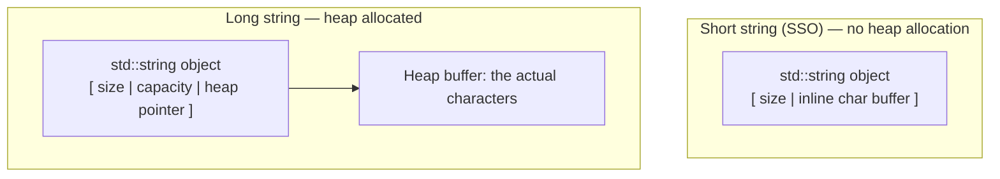

This is a huge, invisible performance win — short strings (variable names, short words, small keys) are extremely common, and SSO avoids the cost of `malloc`/`free` for every one of them. It's an implementation detail (not mandated by the standard), but essentially every modern `std::string` implementation (libstdc++, libc++, MSVC STL) does it.

### 31. How do you convert a string to a number and vice versa in C++?

```cpp
// number -> string
std::string s = std::to_string(42);
std::string sd = std::to_string(3.14);

// string -> number
int i = std::stoi("42");
long l = std::stol("123456789");
double d = std::stod("3.14");

// stream-based (works for custom types with operator<</>> too)
std::ostringstream oss; oss << 42;         // number -> string
std::istringstream iss("42"); int x; iss >> x; // string -> number

// C++17: std::from_chars / std::to_chars — fastest, no exceptions, no locale
```

`std::stoi`/`std::stod` throw `std::invalid_argument` if no conversion is possible and `std::out_of_range` if the value doesn't fit. `std::from_chars` (C++17, `<charconv>`) is preferred in performance-sensitive code — it's locale-independent, doesn't allocate, and reports errors via a return value instead of exceptions.

### 32. What is std::string_view and why was it introduced?

`std::string_view` (C++17, `<string_view>`) is a **non-owning, read-only "view"** into a contiguous sequence of characters — just a pointer + length, with no allocation and no ownership of the underlying data.

```cpp
void printName(std::string_view name) {  // no copy, works with std::string, char*, string literals
    std::cout << name << "\n";
}

std::string s = "Alice";
printName(s);              // no copy of the string data
printName("Bob");           // no temporary std::string constructed, unlike a `const std::string&` param
printName(s.substr(0, 3));  // careful: substr still allocates; use s.substr() sparingly with string_view
```

It was introduced to avoid unnecessary allocations/copies when a function only needs to *read* string data — passing `const std::string&` still forces a temporary `std::string` to be constructed if you pass a `const char*` or string literal; `string_view` avoids that entirely. **Caveat:** it does not own the data, so you must ensure the underlying string outlives the view (a `string_view` into a temporary or a string that goes out of scope is a dangling reference).

### 33. How do you compare two strings in C++?

```cpp
std::string a = "apple", b = "banana";

a == b;            // false — lexicographic equality
a < b;              // true — lexicographic less-than (operator overloads)
a.compare(b);       // negative/0/positive, like strcmp

char c1[] = "apple", c2[] = "banana";
strcmp(c1, c2);     // C-style — negative/0/positive
c1 == c2;            // WRONG for C-strings — compares pointers, not contents!
```

A classic beginner bug: comparing C-style strings with `==` compares the *pointer addresses*, not the contents — you must use `strcmp` (or just use `std::string`, where `==` does the right thing).

### 34. What is the difference between std::string and char*?

This mirrors [Q26](#26-what-is-the-difference-between-c-style-strings-and-stdstring) but framed around the raw pointer specifically: a `char*` is just an address — it has no idea how many bytes it points to or who owns them. `std::string` bundles the buffer, its length, its capacity, and RAII-based memory management together, and provides value semantics (copying a `std::string` copies its data; copying a `char*` just copies the address, leaving both pointers aiming at the same buffer — a common source of double-free/dangling-pointer bugs). Modern C++ guidance: use `std::string` (or `std::string_view` for read-only, non-owning access) everywhere; reach for raw `char*` only at C-API boundaries.

---

## Object Oriented Programming Basics

### 35. What is a class?

A **class** is a user-defined blueprint that bundles data (member variables) and the functions that operate on that data (member functions/methods) into one unit. It defines what an object of that type *looks like* (its state) and *can do* (its behavior), but a class by itself doesn't occupy memory for an instance's data — it's a template.

```cpp
class Car {
public:
    std::string model;
    int speed = 0;

    void accelerate(int amount) { speed += amount; }
};
```

### 36. What is an object?

An **object** is a concrete instance of a class — actual memory allocated with actual values for its member variables, created either on the stack, on the heap, or as a member of another object.

```cpp
Car myCar;                 // object on the stack, model="" , speed=0
myCar.model = "Tesla";
myCar.accelerate(50);       // myCar.speed is now 50

Car* c = new Car();         // object on the heap (must delete c later, or use a smart pointer)
```

If a class is the blueprint, the object is the house built from it — you can build many houses (objects) from the same blueprint (class), each with its own independent state.

### 37. What is the difference between a class and a struct in C++?

Unlike C, C++ `struct` can have constructors, member functions, access specifiers, and inheritance — functionally, `class` and `struct` are nearly identical. The **only** technical differences:

| | `class` | `struct` |
|---|---|---|
| Default member access | `private` | `public` |
| Default inheritance access | `private` | `public` |

```cpp
struct Point { int x, y; };      // x, y are public by default
class Point2 { int x, y; };       // x, y are private by default
```

By convention (not enforced by the compiler), `struct` is used for simple data-holding aggregates with little/no behavior ("plain old data"), and `class` is used when encapsulation, invariants, and non-trivial behavior are involved.

### 38. What is encapsulation?

Encapsulation is the OOP principle of bundling data with the methods that operate on it, and restricting direct access to that data from outside the class (via `private`/`protected` access specifiers), exposing only a controlled `public` interface.

```cpp
class BankAccount {
private:
    double balance = 0;   // can't be touched directly from outside
public:
    void deposit(double amt) { if (amt > 0) balance += amt; }  // controlled, validated access
    double getBalance() const { return balance; }
};
```

This protects the object's **invariants** (e.g., "balance can never go negative from a deposit") — external code can't bypass the validation logic by poking at `balance` directly, because it simply can't see it.

### 39. What is the this pointer?

Inside a non-static member function, `this` is an implicit pointer to the object the function was called on — `this` has type `ClassName*` (or `const ClassName*` inside a `const` member function).

```cpp
class Point {
    int x, y;
public:
    Point& setX(int x) {
        this->x = x;    // disambiguate the member `x` from the parameter `x`
        return *this;    // return the object itself, by reference, to allow chaining
    }
};

p.setX(5).setY(10);       // method chaining, enabled by returning *this
```

Common uses: disambiguating a member variable from a same-named parameter, returning `*this` for method chaining, and passing the current object to another function.

### 40. What are member functions and data members?

**Data members** (a.k.a. member variables / fields) are the variables declared inside a class that represent an object's state. **Member functions** (a.k.a. methods) are the functions declared inside a class that operate on that state — they implicitly receive the calling object via `this`.

```cpp
class Rectangle {
    double width, height;              // data members

public:
    Rectangle(double w, double h) : width(w), height(h) {} // member function (constructor)
    double area() const { return width * height; }          // member function
};
```

### 41. What is a member initializer list, and why is it preferred over assignment in the constructor body?

A **member initializer list** is the `: member1(value1), member2(value2)` syntax right after a constructor's parameter list, used to initialize data members before the constructor body runs.

```cpp
class Point {
    int x, y;
public:
    // Preferred: initializer list
    Point(int x, int y) : x(x), y(y) {}

    // Less good: assignment in the body
    Point(int x, int y) { this->x = x; this->y = y; }
};
```

It's preferred for several concrete reasons:

1. **Required for certain members** — `const` members, reference members, and members of a class with no default constructor *must* be initialized in the initializer list; they can't be assigned afterward in the body.
2. **Efficiency** — in the body-assignment version, members are first default-constructed (possibly doing real work for a class type), *then* assigned — that's construction + assignment. The initializer list constructs each member directly with its final value, in one step.
3. **Order clarity** — members are always initialized in the order they're *declared* in the class (not the order listed in the initializer list — a common gotcha compilers warn about with `-Wreorder`).

### 42. What is method overloading?

Method (function) overloading lets multiple functions share the same name as long as their **parameter lists differ** (in number and/or type) — the compiler picks the right one at compile time based on the arguments you pass. This is *compile-time (static) polymorphism*.

```cpp
class Printer {
public:
    void print(int i)          { std::cout << "int: " << i << "\n"; }
    void print(double d)       { std::cout << "double: " << d << "\n"; }
    void print(const std::string& s) { std::cout << "string: " << s << "\n"; }
};

Printer p;
p.print(5);        // calls print(int)
p.print(3.14);      // calls print(double)
p.print("hi");      // calls print(const std::string&)
```

Return type alone is **not** enough to distinguish overloads — two functions differing only in return type is a compile error.

### 43. What is operator overloading?

Operator overloading lets you redefine what operators like `+`, `==`, `<<`, `[]`, etc. mean for your own class types, so objects of your class can be used with natural syntax. Covered in depth in the [Operator Overloading](#operator-overloading) section below.

```cpp
class Vector2D {
public:
    double x, y;
    Vector2D operator+(const Vector2D& other) const {
        return Vector2D{x + other.x, y + other.y};
    }
};

Vector2D a{1,2}, b{3,4};
Vector2D c = a + b;   // calls operator+ — reads naturally instead of a.add(b)
```

### 44. What is the scope resolution operator :: used for?

`::` disambiguates a name by specifying which scope it belongs to. Common uses:

```cpp
int x = 10;                       // global x
void foo() {
    int x = 5;
    std::cout << x;                // 5 (local)
    std::cout << ::x;               // 10 (global, via ::)
}

class Base { public: void greet(); };
class Derived : public Base {
public:
    void greet() {
        Base::greet();              // call the base class's version explicitly
    }
};

void MyClass::myMethod() { ... }    // define a member function outside the class body

namespace ns { int value = 42; }
std::cout << ns::value;              // access a namespace member

MyClass::StaticInt;                  // access a static member
```

### 45. What are static members of a class?

A **static data member** belongs to the *class itself*, not to any individual object — there's exactly one shared copy, no matter how many objects of the class exist.

```cpp
class Counter {
public:
    static int count;          // declaration inside the class
    Counter() { ++count; }
};
int Counter::count = 0;         // definition + initialization, once, in a .cpp file (pre-C++17)
// C++17+: `static inline int count = 0;` can be defined right in the class.

Counter a, b, c;
std::cout << Counter::count;    // 3 — shared across all instances
```

Static members are useful for per-class state: instance counters, shared configuration, or a class-wide cache.

### 46. What is a static member function, and how does it differ from an instance member function?

A **static member function** belongs to the class rather than to any object — it can be called without an instance (`ClassName::function()`), has **no `this` pointer**, and can only directly access other `static` members (it has no object context to reach instance data from).

```cpp
class MathUtils {
public:
    static int square(int x) { return x * x; }   // no `this`, doesn't need an object
};

int result = MathUtils::square(5);   // called via the class, no object needed
```

Compare to an instance member function, which always operates on a specific object (accessible via `this`) and can read/write that object's non-static data members.

### 47. What is a friend function?

A `friend` function is a non-member function that is granted access to a class's `private` and `protected` members, by being declared inside that class with the `friend` keyword.

```cpp
class Box {
    double width;
public:
    Box(double w) : width(w) {}
    friend void printWidth(const Box& b);  // grants access
};

void printWidth(const Box& b) {
    std::cout << b.width;    // allowed, because printWidth is a friend
}
```

Friendship is commonly used for operator overloads (like `operator<<` for printing, [Q74](#74-how-do-you-overload-the-stream-insertion-and-extraction-operators)) where the left-hand operand isn't the class itself (`std::ostream`), so the operator can't be a member of your class. Friendship is not symmetric, not inherited, and not transitive — granting `friend` to `A` doesn't give `A`'s friends access too.

### 48. What is a friend class?

A `friend class` grants *every* member function of the friend class access to the granting class's private/protected members.

```cpp
class Engine {
    int horsepower = 300;
    friend class Car;    // Car can access Engine's private members
};

class Car {
public:
    void tune(Engine& e) { e.horsepower += 50; }  // allowed, Car is a friend of Engine
};
```

Use sparingly — it's a deliberate, targeted break of encapsulation (e.g., a `Builder` class that needs to construct an object's private internals), not a general-purpose tool.

### 49. What is a nested (inner) class?

A class defined entirely inside another class's body. It's scoped to `Outer::Inner`, keeping an implementation-detail type out of the enclosing namespace.

```cpp
class LinkedList {
    struct Node {              // nested class, scoped to LinkedList::Node
        int value;
        Node* next;
    };
    Node* head = nullptr;
public:
    void push(int v) { head = new Node{v, head}; }
};

// LinkedList::Node n; // usable outside only if Node is public
```

Unlike Java's inner classes, a C++ nested class does **not** implicitly hold a reference to an instance of the outer class — it's purely a scoping/namespacing mechanism unless you explicitly store a pointer/reference to the outer object yourself.

### 50. What is an anonymous/unnamed namespace, and how is it different from static at file scope?

An **unnamed namespace** gives every name inside it **internal linkage** — visible only within the current translation unit (`.cpp` file), invisible to the linker in other files.

```cpp
namespace {
    int helper() { return 42; }   // only callable from within this .cpp file
    const int MAX = 100;
}
```

This is the modern C++ replacement for the old C idiom of marking file-local functions/globals `static` (`static int helper() { ... }`). Both achieve internal linkage, but unnamed namespaces are preferred because they also work for types (you can't make a `class` "static" the old way) and integrate better with the rest of the language (ODR, templates). `static` at file scope is still legal and common in older/mixed C/C++ codebases, but the unnamed-namespace idiom is what the C++ core guidelines recommend today.

---

## Constructors & Destructors

### 51. What is a constructor?

A **constructor** is a special member function, named the same as the class, with no return type, that runs automatically whenever an object of that class is created — its job is to establish the object's initial valid state (initialize members, acquire resources).

```cpp
class Point {
    int x, y;
public:
    Point(int x, int y) : x(x), y(y) {}   // constructor
};

Point p(3, 4);      // constructor runs automatically
```

### 52. What is a default constructor?

A constructor that takes **no arguments** (either explicitly written with no parameters, or every parameter has a default value). If you declare *no* constructors at all, the compiler auto-generates one (that default-constructs each member); the moment you write *any* constructor, the compiler stops generating this implicit default constructor.

```cpp
class A { public: A() { std::cout << "A default-constructed\n"; } };
A a;                 // calls the default constructor

class B { public: B(int) {} };  // has a constructor, so no implicit default ctor
// B b;               // ERROR: no matching default constructor
```

### 53. What is a parameterized constructor?

A constructor that accepts one or more arguments, used to initialize an object with specific values at creation time rather than relying on default/empty state.

```cpp
class Rectangle {
    double width, height;
public:
    Rectangle(double w, double h) : width(w), height(h) {}   // parameterized constructor
};

Rectangle r(3.0, 4.0);
```

### 54. What is a copy constructor, and when is it called?

A copy constructor creates a new object as a copy of an existing object of the same class: `ClassName(const ClassName& other)`. It's invoked whenever:

```cpp
class Point {
    int x, y;
public:
    Point(int x, int y) : x(x), y(y) {}
    Point(const Point& other) : x(other.x), y(other.y) {   // copy constructor
        std::cout << "copied!\n";
    }
};

Point p1(1, 2);
Point p2 = p1;          // (1) copy-initialization
Point p3(p1);            // (2) direct copy construction
void f(Point p);
f(p1);                    // (3) pass by value
Point g() { Point local(1,1); return local; }  // (4) return by value (may be elided by RVO, see Q267)
```

If you don't declare one, the compiler generates a default (member-wise) copy constructor — fine for classes with only value-type members, but dangerous for classes owning raw pointers (see [Q55](#55-what-is-the-difference-between-a-shallow-copy-and-a-deep-copy)).

### 55. What is the difference between a shallow copy and a deep copy?

- **Shallow copy**: copies each member's value as-is. For a raw pointer member, this copies the *address*, leaving both the original and the copy pointing at the **same** underlying memory.
- **Deep copy**: allocates *new* memory for the copy and duplicates the pointed-to data, so the two objects own fully independent copies.

```cpp
class Buffer {
    int* data;
    size_t size;
public:
    Buffer(size_t n) : data(new int[n]), size(n) {}

    // Shallow copy (compiler-generated default) — BOTH Buffers' `data` point to the SAME array!
    // Buffer(const Buffer&) = default;

    // Deep copy — correct
    Buffer(const Buffer& other) : data(new int[other.size]), size(other.size) {
        std::copy(other.data, other.data + size, data);
    }

    ~Buffer() { delete[] data; }
};
```

Without a deep copy constructor, copying a `Buffer` and then destroying either copy calls `delete[]` on the shared pointer — the surviving copy is left with a **dangling pointer**, and destroying it too causes a **double-free** (undefined behavior, often a crash). This is exactly why classes that own raw resources need the [Rule of Three/Five](#59-what-is-the-rule-of-three).

### 56. What is a move constructor?

A move constructor (C++11) *transfers* ownership of resources from a temporary (rvalue) object into a new object, instead of copying them — signature `ClassName(ClassName&& other) noexcept`.

```cpp
class Buffer {
    int* data;
    size_t size;
public:
    Buffer(Buffer&& other) noexcept : data(other.data), size(other.size) {
        other.data = nullptr;   // steal the pointer, null out the source so its destructor is a no-op
        other.size = 0;
    }
    ~Buffer() { delete[] data; }
};

Buffer makeBuffer() { Buffer b(1000); return b; }
Buffer b2 = makeBuffer();   // move constructor used — no deep copy of 1000 ints!
```

Instead of allocating new memory and copying every element (O(n), expensive), a move constructor just copies the pointer and nulls out the source — O(1). It's automatically preferred over the copy constructor whenever the source is an rvalue (a temporary, or something explicitly `std::move`d). See [Q251](#251-what-is-move-semantics-and-how-is-it-different-from-copying).

### 57. What is a destructor, and when is it called?

A **destructor** (`~ClassName()`) is a special member function that runs automatically when an object's lifetime ends, used to release resources the object acquired (free memory, close files, unlock mutexes). It takes no arguments and can't be overloaded (a class has exactly one destructor).

Called automatically when:

```cpp
{
    Point p;              // constructed
}                          // p goes out of scope here -> destructor runs automatically

Point* ptr = new Point();
delete ptr;                // destructor runs, then memory is freed

// For an array: delete[] arr;  runs the destructor for every element
```

If not declared, the compiler generates a default destructor that calls the destructors of all members (and base classes) — fine unless your class manually owns a resource like `new`'d memory or a raw file handle.

### 58. Can a destructor be virtual? Why is a virtual destructor important?

Yes — and it's critically important whenever a class is meant to be used **polymorphically** (deleted through a base class pointer).

```cpp
class Base {
public:
    virtual ~Base() { std::cout << "~Base\n"; }   // virtual — correct
};
class Derived : public Base {
    int* data = new int[100];
public:
    ~Derived() override { delete[] data; std::cout << "~Derived\n"; }
};

Base* b = new Derived();
delete b;    // with virtual ~Base(): calls ~Derived() then ~Base() — correct, no leak
             // WITHOUT virtual: only ~Base() runs — Derived's `data` leaks!
```

If the base class destructor is **not** virtual, `delete`ing a `Derived` object through a `Base*` only calls `~Base()` — `~Derived()` never runs, silently leaking any resources `Derived` owns. **Rule of thumb**: any class intended as a polymorphic base (has virtual functions, or is inherited from and used via base pointers) must have a `virtual` destructor.

### 59. What is the Rule of Three?

If a class needs to define **any one** of these three special member functions, it almost certainly needs to define **all three**, because it's a sign the class manages a resource that needs custom cleanup logic:

1. Destructor
2. Copy constructor
3. Copy assignment operator

```cpp
class Buffer {
    int* data; size_t size;
public:
    Buffer(size_t n) : data(new int[n]), size(n) {}
    ~Buffer() { delete[] data; }                                    // 1. destructor
    Buffer(const Buffer& o) : data(new int[o.size]), size(o.size) { // 2. copy ctor
        std::copy(o.data, o.data + size, data);
    }
    Buffer& operator=(const Buffer& o) {                             // 3. copy assignment
        if (this != &o) {
            delete[] data;
            data = new int[o.size]; size = o.size;
            std::copy(o.data, o.data + size, data);
        }
        return *this;
    }
};
```

If you only write the destructor, the compiler-generated copy constructor/assignment will still do a shallow copy — reintroducing the double-free bug from [Q55](#55-what-is-the-difference-between-a-shallow-copy-and-a-deep-copy).

### 60. What is the Rule of Five?

C++11 extended the Rule of Three to five, adding the two move operations: if you manage a resource manually, you should typically define all of:

1. Destructor
2. Copy constructor
3. Copy assignment operator
4. Move constructor
5. Move assignment operator

Adding move operations lets your class avoid unnecessary deep copies when the source is a temporary — without them, moving falls back to copying (still correct, just slower). Declaring *any* of the "special five" also suppresses the compiler's implicit generation of the move operations, so if you define a custom destructor/copy-ctor without moves, your class silently loses move semantics and always copies — another reason to define all five together (or none, per the Rule of Zero).

### 61. What is the Rule of Zero?

The **Rule of Zero** says: design your classes so they **don't need to define any** of the five special member functions at all — by delegating resource ownership entirely to existing RAII types (`std::vector`, `std::string`, `std::unique_ptr`, `std::shared_ptr`) as members, instead of owning raw resources directly.

```cpp
class Buffer {
    std::vector<int> data;   // vector already manages its own memory correctly
public:
    Buffer(size_t n) : data(n) {}
    // No destructor, copy ctor, copy assign, move ctor, move assign needed —
    // the compiler-generated ones correctly copy/move/destroy the vector member.
};
```

This is the **preferred modern approach**: it eliminates an entire category of bugs (the Rule of Three/Five exists specifically because manual resource management is error-prone) by never writing manual `new`/`delete` in application code at all — reserve raw resource ownership for a small number of low-level RAII wrapper classes (like `std::vector` or `std::unique_ptr` themselves).

### 62. What is a delegating constructor?

A C++11 feature letting one constructor call another constructor of the *same* class in its initializer list, to avoid duplicating initialization logic.

```cpp
class Rectangle {
    double width, height;
public:
    Rectangle(double w, double h) : width(w), height(h) {}
    Rectangle() : Rectangle(1.0, 1.0) {}          // delegates to the two-arg constructor
    Rectangle(double side) : Rectangle(side, side) {} // delegates too — a square
};
```

Before C++11, this required a separate private "init" helper member function; delegating constructors make the intent direct and avoid partial re-initialization bugs.

### 63. What is an explicit constructor, and why use the explicit keyword?

By default, a constructor callable with a *single* argument acts as an **implicit conversion** from that argument's type to your class type — which can silently do surprising conversions. `explicit` disables that, requiring the constructor to be called deliberately.

```cpp
class Meters {
public:
    explicit Meters(double m) : value(m) {}
    double value;
};

void printDistance(Meters m);

printDistance(5.0);            // ERROR if explicit — 5.0 won't implicitly convert to Meters
printDistance(Meters(5.0));    // OK — explicit construction
printDistance(static_cast<Meters>(5.0)); // OK too

// Without `explicit`:
// printDistance(5.0); // would silently compile — is 5.0 meant to be meters? feet? bug-prone!
```

Best practice: mark every single-argument (and multi-argument, in C++11+ with `{}` init) constructor `explicit` unless you *specifically want* implicit conversion (e.g., `std::string(const char*)` is deliberately non-explicit, so `"hi"` implicitly becomes a `std::string`).

### 64. What is a copy assignment operator, and when is it invoked?

`ClassName& operator=(const ClassName& other)` — assigns the contents of one **already-existing** object to another already-existing object of the same type (as opposed to the copy constructor, which creates a brand-new object).

```cpp
Point p1(1, 2);
Point p2(3, 4);
p2 = p1;      // copy assignment — p2 already exists; its old state is replaced
```

A correct hand-written copy assignment operator must: (1) check for self-assignment, (2) release any resources it currently owns, (3) deep-copy the source's resources, (4) return `*this` to allow chaining (`a = b = c;`). See the Rule of Three example in [Q59](#59-what-is-the-rule-of-three) for a full implementation.

### 65. What is a move assignment operator?

`ClassName& operator=(ClassName&& other) noexcept` — assigns to an already-existing object by *stealing* resources from a temporary/rvalue source, instead of deep-copying.

```cpp
Buffer& operator=(Buffer&& other) noexcept {
    if (this != &other) {
        delete[] data;              // release what we currently own
        data = other.data;           // steal the source's pointer
        size = other.size;
        other.data = nullptr;        // leave source in a valid, destructible (empty) state
        other.size = 0;
    }
    return *this;
}

b1 = makeBuffer();   // move assignment — makeBuffer()'s return value is a temporary (rvalue)
```

Like the move constructor, it's O(1) instead of O(n), and is automatically selected over copy-assignment whenever the right-hand side is an rvalue.

### 66. What happens if you don't define a copy constructor, destructor, or assignment operator?

The compiler implicitly generates them for you (unless you've suppressed them via the Rule of Three/Five interactions):

- **Implicit destructor** — calls the destructor of every member and base class, in reverse declaration order. Correct as long as no member is a raw owning resource.
- **Implicit copy constructor / copy assignment** — copies (or assigns) each member individually using *its own* copy constructor/assignment (a "member-wise" copy). Correct for classes made only of value types (`int`, `std::string`, `std::vector`, other well-behaved classes); dangerous if a member is a raw owning pointer (shallow copy, see [Q55](#55-what-is-the-difference-between-a-shallow-copy-and-a-deep-copy)).
- **Implicit move constructor / move assignment** — generated *only if* the class declares none of the other four special members; move member-wise (calling each member's own move operation).

This is the mechanical basis for the [Rule of Zero](#61-what-is-the-rule-of-zero): if every member is already well-behaved, the implicitly generated versions are correct and you need write nothing.

### 67. What is the order of constructor and destructor calls in an inheritance hierarchy?

**Construction** goes base-to-derived (base class is fully constructed *before* the derived class's constructor body runs, so that the derived part can safely rely on the base part existing). **Destruction** goes in the exact reverse order, derived-to-base.

```cpp
class Base    { public: Base()  { std::cout << "Base ctor\n"; }  ~Base()  { std::cout << "Base dtor\n"; } };
class Derived : public Base {
public:
    Derived() { std::cout << "Derived ctor\n"; }
    ~Derived() { std::cout << "Derived dtor\n"; }
};

Derived d;
// Output:
// Base ctor
// Derived ctor
// Derived dtor
// Base dtor
```

For members too: members are constructed in declaration order (base class first, then members in the order declared), and destroyed in the exact reverse order.

### 68. Can a constructor call another constructor of the same class directly?

Not as a plain statement in the constructor body — `MyClass();` inside another constructor's body doesn't delegate, it just constructs and immediately discards a temporary, unrelated object. The correct way is a **delegating constructor** ([Q62](#62-what-is-a-delegating-constructor)), using the initializer-list syntax `Ctor(...) : Ctor(other args) { }`, introduced in C++11 specifically to make this possible and unambiguous.

### 69. What is a private constructor used for?

Making a constructor `private` (or `protected`) prevents outside code from directly instantiating the class with `new`/stack allocation, forcing object creation through some other controlled path. Common uses:

```cpp
class Singleton {
    Singleton() {}                       // private — can't be `new`'d from outside
public:
    static Singleton& instance() {
        static Singleton s;               // the only instance ever created
        return s;
    }
    Singleton(const Singleton&) = delete;  // also prevent copying
};

class Widget {
    Widget(int id) {}
public:
    static Widget create(int id) { /* validation logic */ return Widget(id); } // factory method
    friend class WidgetFactory;             // or grant a specific factory access
};
```

Typical uses: the **Singleton pattern** (ensuring exactly one instance exists), **factory functions/classes** (centralizing and validating construction logic), and preventing stack allocation of classes that must always live on the heap (e.g., reference-counted types).

---

## Operator Overloading

### 70. What operators can be overloaded in C++, and which cannot?

Almost all operators can be overloaded: `+ - * / % ^ & | ~ ! = < > += -= *= /= %= ^= &= |= << >> <<= >>= == != <= >= <=> && || ++ -- , ->* -> ( ) [ ] new new[] delete delete[]`.

**Cannot** be overloaded: `::` (scope resolution), `.` (member access), `.*` (member pointer access), `?:` (ternary), `sizeof`, `typeid`, and the C-style cast. These are excluded because allowing them to be overloaded would make basic language semantics ambiguous or unsafe (e.g., overloading `.` could make it impossible to reliably access a real member).

You also **cannot** create new operator symbols or change an operator's arity/precedence — overloading only changes what an *existing* operator does for a *specific type*.

### 71. How do you overload the + operator for a custom class?

```cpp
class Vector2D {
public:
    double x, y;
    Vector2D operator+(const Vector2D& other) const {
        return Vector2D{x + other.x, y + other.y};
    }
};

Vector2D a{1, 2}, b{3, 4};
Vector2D c = a + b;   // c = {4, 6}, calls a.operator+(b)
```

By convention, binary arithmetic operators return a **new value** (not a reference) and don't modify either operand (hence `const` on the method and parameter), mirroring how `int + int` behaves.

### 72. What is the difference between overloading an operator as a member function vs a friend function?

```cpp
class Vector2D {
public:
    double x, y;
    Vector2D operator+(const Vector2D& other) const { return {x+other.x, y+other.y}; }        // member
    friend Vector2D operator-(const Vector2D& a, const Vector2D& b);                            // friend (non-member)
};
Vector2D operator-(const Vector2D& a, const Vector2D& b) { return {a.x-b.x, a.y-b.y}; }
```

- **Member function**: the left-hand operand must be an object of the class (implicitly `this`). Fine for `a + b` where `a` is always your type.
- **Friend (non-member) function**: needed when the left-hand operand is *not* your class type — e.g., `5 * myVector` (a `double` on the left, which you can't add a member function to), or `std::cout << myVector` (the left operand is `std::ostream`, a type you don't control). A `friend` declaration is used so the non-member function can still reach private data.

Rule of thumb: use a member function when the left operand is naturally your type; use a non-member (friend, if it needs private access) function otherwise, especially for symmetric operators like `operator==` and for stream operators.

### 73. How do you overload the assignment operator (=)?

```cpp
class Buffer {
    int* data; size_t size;
public:
    Buffer& operator=(const Buffer& other) {
        if (this == &other) return *this;         // 1. guard against self-assignment (a = a;)
        delete[] data;                              // 2. release currently-owned resources
        size = other.size;
        data = new int[size];                        // 3. deep-copy the source
        std::copy(other.data, other.data + size, data);
        return *this;                                 // 4. return *this for chaining (a = b = c)
    }
};
```

Unlike most operators, `operator=` **cannot** be a free function/friend — it must always be a non-static member function of the class (this is enforced by the language, since assignment inherently modifies `this`).

### 74. How do you overload the stream insertion (<<) and extraction (>>) operators?

```cpp
class Point {
    int x, y;
public:
    Point(int x, int y) : x(x), y(y) {}
    friend std::ostream& operator<<(std::ostream& os, const Point& p);
    friend std::istream& operator>>(std::istream& is, Point& p);
};

std::ostream& operator<<(std::ostream& os, const Point& p) {
    os << "(" << p.x << ", " << p.y << ")";
    return os;                    // return the stream, to allow chaining: cout << p1 << p2;
}
std::istream& operator>>(std::istream& is, Point& p) {
    is >> p.x >> p.y;
    return is;
}

Point p(3, 4);
std::cout << p;        // prints "(3, 4)"
```

These **must** be non-member (friend, if private access is needed) functions, because the left-hand operand (`std::cout`, an `std::ostream`) is not your class — you can't add member functions to a class you don't own.

### 75. How do you overload the [] (subscript) operator?

```cpp
class MyArray {
    int data[100];
public:
    int& operator[](int index) { return data[index]; }               // mutable access: arr[i] = 5;
    const int& operator[](int index) const { return data[index]; }    // read-only access on const objects
};

MyArray arr;
arr[3] = 42;              // calls the non-const overload, returns a reference you can assign through
int x = arr[3];           // reads via either overload depending on constness
```

`operator[]` must be a non-static member function. Providing both a `const` and non-`const` overload (returning `T&` vs `const T&`) is the standard pattern, mirroring how `std::vector::operator[]` itself works. (C++23 adds support for a multi-argument subscript operator, `operator[](i, j)`, useful for matrix-like types — see [Q262](#262-what-are-the-major-features-introduced-in-c23).)

### 76. How do you overload the () (function call) operator, and what is a functor?

Overloading `operator()` makes objects of your class **callable like a function** — such an object is called a **functor** (function object).

```cpp
class Multiplier {
    int factor;
public:
    Multiplier(int f) : factor(f) {}
    int operator()(int x) const { return x * factor; }   // overload operator()
};

Multiplier triple(3);
int result = triple(5);        // 15 — calling the object like a function

std::vector<int> v = {1,2,3};
std::transform(v.begin(), v.end(), v.begin(), Multiplier(10)); // used as an algorithm callback
```

Unlike a plain function pointer, a functor can **carry state** (`factor` above) and, being a concrete type, is often inlined by the compiler at the call site (whereas a function pointer call typically isn't) — a major reason STL algorithms are fast when used with functors/lambdas. See [Q211](#211-what-is-a-functor-function-object).

### 77. What is operator overloading ambiguity, and how do you avoid it?

Ambiguity arises when the compiler can't determine a single best-matching overload for an expression — e.g., multiple overloads are equally viable candidates via implicit conversions, or an operator is overloaded both as a member and (confusingly) as a free function with overlapping signatures.

```cpp
class Number {
public:
    Number(int i) {}      // implicit conversion from int
    Number(double d) {}   // implicit conversion from double
};
void f(Number n);
f(5);          // fine — exact match, int -> Number(int)
// f(5L);      // AMBIGUOUS if both Number(int) and Number(double) are viable via conversion,
               // and neither is a strictly better match than the other
```

Avoid ambiguity by: marking single-argument constructors `explicit` unless implicit conversion is genuinely desired ([Q63](#63-what-is-an-explicit-constructor-and-why-use-the-explicit-keyword)), not overloading an operator both as a member and as a conflicting free function, and keeping overload sets for a given operator few and clearly differentiated by type. When ambiguity does occur, the compiler emits a hard error (it never silently guesses), so it surfaces at compile time rather than causing a runtime surprise.

---

## Inheritance

### 78. What is inheritance in C++?

Inheritance lets one class (the **derived**/child class) acquire the members and behavior of another class (the **base**/parent class), enabling code reuse and establishing an "is-a" relationship.

```cpp
class Animal {
public:
    void eat() { std::cout << "eating\n"; }
};
class Dog : public Animal {   // Dog "is-a" Animal
public:
    void bark() { std::cout << "woof\n"; }
};

Dog d;
d.eat();   // inherited from Animal
d.bark();  // Dog's own
```

### 79. What are the types of inheritance in C++?

C++ supports six inheritance shapes: **single**, **multiple**, **multilevel**, **hierarchical**, **hybrid**, and (a special case enabling the others) **virtual inheritance**. Each is detailed in the following questions.

### 80. What is single inheritance?

One derived class inherits from exactly one base class.

```cpp
class Animal { /* ... */ };
class Dog : public Animal { /* ... */ };   // single inheritance
```

### 81. What is multiple inheritance?

A single derived class inherits from **more than one** base class simultaneously — a feature C++ has that Java (for classes) does not.

```cpp
class Flyable   { public: void fly() {} };
class Swimmable { public: void swim() {} };
class Duck : public Flyable, public Swimmable {};  // multiple inheritance

Duck d;
d.fly();
d.swim();
```

Powerful, but can introduce ambiguity if two base classes share a member name, or the [diamond problem](#85-what-is-the-diamond-problem-and-how-does-c-solve-it) if they share a common ancestor.

### 82. What is multilevel inheritance?

A chain of inheritance: `C` derives from `B`, which derives from `A`.

```cpp
class Animal   { public: void eat() {} };
class Mammal   : public Animal { public: void breathe() {} };
class Dog      : public Mammal { public: void bark() {} };   // multilevel

Dog d;
d.eat(); d.breathe(); d.bark();   // all inherited/own methods available
```

### 83. What is hierarchical inheritance?

Multiple derived classes all inherit from the **same single** base class.

```cpp
class Animal { public: void eat() {} };
class Dog : public Animal { public: void bark() {} };
class Cat : public Animal { public: void meow() {} };   // hierarchical — Dog and Cat both derive from Animal
```

### 84. What is hybrid inheritance?

A combination of two or more inheritance types in one hierarchy — e.g., hierarchical + multiple. This is exactly the shape that produces the [diamond problem](#85-what-is-the-diamond-problem-and-how-does-c-solve-it) when the combined paths converge back on a common ancestor.

### 85. What is the diamond problem, and how does C++ solve it?

The diamond problem occurs when a class inherits from two base classes that both inherit from the **same** common ancestor — the most-derived class ends up with **two separate copies** of the ancestor's data, and any unqualified reference to it is ambiguous.

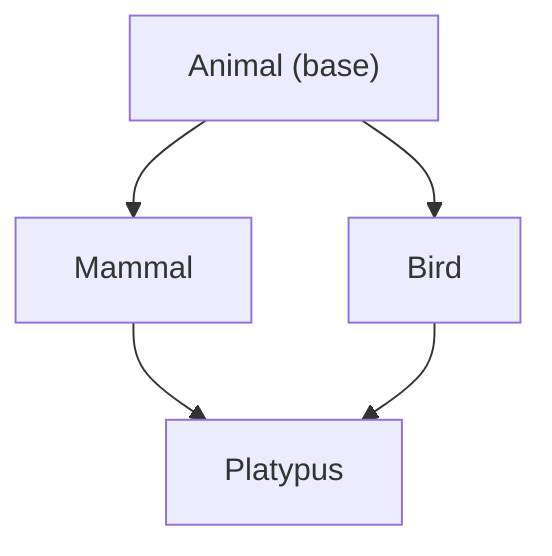

```cpp
class Animal { public: int age; };
class Mammal : public Animal {};
class Bird   : public Animal {};
class Platypus : public Mammal, public Bird {};

Platypus p;
// p.age = 5;   // ERROR: ambiguous — is this Mammal::age or Bird::age? Platypus has TWO Animal subobjects.
p.Mammal::age = 5;   // must disambiguate explicitly
```

C++ solves this with **virtual inheritance** ([Q86](#86-what-is-virtual-inheritance)) — if `Mammal` and `Bird` both inherit `Animal` *virtually*, `Platypus` gets only **one** shared `Animal` subobject, eliminating both the duplication and the ambiguity.

### 86. What is virtual inheritance?

Declaring a base class as `virtual` in the inheritance list ensures that no matter how many derived paths lead back to it, only **one** shared subobject of that base exists in the most-derived object.

```cpp
class Animal   { public: int age; };
class Mammal   : virtual public Animal {};
class Bird     : virtual public Animal {};
class Platypus : public Mammal, public Bird {};   // now only ONE Animal subobject

Platypus p;
p.age = 5;    // no longer ambiguous — there's just one `age`
```

The tradeoff: virtual inheritance adds a small runtime/memory overhead (an extra indirection to locate the shared base subobject, similar in spirit to a vtable pointer) and complicates construction (the *most-derived* class becomes directly responsible for initializing the virtual base, bypassing the intermediate classes).

### 87. What are public, private, and protected inheritance?

The inheritance access specifier controls how the base class's `public` and `protected` members are exposed *through* the derived class:

| Base member | `public` inheritance | `protected` inheritance | `private` inheritance |
|---|---|---|---|
| `public` in Base | stays `public` in Derived | becomes `protected` in Derived | becomes `private` in Derived |
| `protected` in Base | stays `protected` in Derived | stays `protected` in Derived | becomes `private` in Derived |
| `private` in Base | not accessible in Derived | not accessible in Derived | not accessible in Derived |

```cpp
class Base { public: int a; protected: int b; private: int c; };
class D1 : public Base    {};  // a public, b protected — models a true "is-a" relationship
class D2 : protected Base {};  // a and b both become protected in D2
class D3 : private Base   {};  // a and b both become private in D3 — models "implemented in terms of"
```

`public` inheritance (the overwhelming majority case) models "is-a." `private` inheritance models "is-implemented-in-terms-of" (closer to composition, but with access to protected members and the ability to override virtuals) and is rare in typical application code.

### 88. Can a derived class access private members of the base class?

No — `private` members of the base class are **never** directly accessible in a derived class, regardless of the inheritance type used. They still exist inside the derived object's memory layout (a `Derived` object contains its `Base` subobject in full), but the derived class's code cannot name them directly. Access is only possible indirectly, through `public`/`protected` member functions of the base class that the base class itself provides. This is exactly why `protected` exists — as the access level explicitly designed to be visible to derived classes while remaining hidden from the outside world.

### 89. What is object slicing?

Object slicing happens when a `Derived` object is assigned/copied **by value** into a `Base`-typed variable — only the `Base` part is copied ("sliced off"), and any additional `Derived`-only data (and its dynamic type for virtual dispatch) is lost.

```cpp
class Animal { public: virtual void speak() { std::cout << "..."; } };
class Dog : public Animal {
    std::string breed = "Labrador";
public:
    void speak() override { std::cout << "Woof (" << breed << ")"; }
};

void process(Animal a) {    // pass BY VALUE — slicing happens here
    a.speak();               // always calls Animal::speak(), never Dog::speak() — polymorphism is lost!
}

Dog d;
process(d);   // "..." is printed, not "Woof (Labrador)" — d was sliced down to just its Animal part
```

**Fix**: pass/store polymorphic objects by reference or pointer (`Animal&`, `Animal*`, or a smart pointer), never by value, whenever you need virtual dispatch to keep working.

### 90. How do you call a base class constructor from a derived class?

Via the derived class's member initializer list, exactly like initializing a member:

```cpp
class Animal {
    std::string name;
public:
    Animal(std::string n) : name(std::move(n)) {}
};
class Dog : public Animal {
    std::string breed;
public:
    Dog(std::string n, std::string b) : Animal(std::move(n)), breed(std::move(b)) {}  // call base ctor explicitly
};
```

If you don't explicitly call a base constructor, the compiler calls the base class's **default** constructor automatically before the derived constructor body runs — which fails to compile if the base class has no default constructor available.

### 91. Can a base class reference/pointer hold a derived class object, and vice versa?

**Base pointer/reference to a Derived object**: yes, always allowed — this is the foundation of runtime polymorphism.

```cpp
Animal* a = new Dog();     // OK — a Dog "is-a" Animal
Animal& ref = *a;
a->speak();                  // calls Dog::speak() if speak() is virtual (dynamic dispatch)
```

**Derived pointer to a Base object**: not allowed implicitly — a `Base` object genuinely might not have the extra data/behavior a `Derived` adds. It requires an explicit downcast, and is only safe if the object *actually is* a `Derived` at runtime:

```cpp
Animal* a = new Animal();
// Dog* d = a;                     // ERROR: no implicit conversion
Dog* d = static_cast<Dog*>(a);      // compiles, but UNDEFINED BEHAVIOR — a isn't really a Dog!
Dog* d2 = dynamic_cast<Dog*>(a);     // safe — returns nullptr here, since a isn't really a Dog
```

---

## Polymorphism & Virtual Functions

### 92. What is polymorphism?

Polymorphism ("many forms") lets the same interface/call produce different behavior depending on the actual object involved. C++ has two kinds: **compile-time** (function/operator overloading, templates — resolved by the compiler before the program runs) and **runtime** (virtual functions — resolved dynamically based on the object's actual type at execution time).

### 93. What is compile-time (static) polymorphism vs runtime (dynamic) polymorphism?

| | Compile-time (static) | Runtime (dynamic) |
|---|---|---|
| Mechanism | Function overloading, operator overloading, templates | Virtual functions |
| Resolved | At compile time, based on argument types | At runtime, based on the object's actual type |
| Performance | No overhead — direct call | Small overhead — vtable lookup (indirect call) |
| Requires | Nothing special | `virtual` keyword, base/derived class hierarchy, access via pointer/reference |

```cpp
// Compile-time: which print() runs is decided at compile time, based on the argument type
void print(int x);
void print(double x);

// Runtime: which speak() runs is decided at runtime, based on the actual object *a points to
class Animal { public: virtual void speak(); };
Animal* a = getSomeAnimal();  // could be Dog*, Cat*, ... decided at runtime
a->speak();
```

### 94. What is a virtual function?

A member function declared with `virtual` in the base class, intended to be **overridden** by derived classes, and resolved via **dynamic dispatch** — the version that actually runs is chosen based on the object's real runtime type, not the static type of the pointer/reference used to call it.

```cpp
class Shape {
public:
    virtual double area() const { return 0; }   // virtual
};
class Circle : public Shape {
    double radius;
public:
    Circle(double r) : radius(r) {}
    double area() const override { return 3.14159 * radius * radius; }  // overrides
};

Shape* s = new Circle(5);
s->area();     // calls Circle::area(), even though s is typed as Shape* — this is the whole point
```

### 95. What is function overriding?

A derived class provides its **own implementation** of a base class's `virtual` function, with an **identical signature** (same name, parameters, and — with one exception, [Q107](#107-what-is-a-covariant-return-type)) — return type). At runtime, calling that function through a base pointer/reference invokes the derived class's version.

```cpp
class Base    { public: virtual void greet() { std::cout << "Base\n"; } };
class Derived : public Base { public: void greet() override { std::cout << "Derived\n"; } };  // overriding
```

### 96. What is the difference between overloading and overriding?

| | Overloading | Overriding |
|---|---|---|
| Relationship | Same class (or same scope) | Base class / derived class |
| Signature | Must **differ** (parameters) | Must be **identical** |
| Resolved | Compile time | Runtime (requires `virtual`) |
| Purpose | Multiple ways to call a function with different arguments | Customize/replace inherited behavior |

```cpp
class Base {
public:
    void print(int x) {}            // overload target #1
    void print(double x) {}          // overload target #2 (same class, different params)
    virtual void speak() {}          // to be overridden
};
class Derived : public Base {
public:
    void speak() override {}         // overriding — same signature, different class
};
```

### 97. What is a pure virtual function?

A virtual function with **no implementation** in the base class, declared with `= 0`. Any class containing at least one pure virtual function becomes an **abstract class** and cannot be instantiated directly.

```cpp
class Shape {
public:
    virtual double area() const = 0;    // pure virtual — no body (a body CAN still be provided separately, rarely used)
};

// Shape s;                 // ERROR: cannot instantiate an abstract class
class Circle : public Shape {
public:
    double area() const override { return 3.14159 * r * r; } // MUST override, or Circle is abstract too
    double r;
};
```

### 98. What is an abstract class in C++?

A class with **at least one pure virtual function**. It exists to define a common interface/contract that concrete derived classes must implement — it cannot be instantiated on its own, only used as a base class.

```cpp
class Shape {                          // abstract
public:
    virtual double area() const = 0;
    virtual ~Shape() = default;         // still needs a virtual destructor!
};
```

An abstract class *can* still have data members, non-pure member functions, and a constructor (called implicitly when a concrete derived class is constructed) — it just can't be instantiated by itself.

### 99. What is an interface in C++ (and how is it simulated)?

C++ has no dedicated `interface` keyword (unlike Java/C#). The idiomatic way to simulate a pure interface is an abstract class containing **only** pure virtual functions and no data members (a "pure abstract base class").

```cpp
class Drawable {
public:
    virtual void draw() const = 0;
    virtual ~Drawable() = default;   // always give an interface a virtual destructor
};
class Serializable {
public:
    virtual std::string serialize() const = 0;
    virtual ~Serializable() = default;
};

class Shape : public Drawable, public Serializable {   // "implements" both interfaces via multiple inheritance
public:
    void draw() const override { /* ... */ }
    std::string serialize() const override { /* ... */ return ""; }
};
```

Since C++ classes support genuine multiple inheritance, a class can "implement" multiple such interfaces the same way Java uses multiple `interface` implementation — this is the standard workaround for C++'s lack of a dedicated single-inheritance-of-implementation restriction.

### 100. What is a virtual table (vtable) and vptr?

The **vtable** is a per-class array of function pointers, one entry per virtual function, pointing to the most-derived override for each. Every object of a polymorphic class (a class with at least one virtual function) secretly carries a hidden pointer, the **vptr**, pointing to its class's vtable — this is how the correct overridden function gets found at runtime.

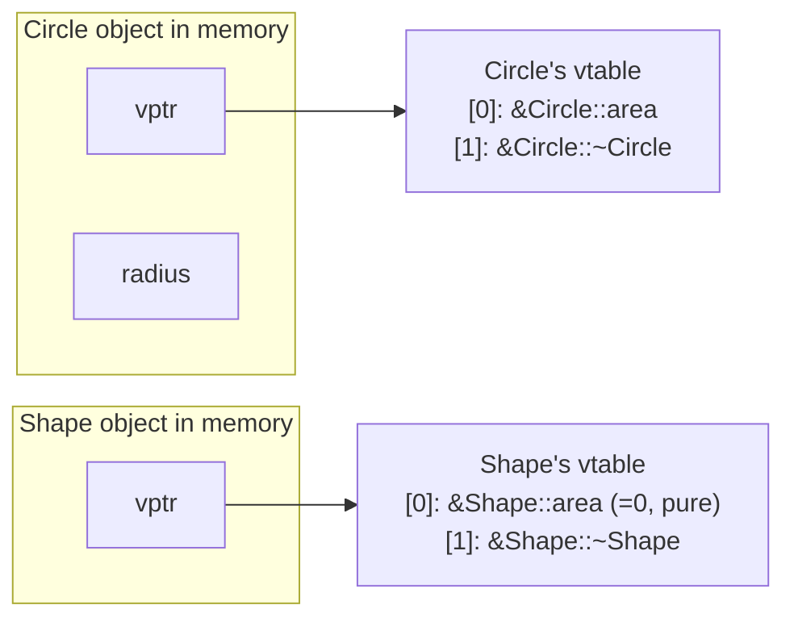

When you call `shapePtr->area()`, the compiler generates code that: (1) follows `shapePtr`'s vptr to find the object's actual vtable, (2) looks up the `area` slot in that vtable, (3) calls whatever function pointer is stored there. Since `Circle`'s vtable has `Circle::area` in that slot (overwritten from `Shape`'s vtable when `Circle` was compiled), you get `Circle::area()` — **dynamic dispatch**. This costs one extra pointer per object (the vptr) and one extra indirection per virtual call, versus a normal direct function call.

### 101. How does dynamic dispatch work internally in C++?

Dynamic dispatch is the mechanism (implemented via the vtable/vptr from Q100) that resolves *which* function body actually runs for a virtual call, at runtime, based on the object's dynamic (actual) type rather than the static (declared) type of the pointer/reference used to call it.

```cpp
Shape* s = new Circle(5);   // static type: Shape*, dynamic type: Circle
s->area();                   // 1. read s's vptr  2. index into the vtable for the "area" slot
                              // 3. call whatever function pointer is stored there (Circle::area)
```

Compare to a **non-virtual** call, which is resolved entirely at compile time based purely on the static type — no vptr lookup, just a direct call (or even inlined), which is why non-virtual calls are faster but lose the "call the actual derived behavior" property.

### 102. What is the override keyword used for?

`override` (C++11) is placed after a derived class's function to tell the compiler "I intend for this to override a virtual function from a base class." The compiler then **verifies** that a matching virtual function actually exists in the base class with an identical signature — if it doesn't (e.g., a typo, a slightly different parameter type), you get a **compile error** instead of silently creating an unrelated new function.

```cpp
class Base    { public: virtual void speak(int volume) {} };
class Derived : public Base {
public:
    void speak(int volume) override {}   // correctly overrides
    // void speek(int volume) override {}    // ERROR: no such virtual function in Base — typo caught!
    // void speak(double volume) override {} // ERROR: signature mismatch — caught!
};
```

Without `override`, a signature mismatch like these would silently compile as an unrelated overload that just happens to never get called virtually — a notoriously hard bug to spot. Always use `override` on every intended override.

### 103. What is the final keyword used for?

`final` (C++11) prevents further overriding of a virtual function, or further inheritance from a class.

```cpp
class Base {
public:
    virtual void speak() final {}   // no further derived class may override speak()
};
class Sealed final : public Base {};  // no class may inherit from Sealed at all

// class Bad : public Sealed {};      // ERROR: cannot derive from a final class
```

Useful for locking down a design (preventing misuse of a hierarchy not meant to be extended further) and can also let the compiler perform devirtualization optimizations in some cases (since it knows no further override is possible).

### 104. Why can't constructors be virtual?

Virtual dispatch relies on the vptr, which is set up *inside* the object **during** construction — but a constructor's whole job is to *create* the object in the first place, so there's no fully-formed object (and no valid vptr) yet for a "virtual constructor call" to dispatch through. Conceptually, you also always know the exact type you're constructing at the call site (`new Circle(...)`) — there's no ambiguity about "which override to run" the way there is for a method called on an existing, already-typed object. (Note: constructors *can* call other virtual functions, but with special, restricted behavior — see [Q106](#106-what-happens-if-you-call-a-virtual-function-from-a-constructor-or-destructor).)

### 105. Why is it important to have a virtual destructor in a base class?

Covered in detail in [Q58](#58-can-a-destructor-be-virtual-why-is-a-virtual-destructor-important) — in short: without it, `delete`ing a `Derived` object through a `Base*` only runs `~Base()`, skipping `~Derived()` entirely and leaking any resources the derived part owns. Any class used polymorphically (base pointers, virtual functions) must have a virtual destructor.

### 106. What happens if you call a virtual function from a constructor or destructor?

It does **not** dispatch to an overriding version in a more-derived class — inside a base class's constructor or destructor, the object's dynamic type is treated as the base class *currently being constructed/destructed*, because the derived parts either don't exist yet (during base construction) or have already been torn down (during base destruction).

```cpp
class Base {
public:
    Base() { init(); }                  // calls Base::init(), NOT Derived::init() — even if Base is being
    virtual void init() { std::cout << "Base::init\n"; }  // used to construct a Derived object!
};
class Derived : public Base {
public:
    void init() override { std::cout << "Derived::init\n"; }
};

Derived d;   // prints "Base::init" — surprising to many C++ newcomers coming from Java/C#, where it WOULD dispatch to Derived::init()
```

This is a well-known gotcha and pitfall: never rely on virtual dispatch inside a constructor or destructor to reach derived-class behavior — it simply won't happen, by design (the vptr is set to point at the currently-executing class's vtable during that class's own constructor/destructor body).

### 107. What is a covariant return type?

An overriding function is normally required to have the *exact same* return type as the base's virtual function — with one relaxation: it may return a type that is a **pointer/reference to a more-derived type**, as long as that type is derived from the base's declared return type.

```cpp
class Animal {
public:
    virtual Animal* clone() const { return new Animal(*this); }
};
class Dog : public Animal {
public:
    Dog* clone() const override { return new Dog(*this); }  // returns Dog*, not Animal* — covariant, allowed
};
```

This is especially useful for a virtual "clone" pattern (the Prototype design pattern), letting each derived class's `clone()` return its own more specific type without the caller needing to `dynamic_cast`/`static_cast` the result back down.

---

## Access Modifiers & Const Correctness

### 108. What are the access specifiers in C++?

Three: `public` (accessible from anywhere), `protected` (accessible within the class and its derived classes), and `private` (accessible only within the class itself, plus `friend`s). Unlike Java, C++ has no "package-private" concept — there's no notion of a package/module boundary controlling access (until C++20 Modules offer something adjacent but different).

```cpp
class Base {
public:    int a;   // anyone can access
protected: int b;   // Base and derived classes can access
private:   int c;   // only Base (and its friends) can access
};
```

### 109. What is the default access specifier for a class and a struct?

`class` defaults to `private`; `struct` defaults to `public` — this is the one meaningful language-level difference between them (see [Q37](#37-what-is-the-difference-between-a-class-and-a-struct-in-c)).

```cpp
class C { int x; };    // x is private
struct S { int x; };    // x is public
```

### 110. What is a const member function?

A member function marked `const` after its parameter list promises **not to modify** the object's non-`mutable` data members — the compiler enforces this, refusing to compile if the function body tries to assign to a member.

```cpp
class Point {
    int x, y;
public:
    int getX() const { return x; }         // const — read-only, doesn't modify the object
    void setX(int newX) { x = newX; }        // non-const — allowed to modify
    // int badGetX() const { x = 0; return x; }  // ERROR: can't modify `x` in a const function
};
```

Inside a `const` member function, `this` has type `const ClassName*`, so any attempt to write through it is a compile error. Mark every member function `const` that doesn't need to mutate the object — it documents intent and enables calling it on `const` objects/references.

### 111. What is a const object, and what can it call?

A `const` object is one whose state cannot be modified after construction, other than through `mutable` members.

```cpp
const Point p(3, 4);
p.getX();        // OK — getX() is a const member function
// p.setX(5);    // ERROR — setX() is non-const, might modify p, disallowed on a const object
```

A `const` object can only call `const` member functions — the compiler must guarantee no accidental mutation is possible through any method call on it. This is why providing both `const` and non-`const` overloads (like [`operator[]`](#75-how-do-you-overload-the-subscript-operator)) matters: a `const` object needs the `const` version to be usable at all.

### 112. What is the difference between a const pointer and a pointer to const?

Read the declaration right-to-left from the variable name, splitting at each `const`:

```cpp
int x = 5, y = 10;

const int* p1 = &x;       // "pointer to const int" — *p1 = 20; is ERROR, but p1 = &y; is OK (can repoint)
int* const p2 = &x;        // "const pointer to int" — p2 = &y; is ERROR, but *p2 = 20; is OK (can modify target)
const int* const p3 = &x;  // "const pointer to const int" — neither repointing nor modifying the target is allowed
```

Mnemonic: `const` applies to whatever is **immediately to its left** (or to the following type if there's nothing to its left). `int* const` reads "a `const` pointer, to `int`" — the pointer itself is fixed; `const int*` reads "a pointer to `const int`" — what it points to is fixed.

### 113. What is the mutable keyword used for?

`mutable` marks a data member as **exempt** from a `const` member function's write restriction — it can be modified even from inside a `const`-qualified method, on a `const` object.

```cpp
class Widget {
    mutable int accessCount = 0;   // allowed to change even in const methods
    int value;
public:
    int getValue() const {
        ++accessCount;              // allowed — accessCount is mutable
        return value;
    }
};
```

Typical uses: caching/memoization inside an otherwise-logically-const method (e.g., a lazily computed hash), reference counters, or a mutex used to make a `const` method thread-safe (locking doesn't logically change the object's observable state, even though it does change the mutex's own state).

### 114. What is constexpr, and how is it different from const?

`const` promises a value **won't change** after initialization, but that initialization can still happen at *runtime*. `constexpr` (C++11) goes further, requiring the value to be **computable at compile time** (given constant inputs), enabling it to be used anywhere a compile-time constant is required (array sizes, template arguments, `case` labels).

```cpp
const int a = getRuntimeValue();     // OK — const, but its value is only known at runtime
constexpr int b = 5 * 5;              // OK — computed entirely at compile time -> 25
// constexpr int c = getRuntimeValue(); // ERROR (usually) — getRuntimeValue() isn't a constexpr function

constexpr int square(int x) { return x * x; }  // can run at compile time (if given constant args) or at runtime
int arr[square(4)];                              // OK — needs a compile-time constant, square(4) qualifies
```

Every `constexpr` variable is implicitly `const`; the reverse isn't true. Use `constexpr` whenever a value is genuinely knowable at compile time — it can enable free compile-time computation and stronger guarantees (e.g., usable as an array bound or template argument).

### 115. What is consteval and constinit (C++20)?

Two more precise siblings of `constexpr`, added in C++20:

- **`consteval`** — marks a function that **must always** be evaluated at compile time; calling it with non-constant arguments (or in a context that can't guarantee compile-time evaluation) is a compile error, unlike `constexpr` functions, which are allowed to fall back to running at runtime.
- **`constinit`** — marks a variable that must be **initialized at compile time** (avoiding the [static initialization order fiasco](#271-what-is-the-static-initialization-order-fiasco)), but — unlike `constexpr` — the variable is **not** required to be immutable afterward; it can still be modified later at runtime.

```cpp
consteval int square(int x) { return x * x; }
constexpr int a = square(5);   // OK — compile-time call
// int n = getInput();
// int b = square(n);          // ERROR — n isn't known at compile time, but consteval demands it

constinit int counter = compute_initial();  // guaranteed compile-time init, but counter can be incremented later
```

---

## Pointers, References & Memory Management

### 116. What is a pointer?

A pointer is a variable that stores the **memory address** of another variable (or object), rather than a value directly. It has its own type, matching what it points to, and supports dereferencing (`*p`) to access the pointed-to value, and pointer arithmetic.

```cpp
int x = 10;
int* p = &x;      // p holds the address of x
*p = 20;           // dereference p, modify x through it — x is now 20
std::cout << p;     // prints the address itself
std::cout << *p;     // prints 20
```

### 117. What is a reference?

A reference is an **alias** for an existing variable — another name for the same memory, not a separate object. Unlike a pointer, a reference must be initialized when declared, can never be null, and can never be "re-seated" to refer to something else afterward.

```cpp
int x = 10;
int& r = x;        // r is now just another name for x
r = 20;             // modifies x directly — x is now 20
int& r2;            // ERROR: references must be initialized
```

### 118. What is the difference between a pointer and a reference?

| | Pointer | Reference |
|---|---|---|
| Can be null | Yes (`nullptr`) | No — must always refer to a real object |
| Can be reassigned | Yes, to point elsewhere | No — bound to one object for its whole lifetime |
| Needs initialization | No (can be declared uninitialized — dangerous) | Yes, always |
| Syntax to access value | Explicit dereference (`*p`) | Implicit (`r` behaves exactly like the original variable) |
| Supports arithmetic | Yes (`p++`, `p + 3`) | No |
| Can point to nothing | Yes | No |
| Memory | Occupies its own storage (an address) | May or may not occupy storage (often optimized away entirely) |

A common guideline: prefer references for function parameters/return values when null isn't a valid state and re-seating isn't needed (safer, cleaner syntax); use pointers when null is a meaningful value, when you need to reassign, or for dynamic memory/optional ownership.

### 119. What is a null pointer, and what is nullptr?

A **null pointer** is a pointer that deliberately points to nothing — dereferencing it is undefined behavior (typically a crash/segfault). Before C++11, `NULL` (a macro, usually `0` or `(void*)0`) or the literal `0` was used, which had a notorious ambiguity problem with overload resolution (an integer `0` could match either a pointer-parameter overload or an integer-parameter overload).

```cpp
int* p = nullptr;    // C++11 — a proper typed null pointer literal (type: std::nullptr_t)

void f(int);
void f(char*);
f(0);          // ambiguous-ish historically with NULL — could look like it means f(char*) or actually calls f(int)
f(nullptr);    // unambiguously calls f(char*)
```

`nullptr` is type-safe (it has its own type, `std::nullptr_t`, implicitly convertible to any pointer type but not to `int`), eliminating that ambiguity — always prefer it over `NULL`/`0` in modern C++.

### 120. What is a dangling pointer?

A pointer that still holds the address of memory that has already been freed/gone out of scope — the memory it points to is no longer valid, but the pointer's bit pattern looks exactly like a normal, valid address.

```cpp
int* danglingExample() {
    int local = 42;
    return &local;         // BUG: returns the address of a stack variable that's about to be destroyed
}                            // local's storage is reclaimed here

int* dp = danglingExample(); // dp now dangles
std::cout << *dp;             // undefined behavior — might "work" by luck, might crash, might print garbage

int* dp2 = new int(5);
delete dp2;                   // dp2 now dangles too
std::cout << *dp2;              // undefined behavior — use-after-free
```

Dereferencing a dangling pointer is undefined behavior; using smart pointers (which either null themselves out or manage lifetime automatically) is the standard fix.

### 121. What is a wild pointer?

A pointer that has been **declared but never initialized** — it holds whatever garbage bit pattern happened to be in that memory location, pointing to a completely random, unpredictable address (as opposed to a dangling pointer, which used to be valid but no longer is).

```cpp
int* wild;             // uninitialized — points to garbage
std::cout << *wild;     // undefined behavior — could crash, could corrupt unrelated memory
```

Always initialize pointers, either to a real address, or explicitly to `nullptr` if there's nothing to point to yet.

### 122. What is a void pointer?

`void*` is a generic pointer type that can hold the address of any object type, but **cannot be dereferenced directly** (the compiler doesn't know what type/size the data is) — it must first be cast to a concrete pointer type.

```cpp
int x = 5;
void* vp = &x;        // any pointer type can implicitly convert to void*
// std::cout << *vp;  // ERROR: cannot dereference void*
int* ip = static_cast<int*>(vp);   // must cast back to a real type first
std::cout << *ip;                   // 5
```

Used for generic, type-erased APIs (e.g., `memcpy(void* dest, const void* src, size_t n)`, C callback userdata parameters) — largely superseded in modern C++ by templates, `std::any`, and `std::variant` where applicable.

### 123. What is pointer arithmetic?

Adding/subtracting integers to/from a pointer moves it by that many **elements** of the pointed-to type (not raw bytes) — the compiler scales the offset by `sizeof(T)`.

```cpp
int arr[5] = {10, 20, 30, 40, 50};
int* p = arr;          // points to arr[0]
p++;                     // now points to arr[1] — advanced by sizeof(int) bytes, not 1 byte
std::cout << *p;          // 20
std::cout << *(p + 2);     // arr[3] -> 40
std::cout << p[2];          // same as *(p + 2) -> 40 — [] is literally pointer arithmetic + dereference

ptrdiff_t diff = &arr[4] - &arr[1];  // 3 — number of elements between them
```

Arithmetic beyond the bounds of the array (other than one-past-the-end, which is legal to *compute* but not dereference) is undefined behavior. This is a capability C++ has that Java deliberately omits (Java references can't be arithmetically manipulated at all) — see [Q11](#11-what-are-the-important-differences-between-c-and-java).

### 124. What is the difference between new/delete and malloc/free?

| | `new` / `delete` | `malloc` / `free` |
|---|---|---|
| Origin | C++ operators | C standard library functions |
| Constructor/destructor | Calls them automatically | Does not — just raw memory |
| Type safety | Returns a properly typed pointer | Returns `void*`, requires an explicit cast |
| Failure behavior | Throws `std::bad_alloc` | Returns `nullptr` |
| Array support | `new[]` / `delete[]` (must be paired correctly) | `malloc`/`free` with manual size calculation |
| Overloadable | Yes (`operator new`/`operator delete` can be customized) | No |

```cpp
MyClass* obj = new MyClass(args);   // allocates AND constructs
delete obj;                           // destructs AND deallocates

MyClass* obj2 = (MyClass*)malloc(sizeof(MyClass));  // allocates raw memory only — constructor NOT called!
free(obj2);                                            // deallocates only — destructor NOT called!
```

Never mix them (`new` with `free`, or `malloc` with `delete`) — undefined behavior. In modern C++, prefer neither directly; use smart pointers and containers instead ([Q127](#127-what-are-smart-pointers-and-why-were-they-introduced)).

### 125. What is a memory leak, and how do you avoid one?

A memory leak occurs when dynamically allocated memory is never freed, because every pointer to it has gone out of scope or been overwritten before a matching `delete`/`free` was called — the memory stays reserved for the lifetime of the program, wasting resources and, in long-running programs, eventually exhausting available memory.

```cpp
void leaky() {
    int* p = new int[1000];
    if (someCondition) return;   // BUG: early return skips the delete[] below — leak!
    delete[] p;
}
```

**Avoidance**: follow **RAII** ([Q133](#133-what-is-raii-resource-acquisition-is-initialization)) — wrap every raw resource in an object whose destructor releases it automatically (a smart pointer, a container, a lock guard), so cleanup happens on every exit path (normal return, early return, or an exception unwinding the stack) without manual bookkeeping. Tools like Valgrind, AddressSanitizer, and static analyzers help detect leaks that do slip through.

### 126. What is the difference between stack and heap memory?

| | Stack | Heap |
|---|---|---|
| Allocation | Automatic, on function call/scope entry | Manual (`new`/`malloc`) or via containers/smart pointers |
| Deallocation | Automatic, on scope exit | Manual (`delete`/`free`), or automatic via RAII |
| Speed | Very fast (just moving a stack pointer) | Slower (bookkeeping in the allocator) |
| Size | Limited (often a few MB, causes stack overflow if exceeded) | Much larger (limited by available system memory) |
| Lifetime | Tied to the enclosing scope | Until explicitly freed (or owning object destroyed) |
| Typical use | Local variables, function parameters | Objects that must outlive the current scope, large/variable-sized data |

```cpp
void f() {
    int local = 5;              // stack — auto-freed when f() returns
    int* heapVal = new int(5);   // heap — lives until delete, or until the owning smart pointer is destroyed
    delete heapVal;
}
```

### 127. What are smart pointers, and why were they introduced?

Smart pointers are class templates (`<memory>`) that wrap a raw pointer and **automatically manage its lifetime** using RAII — the pointed-to object is destroyed (and its memory freed) automatically when the smart pointer itself goes out of scope, eliminating manual `delete` calls and the leaks/double-frees/dangling-pointer bugs that come from getting them wrong.

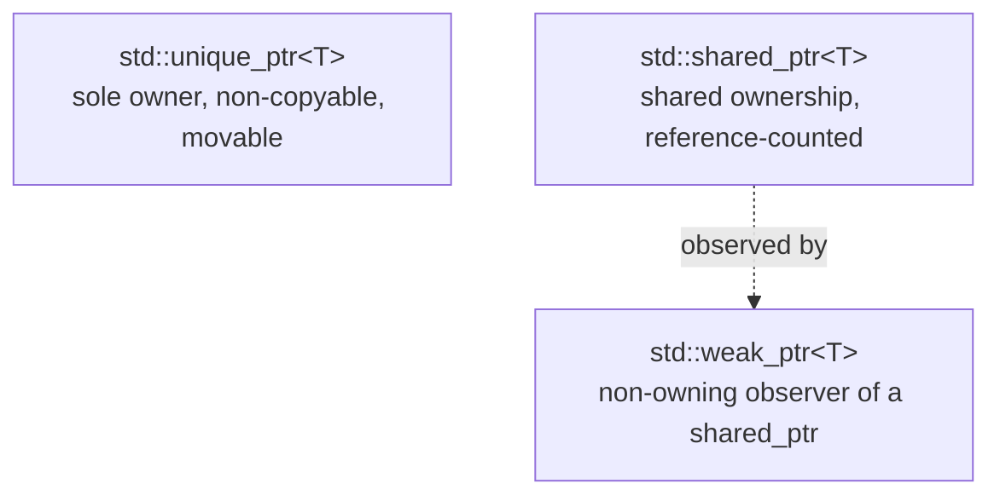

They were introduced (in `<memory>`, standardized in C++11, with `std::auto_ptr` being an earlier flawed C++98 attempt) because manual `new`/`delete` is error-prone at scale — every code path (including exception unwinding) has to remember to free exactly once. The three main ones — `unique_ptr`, `shared_ptr`, `weak_ptr` — are covered individually below.

### 128. What is std::unique_ptr?

`std::unique_ptr<T>` represents **exclusive, sole ownership** of a dynamically allocated object — exactly one `unique_ptr` owns the object at a time. It cannot be copied (copying is deleted), only **moved**, which transfers ownership; when it goes out of scope, it automatically `delete`s the object.

```cpp
std::unique_ptr<int> p1 = std::make_unique<int>(42);  // preferred way to create one (C++14+)
// std::unique_ptr<int> p2 = p1;      // ERROR: copy is deleted
std::unique_ptr<int> p3 = std::move(p1);  // OK — ownership transferred; p1 is now nullptr

// automatically freed when p3 goes out of scope — no explicit delete needed
```

It has essentially **zero overhead** compared to a raw pointer (same size, no reference counting), making it the default choice for owning a dynamically allocated object whenever shared ownership genuinely isn't needed.

### 129. What is std::shared_ptr, and how does reference counting work?

`std::shared_ptr<T>` allows **multiple owners** of the same object simultaneously, via an internal, atomically-updated **reference count**. The object is destroyed only when the *last* `shared_ptr` owning it is destroyed or reset (the count hits zero).

```cpp
std::shared_ptr<int> p1 = std::make_shared<int>(42);  // ref count = 1
{
    std::shared_ptr<int> p2 = p1;                       // ref count = 2 (copy increments)
    std::cout << p1.use_count();                          // 2
}                                                          // p2 destroyed -> ref count = 1
// p1 goes out of scope here -> ref count = 0 -> object deleted
```

`shared_ptr` stores a pointer to a control block (containing the reference count and, optionally, a weak count) alongside the raw pointer — `std::make_shared` allocates the object and control block together in one allocation, which is both faster and more exception-safe than `shared_ptr<T>(new T(...))`. The cost versus `unique_ptr`: extra memory (the control block) and atomic increment/decrement overhead on every copy/destruction (for thread-safety of the count).

### 130. What is std::weak_ptr, and what problem does it solve?

`std::weak_ptr<T>` is a **non-owning** observer of an object managed by `shared_ptr` — it doesn't contribute to the reference count, so it doesn't keep the object alive by itself. Before using the object, you must `.lock()` it into a temporary `shared_ptr` (which returns an empty/null `shared_ptr` if the object has already been destroyed) — this is a safe alternative to keeping a raw pointer around that might dangle.

```cpp
std::shared_ptr<int> sp = std::make_shared<int>(42);
std::weak_ptr<int> wp = sp;      // observes, doesn't own — ref count stays 1

if (auto locked = wp.lock()) {    // safely check whether the object still exists
    std::cout << *locked;           // 42
}
sp.reset();                        // object destroyed, ref count -> 0
if (auto locked = wp.lock()) {     // locked is now empty — condition is false
    std::cout << "still alive";
} else {
    std::cout << "expired";         // this branch runs
}
```

It exists mainly to break **circular references** ([Q131](#131-what-is-a-circular-reference-in-shared_ptr-and-how-does-weak_ptr-fix-it)) and for caches/observer patterns where you want to reference an object without forcing it to stay alive on your account.

### 131. What is a circular reference in shared_ptr, and how does weak_ptr fix it?

If two objects hold `shared_ptr`s to *each other*, each keeps the other's reference count at ≥1 forever — even if nothing external references either of them anymore, neither's count ever reaches zero, so **neither is ever destroyed**: a memory leak.


```cpp
struct Child;
struct Parent { std::shared_ptr<Child> child; };
struct Child  { std::shared_ptr<Parent> parent; };   // BUG: circular shared ownership -> leak

Parent p; Child c;
p.child = std::make_shared<Child>();
p.child->parent = std::shared_ptr<Parent>(&p);  // both keep each other alive forever
```

**Fix**: make one direction of the relationship a `weak_ptr` instead — typically the "back-reference" (child pointing back to its parent), since the parent naturally owns the child, not the other way around.

```cpp
struct Parent { std::shared_ptr<Child> child; };
struct Child  { std::weak_ptr<Parent> parent; };   // fixed — doesn't keep Parent alive
```

### 132. What is std::auto_ptr, and why was it deprecated?

`std::auto_ptr<T>` was C++98's original attempt at a smart pointer for sole ownership — but its "copy" operation actually **transferred ownership** and nulled out the source, which meant it silently violated the normal expectations of copy semantics (a copy of a copyable type is normally supposed to leave the original unchanged).

```cpp
std::auto_ptr<int> p1(new int(5));
std::auto_ptr<int> p2 = p1;   // p1 is now NULL! "copying" secretly moved ownership
std::cout << *p1;               // undefined behavior — p1 no longer owns anything
```

This made it dangerously easy to misuse (e.g., putting one in a `std::vector`, which internally copies elements, silently corrupted the vector's other entries). It was deprecated in C++11 and **removed entirely in C++17**, replaced by `std::unique_ptr`, which achieves the same "sole ownership, transferable" goal correctly by using move semantics (which didn't exist yet when `auto_ptr` was designed) instead of hijacking copy semantics.

### 133. What is RAII (Resource Acquisition Is Initialization)?

RAII is C++'s core idiom for resource management: **tie a resource's lifetime to an object's lifetime**. Acquire the resource in the constructor; release it in the destructor. Because C++ guarantees destructors run automatically and deterministically when an object goes out of scope — including during exception-driven stack unwinding — this guarantees the resource is *always* released, on every code path, with zero manual bookkeeping.

```cpp
class FileHandle {
    FILE* file;
public:
    FileHandle(const char* path) : file(fopen(path, "r")) {}   // acquire in constructor
    ~FileHandle() { if (file) fclose(file); }                    // release in destructor
};

void useFile() {
    FileHandle f("data.txt");
    doSomethingThatMightThrow();      // if this throws, ~FileHandle() STILL runs during stack unwinding
}                                        // file closed here, on every path (normal return or exception)
```

`std::unique_ptr`, `std::shared_ptr`, `std::vector`, `std::lock_guard`, `std::fstream` are all RAII types built into the standard library. RAII is *the* reason C++ doesn't need `finally` blocks or garbage collection to reliably clean up resources — it's arguably C++'s single most important idiom, underlying the [Rule of Zero](#61-what-is-the-rule-of-zero).

### 134. What is a double pointer (pointer to pointer)?

A pointer whose pointed-to value is itself a pointer — `T**`.

```cpp
int x = 5;
int* p = &x;
int** pp = &p;         // pp holds the address of p

**pp = 10;               // dereference twice: pp -> p -> x, now x == 10

// Common use: modifying a caller's pointer through a function parameter
void allocate(int** outPtr) {
    *outPtr = new int(42);   // modifies the caller's actual pointer variable
}
int* result = nullptr;
allocate(&result);           // result now points to the new int
```

Common uses: modifying a pointer variable itself through a function call (since C has no references, this is C's only way to do an "out parameter" pointer), and representing 2D dynamic arrays (`int** grid` — an array of row pointers).

### 135. What is a function pointer?

A variable that holds the address of a function, allowing that function to be called indirectly, passed as an argument, or stored/swapped at runtime.

```cpp
int add(int a, int b) { return a + b; }
int subtract(int a, int b) { return a - b; }

int (*operation)(int, int) = add;    // function pointer, matching add's signature
std::cout << operation(3, 4);          // calls add(3, 4) -> 7

operation = subtract;
std::cout << operation(3, 4);          // calls subtract(3, 4) -> -1

void applyOp(int a, int b, int (*op)(int, int)) {  // passed as a callback parameter
    std::cout << op(a, b);
}
```

In modern C++, `std::function` ([Q216](#216-what-is-stdfunction-and-how-is-it-different-from-a-function-pointer)) and lambdas are usually preferred for callbacks — they can also capture state, unlike a raw function pointer — but function pointers are still common at C-API boundaries and are the lowest-overhead option when no captured state is needed.

### 136. What is the difference between deep copy and shallow copy in the context of pointers?

Already covered conceptually in [Q55](#55-what-is-the-difference-between-a-shallow-copy-and-a-deep-copy) — restated in pointer terms: a **shallow copy** duplicates the pointer's *value* (the address it holds), so two pointers end up aiming at the exact same underlying memory; a **deep copy** allocates *new* memory and copies the pointed-to *contents*, producing two fully independent buffers. Shallow-copying owning pointers is the root cause of double-free and dangling-pointer bugs when either copy is destroyed — which is precisely why classes that own raw pointers need custom copy constructors/assignment operators (or, better, should just use `std::vector`/smart pointers and let the Rule of Zero apply).

---

## Templates & Generic Programming

### 137. What are templates in C++?

Templates let you write **generic, type-parameterized** code once, and have the compiler generate a specialized version for each concrete type you actually use it with, at compile time — this is C++'s mechanism for generic programming, and the foundation the entire STL is built on.

```cpp
template <typename T>
T maxOf(T a, T b) { return (a > b) ? a : b; }

maxOf(3, 7);          // compiler generates/instantiates maxOf<int>
maxOf(3.5, 2.1);       // compiler generates/instantiates maxOf<double>
maxOf(std::string("a"), std::string("b")); // instantiates maxOf<std::string>
```

### 138. What is a function template?

A template that generates a family of functions, parameterized over one or more types.

```cpp
template <typename T>
void printValue(const T& value) {
    std::cout << value << "\n";
}

printValue(42);          // instantiates printValue<int>
printValue("hello");      // instantiates printValue<const char*>
printValue(3.14);         // instantiates printValue<double>
```

The type parameter is usually deduced automatically from the arguments (no need to write `printValue<int>(42)` explicitly, though you can).

### 139. What is a class template?

A template that generates a family of classes, parameterized over one or more types — this is how every STL container (`vector<T>`, `map<K,V>`, etc.) is implemented.

```cpp
template <typename T>
class Box {
    T value;
public:
    Box(T v) : value(v) {}
    T get() const { return value; }
};

Box<int> intBox(5);
Box<std::string> strBox("hi");
```

### 140. What is template specialization?

**Full (explicit) specialization** provides a completely separate, hand-written implementation of a template for one *specific* type, overriding the generic version entirely for that type.

```cpp
template <typename T>
class Storage { public: void store(T v) { std::cout << "generic store\n"; } };

template <>                        // full specialization for bool
class Storage<bool> {
public:
    void store(bool v) { std::cout << "specialized bit-packed store for bool\n"; }
};

Storage<int> s1; s1.store(5);        // "generic store"
Storage<bool> s2; s2.store(true);     // "specialized bit-packed store for bool"
```

This is exactly how `std::vector<bool>` is implemented — as a specialized, bit-packed version distinct from the generic `vector<T>` template.

### 141. What is partial template specialization?

A specialization that constrains *some*, but not all, of a template's parameters — applicable to **class templates only** (function templates cannot be partially specialized, though overloading can often achieve a similar effect).

```cpp
template <typename T, typename U>
class Pair { /* generic version */ };

template <typename T>                    // partial specialization: U is fixed to T (both same type)
class Pair<T, T> {
public:
    void describe() { std::cout << "both types are the same\n"; }
};

template <typename T>                     // partial specialization: second param fixed to pointer of first
class Pair<T, T*> { /* ... */ };
```

### 142. What are variadic templates?

Templates that accept a **variable number** of template arguments, via a **parameter pack** (`typename... Args`). Introduced in C++11, they're what powers `std::make_unique`, `std::tuple`, `printf`-style type-safe functions, and more.

```cpp
template <typename T>
T sum(T last) { return last; }                              // base case

template <typename T, typename... Rest>
T sum(T first, Rest... rest) {                                // recursive case, unpacks one at a time
    return first + sum(rest...);
}

sum(1, 2, 3, 4);      // 10 — instantiates sum<int, int, int, int> essentially

// C++17 fold expression — much simpler for this case:
template <typename... Args>
auto sum2(Args... args) { return (args + ...); }   // fold-expression, expands to args1+args2+...+argsN
```

### 143. What is SFINAE?

**SFINAE** stands for "**S**ubstitution **F**ailure **I**s **N**ot **A**n **E**rror" — when the compiler tries substituting a candidate template's parameters during overload resolution and that substitution produces an invalid type/expression, the compiler doesn't emit an error; it just silently removes that candidate from the overload set and tries the next one.

```cpp
template <typename T>
typename std::enable_if<std::is_integral<T>::value, void>::type
process(T value) { std::cout << "integral: " << value << "\n"; }

template <typename T>
typename std::enable_if<!std::is_integral<T>::value, void>::type
process(T value) { std::cout << "non-integral\n"; }

process(5);        // "integral: 5" — the non-integral overload's enable_if substitution fails, SFINAE drops it
process(3.14);      // "non-integral"
```

SFINAE was historically the (rather cryptic) tool for constraining which types a template accepts, or choosing between alternate implementations based on a type's properties — largely superseded by the much more readable [C++20 Concepts](#144-what-are-c20-concepts-and-how-do-they-improve-on-sfinae).

### 144. What are C++20 Concepts, and how do they improve on SFINAE?

**Concepts** let you name and directly express constraints on template parameters — "T must support `<`", "T must be an integral type" — with clean syntax, checked *before* the template body is even instantiated.

```cpp
#include <concepts>

template <typename T>
concept Numeric = std::is_arithmetic_v<T>;

template <Numeric T>              // constrain T directly in the declaration
T add(T a, T b) { return a + b; }

add(3, 4);          // OK — int satisfies Numeric
// add("a", "b");    // clean compile error: "constraints not satisfied" pointing right at the problem
```

Versus SFINAE, concepts give: **far more readable syntax** (no `enable_if`/`void_t` boilerplate), **dramatically clearer compiler error messages** (SFINAE failures often produce walls of near-unreadable template instantiation errors; a concept failure names exactly which constraint wasn't met), and the ability to express requirements directly (`requires` expressions checking for member functions, operators, etc.) rather than indirectly abusing substitution failure as a control-flow mechanism.

### 145. What is the difference between C++ templates and Java generics?

| | C++ Templates | Java Generics |
|---|---|---|
| Mechanism | Compile-time code generation ("monomorphization") — a separate specialized version of the code is compiled for each type used | Type erasure — one shared bytecode implementation; type info mostly discarded after compile time |
| Primitive types | Can be instantiated directly with `int`, `double`, etc. | Cannot — must use boxed wrapper types (`Integer`, `Double`) |
| Runtime type info | Full — each instantiation is a genuinely distinct type | Erased — `List<String>` and `List<Integer>` are the same class at runtime |
| Performance | No boxing, no runtime casts — often as fast as hand-written type-specific code | Boxing/unboxing overhead for primitives, runtime casts inserted by the compiler |
| Code size | Can bloat binary size (one copy of the code per instantiated type — "template bloat") | One shared implementation, smaller binary |
| Non-type parameters | Supported (`template<int N>`) | Not supported |
| Specialization | Supported (different code for different types) | Not supported |

### 146. What is a template parameter pack?

The `typename... Args` (or `class... Args`) syntax that lets a template accept zero or more type arguments as a single named group — the mechanism behind [variadic templates](#142-what-are-variadic-templates).

```cpp
template <typename... Args>          // Args is a template parameter pack
void logAll(Args... args) {           // args is a function parameter pack
    (std::cout << ... << args) << "\n";  // C++17 fold expression, expands to arg1 << arg2 << ... << argN
}

logAll(1, "two", 3.0);   // Args deduced as <int, const char*, double>
```

### 147. What is CRTP (Curiously Recurring Template Pattern)?

A pattern where a class `Derived` inherits from a base class template **instantiated with itself** as the template argument: `class Derived : public Base<Derived>`. This gives the base class compile-time access to the derived class's members, achieving **static (compile-time) polymorphism** — no vtable, no virtual-call overhead.

```cpp
template <typename Derived>
class Shape {
public:
    double area() const {
        return static_cast<const Derived*>(this)->areaImpl();   // "calls down" into Derived, resolved at compile time
    }
};
class Circle : public Shape<Circle> {
public:
    double areaImpl() const { return 3.14159 * r * r; }
    double r = 2.0;
};

Circle c;
c.area();     // dispatches to Circle::areaImpl() — with ZERO virtual-call overhead, fully inlinable
```

Used when you want polymorphic-style customization but need to avoid the vtable's runtime cost — common in performance-critical libraries (e.g., Eigen, and the "mixin" pattern in general).

### 148. What is template metaprogramming?

Using templates to perform computation **at compile time**, effectively treating the type system itself as a (Turing-complete) programming language that runs during compilation, producing code, values, or type transformations before the program even runs.

```cpp
template <int N>
struct Factorial {
    static constexpr int value = N * Factorial<N - 1>::value;   // recursive template instantiation
};
template <>
struct Factorial<0> {
    static constexpr int value = 1;                               // base case
};

constexpr int f5 = Factorial<5>::value;   // 120 — computed entirely at COMPILE time, zero runtime cost
```

Classic uses: compile-time constant computation, type traits (`std::is_integral`, `std::enable_if`), and generic library code that needs to branch on a type's properties. Modern C++ (`constexpr` functions, `if constexpr`, Concepts) has made a lot of what used to require gnarly template metaprogramming tricks far more readable, but the underlying technique still underlies most of the standard library's `<type_traits>` header.

---

## Exception Handling

### 149. Why is exception handling important?

Exceptions let a program signal and respond to abnormal, exceptional conditions (a failed allocation, an invalid input, a broken invariant) **without** forcing every function up the call chain to manually check and propagate an error code — the runtime automatically unwinds the stack up to the nearest handler that can deal with the specific exception type, running destructors along the way (see [stack unwinding](#154-what-is-stack-unwinding)). This separates the "normal path" logic from error-handling logic, and — critically in C++ — combined with RAII, guarantees resources are still released correctly even when an error occurs mid-operation.

### 150. What are try, catch, and throw?

```cpp
try {
    if (denominator == 0) {
        throw std::runtime_error("division by zero");   // throw: raise an exception
    }
    return numerator / denominator;
} catch (const std::runtime_error& e) {                    // catch: handle a specific exception type
    std::cerr << "Error: " << e.what() << "\n";
    return 0;
} catch (...) {                                              // catch-all, matches anything else
    std::cerr << "Unknown error\n";
    return -1;
}
```

- **`try`** wraps a block of code that might throw.
- **`throw`** raises an exception object (any type — commonly one derived from `std::exception`), immediately transferring control away from the normal flow.
- **`catch`** declares a handler for a specific exception type (or `...` for "anything"); the first matching `catch` block (in the order written) after the nearest enclosing `try` handles it.

### 151. What is the exception hierarchy in C++ (std::exception)?

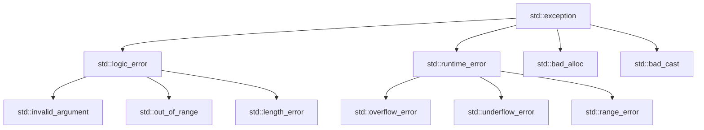

All standard exception types derive from `std::exception`, which declares a single virtual method, `const char* what() const noexcept`, returning a human-readable description. `std::logic_error` covers programmer errors detectable in principle before runtime (bad arguments, out-of-range access); `std::runtime_error` covers errors only detectable during execution (overflow, I/O failures). Catching `const std::exception&` (by reference, to avoid slicing — see [Q153](#153-what-is-the-difference-between-catching-by-value-pointer-and-reference)) is a common catch-all for "any standard exception."

### 152. How do you create a custom exception class?

Derive from `std::exception` (or a more specific standard exception like `std::runtime_error`), and override `what()`.

```cpp
class InsufficientFundsException : public std::runtime_error {
public:
    explicit InsufficientFundsException(double shortfall)
        : std::runtime_error("Insufficient funds, short by " + std::to_string(shortfall)),
          shortfall_(shortfall) {}

    double shortfall() const { return shortfall_; }
private:
    double shortfall_;
};

void withdraw(double amount, double balance) {
    if (amount > balance) throw InsufficientFundsException(amount - balance);
}

try {
    withdraw(500, 100);
} catch (const InsufficientFundsException& e) {
    std::cerr << e.what() << ", need " << e.shortfall() << " more\n";
}
```

Deriving from `std::runtime_error` (rather than `std::exception` directly) is convenient since it already stores and returns the message string via `what()` for you.

### 153. What is the difference between catching by value, pointer, and reference?

```cpp
try { throw DerivedException("oops"); }
catch (BaseException e)   { /* by value — SLICES the exception down to BaseException! loses derived info */ }
catch (BaseException* p)  { /* by pointer — requires throwing a pointer too, unusual and leak-prone */ }
catch (const BaseException& e) { /* by reference — PREFERRED: no slicing, no extra copy, works polymorphically */ }
```

**Catch by `const Base&`** is the standard, correct idiom: it avoids [object slicing](#89-what-is-object-slicing) (so `e.what()` or a virtual override still resolves to the actual derived type), avoids an unnecessary copy, and works uniformly whether the thrown object was a `Base` or any `Derived`. Catching by pointer is rare and generally discouraged (it implies `throw`ing a pointer, which raises awkward ownership questions about who's responsible for `delete`ing it).

### 154. What is stack unwinding?

When an exception is thrown and no `catch` handler exists in the current scope, the runtime "unwinds" the call stack — walking back up through each enclosing function call, **destructing every local object** in each stack frame it passes through (in reverse order of construction) — until it finds a `try` block with a matching `catch` handler, or reaches `main()` (and, finding none, calls [`std::terminate`](#160-what-is-stdterminate-and-when-is-it-called)).

```cpp
void c() { throw std::runtime_error("fail"); }
void b() {
    Resource r;   // r's destructor WILL run during unwinding, even though b() never catches anything
    c();
}
void a() {
    try { b(); }
    catch (const std::exception& e) { std::cout << "caught in a(): " << e.what(); }
}
```

This is precisely why RAII works so reliably with exceptions: every local RAII object's destructor is guaranteed to run during unwinding, releasing its resource, regardless of how far up the stack the exception has to travel before being caught.

### 155. What is a noexcept specifier, and why does it matter?

`noexcept` marks a function as guaranteeing it will **never** throw an exception (or, if it somehow does, the program calls `std::terminate` immediately rather than trying to propagate/unwind).

```cpp
void mayThrow();
void wontThrow() noexcept { /* ... */ }

void safeOperation() noexcept(noexcept(mayThrow())) { /* conditional noexcept, matches mayThrow's spec */ }
```

It matters for two big reasons: (1) it lets the compiler skip generating exception-handling/unwinding machinery for that function, a real (if usually small) performance win; (2) critically, **move constructors/assignment operators should be marked `noexcept`** whenever possible — `std::vector` and other containers check this at compile time, and will only use your move operations during reallocation if they're `noexcept` (otherwise, to preserve their strong exception-safety guarantee, they fall back to the slower **copy** operations instead, silently losing the performance benefit of moves you wrote).

### 156. What happens if an exception is thrown from a destructor?

This is dangerous and generally avoided: if a destructor throws **while the stack is already unwinding due to another active exception**, the C++ runtime has two simultaneous exceptions with nowhere sensible to go, and calls `std::terminate()` immediately — the program aborts, and neither exception's handler ever runs.

```cpp
class Dangerous {
public:
    ~Dangerous() {
        throw std::runtime_error("destructor failure");   // DANGEROUS
    }
};

void f() {
    Dangerous d;
    throw std::runtime_error("first exception");   // during unwinding, ~Dangerous() also throws -> std::terminate()!
}
```

**Rule**: destructors should never let exceptions escape. Since C++11, destructors are implicitly `noexcept` by default — if one does throw and that exception tries to leave the destructor, `std::terminate` is called even *without* a concurrent unwinding in progress. If a cleanup operation might fail, catch and handle/log the error *inside* the destructor rather than letting it propagate.

### 157. Does C++ have checked exceptions like Java?

No. Java distinguishes **checked exceptions** (must be declared in a method's `throws` clause or caught, enforced by the compiler) from unchecked ones. C++ has **no such distinction and no compile-time enforcement at all** — any function can throw any exception type at any time, and the compiler never forces a caller to catch or declare it. The closest historical C++ mechanism, *dynamic exception specifications* (`void f() throw(MyException);`), existed but was checked only at **runtime** (not compile time), was widely considered a design mistake, and was deprecated in C++11 and fully **removed in C++17** — leaving only `noexcept` (a binary "does or doesn't throw," not a list of specific types) as the modern replacement.

### 158. What is the use of catch(...)?

`catch (...)` is a catch-all handler that matches **any** thrown value, regardless of its type — including types that aren't even related to `std::exception` (C++ technically allows throwing any type at all, e.g., `throw 42;` or `throw "oops";`, though throwing non-`std::exception`-derived types is bad practice).

```cpp
try {
    riskyOperation();
} catch (const std::exception& e) {
    std::cerr << "known error: " << e.what() << "\n";
} catch (...) {                                    // last resort — catches literally anything else
    std::cerr << "unknown error occurred\n";
    throw;                                            // re-throw, e.g. to let a higher layer log & terminate cleanly
}
```

Since `catch (...)` gives you no information about *what* was actually thrown (you can't call `.what()` or inspect it), it's typically used as a last-resort safety net (e.g., at a top-level boundary like `main()` or a thread entry point, to avoid `std::terminate` from an uncaught exception) rather than for real error-handling logic.

### 159. What are exception handling best practices in C++?

- **Throw by value, catch by `const&`** — avoids slicing and unnecessary copies.
- **Prefer standard exception types** (or derive from `std::runtime_error`/`std::logic_error`) instead of throwing raw ints/strings/custom unrelated types.
- **Only use exceptions for genuinely exceptional conditions**, not routine control flow — they have real (if often overstated) runtime cost and can make code harder to follow when overused for normal branching.
- **Never let a destructor throw** ([Q156](#156-what-happens-if-an-exception-is-thrown-from-a-destructor)).
- **Mark move operations `noexcept`** whenever truly non-throwing ([Q155](#155-what-is-a-noexcept-specifier-and-why-does-it-matter)).
- **Use RAII everywhere** so resources clean up automatically during unwinding — don't rely on manual cleanup code after a `try` block.
- **Catch specific types before general ones** — a `catch (...)` before a more specific `catch` would make the specific one unreachable (and most compilers warn about this).
- **Don't use exceptions across ABI/DLL boundaries or in noexcept-required contexts** (like most destructors, `swap()` implementations, or signal handlers).

### 160. What is std::terminate and when is it called?

`std::terminate()` is the function the C++ runtime calls when it hits a situation it fundamentally can't recover from with normal exception handling — by default, it calls `std::abort()`, immediately ending the program. It's triggered by:

- An exception is thrown but **no matching `catch` handler** exists anywhere up the call stack (an "uncaught exception").
- A `noexcept` function **does** throw ([Q155](#155-what-is-a-noexcept-specifier-and-why-does-it-matter)).
- A **destructor throws** while another exception is already unwinding ([Q156](#156-what-happens-if-an-exception-is-thrown-from-a-destructor)).
- An exception escapes a thread's entry function, or a `[[noreturn]]` function returns, among a few other edge cases.

```cpp
void f() { throw std::runtime_error("uncaught!"); }
int main() {
    f();     // nothing catches this -> std::terminate() -> std::abort() -> program crashes
}
```

You can install a custom handler via `std::set_terminate()`, but by the time it's called, the program is already in an unrecoverable state — the handler typically just logs something before the program still ends (a custom terminate handler cannot resume normal execution).

---

## Preprocessor & Compilation

### 161. What is the preprocessor, and what does it do?

The preprocessor is a text-substitution pass that runs **before** actual compilation, processing every line starting with `#` (a "directive"). It has no understanding of C++ syntax/types at all — it operates purely on text.

```cpp
#include "myheader.h"     // textually pastes the file's contents in
#define PI 3.14159         // textual find-and-replace
#ifdef DEBUG
    std::cout << "debug mode\n";
#endif
```

Main directives: `#include` (paste in a file), `#define`/`#undef` (macros), `#if`/`#ifdef`/`#ifndef`/`#else`/`#endif` (conditional compilation), and `#pragma` (compiler-specific instructions).

### 162. What is a macro, and what are its pitfalls?

A macro (`#define`) is a preprocessor text-substitution rule — either a simple constant or a function-like template that gets expanded (textually, blindly) everywhere it's used, before the compiler ever sees real C++ code.

```cpp
#define SQUARE(x) x * x

int result = SQUARE(3 + 2);   // expands to: 3 + 2 * 3 + 2  =  3 + 6 + 2  =  11, NOT 25! (operator precedence bug)

#define SQUARE2(x) ((x) * (x))
int result2 = SQUARE2(3 + 2);  // expands to: ((3+2) * (3+2)) = 25 — correct, but needs careful parenthesization

int a = 5;
int b = SQUARE2(a++);  // expands to ((a++) * (a++)) — a incremented TWICE, undefined order — classic macro trap
```

Pitfalls: no type checking (a macro accepts anything, syntactically valid or not), operator-precedence bugs unless every parameter and the whole expansion is heavily parenthesized, double-evaluation of arguments with side effects (as above), no scoping (macros are global and can clash across files), and much harder debugging (the debugger sees the *expanded* text, not your original macro call). Modern C++ prefers `const`/`constexpr` for constants and `inline`/template functions for parameterized logic — see [Q163](#163-what-is-the-difference-between-a-macro-and-an-inline-function).

### 163. What is the difference between a macro and an inline function?

```cpp
#define SQUARE(x) ((x) * (x))         // macro
inline int square(int x) { return x * x; } // inline function
```

| | Macro | Inline function |
|---|---|---|
| Processed by | Preprocessor (text substitution) | Compiler (real function, type-checked) |
| Type checking | None | Full |
| Debugging | Hard (debugger sees expanded text) | Normal (a real function, steppable) |
| Scoping | None — global, no namespaces | Normal C++ scoping rules apply |
| Evaluates arguments once | Not guaranteed (can double-evaluate side effects) | Guaranteed — arguments evaluated exactly like normal function calls |
| Can be overloaded/templated | No | Yes |

`inline` (a *hint* to the compiler to substitute the function body at the call site instead of a real call, avoiding call overhead — modern compilers largely decide this themselves regardless of the keyword) achieves the performance goal macros were historically used for, while remaining a type-safe, debuggable, properly scoped real function. Prefer inline/`constexpr` functions and `const`/`constexpr` variables over macros for essentially everything except conditional compilation and include guards, where macros remain necessary.

### 164. What is #pragma once vs traditional include guards?

Both solve the same problem — preventing a header from being processed twice in one translation unit ([Q7](#7-what-is-a-header-file-and-why-do-we-use-header-guards)) — with different tradeoffs:

```cpp
// Traditional include guard — portable, standard C++, but verbose and prone to name clashes
#ifndef MYHEADER_H
#define MYHEADER_H
// ... contents ...
#endif

// #pragma once — concise, and typically faster to compile (many compilers cache by file identity
// rather than re-scanning text), but not part of the official C++ standard (though virtually every
// modern compiler supports it)
#pragma once
// ... contents ...
```

`#pragma once` is simpler (no macro name to accidentally collide with another header's guard) and often slightly faster to compile, but it's technically a non-standard, compiler-specific extension (support is nearly universal in practice: GCC, Clang, MSVC all implement it) and can theoretically misbehave with unusual filesystem setups (the same file reachable via two different paths/symlinks). Many modern style guides use `#pragma once` for its simplicity; some large/portable codebases still prefer traditional guards for standards purity.

### 165. What is conditional compilation?

Using preprocessor directives to include or exclude blocks of code **before** compilation, based on defined macros — used for platform-specific code, debug-only logging, or feature flags.

```cpp
#ifdef _WIN32
    #include <windows.h>
#elif defined(__linux__)
    #include <unistd.h>
#endif

#ifdef DEBUG
    #define LOG(msg) std::cout << "[DEBUG] " << msg << "\n"
#else
    #define LOG(msg)          // no-op in release builds — compiled out entirely
#endif
```

The excluded branches are never even seen by the compiler proper — they're stripped out during preprocessing, so they don't need to be valid/compilable code for the current platform at all (useful for OS-specific headers that don't even exist on other platforms).

### 166. What are storage classes in C++ (auto, register, static, extern, thread_local)?

Storage class specifiers control a variable's **lifetime**, **linkage** (visibility across translation units), and (historically) storage location:

| Specifier | Meaning |
|---|---|
| `auto` | (Pre-C++11) "automatic storage duration" — the default for local variables; repurposed since C++11 for type deduction ([Q14](#14-what-is-the-auto-keyword-and-how-does-type-deduction-work)) |
| `register` | (Deprecated/removed as a storage hint in C++17) a *hint* to keep a variable in a CPU register; modern compilers ignore it and optimize on their own |
| `static` | At function scope: persists across calls, initialized once. At file/global scope: internal linkage (see [Q50](#50-what-is-an-anonymousunnamed-namespace-and-how-is-it-different-from-static-at-file-scope)). As a class member: shared across all instances ([Q45](#45-what-are-static-members-of-a-class)) |
| `extern` | Declares a variable/function defined elsewhere (another translation unit), giving it external linkage |
| `thread_local` (C++11) | Each thread gets its own independent instance of the variable |

```cpp
void counter() {
    static int calls = 0;   // persists across calls, initialized only the first time
    ++calls;
    std::cout << calls;
}
counter(); counter(); counter();   // prints 1, 2, 3

thread_local int threadId = 0;      // each thread sees its own separate copy
```

### 167. What is the difference between declaration and definition of a variable using extern?

`extern int x;` is a pure **declaration** — it tells the compiler "a variable named `x` of type `int` exists somewhere (possibly in another file), trust me" — without allocating any storage. The actual **definition** (which allocates storage) must exist exactly once, somewhere, without the `extern` keyword.

```cpp
// file1.cpp
int globalCounter = 0;              // DEFINITION — allocates storage

// file2.cpp
extern int globalCounter;            // DECLARATION only — refers to file1.cpp's globalCounter
void increment() { ++globalCounter; }  // links against the real one at link time
```

This is how a global variable can be shared across multiple `.cpp` files: declare it `extern` in a header (included everywhere it's used), and define it (without `extern`) exactly once in a single `.cpp` file — violating "exactly once" (defining it in two `.cpp` files, or forgetting the definition entirely) causes a linker error ([Q6](#6-what-is-the-role-of-the-linker-in-c)).

### 168. What is name mangling, and why does C++ need extern "C"?

**Name mangling** is how the C++ compiler encodes extra information (namespace, class, parameter types — needed to support overloading) into the symbol name it emits for the linker, since a linker only understands flat, unique symbol names, not C++'s overload resolution rules.

```cpp
void foo(int);       // might mangle to something like _Z3fooi
void foo(double);     // mangles differently, e.g. _Z3food — this is how two foo()s coexist at link time
```

C, by contrast, has no overloading, so a C compiler emits the function name completely unmangled (`foo`). This becomes a problem when C++ code needs to call a C library (or be called from C) — the mangled C++ name wouldn't match the plain C symbol the linker is looking for. `extern "C"` tells the C++ compiler "use C-style (unmangled) linkage for this declaration," making interoperability possible:

```cpp
extern "C" {
    void c_library_function(int x);   // compiled with C linkage — no name mangling
}
// or for a whole header written in C:
extern "C" {
    #include "some_c_library.h"
}
```

This is exactly why C library headers wrapped for C++ use (e.g., much of the C standard library, `<cstdio>` etc.) are guarded with `extern "C" { ... }` internally (often behind an `#ifdef __cplusplus` check, since the header itself might be compiled by either a C or C++ compiler).

---

## STL Overview & Sequence Containers

### 169. What is the Standard Template Library (STL)? What are its components?

The STL is C++'s generic-programming library providing ready-made, highly-optimized data structures and algorithms, all built on templates so they work with any compatible type. It has four main component families that work together:

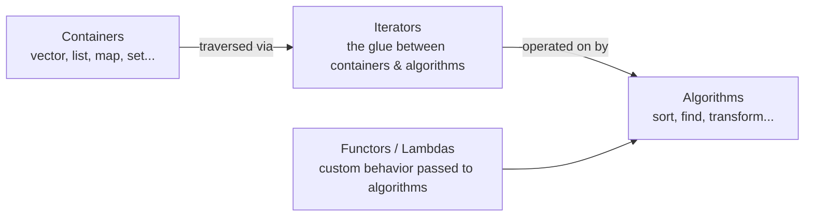

1. **Containers** — data structures that store collections of objects (`vector`, `list`, `map`, `set`, `unordered_map`, etc.)
2. **Iterators** — a generalized "pointer-like" abstraction for traversing a container, decoupling algorithms from the specific container implementation.
3. **Algorithms** — generic functions (`sort`, `find`, `accumulate`, `transform`, ~100+ total) that operate on ranges via iterators, working identically across different container types.
4. **Functors / function objects / lambdas** — objects (or lambdas) callable like functions, used to customize algorithm behavior (a comparison function for `sort`, a predicate for `find_if`).

The key design insight: algorithms and containers are **decoupled** — `std::sort` doesn't know anything about `std::vector` specifically, it just works with any iterators that support random access. This is why, e.g., `std::find` works identically on a `vector`, a `list`, or a `set`.

### 170. What are the main categories of STL containers?

- **Sequence containers** — store elements in a linear order, accessed by position: `array`, `vector`, `deque`, `list`, `forward_list`.
- **Associative containers** — store elements in sorted order, keyed for fast lookup, implemented as balanced binary search trees: `set`, `multiset`, `map`, `multimap`.
- **Unordered associative containers** (C++11) — hash-table-based versions of the above, trading order for average O(1) lookup: `unordered_set`, `unordered_multiset`, `unordered_map`, `unordered_multimap`.
- **Container adapters** — restricted interfaces built on top of another container, exposing a narrower, purpose-specific API: `stack`, `queue`, `priority_queue`.

### 171. What is std::array, and how is it different from a C-style array?

`std::array<T, N>` (C++11, `<array>`) is a fixed-size array wrapped in a proper STL container interface — the size `N` is a compile-time constant (a template parameter), and the data lives inline (on the stack if the `array` itself is a local variable), with **zero overhead** versus a raw C-style array.

```cpp
int cArr[5] = {1,2,3,4,5};              // C-style array — decays to a pointer when passed to functions, no .size()
std::array<int, 5> arr = {1,2,3,4,5};    // std::array — knows its own size, works with STL algorithms/iterators

arr.size();          // 5 — no manual bookkeeping needed
arr.at(2);            // bounds-checked access (throws std::out_of_range if out of bounds)
std::sort(arr.begin(), arr.end());   // works directly with STL algorithms
```

Advantages over a raw array: it doesn't decay to a pointer (so it retains its size information when passed to a function), supports iterators/algorithms directly, has bounds-checked `.at()`, and can be copied with `=` (a raw array cannot be assigned wholesale). Both are fixed-size (cannot grow) and stack-allocated by default.

### 172. What is std::vector, and how does it grow internally?

`std::vector<T>` is a dynamically-resizable array — contiguous memory, random-access, and the default general-purpose sequence container in almost all C++ code.

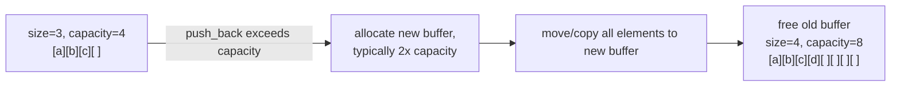

When you `push_back` beyond its current **capacity**, the vector: (1) allocates a new, larger buffer (typically **doubling** the capacity — the exact growth factor is implementation-defined, often 1.5x–2x), (2) moves (or copies, if the element type isn't nocopy-movable) every existing element into the new buffer, (3) frees the old buffer. This makes `push_back` **amortized O(1)** — most calls are instant, but occasionally one call does O(n) work, and that cost is "spread out" across all the O(1) calls when averaged.

```cpp
std::vector<int> v;
v.reserve(1000);    // pre-allocate capacity up front, avoiding repeated reallocation if you know the size ahead of time
for (int i = 0; i < 1000; ++i) v.push_back(i);  // no reallocation happens during this loop now
```

### 173. What is the difference between size() and capacity() of a vector?

- **`size()`** — the number of elements *currently stored* in the vector.
- **`capacity()`** — the number of elements the vector's *currently allocated buffer* could hold **before** it needs to reallocate.

```cpp
std::vector<int> v;
v.reserve(10);
std::cout << v.size();       // 0 — nothing added yet
std::cout << v.capacity();    // 10 — space is reserved, but unused

v.push_back(1); v.push_back(2);
std::cout << v.size();        // 2
std::cout << v.capacity();     // still 10 — no reallocation needed yet, room to spare
```

`capacity() >= size()` always holds. `.shrink_to_fit()` is a (non-binding) request to release unused capacity back down toward `size()`.

### 174. What happens during vector reallocation, and why can it invalidate iterators?

When a `push_back`/`insert` forces a `vector` to grow past its current capacity, it allocates an entirely **new** memory block and moves all elements there — the **old** memory block is then freed. Any iterator, pointer, or reference that pointed *into the old block* is now **dangling** — it points at freed memory.

```cpp
std::vector<int> v = {1, 2, 3};
int& ref = v[0];
auto it = v.begin();

v.push_back(4);   // MIGHT reallocate — depends on whether capacity was already sufficient

// ref and it are now POTENTIALLY DANGLING — using them is undefined behavior if a reallocation happened
std::cout << ref;   // undefined behavior (if reallocated)
```

This is a classic, common bug — especially inside a loop that both iterates *and* pushes to the same vector. **Fixes**: call `.reserve()` up front with a known/estimated final size to avoid reallocation entirely during the loop, or re-fetch iterators/references after any operation that might reallocate, or use an index instead of an iterator/pointer/reference where growth is expected mid-loop (indices remain valid across reallocation, since they're relative, not absolute addresses).

### 175. What is std::deque, and how is it different from std::vector?

`std::deque<T>` ("double-ended queue," `<deque>`) supports **O(1) insertion/removal at both ends** (`push_front` *and* `push_back`), unlike `vector`, which is only efficient at the back. It's typically implemented as a sequence of fixed-size chunks/blocks (not one single contiguous buffer), with an index structure mapping logical position to the right chunk.

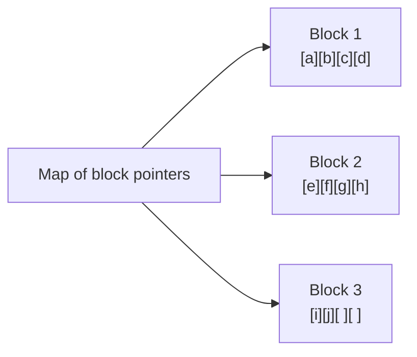

```cpp
std::deque<int> dq;
dq.push_back(3);    // O(1)
dq.push_front(1);    // O(1) — vector can't do this efficiently (would be O(n), shifting everything)
dq.push_back(4);
dq.push_front(0);
// dq is now: 0, 1, 3, 4
```

| | `vector` | `deque` |
|---|---|---|
| Memory | One contiguous block | Multiple fixed-size blocks |
| `push_back` | Amortized O(1) | Amortized O(1) |
| `push_front` | O(n) — must shift everything | Amortized O(1) |
| Random access `[]` | O(1), and cache-friendly (truly contiguous) | O(1), but slightly slower (extra indirection through the block map) |
| Iterator invalidation | On any reallocation | Insert/erase at the ends generally preserve iterators to *other* elements (implementation-defined nuances apply) |

### 176. What is std::list, and when would you use it over a vector?

`std::list<T>` (`<list>`) is a **doubly-linked list** — each element is a separately-allocated node with pointers to its previous and next neighbors. Insertion/removal **anywhere** (given an iterator to the position) is O(1), since it only involves re-linking a few pointers, with **no shifting of other elements** and **no iterator invalidation** for unrelated elements.

```cpp
std::list<int> lst = {1, 2, 3, 4, 5};
auto it = std::find(lst.begin(), lst.end(), 3);
lst.insert(it, 99);     // O(1) — just relinks pointers around the found position, no shifting
lst.erase(it);            // O(1) — no shifting, and iterators to OTHER elements remain valid
```

Use `list` over `vector` when you need **frequent insertion/removal in the middle** of the sequence and don't need random access (`list` has no `operator[]` — accessing the k-th element is O(k), not O(1)). In practice, `vector` is still usually the better default even for many insert/erase-heavy workloads, because of cache locality — a `list`'s scattered nodes cause many more cache misses than `vector`'s contiguous, cache-friendly memory, often outweighing the algorithmic advantage in real-world performance. Reach for `list` specifically when you need stable iterators across insertions/erasures elsewhere in the container, or true O(1) splicing (`list::splice`).

### 177. What is std::forward_list?

`std::forward_list<T>` (C++11, `<forward_list>`) is a **singly-linked** list — each node only points to the *next* node, not the previous one. It's more memory-efficient than `std::list` (one pointer per node instead of two) but can only be traversed **forward** — no `.size()` (would require an O(n) traversal to be always-available, so it's deliberately omitted to keep expectations honest), no `push_back`/`rbegin` (no efficient way to reach or track the end from a purely-forward structure). It's designed for scenarios extremely tight on memory overhead per element where you genuinely never need backward traversal or a cheap size query.

### 178. Compare vector, list, and deque in terms of performance.

| Operation | `vector` | `deque` | `list` |
|---|---|---|---|
| Random access `v[i]` | O(1), cache-friendly | O(1), slight overhead | O(n) — not supported directly |
| `push_back` | Amortized O(1) | Amortized O(1) | O(1) |
| `push_front` | O(n) | Amortized O(1) | O(1) |
| Insert/erase in middle | O(n) — must shift | O(n) — must shift | O(1) (given an iterator) |
| Iterator stability across insert | Invalidated on reallocation | Mostly stable at the ends | Always stable (except erased element) |
| Memory layout | Contiguous | Chunked | Scattered nodes |
| Cache locality | Best | Good | Worst |

**Practical guidance**: default to `vector` unless you have a specific, measured reason not to — its contiguous memory layout makes it the fastest option for iteration and random access in the overwhelming majority of real workloads, even for many insert/remove-heavy cases, because of cache effects. Reach for `deque` when you need efficient push/pop at *both* ends (e.g., implementing a sliding window or a plain FIFO queue). Reach for `list` only when you need guaranteed O(1) insert/erase at arbitrary, iterator-known positions *and* stable iterators/references across those mutations, and profiling shows `vector`'s shifting cost is actually the bottleneck.

---

## STL Associative & Unordered Containers

### 179. What is std::set, and how is it implemented internally?

`std::set<T>` stores a collection of **unique**, automatically **sorted** elements. It's implemented as a self-balancing binary search tree — specifically a **Red-Black Tree** in virtually every major implementation (libstdc++, libc++, MSVC STL), giving O(log n) insertion, deletion, and lookup.

```cpp
std::set<int> s = {5, 3, 8, 3, 1};   // duplicate 3 is silently ignored — set stores unique elements
// s is now: {1, 3, 5, 8} — always kept in sorted order automatically

s.insert(4);       // O(log n)
s.find(8);          // O(log n) — returns an iterator, or s.end() if not found
s.erase(3);          // O(log n)

for (int x : s) std::cout << x << " ";  // 1 4 5 8 — iterates in sorted order, always
```

### 180. What is std::multiset?

Identical to `std::set`, except it **allows duplicate elements** — still kept in sorted order, still a Red-Black Tree internally, O(log n) operations.

```cpp
std::multiset<int> ms = {5, 3, 8, 3, 1};
// ms is: {1, 3, 3, 5, 8} — duplicates ARE kept

ms.count(3);           // 2 — how many copies of 3
auto range = ms.equal_range(3);   // pair of iterators bounding all the 3's
```

### 181. What is std::map, and how is it implemented internally?

`std::map<K, V>` stores **key-value pairs**, sorted automatically by key, with each key appearing **at most once**. Like `set`, it's implemented as a self-balancing **Red-Black Tree**, giving O(log n) insertion, lookup, and deletion.

```cpp
std::map<std::string, int> ages;
ages["Alice"] = 30;             // insert or update — operator[] default-constructs the value if the key is new
ages["Bob"] = 25;
ages.insert({"Carol", 35});      // alternative insertion, doesn't overwrite if key already exists

ages.find("Alice");               // O(log n), returns an iterator (or end() if not found)
ages.at("Bob");                    // O(log n), throws std::out_of_range if missing (unlike operator[], which inserts!)

for (const auto& [name, age] : ages) {   // C++17 structured bindings — iterates in KEY-sorted order
    std::cout << name << ": " << age << "\n";
}
```

**Gotcha**: `map["key"]` on a *non-existent* key **silently inserts** it (default-constructing the value) — use `.find()` or `.at()`/`.contains()` (C++20) if you just want to check existence without accidentally mutating the map.

### 182. What is std::multimap?

Like `std::map`, but allows **multiple values for the same key** — still sorted by key, still a Red-Black Tree, O(log n) operations. It has **no `operator[]`** (there'd be no single unambiguous value to return for a duplicated key).

```cpp
std::multimap<std::string, int> scores;
scores.insert({"Alice", 90});
scores.insert({"Alice", 85});    // both entries coexist — "Alice" now maps to two values

auto range = scores.equal_range("Alice");  // iterator range covering all of Alice's entries
for (auto it = range.first; it != range.second; ++it) std::cout << it->second << " ";  // 90 85
```

### 183. What is the difference between map and unordered_map?

| | `std::map` | `std::unordered_map` |
|---|---|---|
| Internal structure | Red-Black Tree (balanced BST) | Hash table |
| Order | Always sorted by key | No defined order (implementation/hash-dependent) |
| Lookup/insert/erase | O(log n), guaranteed | O(1) average, O(n) worst case |
| Requires | `operator<` on the key | `operator==` on the key, plus a hash function (`std::hash<Key>` specialization) |
| Iterator stability | Very stable (insert/erase doesn't invalidate other iterators) | Insert can trigger rehashing, invalidating iterators (though references/pointers to elements survive rehashing) |
| Memory overhead | Tree node pointers (parent/left/right) | Hash bucket array + chaining pointers |

Use `unordered_map` for raw lookup speed when order doesn't matter (the overwhelmingly common case); use `map` when you need sorted iteration, range queries (`lower_bound`/`upper_bound`), or when the key type has no good hash function readily available.

### 184. What is std::unordered_set, and how does it handle collisions?

`std::unordered_set<T>` stores unique elements with **no defined order**, using a hash table internally for average O(1) insertion, lookup, and deletion.

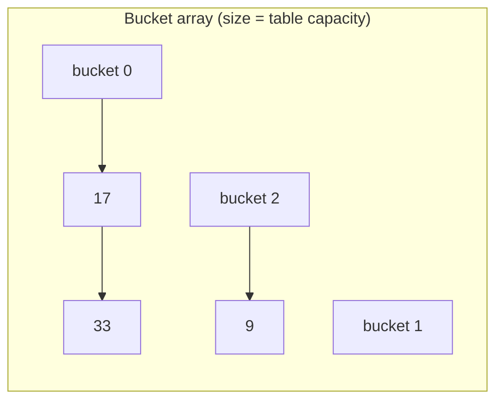

Collisions (two different elements hashing to the same bucket index) are handled via **chaining** — each bucket holds a linked list of all elements that hashed there; on a collision, the new element is simply appended to that bucket's list. Lookup hashes the key to find the right bucket, then linearly scans that (hopefully short) chain for an exact match. See [Q233](#233-how-do-hash-tables-handle-collisions-chaining-vs-open-addressing) for the general concept, and [Q185](#185-what-is-load-factor-and-rehashing-in-unordered-containers) for how the table keeps chains short.

### 185. What is load factor and rehashing in unordered containers?

**Load factor** = `size() / bucket_count()` — the average number of elements per bucket. A high load factor means longer collision chains on average, degrading lookup from O(1) toward O(n).

```cpp
std::unordered_map<int, int> m;
std::cout << m.max_load_factor();   // default is usually 1.0

for (int i = 0; i < 1000; ++i) m[i] = i;   // as elements are added, load factor rises...

// ...once it would exceed max_load_factor, the container automatically REHASHES:
// allocates a larger bucket array (more buckets), and re-distributes every existing
// element into its new bucket (based on hash(key) % new_bucket_count)
```

**Rehashing** keeps the load factor bounded (and thus lookups close to O(1) on average) by growing the bucket array and redistributing elements whenever the load factor would otherwise get too high — conceptually similar to how `vector` reallocates and doubles capacity, but here it also changes which bucket every element belongs to. Rehashing invalidates iterators (but not references/pointers to the elements themselves, which is a specific guarantee the standard makes for node-based unordered containers). Calling `.reserve(n)` up front, if you know the approximate final size, avoids repeated rehashing during a large insertion burst — the same optimization idea as `vector::reserve`.

### 186. What is std::unordered_multimap / std::unordered_multiset?

The hash-table-based counterparts of `multimap`/`multiset` — allow duplicate keys/elements, no ordering guarantee, average O(1) operations instead of `multimap`/`multiset`'s O(log n). Use `.equal_range(key)` the same way as their ordered counterparts to iterate all entries sharing a key.

### 187. When would you prefer map over unordered_map, and vice versa?

**Prefer `unordered_map`** when: you only need lookup/insert/erase by key (no ordering needs), and want the fastest average-case performance — this is the right default for the vast majority of "dictionary"/"cache"/"lookup table" use cases.

**Prefer `map`** when:
- You need elements in **sorted key order** (e.g., iterating a leaderboard from highest to lowest score).
- You need **range queries**: "all keys between X and Y" (`lower_bound`/`upper_bound`), which `unordered_map` cannot do efficiently at all.
- You need **worst-case guaranteed O(log n)** performance — `unordered_map` degrades to O(n) worst case under hash collisions (a real concern in adversarial/security-sensitive contexts, where an attacker could craft inputs that all hash to the same bucket).
- Your key type has no natural, well-distributed hash function readily available, but does have a natural `operator<` (e.g., composite/tuple keys — though `std::hash` can often be specialized for these too, `operator<` is frequently simpler to get right).

### 188. What is std::flat_map (C++23)?

`std::flat_map<K, V>` (C++23, `<flat_map>`) stores key-value pairs in **contiguous, sorted arrays** (conceptually: one sorted `vector` of keys, one parallel `vector` of values) instead of a tree of individually-allocated nodes, while keeping `map`'s sorted-key interface (`lower_bound`, ordered iteration).

```cpp
std::flat_map<int, std::string> fm;
fm[3] = "three";
fm[1] = "one";
fm[2] = "two";
// internally stored as sorted, contiguous arrays: keys [1,2,3], values ["one","two","three"]
```

Because it's backed by contiguous memory instead of scattered tree nodes, iteration and lookup benefit from much better **cache locality** than `std::map` — often significantly faster in practice for read-heavy workloads, despite insert/erase being O(n) (shifting array elements) rather than `map`'s O(log n). It's the STL's built-in version of a pattern many performance-conscious codebases were already hand-rolling ("sorted vector of pairs") before C++23 standardized it. There's a corresponding `std::flat_set` too.

---

## STL Container Adapters

### 189. What is std::stack, and what is its underlying container?

`std::stack<T>` is a **container adapter** providing LIFO (Last-In-First-Out) access — `push`, `pop`, `top` — by wrapping (by default) a `std::deque` and restricting its interface to only those operations. You can swap in a different underlying container (`vector` or `list`) as a second template argument, as long as it supports `push_back`/`pop_back`/`back`.

```cpp
std::stack<int> s;                          // default: backed by std::deque
std::stack<int, std::vector<int>> s2;         // explicitly backed by std::vector instead

s.push(1); s.push(2); s.push(3);
std::cout << s.top();    // 3 — the most recently pushed element
s.pop();                   // removes 3 (pop() returns void — use top() first, then pop())
std::cout << s.top();     // 2
```

All operations are O(1). `std::stack` has **no iterators** at all — by design, you can only ever interact with the top, enforcing LIFO discipline structurally rather than just by convention.

### 190. What is std::queue?

`std::queue<T>` is a container adapter providing FIFO (First-In-First-Out) access — `push` at the back, `pop`/`front` at the front — by default wrapping `std::deque` (which efficiently supports operations at both ends, [Q175](#175-what-is-stddeque-and-how-is-it-different-from-stdvector)).

```cpp
std::queue<int> q;
q.push(1); q.push(2); q.push(3);
std::cout << q.front();   // 1 — the earliest-pushed, still-present element
q.pop();                    // removes 1
std::cout << q.front();     // 2
```

Like `stack`, all operations are O(1), and it deliberately exposes no iterators/random access — just the FIFO interface.

### 191. What is std::priority_queue, and how is it implemented?

`std::priority_queue<T>` always keeps the **largest** element (by default, using `operator<`; configurable via a custom comparator) accessible at `top()` in O(1), with O(log n) insertion (`push`) and removal (`pop`). It's implemented as a **binary heap** (specifically a max-heap by default) laid out inside a `vector` (or another random-access container) — no separate node objects, just array indices computed from parent/child relationships (`parent = (i-1)/2`, `children = 2i+1, 2i+2`).

```cpp
std::priority_queue<int> pq;
pq.push(3); pq.push(1); pq.push(4); pq.push(1); pq.push(5);
while (!pq.empty()) {
    std::cout << pq.top() << " ";   // 5 4 3 1 1 — always extracts the current max next
    pq.pop();
}
```

Under the hood, `push` appends to the end of the underlying vector and "bubbles up" (`sift up`) to restore the heap property; `pop` swaps the last element into the root's position, shrinks the vector, and "bubbles down" (`sift down`) — both O(log n), since a binary heap's height is `log₂(n)`.

### 192. How do you implement a min-heap using priority_queue?

`priority_queue` defaults to a **max-heap** (largest element on top). For a min-heap, supply a custom comparator — `std::greater<T>` flips the ordering so the *smallest* element ends up on top.

```cpp
std::priority_queue<int, std::vector<int>, std::greater<int>> minHeap;
minHeap.push(3); minHeap.push(1); minHeap.push(4); minHeap.push(1); minHeap.push(5);
while (!minHeap.empty()) {
    std::cout << minHeap.top() << " ";   // 1 1 3 4 5 — smallest first
    minHeap.pop();
}

// For a custom type, supply a lambda/functor comparator:
auto cmp = [](const Task& a, const Task& b) { return a.priority > b.priority; };  // reversed for min-heap behavior
std::priority_queue<Task, std::vector<Task>, decltype(cmp)> taskQueue(cmp);
```

The three template parameters are: the element type, the underlying container (must be `vector` or `deque`), and the comparator type — this three-parameter signature is a very common interview gotcha, since most people only remember the element type.

---

## STL Iterators

### 193. What is an iterator in C++?

An iterator is a generalized, pointer-like object that lets you traverse a container's elements one at a time, without the traversing code needing to know the container's actual internal structure. It supports (a subset of) pointer-like operations — dereference (`*it`), advance (`++it`), comparison (`it != end`) — which is precisely what lets the *same* generic algorithm (`std::sort`, `std::find`) work across wildly different container implementations.

```cpp
std::vector<int> v = {1, 2, 3};
std::vector<int>::iterator it = v.begin();
while (it != v.end()) {
    std::cout << *it << " ";   // dereference, like a pointer
    ++it;                        // advance
}
```

### 194. What are the categories of iterators (input, output, forward, bidirectional, random access)?

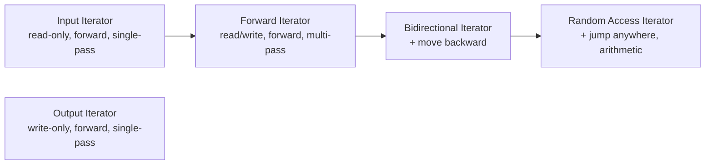

Each category is a strict superset of capabilities of the one before it (algorithms declare the *minimum* category they need, and accept any container providing that category or better):

| Category | Capabilities | Example container |
|---|---|---|
| Input | Read, `++`, single-pass only | `std::istream_iterator` |
| Output | Write, `++`, single-pass only | `std::ostream_iterator`, `back_inserter` |
| Forward | Read/write, `++`, multi-pass (can re-traverse) | `std::forward_list` |
| Bidirectional | + `--` (move backward) | `std::list`, `std::set`, `std::map` |
| Random Access | + `it + n`, `it[n]`, `<`, full pointer arithmetic | `std::vector`, `std::deque`, `std::array`, raw pointers |
| Contiguous (C++20) | + guarantees underlying elements are laid out contiguously in memory | `std::vector`, `std::array` |

This hierarchy is exactly why `std::sort` (which needs random access, for its O(n log n) partitioning) works on `vector` but **not** on `list` (`list` provides only bidirectional) — you must use `list::sort()`, the container's own member function, instead ([Q202](#202-what-is-the-difference-between-stdsort-and-stdstable_sort)).

### 195. What is the difference between begin()/end() and cbegin()/cend()?

`begin()`/`end()` return iterators that (for a non-const container) allow both reading and writing; `cbegin()`/`cend()` (C++11) always return **const_iterator**s, which only permit reading, regardless of whether the container itself is `const`.

```cpp
std::vector<int> v = {1, 2, 3};
auto it = v.begin();
*it = 10;              // OK — mutable iterator, allowed to write

auto cit = v.cbegin();
// *cit = 10;          // ERROR — const_iterator, read-only

for (auto it = v.cbegin(); it != v.cend(); ++it) {
    std::cout << *it;    // read-only traversal, expresses intent clearly even though v itself isn't const
}
```

Using `cbegin()`/`cend()` when you're only reading documents that intent directly in the code and lets the compiler catch accidental mutation.

### 196. What is a reverse iterator?

A reverse iterator (`rbegin()`/`rend()`) traverses a container **backward** — from the last element to the first — while still using the normal `++` (which, internally, actually moves it *backward* through the container) to advance.

```cpp
std::vector<int> v = {1, 2, 3, 4, 5};
for (auto it = v.rbegin(); it != v.rend(); ++it) {
    std::cout << *it << " ";   // 5 4 3 2 1
}
```

Internally, `std::reverse_iterator` wraps a normal (forward) iterator and adjusts dereferencing by one position (`*rit` is implemented as `*(base_iterator - 1)`) — this is why `rbegin()` conceptually sits "one past" the last real element and `rend()` sits "one before" the first, mirroring how `begin()`/`end()` work in the forward direction.

### 197. What is iterator invalidation?

Iterator invalidation is when an operation on a container (insertion, deletion, or reallocation) causes previously-obtained iterators, pointers, or references into that container to become **invalid** — dereferencing them afterward is undefined behavior. Rules vary significantly by container:

| Container | Invalidated by |
|---|---|
| `vector` | Any insertion that triggers reallocation invalidates **all** iterators/pointers/references; even without reallocation, insertion/erasure invalidates everything from the insertion/erasure point onward |
| `deque` | Insertion/erasure at the ends generally preserves iterators to other elements; in the middle, invalidates everything |
| `list`/`forward_list` | Only the iterator to the specific **erased** element is invalidated — everything else stays valid |
| `map`/`set` (and multi-versions) | Only the iterator to the specific **erased** element is invalidated |
| `unordered_map`/`unordered_set` | Insertion may trigger **rehashing**, invalidating all iterators — but references/pointers to individual elements survive rehashing |

See [Q174](#174-what-happens-during-vector-reallocation-and-why-can-it-invalidate-iterators) for the `vector` case in detail. General rule of thumb: never trust an iterator after any mutating operation on its container unless you've specifically checked that operation's invalidation guarantees for that container type.

### 198. What is the difference between an iterator and a pointer?

A raw pointer is technically already a valid (random-access) iterator for a plain array — pointer arithmetic (`p++`, `*p`, `p + n`) matches exactly what a random-access iterator needs to support, and `std::sort(arr, arr + n)` on a raw C array works for exactly this reason. The distinction is that an **iterator is a generalized abstraction** — a *concept*, not a specific type — that any container can implement to provide iteration semantics appropriate to its own internal structure (e.g., a `list`'s iterator internally follows linked-list `next`/`prev` pointers on `++`/`--`, even though it exposes the same `*`/`++`/`==` interface a raw pointer does). Every raw pointer can serve as an iterator; not every iterator is (or behaves like) a raw pointer.

### 199. What are insert iterators (back_inserter, front_inserter, inserter)?

Insert iterators are special **output iterators** (`<iterator>`) that, instead of overwriting an existing element on assignment, **insert a new element** into the underlying container — they adapt algorithms designed to write into a fixed-size range (like `std::copy`) so they can instead grow a container dynamically.

```cpp
std::vector<int> src = {1, 2, 3};
std::vector<int> dest;

std::copy(src.begin(), src.end(), std::back_inserter(dest));   // calls dest.push_back(x) for each x — dest grows to {1,2,3}

std::list<int> lst;
std::copy(src.begin(), src.end(), std::front_inserter(lst));    // calls lst.push_front(x) — lst ends up REVERSED: {3,2,1}

std::set<int> s;
std::copy(src.begin(), src.end(), std::inserter(s, s.begin()));  // calls s.insert(x) at the given position hint
```

Without an insert iterator, `std::copy`'s destination range would need to *already* have enough pre-allocated elements to overwrite — insert iterators let algorithms grow the destination container on the fly instead, which is an extremely common and idiomatic pattern (`std::back_inserter` especially, used constantly with `std::copy`, `std::transform`, and similar algorithms).

---

## STL Algorithms

### 200. What is the <algorithm> header, and what kinds of algorithms does it provide?

`<algorithm>` provides ~100 generic, iterator-based functions that operate uniformly across any compatible container, grouped roughly into:

- **Non-modifying**: `find`, `count`, `all_of`/`any_of`/`none_of`, `for_each`, `equal`, `search`.
- **Modifying**: `copy`, `transform`, `replace`, `fill`, `remove` (see the [erase-remove idiom](#208-what-is-the-difference-between-stdremove-and-container-erase-the-erase-remove-idiom)), `unique`, `reverse`, `rotate`.
- **Sorting**: `sort`, `stable_sort`, `partial_sort`, `nth_element`, `is_sorted`.
- **Binary search (on sorted ranges)**: `binary_search`, `lower_bound`, `upper_bound`, `equal_range`.
- **Set operations (on sorted ranges)**: `set_union`, `set_intersection`, `set_difference`.
- **Min/max**: `min`, `max`, `min_element`, `max_element`, `clamp` (C++17).
- **Numeric** (technically in the separate `<numeric>` header): `accumulate`, `reduce`, `inner_product`, `partial_sum`.

Because they operate on iterator ranges (`[begin, end)`) rather than being tied to a specific container's methods, the exact same call to `std::sort` or `std::find` compiles and works whether you pass it a `vector`'s iterators, a raw array, or any other compatible range.

### 201. How does std::sort work internally, and what is its time complexity?

`std::sort` requires **random-access iterators**, so it works on `vector`, `deque`, `array`, and raw arrays — but not `list` (use `list::sort()` instead, [Q194](#194-what-are-the-categories-of-iterators-input-output-forward-bidirectional-random-access)). Its time complexity is **average and worst-case O(n log n)**.

Internally, most implementations use **Introsort** — a hybrid algorithm designed to get the best of multiple approaches:

1. Starts with **Quicksort** (fast in practice, average O(n log n), cache-friendly).
2. If the recursion depth exceeds a threshold (roughly `2 * log₂(n)`) — signaling Quicksort has degraded toward its O(n²) worst case (e.g., on already-sorted or adversarially crafted input) — it **switches to Heapsort** (guaranteed O(n log n) worst case), avoiding Quicksort's pathological case entirely.
3. For small sub-arrays (typically under ~16 elements), it switches to **Insertion sort**, which has lower constant-factor overhead and is faster in practice for tiny ranges.

```cpp
std::vector<int> v = {5, 2, 8, 1, 9};
std::sort(v.begin(), v.end());                        // ascending, default operator<
std::sort(v.begin(), v.end(), std::greater<int>());     // descending
std::sort(v.begin(), v.end(), [](int a, int b) { return a > b; }); // descending, via lambda
```

`std::sort` is **not guaranteed stable** (equal elements' relative order may change) — use `std::stable_sort` when stability matters.

### 202. What is the difference between std::sort and std::stable_sort?

| | `std::sort` | `std::stable_sort` |
|---|---|---|
| Time complexity | O(n log n) average and worst case | O(n log n) if extra memory is available, else O(n log² n) worst case |
| Stability | **Not** guaranteed — equal elements may be reordered | **Guaranteed** — equal elements retain their original relative order |
| Typical algorithm | Introsort (quicksort + heapsort + insertion sort hybrid) | Merge sort (needs auxiliary buffer for its stable merge step) |

```cpp
struct Person { std::string name; int age; };
std::vector<Person> people = {{"Bob", 30}, {"Alice", 25}, {"Carl", 30}};

std::stable_sort(people.begin(), people.end(),
    [](const Person& a, const Person& b) { return a.age < b.age; });
// Bob and Carl both have age 30 — stable_sort GUARANTEES Bob still comes before Carl afterward
// (since Bob appeared before Carl in the original data); plain sort makes no such promise
```

Use `stable_sort` whenever you're sorting by one criterion but need to preserve relative order among ties (e.g., a multi-pass/multi-key sort, sorting stably by each key from least to most significant).

### 203. What is std::find, and what is its complexity?

`std::find(first, last, value)` performs a **linear scan** through `[first, last)`, returning an iterator to the first element equal to `value` (via `operator==`), or `last` if not found. Its complexity is **O(n)** — it works on any range with at least *input* iterators (the weakest category), because it makes no assumptions about the data being sorted or randomly accessible.

```cpp
std::vector<int> v = {3, 7, 1, 9, 4};
auto it = std::find(v.begin(), v.end(), 9);
if (it != v.end()) {
    std::cout << "found at index " << std::distance(v.begin(), it);  // 3
} else {
    std::cout << "not found";
}
```

For sorted data, `std::binary_search`/`lower_bound` are far faster — O(log n) — see [Q204](#204-what-is-the-difference-between-stdbinary_search-stdlower_bound-and-stdupper_bound). For unsorted data where you'll search repeatedly, it's often worth building a `set`/`unordered_set`/`map` (O(log n) or O(1) lookup) instead of repeatedly linear-scanning with `find`.

### 204. What is the difference between std::binary_search, std::lower_bound, and std::upper_bound?

All three require the range to already be **sorted**, and all run in **O(log n)**:

```cpp
std::vector<int> v = {1, 3, 3, 3, 5, 7, 9};

std::binary_search(v.begin(), v.end(), 3);    // true/false — DOES 3 exist? no position information returned

auto lb = std::lower_bound(v.begin(), v.end(), 3);   // iterator to the FIRST element >= 3 (index 1)
auto ub = std::upper_bound(v.begin(), v.end(), 3);   // iterator to the FIRST element >  3 (index 4)

// [lb, ub) is exactly the range of all elements equal to 3 — same idea as equal_range()
std::cout << std::distance(lb, ub);   // 3 — there are three 3's

auto notFound = std::lower_bound(v.begin(), v.end(), 4);  // 4 isn't present — points to where it WOULD be inserted (index 4, pointing at 5)
```

- `binary_search` only tells you yes/no.
- `lower_bound` finds the insertion point that keeps the range sorted, at the *earliest* valid position (first element `>= value`).
- `upper_bound` finds the insertion point at the *latest* valid position (first element `> value`).

`std::map`/`std::set` provide their own member versions of these (`.lower_bound()`, `.upper_bound()`, `.equal_range()`), which are preferred over the free-function versions for those containers since they use the tree structure directly (O(log n)) rather than requiring random-access iterators.

### 205. What is std::accumulate, and where is it defined?

`std::accumulate` (in `<numeric>`, **not** `<algorithm>` — a common gotcha) folds a range down to a single value by repeatedly applying a binary operation (default: `+`), starting from an initial value.

```cpp
#include <numeric>
std::vector<int> v = {1, 2, 3, 4, 5};

int sum = std::accumulate(v.begin(), v.end(), 0);            // 0+1+2+3+4+5 = 15
int product = std::accumulate(v.begin(), v.end(), 1, std::multiplies<int>());  // 1*1*2*3*4*5 = 120

std::string joined = std::accumulate(v.begin(), v.end(), std::string(),
    [](std::string acc, int x) { return acc + std::to_string(x) + ","; });   // "1,2,3,4,5,"
```

It's the STL's general-purpose "reduce"/"fold" operation — equivalent in spirit to `reduce` in Python or `Stream.reduce` in Java. C++17 added `std::reduce` in `<numeric>` too, which relaxes the strict left-to-right ordering `accumulate` guarantees, allowing it to run in **parallel** (given an execution policy) at the cost of requiring the operation to be associative/commutative.

### 206. What is std::transform?

`std::transform` applies a function to every element of one (or two) input range(s) and writes the results into an output range — the functional-programming "map" operation.

```cpp
std::vector<int> v = {1, 2, 3, 4};
std::vector<int> squared(v.size());

std::transform(v.begin(), v.end(), squared.begin(),
    [](int x) { return x * x; });                     // squared = {1, 4, 9, 16}

// Two-input-range version — combines corresponding elements pairwise:
std::vector<int> a = {1,2,3}, b = {10,20,30}, sums(3);
std::transform(a.begin(), a.end(), b.begin(), sums.begin(),
    [](int x, int y) { return x + y; });               // sums = {11, 22, 33}
```

The output range can be the same as the input (in-place transformation, as in the squared example if `squared.begin()` were replaced with `v.begin()`), or a different container entirely — often paired with [`back_inserter`](#199-what-are-insert-iterators-back_inserter-front_inserter-inserter) when the destination doesn't already have pre-allocated space.

### 207. What is std::for_each?

`std::for_each(first, last, func)` calls `func` once on every element in `[first, last)`, purely for its side effects (unlike `transform`, it doesn't build a new range of results — though the callable can still mutate elements in place if it takes them by reference).

```cpp
std::vector<int> v = {1, 2, 3, 4};
std::for_each(v.begin(), v.end(), [](int& x) { x *= 2; });   // in-place mutation: v = {2, 4, 6, 8}
std::for_each(v.begin(), v.end(), [](int x) { std::cout << x << " "; });  // pure side effect (printing)
```

It's largely equivalent to a plain range-based `for` loop (`for (int& x : v) x *= 2;`) for simple cases — the range-based `for` loop is generally preferred today for readability, with `std::for_each` more useful when you already have a reusable function/functor object you want to apply, or when composing with C++20 Ranges pipelines.

### 208. What is the difference between std::remove and container erase (the erase-remove idiom)?

**Surprising gotcha**: `std::remove` does **not** actually shrink the container or delete anything — algorithms in `<algorithm>` only ever operate through iterators, and have no way to resize the container they're iterating over. What it *actually* does is shift all the "kept" elements to the front of the range, and returns an iterator marking the new logical end — the leftover elements past that point are in an unspecified (but still valid, still occupying space) state.

```cpp
std::vector<int> v = {1, 2, 3, 2, 4, 2, 5};
auto newEnd = std::remove(v.begin(), v.end(), 2);   // v is now something like {1,3,4,5,?,?,?} — SAME SIZE (7)!
std::cout << v.size();   // still 7 — nothing was actually erased!

v.erase(newEnd, v.end());   // NOW actually shrink the vector, removing the "leftover" tail
std::cout << v.size();       // 4 — {1, 3, 4, 5}
```

The idiomatic one-liner combines both steps — the classic **erase-remove idiom**:

```cpp
v.erase(std::remove(v.begin(), v.end(), 2), v.end());
// C++20 alternative, simpler and less error-prone:
std::erase(v, 2);    // a free function that does exactly the above in one call
```

Forgetting the `.erase()` call after `std::remove` is one of the most common STL bugs — the vector *looks* wrong (still full size) but the elements *appear* removed from the front portion, confusing anyone who doesn't know this idiom.

### 209. What is std::unique, and why must the range be sorted first?

`std::unique` removes **consecutive** duplicate elements (following the exact same "doesn't actually shrink, just shifts and returns a new logical end" pattern as `remove`, so it also needs `.erase()` afterward, per the erase-remove idiom).

```cpp
std::vector<int> v = {1, 1, 2, 3, 3, 3, 1, 1};   // NOT sorted — duplicate 1's aren't all consecutive
v.erase(std::unique(v.begin(), v.end()), v.end());
// v is now {1, 2, 3, 1} — the two 1's at the END were NOT removed, because they weren't
// ADJACENT to the earlier 1's! unique() only removes duplicates that are next to each other.
```

To remove **all** duplicates (not just adjacent ones), you must `std::sort` first (bringing every instance of a value next to each other), *then* `std::unique`:

```cpp
std::vector<int> v2 = {3, 1, 2, 3, 1, 2};
std::sort(v2.begin(), v2.end());                        // {1,1,2,2,3,3}
v2.erase(std::unique(v2.begin(), v2.end()), v2.end());    // {1,2,3} — now truly all-unique
```

This "sort then erase-unique" combo is the standard idiom for deduplicating a `vector` in place.

### 210. What are C++20 Ranges, and how do they improve on classic algorithms?

**Ranges** (`<ranges>`, C++20) let algorithms take a single **range object** (something with `begin()`/`end()`, like a container) directly — instead of always requiring the classic `algorithm(container.begin(), container.end(), ...)` two-iterator pairing — and introduce **views**, which are lazy, composable, non-owning transformations of a range (like a pipeline).

```cpp
#include <ranges>
std::vector<int> v = {1, 2, 3, 4, 5, 6, 7, 8, 9, 10};

// Classic style:
std::vector<int> result;
std::copy_if(v.begin(), v.end(), std::back_inserter(result), [](int x) { return x % 2 == 0; });
std::transform(result.begin(), result.end(), result.begin(), [](int x) { return x * x; });

// Ranges style — lazily composed, evaluated only as consumed, no intermediate container needed:
auto view = v | std::views::filter([](int x) { return x % 2 == 0; })
              | std::views::transform([](int x) { return x * x; });
for (int x : view) std::cout << x << " ";   // 4 16 36 64 100 — computed lazily, element by element
```

Improvements over the classic style: **less boilerplate** (one range argument instead of a begin/end pair every time), **composability** via the `|` pipe operator (chaining filter → transform → take → ... like a pipeline, similar to shell pipes or LINQ/functional-language style), **laziness** (views compute elements on demand as they're iterated, rather than eagerly building an intermediate container at every stage — no wasted allocation for intermediate results), and **safety** (fewer opportunities for begin/end mismatch bugs, since a range object is a single, self-consistent unit).

---

## Functors, Lambdas & std::function

### 211. What is a functor (function object)?

Covered briefly in [Q76](#76-how-do-you-overload-the-function-call-operator-and-what-is-a-functor) — a functor is any object of a class that overloads `operator()`, making it callable with function-call syntax. STL algorithms use functors (and lambdas, and plain function pointers — collectively "callables") to customize behavior.

```cpp
struct IsEven {
    bool operator()(int x) const { return x % 2 == 0; }
};

std::vector<int> v = {1,2,3,4,5,6};
int count = std::count_if(v.begin(), v.end(), IsEven{});   // 3
```

Advantage over a plain function pointer: a functor can **carry its own state** as member data (e.g., a threshold value baked in at construction), and — being a concrete type known at compile time — the compiler can typically **inline** its `operator()` call directly at the call site inside a templated algorithm, whereas a call through a raw function pointer usually can't be inlined (the compiler doesn't know at compile time which function the pointer will point to).

### 212. What is a lambda expression in C++?

A lambda (C++11) is an **inline, anonymous function object** — syntactic sugar that has the compiler automatically generate a functor class for you, on the spot, at the point of use. It's by far the most common way to supply a custom callable to an STL algorithm today.

```cpp
auto square = [](int x) { return x * x; };
std::cout << square(5);   // 25

std::vector<int> v = {5, 2, 8, 1};
std::sort(v.begin(), v.end(), [](int a, int b) { return a > b; });   // descending, inline comparator
```

Under the hood, `[](int x) { return x * x; }` is roughly equivalent to the compiler generating:

```cpp
struct __Lambda123 {
    int operator()(int x) const { return x * x; }
};
```

### 213. What is the syntax of a lambda expression, and what does the capture clause do?

```
[capture](parameters) mutable exception -> returnType { body }
  ↑          ↑            ↑        ↑          ↑
  |          |            |        |          optional, usually deduced automatically
  |          |            |        optional (e.g. noexcept)
  |          |            optional — allows modifying captured-by-value variables
  |          the function's parameter list, just like a normal function
  the CAPTURE CLAUSE — controls which surrounding variables the lambda can access, and how
```

```cpp
int threshold = 10;
auto byValue     = [threshold](int x) { return x > threshold; };     // captures a COPY of threshold
auto byReference  = [&threshold](int x) { return x > threshold; };    // captures a REFERENCE to threshold
auto captureAll   = [=](int x) { return x > threshold; };              // captures EVERYTHING used, by value
auto captureAllRef = [&](int x) { return x > threshold; };              // captures EVERYTHING used, by reference
auto mixed         = [threshold, &otherVar](int x) { /* ... */ };        // mix specific captures
auto noCapture      = [](int x) { return x * 2; };                        // captures nothing — can decay to a plain function pointer
```

The capture clause is what makes a lambda more powerful than a plain function pointer: it lets the lambda "close over" (reach into) variables from its surrounding scope, effectively bundling data with behavior — exactly like a hand-written functor's constructor-initialized member variables, but generated automatically.

### 214. What is the difference between capturing by value and by reference in a lambda?

```cpp
int counter = 0;

auto byValue = [counter]() { std::cout << counter; };   // COPY of counter taken at lambda-creation time
counter = 100;
byValue();       // prints 0 — the copy was frozen at creation time, unaffected by the later change

auto byRef = [&counter]() { std::cout << counter; };      // REFERENCE to counter
counter = 200;
byRef();          // prints 200 — sees the live, current value

auto mutating = [&counter]() { counter++; };    // by-reference lambda CAN modify the original variable
mutating();
std::cout << counter;   // 201 — the original variable itself was changed
```

**By value** takes a snapshot at the moment the lambda is created (safe if the lambda might outlive the original variable — e.g., stored and called later, or passed to another thread); **by reference** always reflects the current, live value (more efficient for large objects, but dangerous if the lambda outlives the referenced variable — a classic source of **dangling reference** bugs, especially with async/threaded code or lambdas returned from a function). A by-value-captured variable is `const` inside the lambda by default; add the `mutable` keyword to allow modifying the lambda's own internal copy (which still doesn't affect the original outside the lambda).

### 215. What is a generic (templated) lambda?

A C++14 feature letting a lambda's parameter(s) use `auto` instead of a concrete type, making the lambda itself effectively a template — the compiler generates a separate `operator()` overload for each concrete type it's actually called with, exactly like a function template.

```cpp
auto genericAdd = [](auto a, auto b) { return a + b; };   // C++14 generic lambda

genericAdd(3, 4);              // instantiates operator()(int, int) -> 7
genericAdd(3.5, 2.1);           // instantiates operator()(double, double) -> 5.6
genericAdd(std::string("a"), std::string("b"));  // instantiates operator()(string, string) -> "ab"
```

C++20 goes further, allowing explicit template parameter lists on lambdas too: `[]<typename T>(T x) { ... }`, useful when you need to name the deduced type inside the body (e.g., for `T::value_type` or `sizeof(T)`).

### 216. What is std::function, and how is it different from a function pointer?

`std::function<Signature>` (`<functional>`) is a general-purpose, **type-erased** wrapper that can hold *any* callable matching a given signature — a plain function, a lambda (with or without captures), a functor, or the result of `std::bind` — all behind one uniform type.

```cpp
std::function<int(int, int)> op;

op = [](int a, int b) { return a + b; };      // holds a lambda
std::cout << op(3, 4);                          // 7

int factor = 10;
op = [factor](int a, int b) { return (a + b) * factor; };  // holds a lambda WITH captured state
std::cout << op(3, 4);                                        // 70

struct Multiplier { int operator()(int a, int b) const { return a * b; } };
op = Multiplier{};                              // holds a functor
std::cout << op(3, 4);                           // 12
```

| | Raw function pointer | `std::function` |
|---|---|---|
| Can hold a capturing lambda | No — a capturing lambda can't decay to a plain function pointer | Yes |
| Can hold a functor with state | No | Yes |
| Storage | Just an address, very lightweight | Type-erased — usually heap-allocates for larger callables (small-object optimization for tiny ones) |
| Call overhead | Direct call | Virtual-dispatch-like indirection — slightly slower |

Use `std::function` when you need to store/pass around a callable whose exact type you don't want to (or can't) name — e.g., a member variable holding a configurable callback, or a heterogeneous container of different callables. Use a raw function pointer (or, in template code, just accept the callable as a generic template parameter) when performance is critical and you don't need to hold stateful/capturing callables.

### 217. What is std::bind?

`std::bind` (`<functional>`) creates a new callable by partially applying arguments to (or rearranging the argument order of) an existing function/functor — largely superseded by lambdas in modern code, but still seen in older codebases and occasionally handy.

```cpp
int add(int a, int b, int c) { return a + b + c; }

auto addFive = std::bind(add, 5, std::placeholders::_1, std::placeholders::_2);
std::cout << addFive(2, 3);   // add(5, 2, 3) = 10 — 5 was "bound" (fixed), the rest are still parameters

// Modern equivalent, generally preferred for clarity:
auto addFiveLambda = [](int b, int c) { return add(5, b, c); };
```

Lambdas are almost universally preferred today (C++11 onward) because they're more readable (the intent is spelled out directly rather than encoded via `_1`/`_2` placeholders), easier to debug, and often better-optimized by compilers — `std::bind` is mostly a historical/legacy tool at this point.

### 218. What are the standard functors like std::less, std::greater, std::plus?

`<functional>` provides a set of small, ready-made functor templates wrapping the built-in operators, primarily for use as algorithm/container comparators/operations without needing to write a lambda for trivial cases.

```cpp
std::sort(v.begin(), v.end(), std::greater<int>());    // descending — equivalent to [](int a, int b){ return a > b; }

std::map<int, std::string, std::greater<int>> descendingMap;  // a map sorted in DESCENDING key order

std::accumulate(v.begin(), v.end(), 1, std::multiplies<int>());  // product, instead of the default sum

// The full family: std::plus, std::minus, std::multiplies, std::divides, std::modulus, std::negate,
//                   std::equal_to, std::not_equal_to, std::less, std::greater, std::less_equal, std::greater_equal,
//                   std::logical_and, std::logical_or, std::logical_not
```

Since C++14, these can be used **without** specifying the template type argument (`std::greater<>()`), letting the actual operand types be deduced — useful in generic code, and marginally more efficient in some cases (enables heterogeneous comparison, e.g., comparing a `std::string` against a `const char*` without constructing a temporary `std::string` first).

---

## Data Structures & Complexity

### 219. What is Big-O notation, and why does it matter in interviews?

Big-O describes how an algorithm's running time (or memory usage) **scales** as the input size `n` grows, ignoring constant factors and lower-order terms — it answers "if I double the input, roughly how much more work is this?" rather than giving an exact timing.

| Notation | Name | Example |
|---|---|---|
| O(1) | Constant | array index access, hash table lookup (average) |
| O(log n) | Logarithmic | binary search, balanced BST operations |
| O(n) | Linear | linear scan, single pass through an array |
| O(n log n) | Linearithmic | efficient comparison sorting (`std::sort`) |
| O(n²) | Quadratic | nested loops over the same input, naive sorting (bubble/insertion sort) |
| O(2ⁿ) | Exponential | brute-force subset enumeration |

It matters in interviews because it's the standard shared vocabulary for reasoning about whether a proposed solution will actually perform acceptably at scale — an O(n²) solution might be perfectly fine for `n = 100` but unusable for `n = 10,000,000`, and interviewers use Big-O discussion to gauge whether a candidate is thinking about scalability, not just correctness.

### 220. What is the difference between an array and a linked list?

| | Array | Linked List |
|---|---|---|
| Memory layout | Contiguous | Scattered nodes, connected by pointers |
| Random access `[i]` | O(1) | O(n) — must traverse from the head |
| Insert/delete at a known position | O(n) — must shift elements | O(1) — just relink pointers, given a node reference |
| Cache locality | Excellent | Poor (nodes can be anywhere in memory) |
| Memory overhead | None extra | Extra pointer(s) per node |
| Fixed vs dynamic size | Fixed (C-array) or amortized-growable (`vector`) | Naturally dynamic, grows/shrinks node by node |

This maps directly onto C++'s `std::vector` (array-backed) vs. `std::list` (linked-list-backed) — see [Q178](#178-compare-vector-list-and-deque-in-terms-of-performance) for the practical performance comparison.

### 221. What is a singly linked list vs a doubly linked list vs a circular linked list?

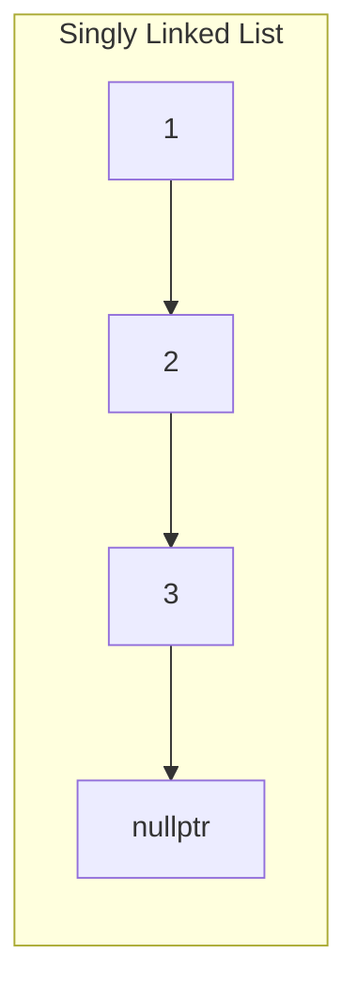

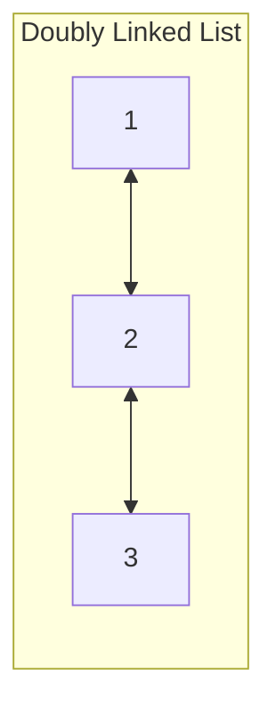

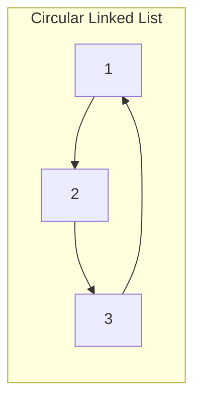

- **Singly linked**: each node points only to the **next** node; traversal is forward-only (`std::forward_list`).
- **Doubly linked**: each node points to **both** the next and previous nodes; traversal works both directions, and deletion given only a node pointer is O(1) (no need to find the predecessor separately, unlike a singly-linked list) (`std::list`).
- **Circular**: the last node points back to the first (in either the singly or doubly linked variant), forming a ring with no natural "end" — useful for round-robin scheduling, circular buffers, or repeatedly cycling through a fixed set of items.

```cpp
struct Node {
    int value;
    Node* next;
    // Node* prev;    // add this for a doubly linked list
};
```

### 222. How do you reverse a singly linked list?

The classic three-pointer iterative technique — walk the list once, re-pointing each node's `next` to its predecessor instead of its successor:

```cpp
struct Node { int value; Node* next; };

Node* reverse(Node* head) {
    Node* prev = nullptr;
    Node* curr = head;
    while (curr != nullptr) {
        Node* nextTemp = curr->next;   // save the next node before we overwrite curr->next
        curr->next = prev;              // reverse the link
        prev = curr;                     // advance prev
        curr = nextTemp;                  // advance curr
    }
    return prev;   // prev is now the new head
}
```

This runs in **O(n) time, O(1) extra space** (in-place, no new nodes allocated). A recursive version is also common (also O(n) time, but O(n) space due to the call stack) — this exact problem is one of the most frequently asked whiteboard questions for exactly this reason: it tests pointer manipulation fluency in a small, self-contained way.

### 223. What is a stack, and what are its common applications?

A **LIFO** (Last-In-First-Out) abstract data type: elements are added and removed from the same end ("top"). Standard operations: `push` (add to top), `pop` (remove from top), `top`/`peek` (view without removing) — all O(1). Backed in C++ by `std::stack` ([Q189](#189-what-is-stdstack-and-what-is-its-underlying-container)).

Common applications: **function call management** (the actual call stack itself — local variables, return addresses), **expression evaluation/parsing** (matching balanced parentheses, converting infix to postfix, evaluating postfix expressions), **undo/redo functionality**, **backtracking algorithms** (DFS, maze-solving), and **browser back-button history**.

### 224. What is a queue, and what are its common applications?

A **FIFO** (First-In-First-Out) abstract data type: elements are added at the back and removed from the front. Standard operations: `push`/`enqueue` (add to back), `pop`/`dequeue` (remove from front), `front` (view without removing) — all O(1) with a well-chosen underlying container. Backed in C++ by `std::queue` ([Q190](#190-what-is-stdqueue)).

Common applications: **task/job scheduling** (processing requests in the order received), **breadth-first search (BFS)** (the frontier of nodes to visit next), **buffering/streaming data** (producer-consumer pipelines), and **print/request queues** (any "first come, first served" resource).

### 225. What is a circular queue?

A queue implemented over a **fixed-size array** where the "front" and "back" indices wrap around to the beginning once they reach the end of the array, instead of requiring elements to physically shift when the front advances — this reuses freed space at the front without needing a resize or a shift operation.

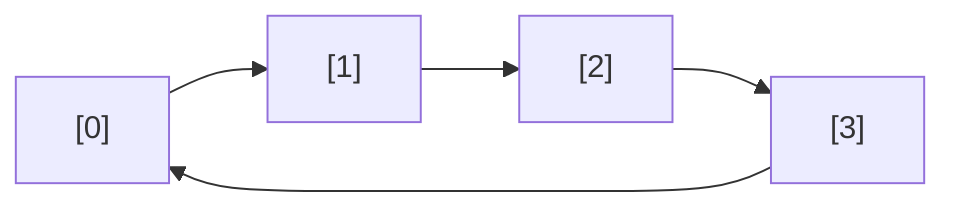

```cpp
class CircularQueue {
    std::vector<int> buf;
    int front = 0, rear = 0, count = 0;
public:
    CircularQueue(int capacity) : buf(capacity) {}
    bool push(int val) {
        if (count == buf.size()) return false;         // full
        buf[rear] = val;
        rear = (rear + 1) % buf.size();                  // wrap around
        ++count;
        return true;
    }
    int pop() {
        int val = buf[front];
        front = (front + 1) % buf.size();                 // wrap around
        --count;
        return val;
    }
};
```

This is the classic implementation technique behind **ring buffers**, widely used in fixed-memory streaming contexts (audio buffers, network packet buffers, producer-consumer pipelines with a bounded queue) where you want O(1) push/pop without dynamic reallocation.

### 226. What is a binary tree?

A hierarchical data structure where each node has **at most two children**, conventionally called "left" and "right."

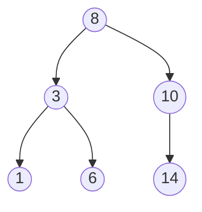

```cpp
struct TreeNode {
    int value;
    TreeNode* left;
    TreeNode* right;
};
```

Common traversal orders: **in-order** (left, node, right — produces sorted order for a BST), **pre-order** (node, left, right — useful for copying/serializing a tree), **post-order** (left, right, node — useful for deleting a tree, since children are visited before their parent), and **level-order** (breadth-first, level by level, using a queue).

### 227. What is a binary search tree (BST), and what are its time complexities?

A binary tree with the **BST invariant**: for every node, everything in its left subtree is smaller, and everything in its right subtree is larger. This ordering property is exactly what enables efficient search — at each node, you can eliminate an entire subtree just by comparing against the current node's value.

```cpp
bool search(TreeNode* node, int target) {
    if (!node) return false;
    if (node->value == target) return true;
    return target < node->value ? search(node->left, target) : search(node->right, target);
}
```

| Operation | Average (balanced) | Worst case (degenerate/unbalanced) |
|---|---|---|
| Search | O(log n) | O(n) |
| Insert | O(log n) | O(n) |
| Delete | O(log n) | O(n) |

The **worst case** happens when the tree degenerates into essentially a linked list — e.g., inserting already-sorted data into a plain (unbalanced) BST, one element always becomes the sole right child of the previous, giving a tree of height `n` instead of `log n`. This is exactly the motivation for [self-balancing trees](#228-what-is-a-balanced-tree-avl-red-black-tree-why-does-stdmap-use-a-red-black-tree), which guarantee O(log n) even in the worst case.

### 228. What is a balanced tree (AVL, Red-Black Tree)? Why does std::map use a Red-Black Tree?

A **self-balancing** BST automatically performs rotations after insertions/deletions to keep the tree's height close to `log n`, guaranteeing O(log n) worst-case (not just average-case) performance for search/insert/delete.

- **AVL tree**: enforces a strict balance invariant (the heights of any node's two subtrees differ by at most 1), rebalancing via rotations after every insert/delete. This gives **faster lookups** (a more tightly balanced, shorter tree) but **more rebalancing work** on every insert/delete (rotations happen more often, to maintain the stricter invariant).
- **Red-Black tree**: enforces a looser balance invariant (via node "color" rules guaranteeing the longest root-to-leaf path is never more than twice the shortest), which permits a somewhat taller tree than AVL but requires **fewer rotations** on average during insert/delete.

`std::map`/`std::set` use a **Red-Black tree** specifically because it offers a better balance between insertion/deletion speed and lookup speed for a **general-purpose** container that doesn't know in advance whether a workload will be read-heavy or write-heavy — AVL trees are theoretically slightly faster for lookup-dominated workloads (since they're more tightly balanced), but Red-Black trees are cheaper to keep balanced under frequent mutation, making them the better *general-purpose* default. (This is an implementation choice, not mandated by the C++ standard — but every major standard library implementation uses a Red-Black tree for this exact reason.)

### 229. What is a heap, and how is it different from a BST?

A heap is a **complete binary tree** (every level fully filled, except possibly the last, which fills left-to-right) satisfying the **heap property**: in a **max-heap**, every parent is ≥ its children (the max-heap root is always the overall maximum); a **min-heap** is the mirror image.

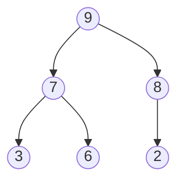

| | Heap | BST |
|---|---|---|
| Ordering guarantee | Only parent-vs-children (local, weak ordering) | Full left-subtree-vs-node-vs-right-subtree (global, strong ordering) |
| Find min/max | O(1) — always at the root | O(log n) — must traverse to the leftmost/rightmost node |
| In-order traversal produces sorted output | No | Yes |
| Typical storage | Implicit, as a plain array (parent/child by index math, no pointers needed) | Explicit nodes with left/right pointers |
| Typical use | Priority queues, heapsort, "find the k largest/smallest" | Ordered maps/sets, range queries, in-order iteration |

A heap is a much **weaker** ordering guarantee than a BST — it only promises "each parent beats its children," not any relationship between siblings or across the whole tree — which is exactly what makes heap insert/extract-max cheaper (O(log n), but with lower constant-factor overhead since it's array-based, no pointer-chasing) at the cost of not supporting efficient in-order traversal or arbitrary search the way a BST does. This is precisely the structure behind `std::priority_queue` ([Q191](#191-what-is-stdpriority_queue-and-how-is-it-implemented)).

### 230. What is a graph, and what are the common ways to represent one?

A graph is a set of **vertices (nodes)** connected by **edges**, optionally directed (one-way) and/or weighted. It generalizes trees (a tree is just a connected, acyclic graph).

```cpp
// Adjacency list — most common, memory-efficient for sparse graphs: O(V + E) space
std::vector<std::vector<int>> adjList(numVertices);
adjList[0].push_back(1);   // edge from 0 to 1
adjList[0].push_back(2);   // edge from 0 to 2

// Adjacency matrix — simple, O(1) edge-existence check, but O(V^2) space regardless of edge count
std::vector<std::vector<bool>> adjMatrix(numVertices, std::vector<bool>(numVertices, false));
adjMatrix[0][1] = true;
```

| | Adjacency List | Adjacency Matrix |
|---|---|---|
| Space | O(V + E) | O(V²) |
| Check if edge (u,v) exists | O(degree of u) | O(1) |
| Iterate all neighbors of v | O(degree of v) — efficient | O(V) — must scan the whole row |
| Best for | Sparse graphs (E << V²) — the common case | Dense graphs, or when O(1) edge lookups matter most |

### 231. What is BFS vs DFS?

Both are fundamental graph/tree traversal strategies, differing in the **order** they explore neighboring nodes:

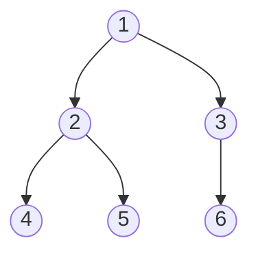

- **BFS (Breadth-First Search)** explores level by level — all of the start node's direct neighbors first, then all of *their* neighbors, and so on. Implemented with a **queue**. Finds the **shortest path** in an unweighted graph (guaranteed, since it explores in order of distance from the start).

```cpp
void bfs(int start, std::vector<std::vector<int>>& adj) {
    std::vector<bool> visited(adj.size(), false);
    std::queue<int> q;
    q.push(start); visited[start] = true;
    while (!q.empty()) {
        int node = q.front(); q.pop();
        std::cout << node << " ";
        for (int neighbor : adj[node]) {
            if (!visited[neighbor]) { visited[neighbor] = true; q.push(neighbor); }
        }
    }
}
```

- **DFS (Depth-First Search)** explores as far down one path as possible before backtracking. Implemented with a **stack** (explicit, or implicitly via recursion). Simpler to implement recursively, uses less memory for wide (but shallow) graphs, and is naturally suited to problems like cycle detection, topological sort, and connected-component discovery.

```cpp
void dfs(int node, std::vector<std::vector<int>>& adj, std::vector<bool>& visited) {
    visited[node] = true;
    std::cout << node << " ";
    for (int neighbor : adj[node]) {
        if (!visited[neighbor]) dfs(neighbor, adj, visited);
    }
}
```

Both run in **O(V + E)** time (visiting every vertex and edge once) and O(V) space for the visited-tracking structure.

### 232. What is a hash table, and how does it achieve O(1) average lookup?

A hash table maps keys to values by computing a **hash function** of the key, reducing it (modulo the table size) to a **bucket index**, and storing the key-value pair in that bucket — giving average O(1) insert/lookup/delete, because you jump nearly straight to the right location instead of searching.

```mermaid
flowchart LR
    K["key: \"apple\""] --> H["hash(\"apple\") = 4237"]
    H --> M["4237 % bucket_count(16) = 13"]
    M --> B["bucket[13]"]
```

The O(1) *average* comes from a well-designed hash function spreading keys **uniformly** across buckets, so each bucket holds only a small, roughly constant number of entries regardless of total table size (assuming the load factor is kept bounded via rehashing, [Q185](#185-what-is-load-factor-and-rehashing-in-unordered-containers)) — the actual work per operation is: compute the hash (O(1), assuming a good hash function on a bounded-size key), then scan a short chain (O(1) *average*, since chains stay short). The **worst case** is still O(n) — if every key happened to collide into the same bucket (a poorly chosen hash function, or an adversarial attacker deliberately crafting colliding keys), lookup degrades to a linear scan of one giant bucket. This is `std::unordered_map`'s internal mechanism ([Q183](#183-what-is-the-difference-between-map-and-unordered_map), [Q184](#184-what-is-stdunordered_set-and-how-does-it-handle-collisions)).

### 233. How do hash tables handle collisions (chaining vs open addressing)?

A **collision** occurs when two different keys hash to the same bucket index. Two main resolution strategies:

```mermaid
flowchart TB
    subgraph Chaining
        B0["bucket 0"] --> N1["key A"] --> N2["key D"]
        B1["bucket 1"] --> N3["key B"]
    end
```

1. **Separate chaining** — each bucket holds a linked list (or small vector/tree, for very dense buckets) of *all* entries that hashed there; a collision just appends to that bucket's list. This is what `std::unordered_map` uses. Simple, degrades gracefully, but has pointer-chasing overhead within a bucket.

2. **Open addressing** — on a collision, probe for a *different* empty slot in the same underlying array itself, following a defined sequence (linear probing: try the next slot; quadratic probing: try slots at increasing quadratic offsets; double hashing: use a second hash function to determine the probe step). No separate linked structure — everything lives directly in one contiguous array, which is more cache-friendly, but deletion is trickier (you can't just empty a slot — it might break the probe chain for a later-inserted colliding key, requiring "tombstone" markers) and performance degrades sharply as the load factor approaches 1 (probes get progressively longer).

`std::unordered_map` is specified in a way that essentially mandates chaining (its interface guarantees, like stable references to elements across insertions, are incompatible with how open addressing typically works) — but many high-performance third-party hash map implementations (e.g., Abseil's `flat_hash_map`, `robin_hood`) use open addressing internally for better cache locality, at the cost of not being able to fully match `unordered_map`'s exact interface guarantees.

### 234. What is a trie, and where is it used?

A **trie** (prefix tree) is a tree structure specialized for storing strings, where each edge represents one character, and any path from the root spells out a prefix — nodes shared by multiple strings that share a common prefix are stored **once**, not duplicated.

```mermaid
flowchart TB
    R(("(root)")) --> C1["c"]
    C1 --> A1["a"]
    A1 --> T1["t*"]
    A1 --> R1["r*"]
    R --> D1["d"]
    D1 --> O1["o"]
    O1 --> G1["g*"]
```

*(the diagram above stores "cat", "car", and "dog" — `*` marks a node that terminates a complete word)*

```cpp
struct TrieNode {
    std::unordered_map<char, TrieNode*> children;
    bool isEndOfWord = false;
};
```

Operations (insert, search, prefix-search) are **O(L)** where L is the string's length — independent of how many other strings are stored, which is the trie's key advantage over, say, storing strings in a `set`/hash table for prefix-based queries. Common uses: **autocomplete/typeahead** (finding all words with a given prefix quickly), **spell checkers**, **IP routing tables** (longest-prefix matching), and **dictionary/word-game implementations** (e.g., Boggle solvers).

### 235. What is the difference between linear search and binary search?

| | Linear Search | Binary Search |
|---|---|---|
| Precondition | None — works on any range | Data **must** already be sorted |
| Time complexity | O(n) | O(log n) |
| Technique | Check every element in order until found | Repeatedly halve the search range by comparing against the midpoint |

```cpp
// Linear search — O(n)
int linearSearch(std::vector<int>& v, int target) {
    for (int i = 0; i < v.size(); ++i) if (v[i] == target) return i;
    return -1;
}

// Binary search — O(log n), REQUIRES v to be sorted
int binarySearch(std::vector<int>& v, int target) {
    int lo = 0, hi = v.size() - 1;
    while (lo <= hi) {
        int mid = lo + (hi - lo) / 2;    // avoids potential overflow of (lo + hi) / 2 for very large indices
        if (v[mid] == target) return mid;
        else if (v[mid] < target) lo = mid + 1;
        else hi = mid - 1;
    }
    return -1;
}
```

Binary search's O(log n) is a massive win at scale (searching a billion sorted elements takes ~30 comparisons instead of up to a billion), but the sortedness requirement means it's only worth it when the data is already sorted, or will be searched many times (amortizing the O(n log n) cost of sorting once, across many subsequent O(log n) searches).

### 236. What is dynamic programming, and how is it different from plain recursion?

Dynamic programming (DP) solves a problem by breaking it into overlapping subproblems, solving each subproblem **only once**, and reusing (caching) that result whenever the same subproblem recurs — avoiding the exponential blowup that plain (naive) recursion suffers when the same subproblem gets recomputed from scratch many times over.

```cpp
// Naive recursion — O(2^n), massively re-solves the same subproblems over and over
int fibNaive(int n) {
    if (n <= 1) return n;
    return fibNaive(n - 1) + fibNaive(n - 2);
}

// DP (memoization / "top-down") — O(n), each subproblem solved exactly once, cached
int fibMemo(int n, std::vector<int>& cache) {
    if (n <= 1) return n;
    if (cache[n] != -1) return cache[n];               // already solved — reuse it
    return cache[n] = fibMemo(n - 1, cache) + fibMemo(n - 2, cache);
}

// DP (tabulation / "bottom-up") — O(n) time, O(1) extra space — builds up from the base cases iteratively
int fibTab(int n) {
    if (n <= 1) return n;
    int prev2 = 0, prev1 = 1;
    for (int i = 2; i <= n; ++i) {
        int curr = prev1 + prev2;
        prev2 = prev1; prev1 = curr;
    }
    return prev1;
}
```

The key requirement for DP to apply: the problem must have **overlapping subproblems** (the same smaller problem recurs multiple times, as with naive Fibonacci) and **optimal substructure** (an optimal solution to the whole problem can be built from optimal solutions to its subproblems). DP comes in two flavors: **memoization** ("top-down" — still recursive, but caches results the first time each subproblem is solved) and **tabulation** ("bottom-up" — iteratively builds a table of solved subproblems from the smallest up, often with better constant factors and no recursion/call-stack overhead).

---

## Multithreading & Concurrency

### 237. What is the need for multithreading in C++?

Multithreading lets a program run multiple sequences of instructions **concurrently**, sharing the same process memory space — used to (1) take advantage of multi-core CPUs for genuine parallel speedup on CPU-bound work (splitting a large computation across cores), and (2) keep a program **responsive** by moving slow/blocking work (I/O, network calls) off the main thread so it doesn't freeze the whole application. C++11 added first-class, standardized threading support (`std::thread`, `<thread>`) directly into the language — before that, C++ had no threading facilities at all, and code relied on platform-specific APIs (POSIX pthreads, Windows threads) or third-party libraries (Boost.Thread).

### 238. How do you create a thread using std::thread?

```cpp
#include <thread>

void worker(int id) {
    std::cout << "Thread " << id << " running\n";
}

int main() {
    std::thread t(worker, 42);    // starts running worker(42) concurrently, immediately
    // ... do other work on the main thread here, concurrently with t ...
    t.join();                       // wait for t to finish before continuing
    return 0;
}

// Lambdas work too, and are extremely common:
std::thread t2([]() { std::cout << "lambda thread\n"; });
t2.join();
```

The thread starts executing **immediately** upon construction — there's no separate `.start()` call. You must call either `.join()` or `.detach()` on every `std::thread` object before it's destroyed, or the program calls `std::terminate()` ([Q239](#239-what-is-the-difference-between-join-and-detach)).

### 239. What is the difference between join() and detach()?

- **`join()`** — blocks the calling thread until the target thread finishes execution. This is the common, safe choice: you get certainty that the thread has fully completed (and any resources it used are safe to clean up) before moving on.
- **`detach()`** — separates the thread object from the actual OS thread, letting it run **independently in the background**; the `std::thread` object no longer represents it, and you lose any way to `join()` or otherwise track it afterward. The detached thread continues running even if the `std::thread` object that created it is destroyed.

```cpp
std::thread t(worker);
t.join();      // wait here until worker() finishes

std::thread t2(backgroundTask);
t2.detach();    // fire-and-forget — backgroundTask() keeps running independently, we never wait for it
```

**Danger with `detach()`**: if the detached thread outlives the `main()` function (or accesses data that's since been destroyed — e.g., a local variable captured by reference in a lambda passed to the thread), that's undefined behavior. `join()` is the safer default; `detach()` is reserved for genuinely independent, long-running background tasks whose completion the rest of the program doesn't need to know about.

### 240. What is a race condition?

A race condition occurs when **multiple threads access shared data concurrently**, at least one of them writing, **without proper synchronization** — the final result then depends unpredictably on the precise timing/interleaving of the threads' operations, which can vary from run to run.

```cpp
int counter = 0;

void increment() {
    for (int i = 0; i < 100000; ++i) {
        counter++;    // NOT atomic! This is actually: read counter, add 1, write counter — 3 separate steps
    }
}

std::thread t1(increment), t2(increment);
t1.join(); t2.join();
std::cout << counter;   // expected 200000, but often LESS — some increments get lost when
                          // two threads read the same value before either has written back their update
```

`counter++` looks like a single operation in source code, but compiles to multiple machine instructions (load, add, store) — if two threads interleave those steps, one thread's increment can be silently overwritten/lost. Fixes: `std::mutex` ([Q241](#241-what-is-stdmutex-and-how-do-you-use-it)) to make the increment atomic in effect, or `std::atomic<int>` ([Q245](#245-what-is-stdatomic)) for simple cases like this counter specifically.

### 241. What is std::mutex, and how do you use it?

`std::mutex` (`<mutex>`, "mutual exclusion") ensures only **one thread at a time** can execute a protected section of code (a "critical section") — a thread calls `.lock()` before entering, `.unlock()` after leaving; any other thread calling `.lock()` in the meantime **blocks** until the first thread unlocks.

```cpp
#include <mutex>
std::mutex mtx;
int counter = 0;

void increment() {
    for (int i = 0; i < 100000; ++i) {
        mtx.lock();
        counter++;      // now protected — only one thread can be here at a time
        mtx.unlock();
    }
}
```

Manually calling `.lock()`/`.unlock()` directly is discouraged in practice — if an exception is thrown between them, `.unlock()` is skipped, leaving the mutex locked forever (deadlocking every other thread that tries to acquire it). Use RAII lock wrappers ([Q242](#242-what-is-stdlock_guard-vs-stdunique_lock)) instead, which unlock automatically (even during exception unwinding) via their destructor.

### 242. What is std::lock_guard vs std::unique_lock?

Both are RAII wrappers around a mutex — they lock it in their constructor and unlock it automatically in their destructor, guaranteeing the mutex gets released even if an exception is thrown in between (no manual `.unlock()` needed, no risk of forgetting it).

```cpp
std::mutex mtx;

void safeIncrement() {
    std::lock_guard<std::mutex> lock(mtx);    // locks mtx here
    counter++;
    // automatically unlocks when `lock` goes out of scope, no matter how the function exits
}

void flexibleUsage() {
    std::unique_lock<std::mutex> lock(mtx);    // locks mtx here
    // ... do protected work ...
    lock.unlock();                               // unique_lock CAN be manually unlocked early...
    // ... do unprotected work, without holding the lock ...
    lock.lock();                                  // ...and re-locked later
    // ... more protected work ...
}   // automatically unlocked here too, if still locked when destroyed
```

| | `lock_guard` | `unique_lock` |
|---|---|---|
| Overhead | Minimal — simplest possible RAII wrapper | Slightly more (tracks lock state internally) |
| Can unlock early / relock | No | Yes |
| Movable (transferable ownership) | No | Yes |
| Works with `std::condition_variable` | No — `condition_variable::wait` requires `unique_lock` | Yes |
| Supports deferred locking (`std::defer_lock`) | No | Yes |

Use `lock_guard` for simple "lock for this whole scope" cases (the common case, and the cheapest); use `unique_lock` when you need more flexibility — early unlocking, deferred locking, or (most commonly) when working with `std::condition_variable`, which specifically requires it.

### 243. What is a deadlock, and how do you avoid it?

A deadlock occurs when two (or more) threads are each waiting for a resource the **other** holds, so neither can ever proceed — a permanent standstill.

```cpp
std::mutex mtxA, mtxB;

void thread1() {
    std::lock_guard<std::mutex> lockA(mtxA);   // thread1 locks A first
    std::this_thread::sleep_for(std::chrono::milliseconds(10));
    std::lock_guard<std::mutex> lockB(mtxB);    // then tries to lock B — but thread2 already has it!
}
void thread2() {
    std::lock_guard<std::mutex> lockB(mtxB);   // thread2 locks B first
    std::this_thread::sleep_for(std::chrono::milliseconds(10));
    std::lock_guard<std::mutex> lockA(mtxA);    // then tries to lock A — but thread1 already has it!
}
// DEADLOCK: thread1 waits forever for B (held by thread2), thread2 waits forever for A (held by thread1)
```

**Avoidance strategies**: (1) always acquire multiple locks in a **consistent, globally agreed-upon order** across every thread (e.g., always lock the mutex with the lower memory address first); (2) use `std::lock()` (a free function) or `std::scoped_lock` (C++17) to acquire multiple mutexes **atomically together**, avoiding the interleaving window entirely:

```cpp
void safeThread1() {
    std::scoped_lock lock(mtxA, mtxB);   // C++17 — locks BOTH atomically, no deadlock possible between these two
}
```

(3) avoid holding a lock while calling into code you don't control (which might itself try to acquire a lock); (4) prefer higher-level, lock-free primitives (`std::atomic`) where they suffice.

### 244. What is std::condition_variable, and how is it used for thread synchronization?

`std::condition_variable` (`<condition_variable>`) lets a thread **block until notified** by another thread that some condition has become true — avoiding wasteful busy-waiting (repeatedly checking a flag in a tight loop, burning CPU).

```cpp
std::mutex mtx;
std::condition_variable cv;
bool dataReady = false;

void producer() {
    { std::lock_guard<std::mutex> lock(mtx); dataReady = true; }
    cv.notify_one();                 // wake up (one) waiting thread
}

void consumer() {
    std::unique_lock<std::mutex> lock(mtx);   // MUST be unique_lock, not lock_guard
    cv.wait(lock, [] { return dataReady; });    // releases the lock while waiting, re-acquires it once woken AND the predicate is true
    // ... dataReady is now true, and we're holding the lock again ...
}
```

`.wait()` **atomically** releases the mutex and puts the thread to sleep, so the producer can acquire the mutex and make its change without deadlocking against a consumer that's holding the lock while blocked — when notified, it re-acquires the mutex before returning. The predicate-taking overload (`cv.wait(lock, predicate)`) also guards against **spurious wakeups** (the OS is allowed to wake a waiting thread even without a real notification) by looping internally until the predicate genuinely holds true.

### 245. What is std::atomic?

`std::atomic<T>` (`<atomic>`) provides operations (read, write, increment, compare-and-swap, etc.) on a value that are guaranteed to execute **indivisibly** — no other thread can ever observe or interleave with a "half-finished" operation — without needing an explicit mutex.

```cpp
std::atomic<int> counter{0};

void increment() {
    for (int i = 0; i < 100000; ++i) {
        counter++;     // now genuinely atomic — no lost updates, no race condition (Q240's bug, fixed)
    }
}
```

For simple cases like a shared counter or flag, `std::atomic` is typically **faster** than a mutex (often compiling down to a single lock-free CPU instruction, like `LOCK XADD`, instead of the OS-level scheduling overhead a mutex can incur under contention) — but it only protects a **single** variable's operations; if you need to keep multiple related variables consistent together, you generally still need a mutex to protect the whole group as one critical section.

### 246. What is std::async, and what is a std::future?

`std::async` (`<future>`) runs a function **possibly asynchronously** (on a separate thread, or, depending on the launch policy and the implementation's discretion, lazily on the calling thread when the result is actually needed) and immediately returns a `std::future` — a handle you can later use to retrieve the eventual result (blocking if it isn't ready yet).

```cpp
#include <future>

int computeSlowly(int x) {
    std::this_thread::sleep_for(std::chrono::seconds(2));
    return x * x;
}

std::future<int> fut = std::async(std::launch::async, computeSlowly, 5);   // runs on a new thread
// ... do other work here, concurrently with computeSlowly running ...
int result = fut.get();     // blocks here until computeSlowly finishes, then returns 25
```

`std::launch::async` forces genuine concurrent execution on a new thread; `std::launch::deferred` runs the function lazily, only when `.get()` is actually called (on the calling thread, not concurrently at all); passing no policy lets the implementation choose either, which can be a subtle source of "why didn't this actually run in parallel?" confusion — explicitly passing `std::launch::async` is recommended whenever genuine concurrency is the actual goal. `.get()` can only be called **once** per future (it consumes the result); calling it twice throws.

### 247. What is the difference between concurrency and parallelism?

- **Concurrency** is about **structure** — a program is composed of multiple independently-progressing tasks that are logically interleaved, whether or not they're literally executing at the exact same instant (e.g., a single-core CPU rapidly time-slicing between threads is still "concurrent," even though only one instruction ever executes at a time).
- **Parallelism** is about **execution** — multiple tasks are literally running at the exact same instant, which requires genuinely multiple execution units (multiple CPU cores).

A useful framing: concurrency is about *dealing with* many things at once (managing interleaved tasks, correctly, regardless of hardware); parallelism is about *doing* many things at once (actual simultaneous computation, which requires the right hardware to be possible at all). A single-core machine can still run a genuinely concurrent program (e.g., an event loop juggling multiple I/O-bound tasks); it cannot run anything in true parallel. `std::thread` code can be concurrent without being parallel (if run on one core) or genuinely parallel (if the OS scheduler spreads the threads across multiple cores, which it typically does when cores are available).

### 248. What is false sharing?

False sharing is a **performance** problem (not a correctness bug) that occurs when two threads modify **different** variables that happen to reside on the **same CPU cache line** (typically 64 bytes) — even though the threads aren't logically sharing any data, the CPU's cache-coherency protocol still has to constantly invalidate and re-fetch that cache line back and forth between the cores' caches on every write, as if they *were* contending over the same memory, silently destroying performance.

```cpp
struct Counters {
    std::atomic<int> counterA;   // used only by thread A
    std::atomic<int> counterB;   // used only by thread B
    // PROBLEM: counterA and counterB likely share the same 64-byte cache line —
    // every write to one invalidates the OTHER thread's cached copy of the line, even though
    // that thread never touches the variable that actually changed!
};

struct alignas(64) PaddedCounter {   // pad each counter out to its own full cache line
    std::atomic<int> value;
    char padding[64 - sizeof(std::atomic<int>)];
};
```

The fix is to **pad/align** frequently-and-independently-written variables so each lands on its own separate cache line (`alignas(std::hardware_destructive_interference_size)`, a C++17 constant specifically meant for this purpose), eliminating the false contention. This is a notoriously subtle performance bug — the code is perfectly *correct* (no race condition, no data race, no undefined behavior), it's simply much *slower* than it should be, and profiling (not code review) is usually what's needed to spot it.

---

## Modern C++ (11/14/17/20/23)

### 249. What are the major features introduced in C++11?

C++11 was the largest single overhaul in the language's history — often described as "C++ becoming a new language":

- **`auto`** type deduction ([Q14](#14-what-is-the-auto-keyword-and-how-does-type-deduction-work))
- **Range-based `for` loops**: `for (auto& x : container)`
- **Lambda expressions** ([Q212](#212-what-is-a-lambda-expression-in-c))
- **Rvalue references & move semantics** ([Q250](#250-what-are-rvalue-references-and-what-problem-do-they-solve), [Q251](#251-what-is-move-semantics-and-how-is-it-different-from-copying))
- **Smart pointers** — `unique_ptr`, `shared_ptr`, `weak_ptr` ([Q127](#127-what-are-smart-pointers-and-why-were-they-introduced))
- **`nullptr`** ([Q119](#119-what-is-a-null-pointer-and-what-is-nullptr))
- **`constexpr`** ([Q114](#114-what-is-constexpr-and-how-is-it-different-from-const))
- **Variadic templates** ([Q142](#142-what-are-variadic-templates))
- **`override`/`final`** ([Q102](#102-what-is-the-override-keyword-used-for), [Q103](#103-what-is-the-final-keyword-used-for))
- **`enum class`** (strongly-typed, scoped enums, fixing old C-style `enum`'s namespace pollution and implicit int conversion)
- **`std::thread`** and the whole `<thread>`/`<mutex>`/`<atomic>` concurrency library
- **Uniform initialization** with `{}` (brace initialization) and `std::initializer_list`
- **`static_assert`** (compile-time assertions)
- **Delegating constructors** ([Q62](#62-what-is-a-delegating-constructor)) and **`explicit`** on more contexts
- **New STL containers**: `unordered_map`/`unordered_set` and friends
- **`std::function`**, **`std::bind`** ([Q216](#216-what-is-stdfunction-and-how-is-it-different-from-a-function-pointer))
- **`decltype`**, trailing return types

### 250. What are rvalue references, and what problem do they solve?

An **rvalue reference** (`T&&`) binds specifically to **temporary, about-to-be-destroyed values** (rvalues) — as opposed to a regular ("lvalue") reference (`T&`), which binds to named, persisting objects.

```cpp
void f(int& x)  { std::cout << "lvalue ref\n"; }
void f(int&& x) { std::cout << "rvalue ref\n"; }

int a = 5;
f(a);          // "lvalue ref" — a is a named variable (an lvalue)
f(5);           // "rvalue ref" — 5 is a temporary (an rvalue)
f(std::move(a)); // "rvalue ref" — std::move CASTS a to an rvalue reference, even though a itself is still an lvalue
```

The problem they solve: before C++11, there was no way to distinguish "this is a temporary about to be destroyed anyway, feel free to cannibalize/steal its resources" from "this is a real, persisting object — copy it, don't touch its internals." Rvalue references make that distinction expressible at the type-system level, which is exactly the mechanism [move constructors/assignment](#56-what-is-a-move-constructor) use to detect "the source is a temporary — steal instead of copy" ([Q251](#251-what-is-move-semantics-and-how-is-it-different-from-copying)).

### 251. What is move semantics, and how is it different from copying?

**Copying** duplicates a resource entirely (allocates new memory, copies every byte) — always safe, but potentially expensive for a large resource. **Moving** *transfers ownership* of the resource directly from a source object (which must be about to be destroyed/discarded anyway — a temporary, or something explicitly `std::move`d) to a destination, leaving the source in a valid-but-unspecified (typically empty) state — no allocation, no copying of the actual data, just repointing a few internal pointers.

```cpp
std::vector<int> makeBigVector() {
    std::vector<int> v(1'000'000, 42);
    return v;    // C++11+: MOVED out, not copied — the local v's internal buffer is transferred directly
}

std::vector<int> a = makeBigVector();     // move — no copy of 1,000,000 ints!
std::vector<int> b = a;                     // COPY — a is a persisting lvalue, so this genuinely duplicates all 1,000,000 ints
std::vector<int> c = std::move(a);          // MOVE — std::move explicitly says "treat a as disposable", steals a's buffer; a is now empty
```

This is one of C++11's biggest performance wins — operations that used to be forced into an expensive deep copy (returning a large container by value, inserting a temporary into another container) now transfer ownership essentially for free, whenever the compiler (or the programmer, via `std::move`) can prove the source won't be needed afterward.

### 252. What is std::move, and what does it actually do?

`std::move` does **not** move anything itself — it's purely a **cast**, converting its argument to an rvalue reference (`static_cast<T&&>(arg)`), which tells the compiler "treat this as a movable temporary" — it's a *hint* to the overload resolution machinery, nothing more.

```cpp
std::string s1 = "hello";
std::string s2 = std::move(s1);   // s1 is CAST to an rvalue reference here, which selects the MOVE constructor
                                      // the actual "moving" happens inside std::string's move constructor,
                                      // which sees the rvalue-ref parameter and steals s1's internal buffer

std::cout << s1;    // s1 is now in a valid-but-unspecified state — for std::string, typically empty,
                       // but NEVER rely on that — only assume it's "safe to destroy or reassign", nothing more
```

Because `std::move` is just a cast, using a variable *after* moving from it is legal C++ (the object is still valid, in a "moved-from" state) but reading its value is generally a logic bug — the rule of thumb is: **never use a moved-from object except to assign a new value to it or let it be destroyed**.

### 253. What is perfect forwarding, and what is std::forward?

**Perfect forwarding** lets a generic (template) function pass its arguments along to another function while preserving each argument's exact **value category** (lvalue vs rvalue) — so an rvalue argument stays an rvalue through the forwarding call (still eligible for a move), and an lvalue stays an lvalue (still copied, not incorrectly moved from).

```cpp
template <typename T>
void wrapper(T&& arg) {              // T&& here is a "forwarding reference" (or "universal reference") —
    inner(std::forward<T>(arg));       // NOT necessarily an rvalue reference — its exact meaning depends on
}                                        // what's passed in (deduced by a special template-deduction rule)

void inner(const std::string& s) { std::cout << "lvalue overload\n"; }
void inner(std::string&& s)      { std::cout << "rvalue overload\n"; }

std::string name = "Alice";
wrapper(name);              // "lvalue overload" — name is an lvalue, forwarded as an lvalue
wrapper(std::string("Bob")); // "rvalue overload" — a temporary, forwarded as an rvalue (still movable)
```

Without `std::forward` (using plain `arg` instead), `arg` inside `wrapper` would always be treated as an **lvalue** (a named parameter is always an lvalue, *regardless* of whether the reference type binding to it is `T&&`) — so the rvalue-ness of the original caller's argument would be silently lost, always selecting the (potentially more expensive) lvalue/copy overload downstream. `std::forward<T>(arg)` restores the original value category based on the deduced `T`, making the forwarding "perfect" — hence the name. This mechanism underlies `std::make_unique`, `std::make_shared`, container `emplace_back`, and any generic wrapper/factory function.

### 254. What are structured bindings (C++17)?

Structured bindings let you **unpack** a tuple-like object (`std::pair`, `std::tuple`, `std::array`, or a plain struct with public members) directly into multiple named variables in one declaration.

```cpp
std::pair<int, std::string> p = {42, "hello"};
auto [id, name] = p;                   // id = 42, name = "hello" — no more p.first / p.second!

std::map<std::string, int> ages = {{"Alice", 30}};
for (const auto& [name, age] : ages) {   // unpacks each map entry's key/value directly
    std::cout << name << ": " << age << "\n";
}

struct Point { int x, y; };
Point pt{3, 4};
auto [px, py] = pt;                      // works on plain structs too
```

This eliminates a whole class of `.first`/`.second`/`std::get<0>(t)` boilerplate that used to make tuple/pair-heavy code noticeably harder to read, and is now the idiomatic way to iterate over a `map`/`unordered_map`'s key-value pairs.

### 255. What is if constexpr (C++17), and how is it different from a normal if?

`if constexpr` evaluates its condition **at compile time**, and the compiler **discards the untaken branch entirely** — it doesn't even need to be valid/compilable code for the types actually in use, unlike a normal `if`, where both branches must compile successfully regardless of which one ends up executing at runtime.

```cpp
template <typename T>
auto getValue(T t) {
    if constexpr (std::is_pointer_v<T>) {
        return *t;              // only compiled/instantiated when T actually IS a pointer type
    } else {
        return t;                 // only compiled/instantiated when T is NOT a pointer type
    }
}

getValue(5);        // T = int — only the `else` branch is compiled for this instantiation; `*t` on an int would be an ERROR, but it's never even attempted
getValue(&x);        // T = int* — only the `if` branch is compiled
```

Before `if constexpr`, achieving this kind of compile-time branching in generic code required template specialization or SFINAE tricks ([Q143](#143-what-is-sfinae)) — `if constexpr` makes it possible to write straightforward, readable conditional logic directly inside a template function's body, a huge ergonomic improvement for generic/template-heavy code.

### 256. What are C++20 Concepts?

Already introduced in [Q144](#144-what-are-c20-concepts-and-how-do-they-improve-on-sfinae) — Concepts are named, compile-time-checked **constraints** on template parameters, letting you directly express "T must support these operations/properties" in the template declaration itself, with clear, readable syntax and much better compiler error messages than the SFINAE-based tricks they largely replace.

```cpp
template <typename T>
concept Sortable = requires(T a, T b) { { a < b } -> std::convertible_to<bool>; };

template <Sortable T>
void mySort(std::vector<T>& v) { std::sort(v.begin(), v.end()); }
```

The standard library also ships a set of ready-made concepts in `<concepts>` (`std::integral`, `std::floating_point`, `std::copyable`, `std::equality_comparable`, etc.) that cover the most common constraints without needing to hand-write them.

### 257. What are C++20 Coroutines?

Coroutines are functions that can **suspend** their execution partway through (at a `co_await`, `co_yield`, or `co_return` point) and later **resume** exactly where they left off, preserving all local state in between — enabling asynchronous code and lazy-generator patterns to be written in a straightforward, linear, sequential style instead of callback-based/state-machine code.

```cpp
// (Simplified sketch — real coroutine code requires a return-type "promise" machinery not shown here)
Generator<int> countUpTo(int n) {
    for (int i = 0; i <= n; ++i) {
        co_yield i;    // suspend here, yielding i; resumes right after this line on the next request
    }
}

Task<std::string> fetchData() {
    auto response = co_await httpGet(url);   // suspends until the async httpGet completes, without blocking the thread
    co_return response.body;
}
```

Unlike `std::thread`, coroutines don't require a dedicated OS thread to "pause" — suspension is a lightweight, cooperative mechanism (the coroutine's state is packaged up on the heap, and control just returns to the caller) — making them well suited to high-throughput asynchronous I/O (thousands of concurrent, mostly-idle coroutines) where spawning a real OS thread per task would be far too heavyweight. C++20 provides only the low-level building blocks (`co_await`/`co_yield`/`co_return`, the promise-type customization protocol); ergonomic, ready-to-use types like `Generator`/`Task` mostly come from third-party libraries in C++20 itself, though C++23 standardized `std::generator`.

### 258. What are C++20 Modules, and how do they improve on header files?

Modules (`import`/`export module`) are a new compilation unit mechanism intended to eventually replace the traditional `#include`-header-file model.

```cpp
// math.ixx (a module interface file)
export module math;
export int add(int a, int b) { return a + b; }

// main.cpp
import math;
int main() { return add(2, 3); }
```

Improvements over `#include` headers: (1) **no more textual re-parsing** — a header gets re-preprocessed and re-parsed from scratch in *every* translation unit that includes it (directly or transitively), which is a huge, well-known cause of slow C++ compile times; a module is compiled **once** into a binary interface the compiler can just load; (2) **no macro leakage** — `#define`s inside a module don't leak out to code that `import`s it (a `#include`'s macros pollute everything after it, in every including file); (3) **no header-guard boilerplate needed** — modules are inherently immune to multiple-inclusion issues; (4) **explicit, controlled exports** — only symbols explicitly marked `export` are visible to importers, unlike a header, where everything declared is implicitly visible to anyone who includes it. Adoption has been gradual — build-system and tooling support (which needs to understand module dependency graphs to build correctly) took years to mature across major compilers/build systems after the standard shipped.

### 259. What is std::optional, and what problem does it solve?

`std::optional<T>` (C++17, `<optional>`) represents a value that **may or may not be present** — an explicit, type-safe alternative to using a sentinel value (like `-1`, an empty string, or a null pointer) to signal "no value," which is often ambiguous (is `-1` a real answer, or does it mean "not found"?) and easy to forget to check.

```cpp
std::optional<int> findUser(const std::string& name) {
    if (name == "Alice") return 42;    // implicitly wraps 42 in an optional<int>
    return std::nullopt;                 // explicitly "no value"
}

auto result = findUser("Bob");
if (result.has_value()) {                // or: if (result)
    std::cout << *result;                  // dereference to get the contained value
} else {
    std::cout << "not found";
}
std::cout << result.value_or(-1);          // -1 — a convenient default if empty, in one call
```

Unlike a raw pointer used as a "maybe absent" signal, `std::optional` **owns** its value directly (no heap allocation, no dangling-pointer risk), makes the "might be absent" possibility **visible in the function's return type** (self-documenting, and the compiler helps enforce checking it, unlike a magic sentinel value that's easy to silently misuse), and clearly communicates intent to callers reading the signature alone.

### 260. What is std::variant, and how is it different from a union?

`std::variant<Types...>` (C++17, `<variant>`) is a **type-safe tagged union** — it holds a value that is *one of* a fixed set of possible types, and always knows (and enforces) which type it currently holds, unlike a raw C-style `union`, which has no built-in memory of which member was last written.

```cpp
std::variant<int, std::string, double> v;
v = 42;                  // holds an int
v = "hello";              // now holds a std::string instead (the int is properly destroyed first)

if (std::holds_alternative<std::string>(v)) {
    std::cout << std::get<std::string>(v);    // safe — throws std::bad_variant_access if v didn't actually hold a string
}

// std::visit — apply a callable to whichever type is currently active, without manually checking
std::visit([](auto&& val) { std::cout << val; }, v);
```

| | `union` | `std::variant` |
|---|---|---|
| Tracks active member | No — programmer's responsibility entirely | Yes — always knows, at runtime, which type is active |
| Type safety | None — accessing the wrong member is undefined behavior | Safe — `std::get` throws if you ask for the wrong type |
| Supports non-trivial types (`std::string`, etc.) | Awkward (requires manual constructor/destructor calls) | Fully supported, handled automatically |
| Common usage pattern | Low-level, C-interop, manual tagging | State machines, error-handling (an "either a result or an error" type), heterogeneous containers |

### 261. What is std::any?

`std::any` (C++17, `<any>`) can hold a value of **literally any copyable type**, decided entirely at runtime — unlike `std::variant`, which is restricted to a fixed, closed set of types declared up front in its template arguments.

```cpp
std::any a = 42;                 // holds an int
a = std::string("hello");         // now holds a std::string — completely different type, no restriction
a = 3.14;                          // now holds a double

int x = std::any_cast<int>(a);     // throws std::bad_any_cast — a currently holds a double, not an int!
double d = std::any_cast<double>(a); // 3.14 — correct type requested
```

It's the most flexible (and most "type-unsafe-feeling," despite being fully type-checked at the point of `any_cast`) of the three C++17 vocabulary types — used sparingly, for genuinely open-ended "could be absolutely anything" scenarios (e.g., a generic property bag, plugin configuration values, heterogeneous message-passing systems) where even `std::variant`'s fixed type list would be too restrictive. Prefer `std::variant` whenever the possible types are actually known and bounded in advance — it's more efficient (no heap allocation for larger held types, in typical implementations) and considerably safer (the compiler can help verify all cases are handled via `std::visit`).

### 262. What are the major features introduced in C++23?

- **`std::print` / `std::println`** (`<print>`) — a `std::format`-based, type-safe, `printf`-like convenience function, finally giving C++ a clean one-liner for formatted console output.
- **`std::expected<T, E>`** — a standard "either a value or an error" type, similar in spirit to `std::variant` but purpose-built for error handling as an alternative to exceptions in performance-sensitive or embedded contexts.
- **`std::flat_map` / `std::flat_set`** ([Q188](#188-what-is-stdflat_map-c23)) — contiguous, cache-friendly sorted associative containers.
- **`std::generator`** (`<generator>`) — a standard-library-provided coroutine type for lazy sequence generation, building on C++20's raw coroutine machinery ([Q257](#257-what-are-c20-coroutines)).
- **Expanded Ranges/`<ranges>`** — many more range adaptors and algorithms.
- **Multidimensional subscript operator**: `operator[](i, j, k)`, useful for matrix/tensor-like types ([Q75](#75-how-do-you-overload-the-subscript-operator)).
- **`if consteval`** — lets a function branch on whether it's currently being evaluated at compile time vs. runtime.
- **`std::stacktrace`** (`<stacktrace>`) — standard, portable stack-trace capture for diagnostics/logging, without needing a platform-specific library.
- **Deducing `this`** — lets a member function's implicit object parameter be spelled out explicitly, simplifying certain overload patterns (e.g., collapsing separate `const`/non-`const` overloads of the same method into one).
- Mandated **UTF-8 source file encoding**, for portability across compilers/platforms.

C++23 is generally seen as a comparatively smaller, more consolidating release than C++20 (which introduced the four headline "big" features — Concepts, Ranges, Coroutines, Modules) — focused on rounding out and polishing the standard library ergonomics around what C++20 introduced.

---

## Miscellaneous

### 263. What is undefined behavior, and can you give examples?

**Undefined behavior (UB)** is behavior the C++ standard places **no requirements on whatsoever** — the compiler is free to do literally anything (crash, produce seemingly correct output, silently corrupt unrelated memory, or anything else) when UB occurs, and is explicitly permitted to *assume UB never happens* when optimizing, which can produce surprising, non-local effects far from the actual offending line.

Common examples:

```cpp
int arr[5];
arr[10] = 1;                    // out-of-bounds access — UB

int* p = nullptr;
std::cout << *p;                 // dereferencing null — UB

int x;
std::cout << x;                   // reading an uninitialized variable — UB

int a = INT_MAX;
a = a + 1;                        // signed integer overflow — UB (Q15)

int* dp = new int(5);
delete dp; delete dp;              // double delete — UB

std::vector<int> v = {1,2,3};
auto it = v.begin();
v.push_back(4);                    // may reallocate
std::cout << *it;                  // using a potentially-invalidated iterator — UB (Q174)
```

UB is a distinctly C++ (and C) concept precisely *because* the language prioritizes performance — many optimizations are only valid if the compiler can assume certain conditions (no overflow, no out-of-bounds access) always hold, and the standard offloads the responsibility for guaranteeing those conditions onto the programmer rather than paying for runtime checks by default. Tools like AddressSanitizer, UndefinedBehaviorSanitizer, and Valgrind exist specifically to catch UB during testing, since it often won't visibly manifest as a crash every single time.

### 264. What is the difference between the . and -> operators?

Both access a member of a class/struct — the choice depends on whether you have an **object** or a **pointer to an object**.

```cpp
Point p;
p.x = 5;              // "." — direct member access, p is an object (not a pointer)

Point* ptr = &p;
ptr->x = 10;            // "->" — access through a pointer; equivalent to (*ptr).x = 10;

std::unique_ptr<Point> up = std::make_unique<Point>();
up->x = 15;              // smart pointers overload -> too, so they behave like raw pointers here
```

`ptr->member` is literally shorthand for `(*ptr).member` — dereference first, then access the member with `.`. This is also why smart pointers (and any custom "smart pointer-like" wrapper) overload `operator->` — it lets the wrapper transparently forward member access through to the wrapped/managed object.

### 265. What is the difference between sizeof and strlen?

```cpp
char str[20] = "hello";

sizeof(str);      // 20 — the SIZE OF THE ARRAY (its declared capacity), a compile-time constant, includes unused space
strlen(str);        // 5  — the number of characters BEFORE the null terminator, computed by scanning at RUNTIME

char* p = str;
sizeof(p);          // 8 (on a 64-bit system) — sizeof(char*), the pointer's own size, NOT the string's length!
strlen(p);           // 5 — strlen always follows the pointer and scans, regardless of what it points to
```

`sizeof` is a **compile-time** operator (evaluated by the compiler, not at runtime — with the narrow exception of a variable-length array in C, not applicable in standard C++) that reports the total size, **in bytes**, of a type or object's storage — for arrays specifically, that's the full declared capacity, not how "full" it currently is. `strlen` is a **runtime function** (`<cstring>`) that scans a C-string byte by byte until it finds the null terminator, returning the count of characters found — it has no idea about the buffer's actual allocated size, and reading past a missing null terminator with `strlen` is undefined behavior. A classic beginner trap: `sizeof(pointerVariable)` gives the pointer's own size (8 bytes on 64-bit systems), **not** the length of whatever string it happens to point to — `sizeof` only "sees" array size for an actual array, not through a pointer (arrays decay to pointers when passed to functions, which is exactly when this trap tends to bite).

### 266. What is the difference between pass-by-value, pass-by-reference, and pass-by-pointer?

```cpp
void byValue(int x)     { x = 100; }    // modifies a LOCAL COPY — caller's variable unaffected
void byReference(int& x) { x = 100; }    // modifies the CALLER'S variable directly, via alias
void byPointer(int* x)  { *x = 100; }     // modifies the CALLER'S variable, via explicit dereference; also handles "no value" via nullptr

int a = 5;
byValue(a);      std::cout << a;   // 5 — unchanged
byReference(a);  std::cout << a;    // 100 — changed
byPointer(&a);   std::cout << a;     // 100 — changed
```

| | Pass-by-value | Pass-by-reference | Pass-by-pointer |
|---|---|---|---|
| Copies the argument | Yes (a full copy is made) | No | No (copies just the address, a small fixed cost) |
| Can modify caller's original | No | Yes | Yes (if not passed as pointer-to-const) |
| Can be "no value" | N/A | No — a reference always refers to something real | Yes — can be `nullptr` |
| Call-site syntax | Plain | Plain (looks identical to pass-by-value at the call site — can be less obvious that mutation might occur) | Explicit `&` needed at the call site (makes potential mutation visible to the reader) |
| Typical use | Small, cheap-to-copy types (`int`, `bool`) | Avoiding a copy of a larger object, or when mutation is intended and "no value" isn't a valid state | C-style APIs, optional/nullable arguments, or when call-site visibility of possible mutation matters |

Modern C++ guidance: pass small trivial types (`int`, `double`, `bool`) by value; pass larger objects by `const&` when read-only (avoids an unnecessary copy), by `&` when mutation is intended and the argument can never legitimately be absent, and by pointer only when "no value" (`nullptr`) is a genuinely meaningful, valid state for that parameter.

### 267. What is Return Value Optimization (RVO) / Copy Elision?

RVO is a compiler optimization that **eliminates** the temporary copy/move that would otherwise happen when a function returns an object by value — the object is constructed **directly** in the caller's destination storage, skipping the intermediate copy/move entirely.

```cpp
std::vector<int> makeVector() {
    std::vector<int> v = {1, 2, 3};
    return v;     // WITHOUT RVO: v would be copied/moved into the caller's variable
                    // WITH RVO: v IS the caller's variable — constructed directly in place, zero copies
}

std::vector<int> result = makeVector();   // no copy AND no move actually happens here, with RVO applied
```

As of **C++17**, "mandatory copy elision" for a specific case — returning a **prvalue** directly (`return std::vector<int>{1,2,3};`, constructing the temporary and returning it in one step) — is guaranteed by the standard, not just an optional optimization; the compiler *must* elide the copy, and in fact, the type doesn't even need a copy or move constructor to be accessible for this to compile. Returning a **named local variable** (as in `makeVector()` above — "NRVO," Named RVO) is still only an *optional* (though extremely widely implemented and reliably applied by every major compiler) optimization, not mandatory — it's why classes are still recommended to have a working, correct copy/move constructor even when RVO usually makes it moot in practice.

### 268. What is the difference between a compiler error and a linker error?

- **Compiler error** — occurs during the compilation phase ([Q3](#3-what-is-the-compilation-process-in-c-preprocessing-compilation-assembly-linking)), when the source code violates C++'s syntax or type rules within a single translation unit: a typo, a missing semicolon, a type mismatch, calling an undeclared function.
- **Linker error** — occurs during the linking phase, *after* every file has compiled successfully on its own, when the linker can't resolve a symbol reference across the combined set of object files/libraries — most commonly, a function/variable is **declared** (e.g., in a header) and used, but never actually **defined** anywhere ([Q5](#5-what-is-the-difference-between-declaration-and-definition)), or is defined in **two** places (violating the One Definition Rule).

```cpp
// Compiler error example:
int x = "hello";        // type mismatch — caught during compilation

// Linker error example:
void foo();               // declared in a header, included by main.cpp
int main() { foo(); }      // compiles fine — foo() is DECLARED, that's enough for the compiler
// ...but if foo() is never DEFINED anywhere in the whole program:
// error: undefined reference to `foo()`   <- this is a LINKER error, not a compiler error
```

The practical distinction matters for debugging: a compiler error points to an exact line in an exact file; a linker error typically just names a missing/duplicate *symbol*, with no source line at all, requiring you to reason about which translation unit should have (or shouldn't have) defined it.

### 269. What is ABI (Application Binary Interface) compatibility?

While the **API** (Application Programming Interface) is about **source-level** compatibility (does code that calls a library still *compile* against a new version?), the **ABI** is about **binary-level** compatibility (does an already-**compiled** program/library that was built against an old version still work correctly, without recompiling, when linked against a new version?) — covering low-level details like function calling conventions, struct/class memory layout (field order, padding, size), name mangling scheme, and vtable layout.

```cpp
// ABI-BREAKING change: adding a member in the MIDDLE of a class, or changing a virtual function's order —
// shifts every subsequent member's memory offset, or every vtable slot after the change, silently corrupting
// any already-compiled code that was built against the OLD layout and now links against the NEW one.
class Widget {
    int a;
    // int newField;   // inserting here shifts b's offset for everyone NOT recompiled — ABI break
    int b;
};
```

ABI stability matters enormously for shared/dynamic libraries (`.so`/`.dll`) distributed independently of the applications that use them — an ABI break means every dependent binary must be recompiled, not just relinked, which is why widely-used libraries (and the C++ standard library itself, within a given major platform ABI) go to great lengths to preserve ABI compatibility across versions, sometimes at real cost to how freely they can otherwise evolve their internal implementation.

### 270. What is the difference between #define and const/constexpr?

```cpp
#define PI 3.14159            // macro — pure textual substitution, no type, no scope
const double PI2 = 3.14159;     // const variable — has a real type, real scope, visible to the debugger
constexpr double PI3 = 3.14159;  // constexpr — same benefits as const, PLUS guaranteed compile-time evaluation
```

| | `#define` | `const` / `constexpr` |
|---|---|---|
| Type checking | None — pure text substitution | Full — has an actual, checkable type |
| Scoping | None — global for the rest of the translation unit, ignores namespaces/classes entirely | Normal C++ scoping rules (namespace, class, block) apply |
| Debugger visibility | Invisible — the debugger only ever sees the substituted literal value, not the name | Visible — you can inspect the named variable directly in a debugger |
| Can be `static`/member of a class | No | Yes |
| Compile-time guarantee | N/A (just text) | `constexpr` guarantees it; plain `const` does not (Q114) |

Modern C++ guidance strongly prefers `const`/`constexpr` over `#define` for constants, for every reason in the table above — `#define` is really only still necessary for things the preprocessor genuinely must handle before real compilation starts: include guards, conditional compilation (`#ifdef`), and stringification/token-pasting tricks that inherently require textual manipulation.

### 271. What is the "static initialization order fiasco"?

C++ guarantees that global/namespace-scope (static-duration) variables **within a single translation unit** are initialized in the order they're **declared** — but makes **no guarantee whatsoever** about the relative initialization order of such variables **across different translation units**. If one global's initializer depends on another global (defined in a different `.cpp` file) already being initialized, the program's behavior depends on which `.cpp` file the compiler/linker happened to initialize first — which can vary by compiler, build order, or even just link order, and is fundamentally not something the standard lets you control directly.

```cpp
// file1.cpp
int a = 10;

// file2.cpp
extern int a;
int b = a + 5;   // UB-ish/fiasco: if file2.cpp's globals are initialized BEFORE file1.cpp's,
                    // `a` is still 0 (its default zero-init) when this runs, so b becomes 5, not 15!
```

**Fix**: the standard idiom is the **"construct on first use"** pattern — wrap the global in a function returning a **local `static`** variable instead of a plain global. Local statics are guaranteed to be initialized the **first time control passes through their declaration** (and only that once), which sidesteps cross-translation-unit ordering entirely, since initialization is now driven by actual first use rather than program startup order:

```cpp
int& getA() {
    static int a = 10;    // initialized on first call to getA(), guaranteed — not at some unpredictable startup order
    return a;
}
int b = getA() + 5;         // always correctly sees a == 10, no matter which translation unit runs first
```

This exact pattern (a function-local `static` returning a reference) is also precisely how the classic C++ **Meyers' Singleton** ([Q69](#69-what-is-a-private-constructor-used-for)) is implemented, for the same underlying reason — it's also thread-safe since C++11, which mandates that concurrent first-use initialization of a local static is properly synchronized.


