# Java Interview Questions & Answers — The Beginner-Friendly Guide

A complete walkthrough of the Java interview questions from `java interview questions.txt`, answered from scratch — no prior Java knowledge assumed. Every question includes a plain-English explanation, most include a small runnable code example, and diagrams (Mermaid) are used wherever a picture explains a concept faster than words: the JVM/JDK/JRE relationship, class and exception hierarchies, the Collections Framework, thread lifecycles, and stream pipelines.

**How to use this guide:** read it top to bottom if you're studying from scratch, or jump to a topic using the table of contents below. Questions are numbered to match the original list.

---

## Table of Contents

- **[Java Platform](#java-platform)**
  - [1. Why is Java so popular?](#1-why-is-java-so-popular)
  - [2. What is platform independence?](#2-what-is-platform-independence)
  - [3. What is bytecode?](#3-what-is-bytecode)
  - [4. Compare JDK vs JVM vs JRE](#4-compare-jdk-vs-jvm-vs-jre)
  - [5. What are the important differences between C++ and Java?](#5-what-are-the-important-differences-between-c-and-java)
  - [6. What is the role for a classloader in Java?](#6-what-is-the-role-for-a-classloader-in-java)
- **[Wrapper Classes](#wrapper-classes)**
  - [7. What are Wrapper classes?](#7-what-are-wrapper-classes)
  - [8. Why do we need Wrapper classes in Java?](#8-why-do-we-need-wrapper-classes-in-java)
  - [9. What are the different ways of creating Wrapper class instances?](#9-what-are-the-different-ways-of-creating-wrapper-class-instances)
  - [10. What are differences in the two ways of creating Wrapper classes?](#10-what-are-differences-in-the-two-ways-of-creating-wrapper-classes)
  - [11. What is auto boxing?](#11-what-is-auto-boxing)
  - [12. What are the advantages of auto boxing?](#12-what-are-the-advantages-of-auto-boxing)
  - [13. What is casting?](#13-what-is-casting)
  - [14. What is implicit casting?](#14-what-is-implicit-casting)
  - [15. What is explicit casting?](#15-what-is-explicit-casting)
- **[Strings](#strings)**
  - [16. Are all String&#39;s immutable?](#16-are-all-strings-immutable)
  - [17. Where are String values stored in memory?](#17-where-are-string-values-stored-in-memory)
  - [18. Why should you be careful about String concatenation(+) operator in loops?](#18-why-should-you-be-careful-about-string-concatenation-operator-in-loops)
  - [19. How do you solve above problem?](#19-how-do-you-solve-above-problem)
  - [20. What are differences between String and StringBuffer?](#20-what-are-differences-between-string-and-stringbuffer)
  - [21. What are differences between StringBuilder and StringBuffer?](#21-what-are-differences-between-stringbuilder-and-stringbuffer)
  - [22. Can you give examples of different utility methods in String class?](#22-can-you-give-examples-of-different-utility-methods-in-string-class)
- **[Object Oriented Programming Basics](#object-oriented-programming-basics)**
  - [23. What is a class?](#23-what-is-a-class)
  - [24. What is an object?](#24-what-is-an-object)
  - [25. What is state of an object?](#25-what-is-state-of-an-object)
  - [26. What is behavior of an object?](#26-what-is-behavior-of-an-object)
  - [27. What is the super class of every class in Java?](#27-what-is-the-super-class-of-every-class-in-java)
  - [28. Explain about toString method?](#28-explain-about-tostring-method)
  - [29. What is the use of equals method in Java?](#29-what-is-the-use-of-equals-method-in-java)
  - [30. What are the important things to consider when implementing equals method?](#30-what-are-the-important-things-to-consider-when-implementing-equals-method)
  - [31. What is the Hashcode method used for in Java?](#31-what-is-the-hashcode-method-used-for-in-java)
  - [32. Explain inheritance with examples.](#32-explain-inheritance-with-examples)
  - [33. What is method overloading?](#33-what-is-method-overloading)
  - [34. What is method overriding?](#34-what-is-method-overriding)
  - [35. Can super class reference variable can hold an object of sub class?](#35-can-super-class-reference-variable-can-hold-an-object-of-sub-class)
  - [36. Is multiple inheritance allowed in Java?](#36-is-multiple-inheritance-allowed-in-java)
  - [37. What is an interface?](#37-what-is-an-interface)
  - [38. How do you define an interface?](#38-how-do-you-define-an-interface)
  - [39. How do you implement an interface?](#39-how-do-you-implement-an-interface)
  - [40. Can you explain a few tricky things about interfaces?](#40-can-you-explain-a-few-tricky-things-about-interfaces)
  - [41. Can you extend an interface?](#41-can-you-extend-an-interface)
  - [42. Can a class extend multiple interfaces?](#42-can-a-class-extend-multiple-interfaces)
  - [43. What is an abstract class?](#43-what-is-an-abstract-class)
  - [44. When do you use an abstract class?](#44-when-do-you-use-an-abstract-class)
  - [45. How do you define an abstract method?](#45-how-do-you-define-an-abstract-method)
  - [46. Compare abstract class vs interface?](#46-compare-abstract-class-vs-interface)
  - [47. What is a constructor?](#47-what-is-a-constructor)
  - [48. What is a default constructor?](#48-what-is-a-default-constructor)
  - [49. Will this code compile?](#49-will-this-code-compile)
  - [50. How do you call a super class constructor from a constructor?](#50-how-do-you-call-a-super-class-constructor-from-a-constructor)
  - [51. Will this code compile?](#51-will-this-code-compile)
  - [52. What is the use of this()?](#52-what-is-the-use-of-this)
  - [53. Can a constructor be called directly from a method?](#53-can-a-constructor-be-called-directly-from-a-method)
  - [54. Is a super class constructor called even when there is no explicit call from a sub class constructor?](#54-is-a-super-class-constructor-called-even-when-there-is-no-explicit-call-from-a-sub-class-constructor)
- **[Advanced Object Oriented Concepts](#advanced-object-oriented-concepts)**
  - [55. What is polymorphism?](#55-what-is-polymorphism)
  - [56. What is the use of instanceof operator in Java?](#56-what-is-the-use-of-instanceof-operator-in-java)
  - [57. What is coupling?](#57-what-is-coupling)
  - [58. What is cohesion?](#58-what-is-cohesion)
  - [59. What is encapsulation?](#59-what-is-encapsulation)
  - [60. What is an inner class?](#60-what-is-an-inner-class)
  - [61. What is a static inner class?](#61-what-is-a-static-inner-class)
  - [62. Can you create an inner class inside a method?](#62-can-you-create-an-inner-class-inside-a-method)
  - [63. What is an anonymous class?](#63-what-is-an-anonymous-class)
- **[Modifiers](#modifiers)**
  - [64. What is default class modifier?](#64-what-is-default-class-modifier)
  - [65. What is private access modifier?](#65-what-is-private-access-modifier)
  - [66. What is default or package access modifier?](#66-what-is-default-or-package-access-modifier)
  - [67. What is protected access modifier?](#67-what-is-protected-access-modifier)
  - [68. What is public access modifier?](#68-what-is-public-access-modifier)
  - [69. What access types of variables can be accessed from a class in same package?](#69-what-access-types-of-variables-can-be-accessed-from-a-class-in-same-package)
  - [70. What access types of variables can be accessed from a class in different package?](#70-what-access-types-of-variables-can-be-accessed-from-a-class-in-different-package)
  - [71. What access types of variables can be accessed from a sub class in same package?](#71-what-access-types-of-variables-can-be-accessed-from-a-sub-class-in-same-package)
  - [72. What access types of variables can be accessed from a sub class in different package?](#72-what-access-types-of-variables-can-be-accessed-from-a-sub-class-in-different-package)
  - [73. What is the use of a final modifier on a class?](#73-what-is-the-use-of-a-final-modifier-on-a-class)
  - [74. What is the use of a final modifier on a method?](#74-what-is-the-use-of-a-final-modifier-on-a-method)
  - [75. What is a final variable?](#75-what-is-a-final-variable)
  - [76. What is a final argument?](#76-what-is-a-final-argument)
  - [77. What happens when a variable is marked as volatile?](#77-what-happens-when-a-variable-is-marked-as-volatile)
  - [78. What is a static variable?](#78-what-is-a-static-variable)
- **[Conditions &amp; Loops](#conditions-loops)**
  - [79. Why should you always use blocks around if statement?](#79-why-should-you-always-use-blocks-around-if-statement)
  - [80. Guess the output](#80-guess-the-output)
  - [81. Guess the output](#81-guess-the-output)
  - [82. Guess the output of this switch block](#82-guess-the-output-of-this-switch-block)
  - [83. Guess the output of this switch block?](#83-guess-the-output-of-this-switch-block)
  - [84. Should default be the last case in a switch statement?](#84-should-default-be-the-last-case-in-a-switch-statement)
  - [85. Can a switch statement be used around a String](#85-can-a-switch-statement-be-used-around-a-string)
  - [86. Guess the output of this for loop](#86-guess-the-output-of-this-for-loop)
  - [87. What is an enhanced for loop?](#87-what-is-an-enhanced-for-loop)
  - [88. What is the output of the for loop below?](#88-what-is-the-output-of-the-for-loop-below)
  - [89. What is the output of the program below?](#89-what-is-the-output-of-the-program-below)
  - [90. What is the output of the program below?](#90-what-is-the-output-of-the-program-below)
- **[Exception Handling](#exception-handling)**
  - [91. Why is exception handling important?](#91-why-is-exception-handling-important)
  - [92. What design pattern is used to implement exception handling features in most languages?](#92-what-design-pattern-is-used-to-implement-exception-handling-features-in-most-languages)
  - [93. What is the need for finally block?](#93-what-is-the-need-for-finally-block)
  - [94. In what scenarios is code in finally not executed?](#94-in-what-scenarios-is-code-in-finally-not-executed)
  - [95. Will finally be executed in the program below?](#95-will-finally-be-executed-in-the-program-below)
  - [96. Is try without a catch is allowed?](#96-is-try-without-a-catch-is-allowed)
  - [97. Is try without catch and finally allowed?](#97-is-try-without-catch-and-finally-allowed)
  - [98. Can you explain the hierarchy of exception handling classes?](#98-can-you-explain-the-hierarchy-of-exception-handling-classes)
  - [99. What is the difference between error and exception?](#99-what-is-the-difference-between-error-and-exception)
  - [100. What is the difference between checked exceptions and unchecked exceptions?](#100-what-is-the-difference-between-checked-exceptions-and-unchecked-exceptions)
  - [101. How do you throw an exception from a method?](#101-how-do-you-throw-an-exception-from-a-method)
  - [102. What happens when you throw a checked exception from a method?](#102-what-happens-when-you-throw-a-checked-exception-from-a-method)
  - [103. What are the options you have to eliminate compilation errors when handling checked exceptions?](#103-what-are-the-options-you-have-to-eliminate-compilation-errors-when-handling-checked-exceptions)
  - [104. How do you create a custom exception?](#104-how-do-you-create-a-custom-exception)
  - [105. How do you handle multiple exception types with same exception handling block?](#105-how-do-you-handle-multiple-exception-types-with-same-exception-handling-block)
  - [106. Can you explain about try with resources?](#106-can-you-explain-about-try-with-resources)
  - [107. How does try with resources work?](#107-how-does-try-with-resources-work)
  - [108. Can you explain a few exception handling best practices?](#108-can-you-explain-a-few-exception-handling-best-practices)
- **[Miscellaneous Topics](#miscellaneous-topics)**
  - [109. What are the default values in an array?](#109-what-are-the-default-values-in-an-array)
  - [110. How do you loop around an array using enhanced for loop?](#110-how-do-you-loop-around-an-array-using-enhanced-for-loop)
  - [111. How do you print the content of an array?](#111-how-do-you-print-the-content-of-an-array)
  - [112. How do you compare two arrays?](#112-how-do-you-compare-two-arrays)
  - [113. What is an enum?](#113-what-is-an-enum)
  - [114. Can you use a switch statement around an enum?](#114-can-you-use-a-switch-statement-around-an-enum)
  - [115. What are variable arguments or varargs?](#115-what-are-variable-arguments-or-varargs)
  - [116. What are asserts used for?](#116-what-are-asserts-used-for)
  - [117. When should asserts be used?](#117-when-should-asserts-be-used)
  - [118. What is garbage collection?](#118-what-is-garbage-collection)
  - [119. Can you explain garbage collection with an example?](#119-can-you-explain-garbage-collection-with-an-example)
  - [120. When is garbage collection run?](#120-when-is-garbage-collection-run)
  - [121. What are best practices on garbage collection?](#121-what-are-best-practices-on-garbage-collection)
  - [122. What are initialization blocks?](#122-what-are-initialization-blocks)
  - [123. What is a static initializer?](#123-what-is-a-static-initializer)
  - [124. What is an instance initializer block?](#124-what-is-an-instance-initializer-block)
  - [125. What is tokenizing?](#125-what-is-tokenizing)
  - [126. Can you give an example of tokenizing?](#126-can-you-give-an-example-of-tokenizing)
  - [127. What is serialization?](#127-what-is-serialization)
  - [128. How do you serialize an object using serializable interface?](#128-how-do-you-serialize-an-object-using-serializable-interface)
  - [129. How do you de-serialize in Java?](#129-how-do-you-de-serialize-in-java)
  - [130. What do you do if only parts of the object have to be serialized?](#130-what-do-you-do-if-only-parts-of-the-object-have-to-be-serialized)
  - [131. How do you serialize a hierarchy of objects?](#131-how-do-you-serialize-a-hierarchy-of-objects)
  - [132. Are the constructors in an object invoked when it is de-serialized?](#132-are-the-constructors-in-an-object-invoked-when-it-is-de-serialized)
  - [133. Are the values of static variables stored when an object is serialized?](#133-are-the-values-of-static-variables-stored-when-an-object-is-serialized)
- **[Collections](#collections)**
  - [134. Why do we need collections in Java?](#134-why-do-we-need-collections-in-java)
  - [135. What are the important interfaces in the collection hierarchy?](#135-what-are-the-important-interfaces-in-the-collection-hierarchy)
  - [136. What are the important methods that are declared in the collection interface?](#136-what-are-the-important-methods-that-are-declared-in-the-collection-interface)
  - [137. Can you explain briefly about the List interface?](#137-can-you-explain-briefly-about-the-list-interface)
  - [138. Explain about ArrayList with an example?](#138-explain-about-arraylist-with-an-example)
  - [139. Can an ArrayList have duplicate elements?](#139-can-an-arraylist-have-duplicate-elements)
  - [140. How do you iterate around an ArrayList using iterator?](#140-how-do-you-iterate-around-an-arraylist-using-iterator)
  - [141. How do you sort an ArrayList?](#141-how-do-you-sort-an-arraylist)
  - [142. How do you sort elements in an ArrayList using comparable interface?](#142-how-do-you-sort-elements-in-an-arraylist-using-comparable-interface)
  - [143. How do you sort elements in an ArrayList using comparator interface?](#143-how-do-you-sort-elements-in-an-arraylist-using-comparator-interface)
  - [144. What is vector class? How is it different from an ArrayList?](#144-what-is-vector-class-how-is-it-different-from-an-arraylist)
  - [145. What is linkedList? What interfaces does it implement? How is it different from an ArrayList?](#145-what-is-linkedlist-what-interfaces-does-it-implement-how-is-it-different-from-an-arraylist)
  - [146. Can you briefly explain about the Set interface?](#146-can-you-briefly-explain-about-the-set-interface)
  - [147. What are the important interfaces related to the Set interface?](#147-what-are-the-important-interfaces-related-to-the-set-interface)
  - [148. What is the difference between Set and sortedSet interfaces?](#148-what-is-the-difference-between-set-and-sortedset-interfaces)
  - [149. Can you give examples of classes that implement the Set interface?](#149-can-you-give-examples-of-classes-that-implement-the-set-interface)
  - [150. What is a HashSet?](#150-what-is-a-hashset)
  - [151. What is a linkedHashSet? How is different from a HashSet?](#151-what-is-a-linkedhashset-how-is-different-from-a-hashset)
  - [152. What is a TreeSet? How is different from a HashSet?](#152-what-is-a-treeset-how-is-different-from-a-hashset)
  - [153. Can you give examples of implementations of navigableSet?](#153-can-you-give-examples-of-implementations-of-navigableset)
  - [154. Explain briefly about Queue interface?](#154-explain-briefly-about-queue-interface)
  - [155. What are the important interfaces related to the Queue interface?](#155-what-are-the-important-interfaces-related-to-the-queue-interface)
  - [156. Explain about the Deque interface?](#156-explain-about-the-deque-interface)
  - [157. Explain the BlockingQueue interface?](#157-explain-the-blockingqueue-interface)
  - [158. What is a priorityQueue?](#158-what-is-a-priorityqueue)
  - [159. Can you give example implementations of the BlockingQueue interface?](#159-can-you-give-example-implementations-of-the-blockingqueue-interface)
  - [160. Can you briefly explain about the Map interface?](#160-can-you-briefly-explain-about-the-map-interface)
  - [161. What is difference between Map and sortedMap?](#161-what-is-difference-between-map-and-sortedmap)
  - [162. What is a HashMap?](#162-what-is-a-hashmap)
  - [163. What are the different methods in a Hash Map?](#163-what-are-the-different-methods-in-a-hash-map)
  - [164. What is a TreeMap? How is different from a HashMap?](#164-what-is-a-treemap-how-is-different-from-a-hashmap)
  - [165. Can you give an example of implementation of navigableMap interface?](#165-can-you-give-an-example-of-implementation-of-navigablemap-interface)
  - [166. What are the static methods present in the collections class?](#166-what-are-the-static-methods-present-in-the-collections-class)
- **[Advanced Collections](#advanced-collections)**
  - [167. What is the difference between synchronized and concurrent collections in Java?](#167-what-is-the-difference-between-synchronized-and-concurrent-collections-in-java)
  - [168. Explain about the new concurrent collections in Java?](#168-explain-about-the-new-concurrent-collections-in-java)
  - [169. Explain about copyonwrite concurrent collections approach?](#169-explain-about-copyonwrite-concurrent-collections-approach)
  - [170. What is compareandswap approach?](#170-what-is-compareandswap-approach)
  - [171. What is a lock? How is it different from using synchronized approach?](#171-what-is-a-lock-how-is-it-different-from-using-synchronized-approach)
  - [172. What is initial capacity of a Java collection?](#172-what-is-initial-capacity-of-a-java-collection)
  - [173. What is load factor?](#173-what-is-load-factor)
  - [174. When does a Java collection throw UnsupportedOperationException?](#174-when-does-a-java-collection-throw-unsupportedoperationexception)
  - [175. What is difference between fail-safe and fail-fast iterators?](#175-what-is-difference-between-fail-safe-and-fail-fast-iterators)
  - [176. What are atomic operations in Java?](#176-what-are-atomic-operations-in-java)
  - [177. What is BlockingQueue in Java?](#177-what-is-blockingqueue-in-java)
- **[Generics](#generics)**
  - [178. What are Generics?](#178-what-are-generics)
  - [179. Why do we need Generics? Can you give an example of how Generics make a program more flexible?](#179-why-do-we-need-generics-can-you-give-an-example-of-how-generics-make-a-program-more-flexible)
  - [180. How do you declare a generic class?](#180-how-do-you-declare-a-generic-class)
  - [181. What are the restrictions in using generic type that is declared in a class declaration?](#181-what-are-the-restrictions-in-using-generic-type-that-is-declared-in-a-class-declaration)
  - [182. How can we restrict Generics to a subclass of particular class?](#182-how-can-we-restrict-generics-to-a-subclass-of-particular-class)
  - [183. How can we restrict Generics to a super class of particular class?](#183-how-can-we-restrict-generics-to-a-super-class-of-particular-class)
  - [184. Can you give an example of a generic method?](#184-can-you-give-an-example-of-a-generic-method)
- **[Multithreading](#multithreading)**
  - [185. What is the need for threads in Java?](#185-what-is-the-need-for-threads-in-java)
  - [186. How do you create a thread?](#186-how-do-you-create-a-thread)
  - [187. How do you create a thread by extending thread class?](#187-how-do-you-create-a-thread-by-extending-thread-class)
  - [188. How do you create a thread by implementing runnable interface?](#188-how-do-you-create-a-thread-by-implementing-runnable-interface)
  - [189. How do you run a thread in Java?](#189-how-do-you-run-a-thread-in-java)
  - [190. What are the different states of a thread?](#190-what-are-the-different-states-of-a-thread)
  - [191. What is priority of a thread? How do you change the priority of a thread?](#191-what-is-priority-of-a-thread-how-do-you-change-the-priority-of-a-thread)
  - [192. What is executorservice?](#192-what-is-executorservice)
  - [193. Can you give an example for executorservice?](#193-can-you-give-an-example-for-executorservice)
  - [194. Explain different ways of creating executor services.](#194-explain-different-ways-of-creating-executor-services)
  - [195. How do you check whether an executionservice task executed successfully?](#195-how-do-you-check-whether-an-executionservice-task-executed-successfully)
  - [196. What is callable? How do you execute a callable from executionservice?](#196-what-is-callable-how-do-you-execute-a-callable-from-executionservice)
  - [197. What is synchronization of threads?](#197-what-is-synchronization-of-threads)
  - [198. Can you give an example of a synchronized block?](#198-can-you-give-an-example-of-a-synchronized-block)
  - [199. Can a static method be synchronized?](#199-can-a-static-method-be-synchronized)
  - [200. What is the use of join method in threads?](#200-what-is-the-use-of-join-method-in-threads)
  - [201. Describe a few other important methods in threads?](#201-describe-a-few-other-important-methods-in-threads)
  - [202. What is a deadlock?](#202-what-is-a-deadlock)
  - [203. What are the important methods in Java for inter-thread communication?](#203-what-are-the-important-methods-in-java-for-inter-thread-communication)
  - [204. What is the use of wait method?](#204-what-is-the-use-of-wait-method)
  - [205. What is the use of notify method?](#205-what-is-the-use-of-notify-method)
  - [206. What is the use of notifyall method?](#206-what-is-the-use-of-notifyall-method)
  - [207. Can you write a synchronized program with wait and notify methods?](#207-can-you-write-a-synchronized-program-with-wait-and-notify-methods)
  - [Runnable vs Callable (quick comparison)](#runnable-vs-callable-quick-comparison)
- **[Functional Programming (Lambda &amp; Streams)](#functional-programming-lambda-streams)**
  - [208. What is functional programming?](#208-what-is-functional-programming)
  - [209. Can you give an example of functional programming?](#209-can-you-give-an-example-of-functional-programming)
  - [210. What is a stream?](#210-what-is-a-stream)
  - [211. Explain about streams with an example?](#211-explain-about-streams-with-an-example)
  - [212. What are intermediate operations in streams?](#212-what-are-intermediate-operations-in-streams)
  - [213. What are terminal operations in streams?](#213-what-are-terminal-operations-in-streams)
  - [214. What are method references?](#214-what-are-method-references)
  - [215. What are lambda expressions?](#215-what-are-lambda-expressions)
  - [216. Can you give an example of lambda expression?](#216-can-you-give-an-example-of-lambda-expression)
  - [217. Can you explain the relationship between lambda expression and functional interfaces?](#217-can-you-explain-the-relationship-between-lambda-expression-and-functional-interfaces)
  - [218. What is a predicate?](#218-what-is-a-predicate)
  - [219. What is the functional interface - function?](#219-what-is-the-functional-interface---function)
  - [220. What is a consumer?](#220-what-is-a-consumer)
  - [221. Can you give examples of functional interfaces with multiple arguments?](#221-can-you-give-examples-of-functional-interfaces-with-multiple-arguments)
- **[New Features by Java Version](#new-features-by-java-version)**
  - [222. What are the new features in Java 5?](#222-what-are-the-new-features-in-java-5)
  - [223. What are the new features in Java 6?](#223-what-are-the-new-features-in-java-6)
  - [224. What are the new features in Java 7?](#224-what-are-the-new-features-in-java-7)
  - [225. What are the new features in Java 8?](#225-what-are-the-new-features-in-java-8)
  - [Java 5 vs 6 vs 7 vs 8 — major features at a glance](#java-5-vs-6-vs-7-vs-8-major-features-at-a-glance)

---

## Java Platform

### 1. Why is Java so popular?

Java has stayed one of the world's most-used languages for over 25 years because it combines several strengths:

- **"Write Once, Run Anywhere"** — Java code compiles to bytecode that runs on any device with a JVM (Windows, Linux, Mac, servers, phones), instead of being tied to one operating system.
- **Automatic memory management** — the Garbage Collector frees you from manually allocating/deallocating memory (unlike C/C++), which eliminates a huge class of bugs.
- **Strongly typed & object-oriented** — catches many mistakes at compile time rather than at runtime.
- **Huge ecosystem** — massive standard library, plus frameworks like Spring, and millions of third-party libraries via Maven/Gradle.
- **Backward compatibility** — old Java code usually still runs on new JVMs, which matters enormously for large, long-lived enterprise systems.
- **Strong community & job market** — used heavily in banking, e-commerce, Android apps, and big data systems.

### 2. What is platform independence?

Platform independence means the **same compiled program** can run on different operating systems and hardware **without being recompiled**. Java achieves this with a two-step process:

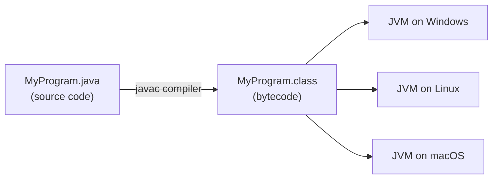

You compile your `.java` source **once** into bytecode (`.class` files). That bytecode isn't native machine code for any particular CPU — it's an intermediate format that any **Java Virtual Machine (JVM)** knows how to run. Since a JVM exists for essentially every OS, the same `.class` file runs unmodified everywhere a JVM is installed.

### 3. What is bytecode?

Bytecode is the intermediate, platform-neutral instruction set that the Java compiler (`javac`) produces from your `.java` source files — stored in `.class` files. It's not directly executable machine code; it's designed to be **interpreted or JIT-compiled by the JVM** at runtime. Think of it as a "middle language" — more abstract than machine code, but much more compact and faster to process than raw source text.

```
MyProgram.java  --javac-->  MyProgram.class (bytecode)  --JVM-->  runs on any OS
```

### 4. Compare JDK vs JVM vs JRE

These three terms are commonly confused. Here's how they nest inside each other:

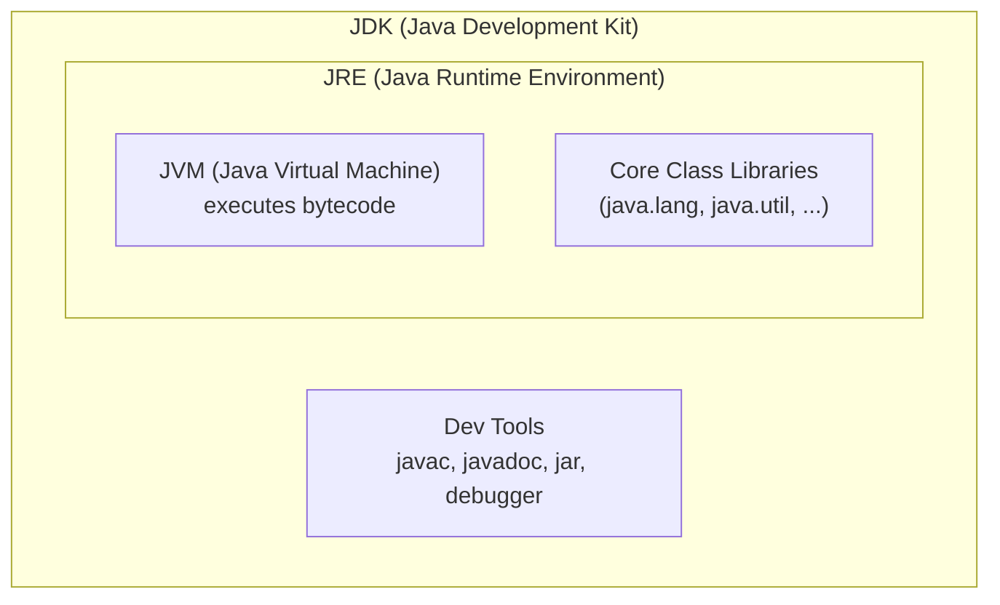

|                      | JVM                               | JRE                                             | JDK                                                                   |
| -------------------- | --------------------------------- | ----------------------------------------------- | --------------------------------------------------------------------- |
| Full name            | Java Virtual Machine              | Java Runtime Environment                        | Java Development Kit                                                  |
| What it is           | The engine that executes bytecode | JVM + core libraries needed to**run** Java apps | JRE + tools needed to**develop** Java apps (compiler, debugger, etc.) |
| Contains a compiler? | No                                | No                                              | Yes (`javac`)                                                         |
| Who needs it         | Anyone running Java software      | End users running Java apps                     | Developers writing Java code                                          |

In short: **JDK ⊃ JRE ⊃ JVM** — the JDK is a superset of the JRE, which is a superset of the JVM.

### 5. What are the important differences between C++ and Java?

|                            | C++                                         | Java                                             |
| -------------------------- | ------------------------------------------- | ------------------------------------------------ |
| Platform independence      | No — compiles to native machine code per OS | Yes — compiles to bytecode, runs on any JVM      |
| Memory management          | Manual (`new`/`delete`)                     | Automatic (Garbage Collector)                    |
| Pointers                   | Explicit pointer arithmetic allowed         | No pointer arithmetic (references only)          |
| Multiple inheritance       | Supported (classes)                         | Not for classes; achieved via interfaces instead |
| Operator overloading       | Supported                                   | Not supported                                    |
| Compilation target         | Native machine code                         | Bytecode, run by the JVM                         |
| Global functions/variables | Allowed outside classes                     | Everything must live inside a class              |

### 6. What is the role for a classloader in Java?

A **classloader** is responsible for dynamically loading `.class` files into the JVM's memory at runtime, on demand (as opposed to loading everything up-front). Java uses a **delegation hierarchy** of classloaders:

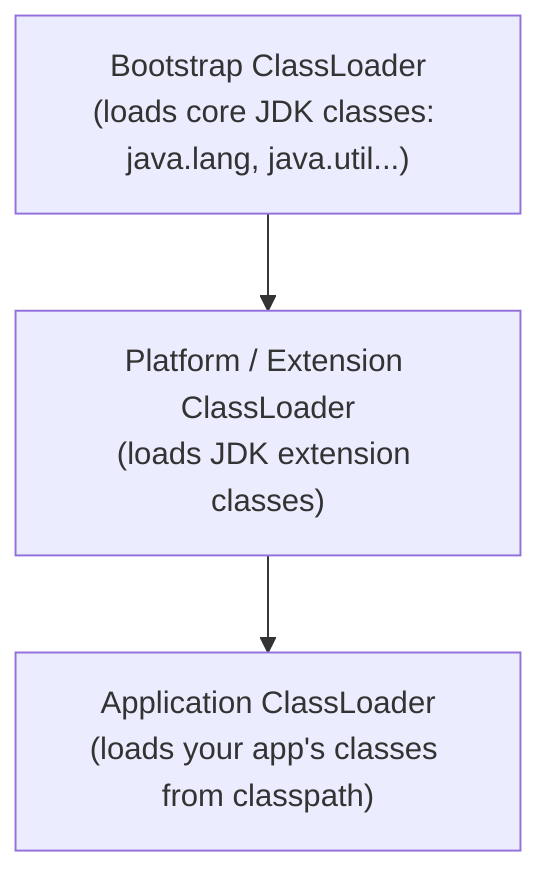

When a class needs to be loaded, the request is delegated **upward first**: the Application loader asks the Platform loader, which asks the Bootstrap loader. Each checks if it has already loaded the class, or if it's responsible for it, before letting a lower loader try. This delegation model prevents core classes like `java.lang.String` from being accidentally overridden by user code, and enables features like loading classes from JARs, over a network, or dynamically at runtime (e.g. in application servers and plugin systems).

---

## Wrapper Classes

### 7. What are Wrapper classes?

Java has 8 **primitive types** (`int`, `char`, `boolean`, `byte`, `short`, `long`, `float`, `double`) that are **not objects** — just raw values. For every primitive type, Java provides a corresponding **Wrapper class** that wraps that value inside a real object:

| Primitive | Wrapper class |
| --------- | ------------- |
| `int`     | `Integer`     |
| `char`    | `Character`   |
| `boolean` | `Boolean`     |
| `byte`    | `Byte`        |
| `short`   | `Short`       |
| `long`    | `Long`        |
| `float`   | `Float`       |
| `double`  | `Double`      |

```java
int primitive = 5;
Integer wrapped = Integer.valueOf(5); // an actual object
```

### 8. Why do we need Wrapper classes in Java?

Primitives can't be used in places that require an **object**:

- **Collections** — `List<int>` is illegal; you must use `List<Integer>`, because generics only work with objects.
- **`null` values** — a primitive `int` can never be `null` (a missing/unknown value), but an `Integer` can.
- **Utility methods** — wrapper classes bring useful static methods like `Integer.parseInt("42")`, `Integer.MAX_VALUE`, `Character.isDigit('5')`.
- **Object-oriented APIs** — reflection, serialization, and many frameworks are designed to work with objects, not raw primitives.

```java
List<Integer> scores = new ArrayList<>(); // must use Integer, not int
scores.add(null); // valid — represents "no score yet"
```

### 9. What are the different ways of creating Wrapper class instances?

```java
// 1. Using valueOf() -- recommended, may reuse cached instances
Integer a = Integer.valueOf(10);

// 2. Using the constructor -- deprecated since Java 9, always creates a new object
Integer b = new Integer(10);

// 3. Autoboxing -- the compiler converts automatically
Integer c = 10;
```

### 10. What are differences in the two ways of creating Wrapper classes?

|                          | `Integer.valueOf(10)`                                     | `new Integer(10)`                                   |
| ------------------------ | --------------------------------------------------------- | --------------------------------------------------- |
| Object creation          | May reuse a cached instance (for values -128 to 127)      | Always creates a brand-new object                   |
| Memory efficiency        | Better — avoids duplicate objects for common small values | Worse — wastes memory with duplicates               |
| Recommended?             | Yes                                                       | No —**deprecated since Java 9**                     |
| `==` comparison behavior | Can be`true` for cached small values                      | Always`false` when compared to another `new` object |

```java
Integer x = Integer.valueOf(100);
Integer y = Integer.valueOf(100);
System.out.println(x == y); // true -- both come from the internal cache (-128..127)

Integer p = new Integer(100);
Integer q = new Integer(100);
System.out.println(p == q); // false -- two distinct objects
```

### 11. What is auto boxing?

**Autoboxing** is the compiler automatically converting a primitive value into its corresponding Wrapper object (and **unboxing** does the reverse — Wrapper back to primitive) — without you writing the conversion explicitly.

```java
int primitive = 42;
Integer boxed = primitive;       // autoboxing: int -> Integer
int backToPrimitive = boxed;     // unboxing: Integer -> int

List<Integer> list = new ArrayList<>();
list.add(5); // autoboxing happens here: 5 (int) -> Integer.valueOf(5)
```

### 12. What are the advantages of auto boxing?

- Lets you write natural-looking code that mixes primitives and their wrapper types freely (e.g. adding an `int` directly into a `List<Integer>`).
- Reduces boilerplate — no need to manually call `Integer.valueOf()` / `.intValue()` everywhere.
- Makes primitives usable seamlessly with generic APIs (Collections, Streams) that require objects.

_Caution:_ autoboxing/unboxing happening invisibly can hurt performance in tight loops (creating many small objects) and can even throw a `NullPointerException` if you unbox a `null` Wrapper.

```java
Integer count = null;
int x = count; // NullPointerException! unboxing null
```

### 13. What is casting?

**Casting** is explicitly converting a value from one type to another, e.g. from `double` to `int`, or from a superclass reference to a subclass reference.

```java
double d = 9.7;
int i = (int) d; // casting double to int -> 9 (fraction truncated, not rounded)
```

### 14. What is implicit casting?

Implicit casting (a.k.a. **widening conversion**) happens **automatically**, without you writing anything, when converting from a "smaller" type to a "larger"/more general one — no data can be lost, so the compiler does it for you.

```java
int i = 100;
long l = i;      // implicit: int -> long
double d = l;    // implicit: long -> double
```

Order of widening for numeric types: `byte -> short -> int -> long -> float -> double`.

### 15. What is explicit casting?

Explicit casting (a.k.a. **narrowing conversion**) is required when converting from a "larger" type to a "smaller" one, because data **could** be lost — so you must acknowledge that risk by writing the cast yourself using `(type)`.

```java
double d = 9.99;
int i = (int) d;      // explicit cast required: double -> int (loses the .99)

long l = 123456789012L;
int i2 = (int) l;     // explicit cast: may overflow/truncate for large values
```

---

## Strings

### 16. Are all String's immutable?

Yes — once a `String` object is created, its internal character content can **never be changed**. Every operation that looks like it "modifies" a string (`concat`, `replace`, `toUpperCase`, `substring`, ...) actually returns a **brand-new** `String` object, leaving the original untouched.

```java
String s = "hello";
s.toUpperCase();          // returns a NEW string "HELLO" -- s itself is unchanged!
System.out.println(s);    // still prints "hello"

s = s.toUpperCase();      // now s points to the new string
System.out.println(s);    // prints "HELLO"
```

Immutability gives Strings big benefits: they're safe to share across threads without synchronization, safe to use as `HashMap` keys (their hash never changes), and safe to cache/reuse in the String Pool (see next question).

### 17. Where are String values stored in memory?

String literals (written directly in code, like `"hello"`) are stored in a special memory region called the **String Constant Pool** (part of the heap since Java 7), which enables **reuse**: identical literals share the same object instead of creating duplicates. Strings created with `new String(...)` are forced onto the regular heap as separate objects, even if an identical literal already exists in the pool.

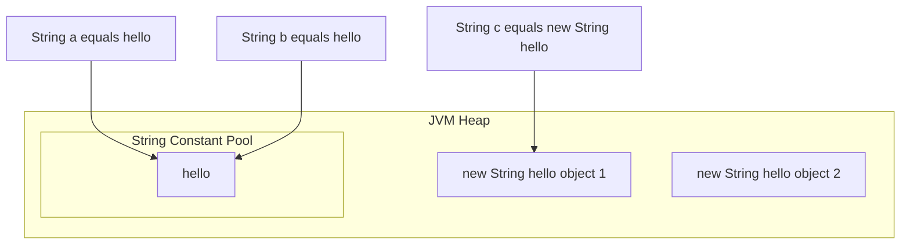

```java
String a = "hello";
String b = "hello";
System.out.println(a == b); // true -- both point to the SAME pooled object

String c = new String("hello");
System.out.println(a == c); // false -- c is a separate object on the heap

System.out.println(a.equals(c)); // true -- same content, use equals() to compare values!
```

### 18. Why should you be careful about String concatenation(+) operator in loops?

Because `String` is immutable, every `+` concatenation creates a **brand-new String object**, copying all the old characters plus the new ones. In a loop, this means you're repeatedly allocating and throwing away larger and larger string objects — an O(n²) performance trap.

```java
// BAD: creates a new String object on every iteration
String result = "";
for (int i = 0; i < 10000; i++) {
    result = result + i; // each += silently does: result = new String(result + i)
}
```

### 19. How do you solve above problem?

Use `StringBuilder` (or `StringBuffer` for the thread-safe version), which uses a **mutable, resizable internal character array** — appending just writes into existing space (occasionally resizing), instead of allocating a whole new string every time.

```java
// GOOD: one mutable buffer, appended to in place
StringBuilder sb = new StringBuilder();
for (int i = 0; i < 10000; i++) {
    sb.append(i); // no new object per iteration
}
String result = sb.toString(); // convert to String only once, at the end
```

### 20. What are differences between String and StringBuffer?

|             | `String`                       | `StringBuffer`                     |
| ----------- | ------------------------------ | ---------------------------------- |
| Mutability  | Immutable                      | Mutable                            |
| Thread-safe | Yes (because immutable)        | Yes (methods are`synchronized`)    |
| Performance | Slow for repeated modification | Fast for repeated modification     |
| Use case    | Fixed/rarely-changing text     | Text built/modified across threads |

### 21. What are differences between StringBuilder and StringBuffer?

|                  | `StringBuilder`                         | `StringBuffer`                          |
| ---------------- | --------------------------------------- | --------------------------------------- |
| Mutability       | Mutable                                 | Mutable                                 |
| Thread-safe      | No (not synchronized)                   | Yes (synchronized methods)              |
| Performance      | Faster (no locking overhead)            | Slower (locking overhead)               |
| Introduced in    | Java 5                                  | Java 1.0                                |
| Recommended when | Single-threaded code (most common case) | Multiple threads modify the same buffer |

**Full picture:**

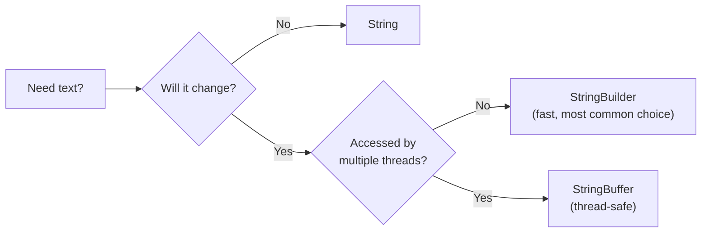

### 22. Can you give examples of different utility methods in String class?

```java
String s = "  Hello, World!  ";

s.length();                 // 17 -- number of characters
s.trim();                   // "Hello, World!" -- removes leading/trailing whitespace
s.toUpperCase();             // "  HELLO, WORLD!  "
s.toLowerCase();             // "  hello, world!  "
s.substring(2, 7);           // "Hello" -- characters from index 2 up to (not including) 7
s.charAt(2);                 // 'H' -- character at index 2
s.indexOf("World");          // 9 -- position where "World" starts
s.replace("Hello", "Hi");    // "  Hi, World!  "
s.contains("World");         // true
s.split(",");                // ["  Hello", " World!  "] -- array of substrings
s.equals("hello");           // false -- case-sensitive comparison
s.equalsIgnoreCase("  hello, world!  ".toUpperCase()); // case-insensitive comparison
String.join("-", "a", "b", "c"); // "a-b-c"
s.isEmpty();                 // false
s.isBlank();                 // false (Java 11+) -- true only for whitespace-only strings
```

## Object Oriented Programming Basics

### 23. What is a class?

A **class** is a blueprint/template for creating objects. It defines what **data** (fields) and **behavior** (methods) objects of that type will have — but the class itself is not a "thing" you can use directly, it's the design.

```java
class Car {
    String color;   // data (field)
    int speed;

    void accelerate() {  // behavior (method)
        speed += 10;
    }
}
```

### 24. What is an object?

An **object** is a concrete **instance** of a class — actual memory created from the blueprint, with its own real values.

```java
Car myCar = new Car();     // an object created from the Car class
myCar.color = "red";
myCar.accelerate();
```

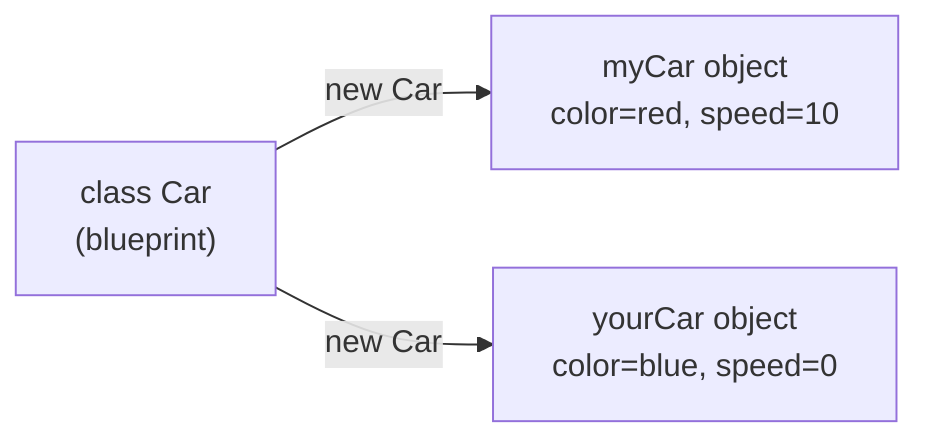

### 25. What is state of an object?

The **state** of an object is the current values held in its fields at a given moment — e.g. `myCar`'s state includes `color = "red"` and `speed = 10`. Two objects of the same class can have completely different states.

### 26. What is behavior of an object?

The **behavior** of an object is what it can _do_ — defined by its methods. Behavior often reads or changes the object's state, e.g. `accelerate()` changes `speed`.

### 27. What is the super class of every class in Java?

`java.lang.Object` is the root superclass of **every** class in Java. Even if you don't explicitly write `extends Object`, the compiler adds it for you. `Object` provides fundamental methods every object has: `toString()`, `equals()`, `hashCode()`, `getClass()`, `wait()`, `notify()`.

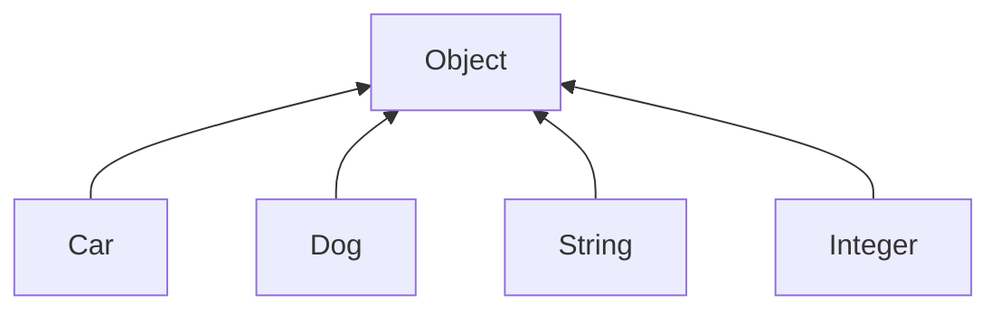

### 28. Explain about toString method?

`toString()` returns a **human-readable String representation** of an object. `Object`'s default implementation just prints the class name plus a hash code (e.g. `Car@1b6d3586`), which is rarely useful — so classes commonly **override** it.

```java
class Car {
    String color;
    Car(String color) { this.color = color; }

    @Override
    public String toString() {
        return "Car[color=" + color + "]";
    }
}

Car c = new Car("red");
System.out.println(c); // implicitly calls toString() -> "Car[color=red]"
```

### 29. What is the use of equals method in Java?

`equals()` checks whether two objects are **logically equal** (same content), as opposed to `==` which checks whether two references point to the exact **same object in memory**. The default `Object.equals()` just does `==`, so classes that need value-based comparison must override it.

```java
String a = new String("hi");
String b = new String("hi");
System.out.println(a == b);      // false -- different objects
System.out.println(a.equals(b)); // true -- same content (String overrides equals)
```

### 30. What are the important things to consider when implementing equals method?

A correct `equals()` implementation should be:

- **Reflexive** — `x.equals(x)` is always `true`.
- **Symmetric** — `x.equals(y)` implies `y.equals(x)`.
- **Transitive** — if `x.equals(y)` and `y.equals(z)`, then `x.equals(z)`.
- **Consistent** — repeated calls give the same result, as long as nothing changes.
- **Null-safe** — `x.equals(null)` must return `false`, never throw.
- **Consistent with `hashCode()`** — if `a.equals(b)`, then `a.hashCode() == b.hashCode()` **must** hold (see Q31).

```java
class Point {
    int x, y;
    Point(int x, int y) { this.x = x; this.y = y; }

    @Override
    public boolean equals(Object o) {
        if (this == o) return true;
        if (!(o instanceof Point)) return false;
        Point p = (Point) o;
        return x == p.x && y == p.y;
    }

    @Override
    public int hashCode() {
        return Objects.hash(x, y); // must stay in sync with equals()
    }
}
```

### 31. What is the Hashcode method used for in Java?

`hashCode()` returns an `int` "fingerprint" of an object, used by hash-based collections (`HashMap`, `HashSet`) to decide which internal bucket to store/look up the object in — making lookups fast (roughly O(1)) instead of scanning every element.

**The golden rule:** if `a.equals(b)` is `true`, then `a.hashCode()` **must** equal `b.hashCode()`. Breaking this rule causes objects to "disappear" inside `HashMap`/`HashSet` (they get stored in one bucket but looked up in another).

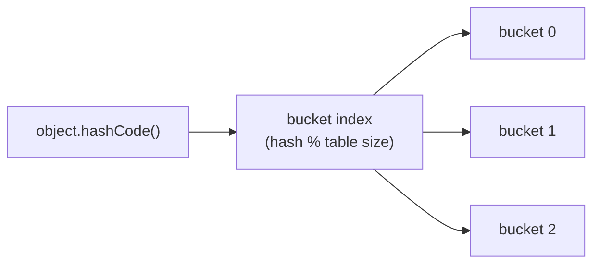

### 32. Explain inheritance with examples.

**Inheritance** lets a class (subclass/child) reuse fields and methods from another class (superclass/parent), using `extends`. It models an **"is-a"** relationship.

```java
class Animal {
    void eat() { System.out.println("This animal eats food"); }
}

class Dog extends Animal {   // Dog IS-A Animal
    void bark() { System.out.println("Woof!"); }
}

Dog d = new Dog();
d.eat();  // inherited from Animal
d.bark(); // defined in Dog
```

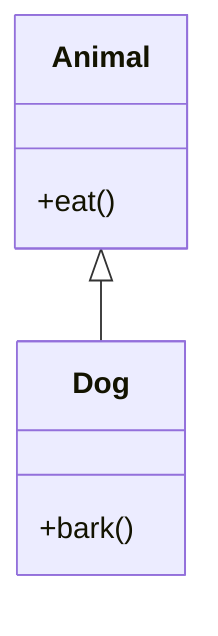

### 33. What is method overloading?

**Overloading** means defining multiple methods with the **same name** but **different parameter lists** (different number/type of parameters) within the same class. It's resolved at **compile time** (also called static/early binding).

```java
class Calculator {
    int add(int a, int b) { return a + b; }
    double add(double a, double b) { return a + b; }
    int add(int a, int b, int c) { return a + b + c; }
}
```

### 34. What is method overriding?

**Overriding** happens when a **subclass** provides its own implementation of a method already defined in its **superclass**, with the exact same signature. It's resolved at **runtime** based on the actual object type (dynamic/late binding), which is the mechanism behind runtime polymorphism (Q55).

```java
class Animal {
    void makeSound() { System.out.println("Some generic sound"); }
}
class Dog extends Animal {
    @Override
    void makeSound() { System.out.println("Woof!"); } // overrides parent's version
}
```

|             | Overloading              | Overriding            |
| ----------- | ------------------------ | --------------------- |
| Where       | Same class               | Superclass & subclass |
| Signature   | Must differ (parameters) | Must be identical     |
| Resolved    | Compile time             | Runtime               |
| Also called | Static/early binding     | Dynamic/late binding  |

### 35. Can super class reference variable can hold an object of sub class?

Yes — this is a core feature of polymorphism. A reference variable of the superclass type can point to a subclass object; you can only directly call methods declared on the superclass type through that reference, but overridden methods still run the subclass's version.

```java
Animal a = new Dog(); // valid! Dog IS-A Animal
a.makeSound();         // prints "Woof!" -- runs Dog's overridden version at runtime
```

### 36. Is multiple inheritance allowed in Java?

**Not for classes.** A class can only `extends` **one** other class, to avoid the "Diamond Problem" (ambiguity when two parent classes define conflicting methods). However, a class **can implement multiple interfaces**, which gives you multiple inheritance of _type_ (and, since Java 8's default methods, partial inheritance of behavior too, with explicit conflict resolution required).

```java
class MyClass extends OneParent implements InterfaceA, InterfaceB { } // OK
// class MyClass extends ParentA, ParentB { } // ILLEGAL -- won't compile
```

### 37. What is an interface?

An **interface** defines a **contract** — a set of method signatures that any implementing class must provide — without (traditionally) any implementation of its own. It's Java's answer to "what can this thing do?" rather than "what is this thing?"

```java
interface Flyable {
    void fly(); // no body -- implicitly abstract
}
```

### 38. How do you define an interface?

```java
interface Shape {
    double AREA_UNIT = 1.0;      // implicitly public static final (a constant)
    double calculateArea();       // implicitly public abstract

    default void describe() {     // default method (Java 8+) -- has a body
        System.out.println("I am a shape");
    }
}
```

### 39. How do you implement an interface?

A class uses `implements` and must provide bodies for all abstract methods (unless the class itself is declared `abstract`).

```java
class Circle implements Shape {
    double radius;
    Circle(double radius) { this.radius = radius; }

    @Override
    public double calculateArea() {
        return Math.PI * radius * radius;
    }
}
```

### 40. Can you explain a few tricky things about interfaces?

- All fields in an interface are implicitly `public static final` (constants) — you can't have regular instance fields.
- All methods are implicitly `public`, and `abstract` unless marked `default` or `static`.
- Since Java 8, interfaces can have **`default`** methods (with a body, inherited by implementers) and **`static`** methods.
- Since Java 9, interfaces can have **`private`** methods (helper methods used only inside default methods).
- A class can implement **multiple** interfaces — this is how Java achieves multiple inheritance of behavior.
- If two interfaces provide conflicting `default` methods, the implementing class **must** override the method to resolve the conflict.
- An interface **cannot** be instantiated directly (`new Shape()` is illegal).

### 41. Can you extend an interface?

Yes — an interface can `extend` one **or more** other interfaces (unlike classes, which can only extend one class), inheriting their abstract method signatures.

```java
interface Movable { void move(); }
interface Rotatable { void rotate(); }
interface Transformable extends Movable, Rotatable { } // inherits both
```

### 42. Can a class extend multiple interfaces?

The correct verb is _implement_, not _extend_ — a class **implements** multiple interfaces using `implements InterfaceA, InterfaceB`, which is exactly how Java provides multiple inheritance of type.

```java
class Duck implements Flyable, Swimmable {
    public void fly() { System.out.println("Duck flying"); }
    public void swim() { System.out.println("Duck swimming"); }
}
```

### 43. What is an abstract class?

An `abstract class` is a class that **cannot be instantiated directly** and may contain a mix of **abstract methods** (no body — subclasses must implement them) and **concrete methods** (with a body, shared by all subclasses). It's used to define a partial, shared implementation as a base for related subclasses.

```java
abstract class Shape {
    abstract double area();               // must be implemented by subclasses
    void printArea() {                    // shared, concrete behavior
        System.out.println("Area: " + area());
    }
}
```

### 44. When do you use an abstract class?

Use an abstract class when:

- You want to share **common code** (fields, concrete methods) across related subclasses, not just method signatures.
- You want to force subclasses to implement certain methods, while providing default behavior for others.
- The classes involved share a clear **"is-a"** relationship (e.g. `Circle`, `Square` are both "a `Shape`").
- You need constructors, non-`public`/non-`static`/non-`final` fields, or non-public methods — none of which plain interfaces support as freely.

### 45. How do you define an abstract method?

An abstract method has **no body** — just a signature ending in `;` — and must be declared inside an `abstract` class (or an interface).

```java
abstract class Beverage {
    abstract void brew(); // no implementation here
}
class Coffee extends Beverage {
    @Override
    void brew() { System.out.println("Brewing coffee"); } // subclass MUST implement it
}
```

### 46. Compare abstract class vs interface?

|                             | Abstract class                                       | Interface                                               |
| --------------------------- | ---------------------------------------------------- | ------------------------------------------------------- |
| Instantiable                | No                                                   | No                                                      |
| Method bodies               | Yes, freely (concrete + abstract)                    | Only`default`/`static`/`private` methods (Java 8+)      |
| Fields                      | Any (instance, static, final, etc.)                  | Only`public static final` constants                     |
| Constructors                | Yes                                                  | No                                                      |
| Multiple inheritance        | A class can extend only**one** abstract class        | A class can implement**many** interfaces                |
| Access modifiers on methods | Any (`public`, `protected`, `private`)               | Implicitly`public` (except `private` helper methods)    |
| Use when                    | Sharing implementation among closely related classes | Defining a capability/contract across unrelated classes |

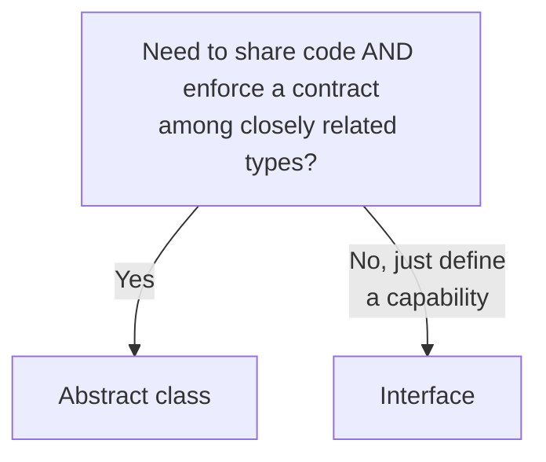

### 47. What is a constructor?

A **constructor** is a special block of code that runs when an object is created with `new`, used to initialize the object's state. It has the same name as the class and **no return type** (not even `void`).

```java
class Car {
    String color;
    Car(String color) {   // constructor
        this.color = color;
    }
}
Car c = new Car("red"); // constructor runs here
```

### 48. What is a default constructor?

If a class defines **no constructors at all**, the compiler automatically generates a **default (no-argument) constructor** that does nothing but call the superclass's no-arg constructor. The moment you write **any** constructor yourself, the compiler stops generating this default one.

```java
class Car { } // compiler secretly adds: Car() { super(); }
Car c = new Car(); // works fine, uses the compiler-generated constructor
```

### 49. Will this code compile?

```java
class Car {
    Car(String color) { }
}
class Test {
    public static void main(String[] args) {
        Car c = new Car(); // ??
    }
}
```

**No, it won't compile.** Once you define _any_ constructor (`Car(String color)`), the compiler does **not** generate the no-arg default constructor anymore. Calling `new Car()` fails because no matching constructor exists — you'd need to either call `new Car("red")` or add a no-arg constructor yourself.

### 50. How do you call a super class constructor from a constructor?

Use `super(...)` as the **very first statement** in the subclass constructor.

```java
class Animal {
    String name;
    Animal(String name) { this.name = name; }
}
class Dog extends Animal {
    Dog(String name) {
        super(name); // must be the first line
        System.out.println("Dog created");
    }
}
```

### 51. Will this code compile?

```java
class Dog extends Animal {
    Dog(String name) {
        System.out.println("Dog created");
        super(name); // ??
    }
}
```

**No.** `super(...)` must be the **first statement** in a constructor. Putting any code before it (even a `System.out.println`) is a compile-time error.

### 52. What is the use of this()?

`this(...)` calls **another constructor in the same class** — used to avoid duplicating initialization logic across overloaded constructors. Like `super()`, it must be the first statement in the constructor.

```java
class Car {
    String color;
    int speed;

    Car() {
        this("white"); // delegates to the constructor below
    }
    Car(String color) {
        this.color = color;
        this.speed = 0;
    }
}
```

### 53. Can a constructor be called directly from a method?

No — a constructor can only be invoked via `new`, or via `this(...)`/`super(...)` from another constructor. You cannot call `MyClass()` like a regular method from inside a normal method body; attempting `this.MyClass()` is a compile error.

### 54. Is a super class constructor called even when there is no explicit call from a sub class constructor?

Yes — if a subclass constructor doesn't explicitly call `super(...)` or `this(...)`, the compiler **automatically inserts an implicit `super()`** call (the superclass's no-arg constructor) as the first line. This means the superclass's no-arg constructor must exist (or be the compiler-generated default), otherwise you get a compile error.

```java
class Animal {
    Animal() { System.out.println("Animal created"); }
}
class Dog extends Animal {
    Dog() {
        // compiler inserts super(); here automatically
        System.out.println("Dog created");
    }
}
new Dog(); // prints: "Animal created" then "Dog created"
```

---

## Advanced Object Oriented Concepts

### 55. What is polymorphism?

**Polymorphism** ("many forms") means an object can be treated as an instance of its superclass or interface, while still executing its **own specific behavior** at runtime. It's what lets a single piece of code work with many different object types.

```java
Animal[] animals = { new Dog(), new Cat() };
for (Animal a : animals) {
    a.makeSound(); // each prints its OWN sound, even though the array type is Animal
}
```

There are two kinds:

- **Compile-time (static) polymorphism** — method overloading (Q33).
- **Runtime (dynamic) polymorphism** — method overriding (Q34).

### 56. What is the use of instanceof operator in Java?

`instanceof` checks whether an object is an instance of a given class/interface at runtime, returning `true`/`false`. It's commonly used before casting, to avoid a `ClassCastException`.

```java
Animal a = new Dog();
if (a instanceof Dog) {
    Dog d = (Dog) a; // safe cast, we already checked
    d.bark();
}

// Java 16+ pattern matching shortcut:
if (a instanceof Dog dog) {
    dog.bark(); // "dog" is automatically cast and ready to use
}
```

### 57. What is coupling?

**Coupling** measures how much one class/module **depends on** the internal details of another. **Low (loose) coupling** is desirable — classes interact through clean interfaces/abstractions rather than reaching into each other's internals, making the system easier to change without ripple effects.

```java
// Tight coupling: depends directly on a concrete class
class Car {
    PetrolEngine engine = new PetrolEngine();
}

// Loose coupling: depends on an abstraction (interface)
class Car {
    Engine engine; // could be PetrolEngine, ElectricEngine, ...
    Car(Engine engine) { this.engine = engine; }
}
```

### 58. What is cohesion?

**Cohesion** measures how focused a single class/module is on doing **one well-defined job**. **High cohesion** is desirable — a class should have a clear, single responsibility. Low cohesion (a class doing many unrelated things) makes code harder to understand, test, and maintain.

```java
// Low cohesion: unrelated responsibilities crammed together
class Utils {
    void sendEmail() {}
    void calculateTax() {}
    void parseXml() {}
}

// High cohesion: focused responsibility
class EmailSender {
    void sendEmail() {}
}
```

### 59. What is encapsulation?

**Encapsulation** means bundling data (fields) and the methods that operate on it together inside a class, while **hiding internal details** from the outside world — typically by making fields `private` and exposing controlled access via `public` getter/setter methods. This protects an object's internal state from being put into an invalid condition by outside code.

```java
class BankAccount {
    private double balance; // hidden -- can't be touched directly from outside

    public double getBalance() { return balance; }
    public void deposit(double amount) {
        if (amount > 0) balance += amount; // validation enforced here
    }
}
```

### 60. What is an inner class?

An **inner class** is a class defined **inside** another class. It has access to the outer class's fields and methods (including `private` ones), and is tied to a specific **instance** of the outer class.

```java
class Outer {
    private int x = 10;
    class Inner {
        void show() {
            System.out.println("x = " + x); // can access Outer's private field
        }
    }
}
Outer outer = new Outer();
Outer.Inner inner = outer.new Inner(); // needs an Outer instance to create
```

### 61. What is a static inner class?

A **static inner (nested) class** is declared with `static`, meaning it does **not** need — and cannot directly access — an instance of the outer class. It behaves like a top-level class that just happens to be namespaced inside another class.

```java
class Outer {
    static class StaticInner {
        void show() { System.out.println("Static inner class"); }
    }
}
Outer.StaticInner inner = new Outer.StaticInner(); // no Outer instance needed!
```

|                                     | Inner (non-static) class                | Static nested class                            |
| ----------------------------------- | --------------------------------------- | ---------------------------------------------- |
| Needs outer instance?               | Yes                                     | No                                             |
| Can access outer's instance fields? | Yes                                     | No (only static members)                       |
| Common use                          | Tightly bound helper (e.g. an Iterator) | Logical grouping, no dependency on outer state |

### 62. Can you create an inner class inside a method?

Yes — this is called a **local class**. It's defined inside a method body and is only visible within that method. It can access the enclosing method's local variables, as long as they're `final` or _effectively final_ (never reassigned).

```java
void process() {
    final String prefix = "Item: ";
    class Printer { // local class
        void print(String name) { System.out.println(prefix + name); }
    }
    new Printer().print("Book");
}
```

### 63. What is an anonymous class?

An **anonymous class** is a local class **without a name**, declared and instantiated in a single expression — usually to quickly implement an interface or extend a class for one-off use, before lambda expressions made this less common for functional interfaces.

```java
Runnable r = new Runnable() {   // anonymous class implementing Runnable
    @Override
    public void run() {
        System.out.println("Running!");
    }
};
r.run();

// Since Java 8, for functional interfaces, a lambda is shorter:
Runnable r2 = () -> System.out.println("Running!");
```

## Modifiers

### 64. What is default class modifier?

When you write a class in Java and you don't put any access word (like `public`) in front of it, that's called the **default** (or "package-private") modifier. It's not a keyword you type — it's what you get by _not_ typing anything.

A class with default access can only be used by other classes that live in the **same package** (same folder/namespace). Classes in other packages can't see it at all.

```java
// File: Greeter.java (no modifier = default access)
class Greeter {
    void sayHello() {
        System.out.println("Hello!");
    }
}
```

Think of it like a note pinned on your team's office wall — anyone on your team (same package) can read it, but people from other teams (other packages) don't even know it exists.

### 65. What is private access modifier?

`private` is the strictest access level. A `private` member (field, method, or constructor) can only be used **inside the same class** where it's declared — not even subclasses can touch it directly.

```java
public class BankAccount {
    private double balance; // only BankAccount can touch this directly

    public double getBalance() {
        return balance; // accessing it from inside the same class is fine
    }
}
```

It's like a diary you keep locked in your own drawer — nobody else, not even your siblings (subclasses), gets to open it directly. This is the foundation of "encapsulation": hiding your data and only exposing it through safe methods like `getBalance()`.

### 66. What is default or package access modifier?

This is the same idea as question 64, but it applies to any member — fields, methods, constructors — not just classes. If you skip the access modifier, Java gives that member **default (package-private)** access: visible to any class in the same package, invisible outside it.

```java
class Car {
    String model; // default access — no keyword written

    void start() { // default access
        System.out.println("Vroom!");
    }
}
```

Any other class in the same package can use `model` and `start()`, but a class in a different package cannot.

### 67. What is protected access modifier?

`protected` is a middle-ground access level. A `protected` member is visible:

- inside the same class,
- to any class in the same package (just like default), **and**
- to subclasses in _other_ packages too (this is the extra bit default doesn't give you).

```java
public class Animal {
    protected String sound = "generic sound";

    protected void makeSound() {
        System.out.println(sound);
    }
}

// In a different package:
public class Dog extends Animal {
    void bark() {
        sound = "Woof"; // allowed because Dog is a subclass
        makeSound();
    }
}
```

Think of `protected` as "family only" — your own class, your neighbors (same package), and your children (subclasses), even if the children moved to a different neighborhood (package).

### 68. What is public access modifier?

`public` is the most open access level. A `public` class, method, or field can be accessed from **anywhere** — any class, in any package, no restrictions.

```java
public class Calculator {
    public int add(int a, int b) {
        return a + b;
    }
}
```

It's like putting a poster on a public billboard — anyone, anywhere, can see and use it. Use `public` for things you genuinely want other parts of your program (or other programs using your library) to be able to call.

### 69. What access types of variables can be accessed from a class in same package?

From a class that's in the **same package**, you can access variables/members that are:

- `public`
- `protected`
- default (package-private)

You **cannot** access `private` members of another class — those stay locked to their own class no matter what package you're in.

### 70. What access types of variables can be accessed from a class in different package?

From an ordinary (non-subclass) class in a **different package**, you can only access:

- `public`

`protected`, default, and `private` members are all off-limits to a plain, unrelated class in another package.

### 71. What access types of variables can be accessed from a sub class in same package?

A subclass in the **same package** as its parent can access:

- `public`
- `protected`
- default (package-private)

Still not `private` — that always stays inside the exact class that declared it.

### 72. What access types of variables can be accessed from a sub class in different package?

A subclass in a **different package** from its parent can access:

- `public`
- `protected` (this is the special power `protected` gives to subclasses across packages)

It cannot access default (package-private) or `private` members of the parent, because being a subclass doesn't override package boundaries for those two.

**Access modifier summary table** (covers questions 69–72):

| Modifier             | Same class | Same package | Subclass in different package | Unrelated class in different package |
| -------------------- | ---------- | ------------ | ----------------------------- | ------------------------------------ |
| `private`            | Yes        | No           | No                            | No                                   |
| default (no keyword) | Yes        | Yes          | No                            | No                                   |
| `protected`          | Yes        | Yes          | Yes                           | No                                   |
| `public`             | Yes        | Yes          | Yes                           | Yes                                  |

### 73. What is the use of a final modifier on a class?

Putting `final` on a class means **no one can extend (subclass) it**. It's Java's way of saying "this class is complete as-is — don't try to build on top of it."

```java
public final class MathConstants {
    public static final double PI_APPROX = 3.14159;
}

// This would NOT compile:
// class MyConstants extends MathConstants { }
```

This is useful when you want to guarantee the behavior of a class can never be changed or overridden by someone else's subclass — for example, `java.lang.String` itself is `final` for exactly this reason (so nobody can create a "fake" String that behaves differently).

### 74. What is the use of a final modifier on a method?

Putting `final` on a method means **subclasses cannot override it**. The method's implementation is locked in place.

```java
public class Vehicle {
    public final void showLicensePlateRule() {
        System.out.println("Every vehicle must have a valid license plate.");
    }
}

class Car extends Vehicle {
    // This would NOT compile:
    // public void showLicensePlateRule() { ... }
}
```

This is handy when a method does something critical or security-sensitive and you don't want a subclass to accidentally (or intentionally) change its behavior.

### 75. What is a final variable?

A `final` variable is a variable whose value, once assigned, **cannot be changed** — it becomes a constant.

```java
public class Circle {
    final double radius = 5.0;

    void changeRadius() {
        // radius = 10.0; // This would NOT compile — radius is final
    }
}
```

You can also declare a `final` variable without assigning it right away ("blank final"), but then you must assign it exactly once — usually in the constructor:

```java
public class Circle {
    final double radius;

    Circle(double r) {
        radius = r; // allowed: first and only assignment
    }
}
```

Think of `final` on a variable like writing something in permanent marker instead of pencil — once it's written, it's written.

### 76. What is a final argument?

A `final` argument is a method parameter marked `final`, meaning the method **cannot reassign** that parameter to something else inside its body. It doesn't stop the caller from passing different values on different calls — it just stops the method from changing the parameter's value once inside.

```java
public class Printer {
    void printMessage(final String message) {
        System.out.println(message);
        // message = "changed"; // This would NOT compile
    }
}
```

This is mostly used to protect against accidental reassignment, and it's required if you want to use the parameter inside an anonymous inner class or lambda in older Java versions.

### 77. What happens when a variable is marked as volatile?

`volatile` is a special keyword used in **multi-threaded** programs. It tells Java: "Whenever a thread reads this variable, get the _latest_ value directly from main memory — don't use a cached copy stored just for that one thread's CPU core."

```java
public class Flag {
    private volatile boolean running = true;

    public void stop() {
        running = false;
    }

    public void run() {
        while (running) {
            // do work
        }
        System.out.println("Stopped!");
    }
}
```

Without `volatile`, one thread might change `running` to `false`, but another thread (running `run()` on a different CPU core) might keep using an old cached copy that still says `true`, and never notice the change. `volatile` guarantees visibility of the latest value across threads. (Note: it does **not** make compound operations like `count++` atomic/thread-safe by itself — for that you'd need `synchronized` or classes like `AtomicInteger`.)

### 78. What is a static variable?

A `static` variable belongs to the **class itself**, not to any one object. All objects of that class share the exact same copy of it, instead of each object getting its own.

```java
public class Counter {
    static int totalCreated = 0; // shared by every Counter object

    Counter() {
        totalCreated++;
    }
}

public class Main {
    public static void main(String[] args) {
        new Counter();
        new Counter();
        new Counter();
        System.out.println(Counter.totalCreated); // prints 3
    }
}
```

Think of a static variable like a shared whiteboard in a classroom — every student (object) can read and write to it, and there's only ever one whiteboard, not one per student. You access it using the class name (`Counter.totalCreated`) rather than through an individual object.

## Conditions & Loops

### 79. Why should you always use blocks around if statement?

Without curly braces `{ }`, an `if` statement only controls the **single next line** of code. This is a very common source of bugs, because it's easy to add a second line later and assume it's still "inside" the `if` — when it actually isn't.

```java
if (isRaining)
    System.out.println("Take an umbrella");
    System.out.println("Wear boots"); // this ALWAYS runs, if or no if!
```

Even though it _looks_ like both print statements are guarded by `isRaining`, only the first one is. The second line runs no matter what, because indentation doesn't matter to the Java compiler — only the braces do.

Always wrapping the body in `{ }` avoids this trap entirely:

```java
if (isRaining) {
    System.out.println("Take an umbrella");
    System.out.println("Wear boots");
}
```

It also makes code easier to read and safer to modify later — a good habit even when the body is just one line.

### 80. Guess the output

```java
public class DanglingElse {
    public static void main(String[] args) {
        int score = 85;
        boolean passed = true;

        if (score > 90)
            if (passed)
                System.out.println("Excellent!");
        else
            System.out.println("Not so great.");

        System.out.println("Done checking.");
    }
}
```

**Output:**

```
Done checking.
```

**Why:** This is the classic "dangling else" trap. Even though the `else` is indented to line up visually with the _outer_ `if (score > 90)`, Java actually attaches an `else` to the **nearest unmatched `if`** — which here is `if (passed)`. So the code really behaves like:

```java
if (score > 90) {
    if (passed) {
        System.out.println("Excellent!");
    } else {
        System.out.println("Not so great.");
    }
}
```

Since `score` is `85`, the outer condition `score > 90` is `false`, so neither inner branch ever runs at all — the whole inner `if/else` is skipped. Only `"Done checking."` gets printed. This is exactly why question 79 tells you to always use braces — the indentation lied to us about what the code does!

### 81. Guess the output

```java
public class IncrementDemo {
    public static void main(String[] args) {
        int i = 5;
        int a = i++ + ++i;
        System.out.println("i = " + i);
        System.out.println("a = " + a);
    }
}
```

**Output:**

```
i = 7
a = 12
```

**Why:**

- `i++` (post-increment) uses the **current** value of `i` (which is `5`) in the expression, _then_ increments `i` to `6`.
- `++i` (pre-increment) increments `i` **first** (from `6` to `7`), then uses the new value (`7`) in the expression.
- So `a = i++ + ++i` becomes `a = 5 + 7 = 12`.
- After both operations, `i` ends up at `7`.

The key lesson: `x++` gives you the old value and updates afterward; `++x` updates first and gives you the new value.

### 82. Guess the output of this switch block

```java
public class SwitchFallThrough {
    public static void main(String[] args) {
        int day = 2;

        switch (day) {
            case 1:
                System.out.println("Monday");
            case 2:
                System.out.println("Tuesday");
            case 3:
                System.out.println("Wednesday");
                break;
            case 4:
                System.out.println("Thursday");
            default:
                System.out.println("Unknown day");
        }
    }
}
```

**Output:**

```
Tuesday
Wednesday
```

**Why:** `switch` jumps straight to the matching `case 2:` label and then just keeps executing every line **downward** until it hits a `break` (or the end of the switch) — it does not automatically stop after one case. Since `case 2` and `case 3` have no `break` between them, both `"Tuesday"` and `"Wednesday"` print. Execution stops at `case 3`'s `break`, so `"Thursday"` and `"Unknown day"` never run. This "falling through" behavior is intentional in Java and is exactly why forgetting a `break` is a classic beginner bug.

### 83. Guess the output of this switch block?

```java
public class MissingBreak {
    public static void main(String[] args) {
        int grade = 2;
        String result = "";

        switch (grade) {
            case 1:
                result = "Excellent";
                break;
            case 2:
                result = "Good";
            case 3:
                result = "Average";
                break;
            default:
                result = "Invalid";
        }

        System.out.println(result);
    }
}
```

**Output:**

```
Average
```

**Why:** `grade` is `2`, so execution starts at `case 2:` and sets `result = "Good"`. But there's no `break` after that line, so it "falls through" into `case 3:` as well, which overwrites `result` with `"Average"`. _Then_ it hits the `break` in `case 3` and stops. So even though we matched `case 2`, the final printed value is `"Average"` because the missing `break` let execution slide into the next case. This is a very common real-world bug — always double check your `break` statements!

### 84. Should default be the last case in a switch statement?

No, it's not required — `default` can technically be placed anywhere in a `switch` block (first, middle, or last), and Java will still only jump to it if none of the other `case` labels match. However, it's **strongly recommended as a best practice** to put `default` last, because:

1. It's what most readers expect (matches how we read "if none of the above, do this").
2. It avoids confusing fall-through behavior — if `default` isn't last and doesn't have a `break`, execution can fall through into the `case`s that come after it, which is rarely what you want.

```java
switch (value) {
    case 1:
        System.out.println("One");
        break;
    case 2:
        System.out.println("Two");
        break;
    default:
        System.out.println("Something else");
}
```

So: allowed anywhere, but put it last for clarity and to avoid surprises.

### 85. Can a switch statement be used around a String

Yes. Since **Java 7**, you can `switch` on a `String` value, not just on `int`, `char`, `byte`, `short`, or `enum` types.

```java
public class SwitchOnString {
    public static void main(String[] args) {
        String day = "MON";

        switch (day) {
            case "MON":
                System.out.println("Start of the work week");
                break;
            case "FRI":
                System.out.println("Almost the weekend!");
                break;
            default:
                System.out.println("Some other day");
        }
    }
}
```

**Output:**

```
Start of the work week
```

Under the hood, Java compares Strings using `.equals()` (and uses `hashCode()` for efficiency), so it behaves the way you'd expect String comparison to work. One important gotcha: if the `String` you're switching on is `null`, it throws a `NullPointerException`, so it's good practice to check for `null` before the `switch`.

### 86. Guess the output of this for loop

```java
public class ForLoopDemo {
    public static void main(String[] args) {
        for (int i = 0; i < 10; i++) {
            System.out.print(i);
            if (i < 9) {
                System.out.print("-");
            }
        }
    }
}
```

**Output:**

```
0-1-2-3-4-5-6-7-8-9
```

**Why:** The loop starts `i` at `0` and keeps going as long as `i < 10`, printing `i` and then a dash (except after the last number). So it prints `0`, then `1`, ... all the way through `9`, separated by dashes, giving `0-1-2-3-4-5-6-7-8-9`.

**Note:** Depending on how a particular for-loop gotcha is written (off-by-one conditions, `<=` vs `<`, or modifying `i` inside the loop body), it's easy to end up with a slightly different range in a beginner's own code — that's exactly the kind of thing this question is testing awareness of. But per the original source material for this question, the intended/expected output is `0-1-2-3-4-5-6-7-8-9`, and that's the answer to go with here.

### 87. What is an enhanced for loop?

An **enhanced for loop** (also called a "for-each" loop) is a simpler way to loop over every element of an array or a collection (like a `List`), without needing to manually manage an index counter.

```java
public class EnhancedForDemo {
    public static void main(String[] args) {
        int[] numbers = {10, 20, 30, 40};

        for (int num : numbers) {
            System.out.println(num);
        }
    }
}
```

**Output:**

```
10
20
30
40
```

Compare this to the traditional for loop, which needs an explicit counter:

```java
for (int i = 0; i < numbers.length; i++) {
    System.out.println(numbers[i]);
}
```

The enhanced for loop reads as "for each `num` in `numbers`, do this." It's shorter, less error-prone (no risk of an off-by-one bug), and easier to read — but it does not give you the index, and you can't use it to modify the original array/collection's structure while looping (e.g., you can't safely add/remove elements from a `List` inside it).

### 88. What is the output of the for loop below?

```java
public class ForLoopScope {
    public static void main(String[] args) {
        for (int i = 0, j = 5; i < j; i++, j--) {
            System.out.println("i = " + i + ", j = " + j);
        }
    }
}
```

**Output:**

```
i = 0, j = 5
i = 1, j = 4
```

**Why:** This loop uses the comma operator to initialize **two** variables (`i` and `j`) and update both of them each iteration. `i` counts up from `0`, `j` counts down from `5`, and the loop keeps running as long as `i < j`.

- Start: `i = 0`, `j = 5` → `0 < 5` is true → prints, then `i` becomes `1`, `j` becomes `4`.
- Next: `i = 1`, `j = 4` → `1 < 4` is true → prints, then `i` becomes `2`, `j` becomes `3`.
- Next: `i = 2`, `j = 3` → `2 < 3` is true → prints...

Wait — let's recheck carefully: after the second print, `i` becomes `2` and `j` becomes `3`, and `2 < 3` is still true, so it would print a third line too. So the accurate output is actually three lines:

```
i = 0, j = 5
i = 1, j = 4
i = 2, j = 3
```

After that iteration, `i` becomes `3` and `j` becomes `2`, and `3 < 2` is false, so the loop stops. This demonstrates two useful for-loop features: initializing/updating multiple variables at once using commas, and using any boolean condition (not just a simple counter check) to control the loop.

### 89. What is the output of the program below?

```java
public class LoopGotcha {
    public static void main(String[] args) {
        int total = 0;
        for (int i = 1; i <= 5; i++) {
            if (i == 3)
                continue;
            total += i;
        }
        System.out.println("Total: " + total);
    }
}
```

**Output:**

```
Total: 12
```

**Why:** The loop runs `i` from `1` to `5`. Every time, it adds `i` to `total` — **except** when `i` equals `3`, because the `continue` statement skips the rest of that loop iteration (the `total += i` line) and jumps straight to the next value of `i`. So the numbers actually added are `1 + 2 + 4 + 5 = 12`. The value `3` is simply skipped, not added. This shows how `continue` differs from `break`: `continue` skips just the current iteration, while `break` would stop the whole loop entirely.

### 90. What is the output of the program below?

```java
public class WhileTrueDemo {
    public static void main(String[] args) {
        int count = 0;
        while (true) {
            count++;
            if (count == 4) {
                break;
            }
            System.out.println("Count is: " + count);
        }
        System.out.println("Final count: " + count);
    }
}
```

**Output:**

```
Count is: 1
Count is: 2
Count is: 3
Final count: 4
```

**Why:** `while (true)` creates a loop that would run forever on its own — the only way out is the `break` statement inside it. Each pass increments `count`. When `count` reaches `4`, the `if` condition becomes true and `break` immediately exits the loop **before** the `println("Count is: ...")` line runs for `4`. That's why we only ever see `"Count is: 1"`, `"Count is: 2"`, and `"Count is: 3"` printed inside the loop, but the `"Final count: 4"` line afterward correctly shows `4`, since `count` was already incremented to `4` right before the `break` fired. This is a good example of how `break` can exit a loop at exactly the point you need, even one written as an "infinite" loop.

## Exception Handling

### 91. Why is exception handling important?

Real programs constantly encounter unexpected situations — a file that doesn't exist, a network call that times out, invalid user input, dividing by zero. **Exception handling** lets you detect and respond to these problems gracefully — logging them, retrying, showing a friendly error message — instead of the whole program **crashing** unexpectedly. It also lets you separate the "normal" logic of your code from "what do we do when things go wrong" logic, keeping code readable.

### 92. What design pattern is used to implement exception handling features in most languages?

The **try-catch-finally** pattern (sometimes discussed as an implementation of a broader "error handling" idiom, related to the **Chain of Responsibility** pattern) — an exception is _thrown_ at the point of failure and propagates up the call stack until some _catch_ block along the way is prepared to handle that specific exception type. This decouples "where an error occurs" from "where it's handled."

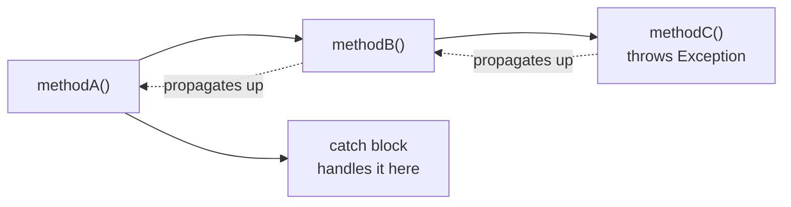

### 93. What is the need for finally block?

A `finally` block contains code that **always runs**, whether the `try` block completed normally, threw an exception, or even executed a `return` statement — used for guaranteed cleanup (closing files, releasing locks/connections, etc.).

```java
FileReader reader = null;
try {
    reader = new FileReader("data.txt");
    // ... read the file, might throw an exception
} catch (IOException e) {
    System.out.println("Error reading file: " + e.getMessage());
} finally {
    if (reader != null) {
        try { reader.close(); } catch (IOException e) { /* ignore */ }
    }
    System.out.println("Cleanup done"); // always runs
}
```

### 94. In what scenarios is code in finally not executed?

`finally` is _almost_ guaranteed to run, except when:

- The JVM itself crashes or is forcibly terminated (`System.exit()` is called inside the `try`/`catch`).
- The thread running the code is forcibly killed (e.g. `Thread.stop()` — a deprecated, dangerous method).
- The machine loses power or the OS kills the process.
- An infinite loop or a fatal `Error` (e.g. `StackOverflowError` in some edge cases) prevents control from ever reaching `finally`.

```java
try {
    System.out.println("In try");
    System.exit(0); // finally will NOT run after this
} finally {
    System.out.println("This never prints");
}
```

### 95. Will finally be executed in the program below?

```java
public int test() {
    try {
        return 1;
    } finally {
        System.out.println("Finally runs!");
    }
}
```

**Yes** — `finally` runs even when the `try` block hits a `return` statement. Java evaluates and "remembers" the return value `1`, then executes `finally`, and only _then_ actually returns. Output: `"Finally runs!"` is printed, and the method returns `1`.

_(Tricky bonus: if `finally` also contains a `return`, that new return value silently overrides the one from `try` — generally considered bad practice.)_

### 96. Is try without a catch is allowed?

Yes — `try` can be paired with just a `finally` block, no `catch` at all, as long as you're not trying to actually handle any exception (just guarantee cleanup).

```java
try {
    riskyOperation();
} finally {
    cleanup(); // runs regardless of what happens above
}
```

### 97. Is try without catch and finally allowed?

No — a `try` block **must** be followed by at least one `catch` **or** a `finally` block (or both). A bare `try { }` with neither is a compile-time error. (The one exception is **try-with-resources**, Q106, which is valid on its own since the resource-closing acts like an implicit finally.)

### 98. Can you explain the hierarchy of exception handling classes?

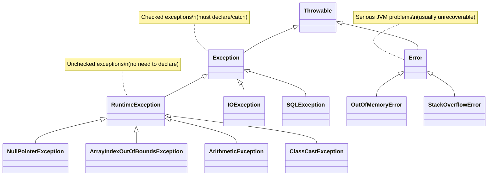

Everything throwable extends `Throwable`, which splits into `Error` (serious, usually unrecoverable JVM-level problems) and `Exception` (application-level problems you're expected to handle). `RuntimeException` (and its subclasses) form the "unchecked" branch of `Exception`.

### 99. What is the difference between error and exception?

|                      | `Error`                                                                              | `Exception`                                                   |
| -------------------- | ------------------------------------------------------------------------------------ | ------------------------------------------------------------- |
| Meaning              | Serious problems, usually outside the app's control (e.g. JVM running out of memory) | Problems the application can reasonably anticipate and handle |
| Recoverable?         | Usually not                                                                          | Usually yes                                                   |
| Examples             | `OutOfMemoryError`, `StackOverflowError`                                             | `IOException`, `NullPointerException`                         |
| Should you catch it? | Generally no — let it crash                                                          | Yes, when appropriate                                         |

### 100. What is the difference between checked exceptions and unchecked exceptions?

|                      | Checked exceptions                                                   | Unchecked exceptions                                                            |
| -------------------- | -------------------------------------------------------------------- | ------------------------------------------------------------------------------- |
| Extends              | `Exception` (but not `RuntimeException`)                             | `RuntimeException`                                                              |
| Compiler enforcement | Must be caught or declared (`throws`) — verified at **compile time** | No such requirement                                                             |
| Represents           | Recoverable, expected conditions (e.g. a missing file)               | Programming errors / unexpected conditions (e.g. null pointer, bad array index) |
| Examples             | `IOException`, `SQLException`                                        | `NullPointerException`, `ArithmeticException`, `IllegalArgumentException`       |

```java
// Checked -- compiler forces you to handle it
void readFile() throws IOException { ... }

// Unchecked -- compiler does NOT force you to handle it
void divide(int a, int b) { int result = a / b; } // may throw ArithmeticException
```

### 101. How do you throw an exception from a method?

Use the `throw` keyword with an exception instance.

```java
void withdraw(double amount, double balance) {
    if (amount > balance) {
        throw new IllegalArgumentException("Insufficient funds");
    }
    // proceed with withdrawal
}
```

### 102. What happens when you throw a checked exception from a method?

The compiler forces you to either **catch it** inside the method, or **declare it** in the method's signature with `throws`, so callers are aware they need to handle it too. Failing to do either is a **compile-time error**.

```java
void readFile() throws IOException {   // must declare it
    FileReader fr = new FileReader("data.txt"); // this constructor throws IOException
}
```

### 103. What are the options you have to eliminate compilation errors when handling checked exceptions?

1. **Catch it** with a `try`/`catch` block right there.
2. **Declare it** with `throws` on the method signature, pushing the responsibility to the caller.
3. **Wrap it** in an unchecked exception (e.g. `RuntimeException`) and rethrow, if you don't want to force callers to handle it.

```java
// Option 1: catch
try { readFile(); } catch (IOException e) { e.printStackTrace(); }

// Option 2: declare
void process() throws IOException { readFile(); }

// Option 3: wrap
try { readFile(); } catch (IOException e) { throw new RuntimeException(e); }
```

### 104. How do you create a custom exception?

Extend `Exception` (for a checked exception) or `RuntimeException` (for an unchecked one).

```java
class InsufficientFundsException extends Exception {
    public InsufficientFundsException(String message) {
        super(message);
    }
}

void withdraw(double amount, double balance) throws InsufficientFundsException {
    if (amount > balance) {
        throw new InsufficientFundsException("Not enough balance!");
    }
}
```

### 105. How do you handle multiple exception types with same exception handling block?

Since Java 7, use the **multi-catch** syntax with `|` to handle several exception types identically in one block (they must not be related by inheritance to each other).

```java
try {
    riskyOperation();
} catch (IOException | SQLException e) {
    System.out.println("Something went wrong: " + e.getMessage());
}
```

### 106. Can you explain about try with resources?

**Try-with-resources** (Java 7+) automatically closes any resource that implements `AutoCloseable` (e.g. `FileReader`, database connections, streams) when the `try` block exits — no explicit `finally` block needed to close it.

```java
try (FileReader reader = new FileReader("data.txt");
     BufferedReader br = new BufferedReader(reader)) {
    System.out.println(br.readLine());
} catch (IOException e) {
    System.out.println("Error: " + e.getMessage());
}
// both reader and br are automatically closed here, even if an exception occurred
```

### 107. How does try with resources work?

Any resources declared in the `try(...)` parentheses must implement `AutoCloseable` (which has a single `close()` method). The compiler automatically generates code equivalent to a `finally` block that calls `close()` on each resource, in **reverse order of declaration**, guaranteed to run even if an exception is thrown — behind the scenes it's essentially syntactic sugar over nested try/finally blocks.

### 108. Can you explain a few exception handling best practices?

- **Catch specific exceptions**, not a broad `catch (Exception e)` — you want to handle what you actually expect, not silently swallow bugs.
- **Never leave a catch block empty** — at minimum, log the exception.
- **Don't use exceptions for normal control flow** — they're relatively expensive and meant for exceptional situations.
- **Always clean up resources** — prefer try-with-resources over manual `finally` cleanup.
- **Preserve the original exception's stack trace** when wrapping — use `new RuntimeException(msg, originalException)`, not just `new RuntimeException(msg)`.
- **Throw early, catch late** — validate inputs and fail fast, but handle exceptions at a layer that actually knows what to do about them (e.g. show a user-facing message).
- **Use custom exceptions** for meaningful, domain-specific error conditions instead of generic ones.

---

## Miscellaneous Topics

### 109. What are the default values in an array?

When an array is created, Java automatically initializes every element to a type-appropriate default — you never get "garbage" values like in C.

| Type                               | Default value          |
| ---------------------------------- | ---------------------- |
| `int`, `short`, `byte`, `long`     | `0`                    |
| `float`, `double`                  | `0.0`                  |
| `boolean`                          | `false`                |
| `char`                             | `'�'` (null character) |
| Object references (`String`, etc.) | `null`                 |

```java
int[] numbers = new int[3];
System.out.println(numbers[0]); // 0

String[] names = new String[3];
System.out.println(names[0]); // null
```

### 110. How do you loop around an array using enhanced for loop?

```java
int[] scores = {90, 85, 78};
for (int score : scores) {
    System.out.println(score);
}
```

### 111. How do you print the content of an array?

Directly printing an array (`System.out.println(array)`) prints an unhelpful memory reference like `[I@1b6d3586`. Use `Arrays.toString()` (1D) or `Arrays.deepToString()` (nested/multi-dimensional arrays) instead.

```java
int[] numbers = {1, 2, 3};
System.out.println(numbers);                     // [I@1b6d3586 -- not useful!
System.out.println(Arrays.toString(numbers));     // [1, 2, 3]

int[][] grid = {{1, 2}, {3, 4}};
System.out.println(Arrays.deepToString(grid));    // [[1, 2], [3, 4]]
```

### 112. How do you compare two arrays?

Use `Arrays.equals()` for 1D arrays (compares content, element by element) — never `==`, which just compares references.

```java
int[] a = {1, 2, 3};
int[] b = {1, 2, 3};
System.out.println(a == b);              // false -- different array objects
System.out.println(Arrays.equals(a, b)); // true -- same contents

int[][] a2 = {{1, 2}}, b2 = {{1, 2}};
System.out.println(Arrays.deepEquals(a2, b2)); // true -- for nested arrays
```

### 113. What is an enum?

An `enum` is a special type representing a **fixed set of named constants** — safer and more expressive than using raw `int` or `String` constants.

```java
enum Day { MONDAY, TUESDAY, WEDNESDAY, THURSDAY, FRIDAY, SATURDAY, SUNDAY }

Day today = Day.MONDAY;
System.out.println(today); // MONDAY
```

Enums can also have fields, constructors, and methods:

```java
enum Planet {
    MERCURY(3.3e23), EARTH(5.9e24);

    final double mass;
    Planet(double mass) { this.mass = mass; }
}
```

### 114. Can you use a switch statement around an enum?

Yes — this is one of the most common and readable uses of `switch`. Note: inside the `switch`, you reference the enum constant **without** the enum type prefix.

```java
Day today = Day.WEDNESDAY;
switch (today) {
    case MONDAY:
        System.out.println("Start of the week");
        break;
    case WEDNESDAY:
        System.out.println("Midweek!");
        break;
    default:
        System.out.println("Some other day");
}
```

### 115. What are variable arguments or varargs?

**Varargs** (`...`) let a method accept **any number** of arguments of a given type, treated internally as an array. A method can have at most one varargs parameter, and it must be the **last** parameter.

```java
int sum(int... numbers) {
    int total = 0;
    for (int n : numbers) total += n;
    return total;
}

sum();           // 0
sum(1, 2);       // 3
sum(1, 2, 3, 4); // 10
```

### 116. What are asserts used for?

`assert` statements check that an assumption you believe _must_ be true actually holds, throwing an `AssertionError` if not. They're meant for **catching programming bugs during development/testing**, not for validating user input in production.

```java
int age = -5;
assert age >= 0 : "Age cannot be negative"; // throws AssertionError if age < 0
```

_Important:_ assertions are **disabled by default** at runtime — you must explicitly enable them with the `-ea` JVM flag, otherwise they're silently skipped entirely.

### 117. When should asserts be used?

- To verify **internal invariants** that should logically always be true if your code is correct (e.g. "this switch's default case should be unreachable").
- During **development and testing**, to catch bugs early.
- **Never** for validating external input (user input, network data, file content) — since assertions can be disabled in production, use proper exceptions (`IllegalArgumentException`, etc.) for anything that must always be checked.

### 118. What is garbage collection?

**Garbage Collection (GC)** is the JVM's automatic process of finding and reclaiming memory occupied by objects that are **no longer reachable** from any live reference in the program, freeing developers from manually deallocating memory (unlike C/C++'s `free()`/`delete`).

### 119. Can you explain garbage collection with an example?

```java
void createObjects() {
    String s = new String("hello"); // s references the object
    s = null; // no more references to "hello" -- it's now eligible for GC
}
```

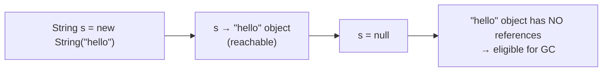

Once an object becomes unreachable (nothing in the program can access it anymore), the Garbage Collector will eventually reclaim its memory — you don't call `delete` yourself.

### 120. When is garbage collection run?

The JVM decides automatically, typically when available memory (heap space) runs low. You **cannot force** GC to run at an exact moment — calling `System.gc()` is only a _suggestion/hint_ to the JVM, which it's free to ignore. This lets the JVM pick the most efficient moment, rather than pausing your program on a fixed schedule.

### 121. What are best practices on garbage collection?

- **Nullify references** you no longer need (especially in long-lived objects/collections) so objects become eligible for collection sooner.
- **Avoid unnecessary object creation** in tight loops (e.g. Q18/19's String concatenation trap).
- **Close resources properly** (files, connections) — GC doesn't know about _external_ OS resources.
- **Don't call `System.gc()` manually** in normal code — it doesn't guarantee anything and can hurt performance.
- **Watch out for memory leaks** caused by long-lived collections (e.g. static `Map`s) holding references to objects that are logically "done."

### 122. What are initialization blocks?

Initialization blocks are blocks of code (not inside any method) that run automatically to set up a class's state — there are two kinds: **static** (Q123) and **instance** (Q124).

### 123. What is a static initializer?

A `static { }` block runs **once**, when the class is first loaded by the JVM — used to initialize `static` fields with logic that a simple one-line assignment can't express.

```java
class Config {
    static Map<String, String> settings;
    static {
        settings = new HashMap<>();
        settings.put("env", "production");
        System.out.println("Static block ran!");
    }
}
```

### 124. What is an instance initializer block?

An instance initializer `{ }` block (no `static` keyword) runs **every time a new object is created**, right before the constructor body — useful for shared setup logic across multiple constructors.

```java
class Car {
    String id;
    { // instance initializer -- runs before EVERY constructor
        id = "CAR-" + System.currentTimeMillis();
        System.out.println("Instance block ran!");
    }
    Car() { System.out.println("Constructor ran!"); }
}
```

Order of execution when an object is created: **static blocks (once, first class load) → instance initializer blocks → constructor body.**

### 125. What is tokenizing?

**Tokenizing** means breaking up a larger piece of text into smaller, meaningful pieces ("tokens") — typically words or symbols — usually split by a delimiter like whitespace or commas.

### 126. Can you give an example of tokenizing?

```java
String sentence = "Java is fun to learn";
StringTokenizer tokenizer = new StringTokenizer(sentence); // splits on whitespace by default
while (tokenizer.hasMoreTokens()) {
    System.out.println(tokenizer.nextToken());
}
// Output: Java / is / fun / to / learn

// Modern alternative, generally preferred today:
String[] words = sentence.split(" ");
```

### 127. What is serialization?

**Serialization** converts an object's state into a **byte stream**, so it can be saved to a file, sent over a network, or stored in a database — and later reconstructed (**deserialized**) back into an equivalent object.

### 128. How do you serialize an object using serializable interface?

Implement the marker interface `java.io.Serializable` (it has no methods — it just signals "this class is allowed to be serialized"), then use `ObjectOutputStream`.

```java
class Person implements Serializable {
    String name;
    int age;
    Person(String name, int age) { this.name = name; this.age = age; }
}

try (ObjectOutputStream out = new ObjectOutputStream(new FileOutputStream("person.ser"))) {
    out.writeObject(new Person("Alice", 30));
}
```

### 129. How do you de-serialize in Java?

Use `ObjectInputStream` to read the bytes back and reconstruct the object.

```java
try (ObjectInputStream in = new ObjectInputStream(new FileInputStream("person.ser"))) {
    Person p = (Person) in.readObject();
    System.out.println(p.name); // "Alice"
}
```

### 130. What do you do if only parts of the object have to be serialized?

Mark the fields you want to **exclude** with the `transient` keyword — they'll be skipped during serialization and come back as their default value (e.g. `null`, `0`) after deserialization.

```java
class User implements Serializable {
    String username;
    transient String password; // NOT saved -- e.g. for security
}
```

### 131. How do you serialize a hierarchy of objects?

If a class implements `Serializable`, **all its non-transient fields are serialized recursively**, including any objects they reference — as long as those referenced objects _also_ implement `Serializable` (otherwise you'll get a `NotSerializableException`). The whole connected object graph is saved and later reconstructed with the same structure (including shared references, correctly, not duplicated).

```java
class Address implements Serializable { String city; }
class Person implements Serializable {
    String name;
    Address address; // must ALSO be Serializable, otherwise serialization fails
}
```

### 132. Are the constructors in an object invoked when it is de-serialized?

**No** — deserialization bypasses the normal constructor of the serialized class entirely; the object's fields are restored directly from the byte stream via reflection-like mechanisms. However, if the **superclass is not `Serializable`**, that superclass's no-arg constructor _is_ called during deserialization (to properly initialize the non-serializable parent portion).

### 133. Are the values of static variables stored when an object is serialized?

**No** — serialization only saves **instance (non-static) state**. `static` fields belong to the class, not to any individual object, so they're never part of an object's serialized data. After deserialization, static fields simply reflect whatever the class's current value is at that time.

## Collections

### 134. Why do we need collections in Java?

Imagine you want to store the names of 5 friends. You could create 5 separate variables — `friend1`, `friend2`, `friend3`... — but what if you have 500 friends, or you don't know how many friends there will be? That's clumsy and doesn't scale.

Arrays help a bit (`String[] friends = new String[500];`), but arrays have a big limitation: their size is **fixed** once created, and they don't give you many built-in ways to search, sort, insert, or remove items easily.

**Collections** are Java's built-in, ready-made "containers" for groups of objects. They:

- Grow and shrink automatically as you add/remove items.
- Come with tons of useful, tested methods (add, remove, search, sort, etc.) so you don't reinvent the wheel.
- Offer different types of containers (lists, sets, maps, queues) for different needs — like choosing the right box for the right job.

```java
import java.util.ArrayList;
import java.util.List;

public class WhyCollections {
    public static void main(String[] args) {
        List<String> friends = new ArrayList<>(); // no fixed size needed!
        friends.add("Amit");
        friends.add("Priya");
        friends.add("Ravi");
        System.out.println(friends); // [Amit, Priya, Ravi]
        System.out.println("Total friends: " + friends.size());
    }
}
```

In short: collections save you time, reduce bugs, and give you powerful tools to manage groups of data.

---

### 135. What are the important interfaces in the collection hierarchy?

Java's Collections Framework is organized as a family tree of interfaces and classes. At the very top is the `Collection` interface (with a capital C), and most containers you use every day (`List`, `Set`, `Queue`) are built on top of it. `Map` is a special case — it stores key-value pairs and sits in its **own separate hierarchy** (it does not extend `Collection`, because a map deals with pairs, not single elements).

Here is the big picture:

- **`Collection`** — the root interface for groups of individual objects.
  - **`List`** — an ordered collection that allows duplicates (like a shopping list). Implemented by `ArrayList`, `LinkedList`, `Vector`.
  - **`Set`** — a collection that does **not** allow duplicates (like a bag of unique stamps). Implemented by `HashSet`, `LinkedHashSet`, `TreeSet`.
  - **`Queue`** — a collection designed for holding items before processing (like a line at a ticket counter). Implemented by `LinkedList`, `PriorityQueue`.
- **`Map`** — a separate interface for key-value pairs (like a dictionary: word → meaning). Implemented by `HashMap`, `LinkedHashMap`, `TreeMap`.

Here's a diagram showing how they all connect:

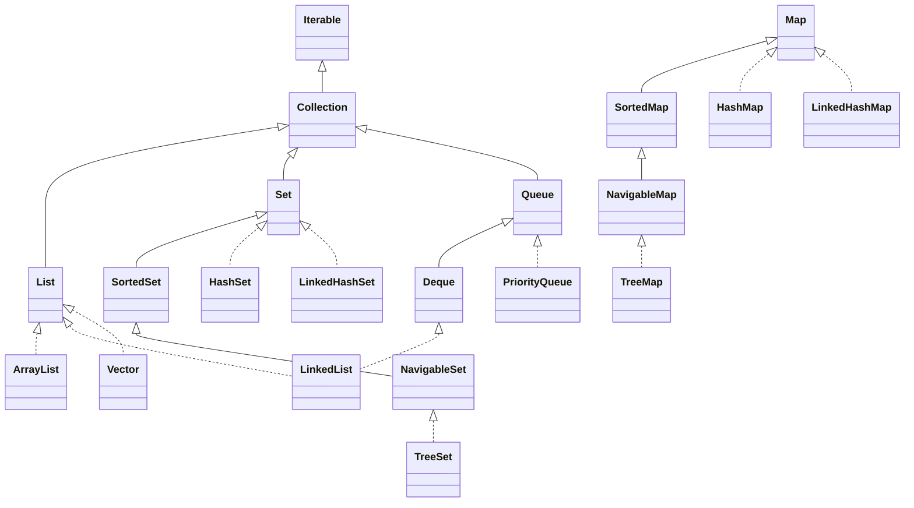

Notice: `Map` is drawn separately because it is **not** a child of `Collection` — it's a whole different family that deals with key-value pairs instead of single values.

---

### 136. What are the important methods that are declared in the collection interface?

The `Collection` interface defines the basic "vocabulary" that every collection (List, Set, Queue) understands. Think of these as the universal remote-control buttons that work on any collection, no matter which specific type it is.

Some of the most important methods:

| Method                    | What it does                                                |
| ------------------------- | ----------------------------------------------------------- |
| `add(E e)`                | Adds an element to the collection                           |
| `remove(Object o)`        | Removes a specific element                                  |
| `size()`                  | Returns how many elements are in it                         |
| `isEmpty()`               | Checks if the collection has zero elements                  |
| `contains(Object o)`      | Checks if an element exists in the collection               |
| `iterator()`              | Returns an`Iterator` to loop through elements one by one    |
| `clear()`                 | Removes all elements                                        |
| `addAll(Collection c)`    | Adds all elements from another collection                   |
| `removeAll(Collection c)` | Removes all elements that also appear in another collection |
| `retainAll(Collection c)` | Keeps only elements that also appear in another collection  |
| `toArray()`               | Converts the collection into an array                       |

```java
import java.util.ArrayList;
import java.util.Collection;

public class CollectionMethods {
    public static void main(String[] args) {
        Collection<String> fruits = new ArrayList<>();
        fruits.add("Apple");
        fruits.add("Banana");
        fruits.add("Mango");

        System.out.println("Size: " + fruits.size());              // 3
        System.out.println("Has Banana? " + fruits.contains("Banana")); // true

        fruits.remove("Banana");
        System.out.println("After remove: " + fruits);             // [Apple, Mango]
        System.out.println("Is empty? " + fruits.isEmpty());       // false

        fruits.clear();
        System.out.println("After clear, is empty? " + fruits.isEmpty()); // true
    }
}
```

Because `List`, `Set`, and `Queue` all extend `Collection`, every one of them supports these methods — that's the beauty of the interface hierarchy.

---

### 137. Can you explain briefly about the List interface?

A `List` is like a numbered to-do list or a playlist of songs — the **order matters**, and you're allowed to have the **same item more than once**. Every element has an index (position), starting from `0`.

Key features of `List`:

- **Ordered**: Elements stay in the order you insert them (unless you sort them).
- **Index-based access**: You can grab any element directly using its position, e.g., `list.get(2)`.
- **Allows duplicates**: You can add "Apple" twice if you want.

Common implementations: `ArrayList`, `LinkedList`, `Vector`.

```java
import java.util.List;
import java.util.ArrayList;

public class ListDemo {
    public static void main(String[] args) {
        List<String> playlist = new ArrayList<>();
        playlist.add("Song A");
        playlist.add("Song B");
        playlist.add("Song A"); // duplicate allowed

        System.out.println(playlist);          // [Song A, Song B, Song A]
        System.out.println(playlist.get(1));    // Song B (index starts at 0)
        System.out.println(playlist.indexOf("Song A")); // 0 (first occurrence)
    }
}
```

Use a `List` whenever order matters and duplicates are okay — like a queue of tasks, a history of actions, or a list of exam scores.

---

### 138. Explain about ArrayList with an example?

`ArrayList` is the most commonly used implementation of the `List` interface. Think of it as a **resizable array** — behind the scenes it uses an array, but it automatically grows (and shifts things around) as needed, so you never have to worry about running out of space.

Why people love `ArrayList`:

- Fast random access — getting `list.get(5)` is very quick.
- Grows automatically as you add elements.
- Easy to use with lots of helper methods.

The trade-off: inserting or removing elements in the **middle** of a large `ArrayList` can be slow, because everything after that position has to shift over.

```java
import java.util.ArrayList;

public class ArrayListDemo {
    public static void main(String[] args) {
        ArrayList<String> cities = new ArrayList<>();
        cities.add("Delhi");
        cities.add("Mumbai");
        cities.add("Chennai");

        // Insert at a specific position
        cities.add(1, "Kolkata");
        System.out.println(cities); // [Delhi, Kolkata, Mumbai, Chennai]

        // Access by index
        System.out.println("First city: " + cities.get(0));

        // Update an element
        cities.set(0, "New Delhi");

        // Remove an element
        cities.remove("Mumbai");

        System.out.println(cities); // [New Delhi, Kolkata, Chennai]
    }
}
```

---

### 139. Can an ArrayList have duplicate elements?

**Yes!** Since `ArrayList` implements the `List` interface, and `List` explicitly allows duplicate values, you can add the exact same element as many times as you like.

```java
import java.util.ArrayList;

public class DuplicatesDemo {
    public static void main(String[] args) {
        ArrayList<String> names = new ArrayList<>();
        names.add("Sam");
        names.add("Sam");
        names.add("Sam");

        System.out.println(names);      // [Sam, Sam, Sam]
        System.out.println(names.size()); // 3
    }
}
```

If you ever need to automatically prevent duplicates, that's exactly what a `Set` (like `HashSet`) is for — see question 146 below.

---

### 140. How do you iterate around an ArrayList using iterator?

An `Iterator` is a special object that lets you walk through a collection one element at a time, safely — including the ability to remove elements while looping (something a plain for-loop can struggle with).

The `Iterator` interface has three main methods:

- `hasNext()` — is there another element left?
- `next()` — gets the next element and moves forward.
- `remove()` — safely removes the current element during iteration.

```java
import java.util.ArrayList;
import java.util.Iterator;

public class IteratorDemo {
    public static void main(String[] args) {
        ArrayList<String> fruits = new ArrayList<>();
        fruits.add("Apple");
        fruits.add("Banana");
        fruits.add("Cherry");

        Iterator<String> it = fruits.iterator();
        while (it.hasNext()) {
            String fruit = it.next();
            System.out.println(fruit);
            if (fruit.equals("Banana")) {
                it.remove(); // safely remove while iterating
            }
        }

        System.out.println("After removal: " + fruits); // [Apple, Cherry]
    }
}
```

Tip: Never call `list.remove()` directly while looping with a normal `for-each` loop — that throws a `ConcurrentModificationException`. Always use `iterator.remove()` instead when removing during iteration.

---

### 141. How do you sort an ArrayList?

The easiest way is to use the utility method `Collections.sort(list)`, which sorts elements into their "natural order" (alphabetical for Strings, numerical for numbers).

```java
import java.util.ArrayList;
import java.util.Collections;

public class SortDemo {
    public static void main(String[] args) {
        ArrayList<Integer> numbers = new ArrayList<>();
        numbers.add(40);
        numbers.add(10);
        numbers.add(30);
        numbers.add(20);

        Collections.sort(numbers);
        System.out.println(numbers); // [10, 20, 30, 40]

        // Sort in reverse order
        Collections.sort(numbers, Collections.reverseOrder());
        System.out.println(numbers); // [40, 30, 20, 10]
    }
}
```

You can also call `list.sort(...)` directly since Java 8 (it accepts a `Comparator`, or `null` for natural order):

```java
numbers.sort(null); // sorts in natural (ascending) order
```

For custom sorting logic (like sorting objects by a specific field), you'll use `Comparable` or `Comparator` — explained next.

---

### 142. How do you sort elements in an ArrayList using comparable interface?

`Comparable` is used when a class wants to define its **own natural/default sort order** — "how should objects of this type normally be compared to each other?" You implement the `compareTo()` method inside the class itself.

```java
import java.util.ArrayList;
import java.util.Collections;

class Student implements Comparable<Student> {
    String name;
    int age;

    Student(String name, int age) {
        this.name = name;
        this.age = age;
    }

    // Defines the natural order: sort by age, ascending
    @Override
    public int compareTo(Student other) {
        return this.age - other.age;
    }

    @Override
    public String toString() {
        return name + "(" + age + ")";
    }
}

public class ComparableDemo {
    public static void main(String[] args) {
        ArrayList<Student> students = new ArrayList<>();
        students.add(new Student("Ravi", 22));
        students.add(new Student("Anu", 19));
        students.add(new Student("Kiran", 25));

        Collections.sort(students); // uses compareTo() automatically
        System.out.println(students); // [Anu(19), Ravi(22), Kiran(25)]
    }
}
```

Rule of thumb: `compareTo()` should return a negative number if `this` comes before `other`, zero if they're equal, and positive if `this` comes after `other`.

A class can only have **one** `Comparable` implementation — one "natural" way to sort. If you need multiple different sort orders, use `Comparator` instead (next question).

---

### 143. How do you sort elements in an ArrayList using comparator interface?

`Comparator` lets you define sorting logic **outside** the class, so you can have as many different sorting strategies as you want — without touching the original class. This is handy when you don't own the class's source code, or you need multiple sort orders (by name, by age, by salary, etc.).

```java
import java.util.ArrayList;
import java.util.Comparator;

class Employee {
    String name;
    double salary;

    Employee(String name, double salary) {
        this.name = name;
        this.salary = salary;
    }

    @Override
    public String toString() {
        return name + " ($" + salary + ")";
    }
}

public class ComparatorDemo {
    public static void main(String[] args) {
        ArrayList<Employee> employees = new ArrayList<>();
        employees.add(new Employee("Meera", 55000));
        employees.add(new Employee("Arjun", 42000));
        employees.add(new Employee("Divya", 61000));

        // Sort by salary using a Comparator (Java 8 lambda style)
        employees.sort(Comparator.comparingDouble(e -> e.salary));
        System.out.println(employees); // Arjun, Meera, Divya

        // Sort by name, descending
        employees.sort(Comparator.comparing((Employee e) -> e.name).reversed());
        System.out.println(employees); // Meera, Divya, Arjun
    }
}
```

Quick comparison — **Comparable vs Comparator**:

|                       | Comparable                     | Comparator                                                      |
| --------------------- | ------------------------------ | --------------------------------------------------------------- |
| Package               | `java.lang`                    | `java.util`                                                     |
| Method                | `compareTo(Object o)`          | `compare(Object o1, Object o2)`                                 |
| Where defined         | Inside the class being sorted  | In a separate class or lambda                                   |
| Number of sort orders | Only one (the "natural" order) | Many, as needed                                                 |
| Used by               | `Collections.sort(list)`       | `Collections.sort(list, comparator)` or `list.sort(comparator)` |

---

### 144. What is vector class? How is it different from an ArrayList?

`Vector` is one of the oldest classes in Java (it existed even before the Collections Framework was introduced in Java 1.2!). Like `ArrayList`, it's a resizable array-backed `List`. The key difference is that **`Vector` is synchronized**, meaning its methods are thread-safe by default — only one thread can access it at a time.

```java
import java.util.Vector;

public class VectorDemo {
    public static void main(String[] args) {
        Vector<String> v = new Vector<>();
        v.add("Red");
        v.add("Green");
        v.add("Blue");
        System.out.println(v); // [Red, Green, Blue]
    }
}
```

**ArrayList vs Vector**:

| Feature               | ArrayList                          | Vector                                                                                           |
| --------------------- | ---------------------------------- | ------------------------------------------------------------------------------------------------ |
| Thread-safety         | Not synchronized (not thread-safe) | Synchronized (thread-safe)                                                                       |
| Performance           | Faster (no locking overhead)       | Slower (locking overhead)                                                                        |
| Growth rate when full | Increases by 50% of current size   | Doubles (100% growth)                                                                            |
| Introduced in         | Java 1.2 (Collections Framework)   | Java 1.0 (legacy class)                                                                          |
| Recommended today?    | Yes, for most single-threaded use  | Rarely — prefer`ArrayList` + explicit synchronization, or `CopyOnWriteArrayList` for concurrency |

In modern Java code, `Vector` is rarely used. If you need thread safety, most developers prefer `Collections.synchronizedList(new ArrayList<>())` or concurrent collections like `CopyOnWriteArrayList`.

---

### 145. What is linkedList? What interfaces does it implement? How is it different from an ArrayList?

`LinkedList` stores elements as a chain of "nodes," where each node holds the data plus a link (pointer) to the next (and previous) node — like a treasure hunt where each clue points to the next location. This is different from `ArrayList`, which stores elements in one continuous block of memory (like numbered lockers in a row).

`LinkedList` implements both:

- **`List`** — so it supports index-based operations like `get()`, `add()`.
- **`Deque`** — so it can be used as a double-ended queue, stack, or queue (adding/removing from both ends efficiently).

```java
import java.util.LinkedList;

public class LinkedListDemo {
    public static void main(String[] args) {
        LinkedList<String> tasks = new LinkedList<>();
        tasks.add("Write report");
        tasks.addFirst("Check email");  // add to the front
        tasks.addLast("Attend meeting"); // add to the end

        System.out.println(tasks); // [Check email, Write report, Attend meeting]
        System.out.println(tasks.removeFirst()); // Check email
        System.out.println(tasks); // [Write report, Attend meeting]
    }
}
```

**ArrayList vs LinkedList vs Vector** (full comparison):

| Feature                       | ArrayList                        | LinkedList                                              | Vector                   |
| ----------------------------- | -------------------------------- | ------------------------------------------------------- | ------------------------ |
| Underlying structure          | Dynamic array                    | Doubly linked list                                      | Dynamic array            |
| Random access (`get(i)`)      | Fast — O(1)                      | Slow — O(n), must walk the chain                        | Fast — O(1)              |
| Insert/remove at start/middle | Slow — O(n), must shift elements | Fast at ends — O(1); middle still O(n) to find the spot | Slow — O(n)              |
| Memory overhead               | Lower                            | Higher (stores extra links per node)                    | Lower                    |
| Thread-safe                   | No                               | No                                                      | Yes                      |
| Implements`Deque`?            | No                               | Yes                                                     | No                       |
| Best for                      | Frequent reads/lookups           | Frequent insertions/removals at ends                    | Legacy thread-safe needs |

---

### 146. Can you briefly explain about the Set interface?

A `Set` is a collection that **does not allow duplicate elements** — just like a real-world set of unique items (you can't have two identical entries in a mathematical set). If you try to add an item that's already there, it's simply ignored.

Key features:

- **No duplicates** allowed.
- Order is **not guaranteed** by default (though some implementations preserve it — see below).
- Great for checking "does this already exist?" efficiently.

```java
import java.util.HashSet;
import java.util.Set;

public class SetDemo {
    public static void main(String[] args) {
        Set<String> uniqueNames = new HashSet<>();
        uniqueNames.add("Tom");
        uniqueNames.add("Jerry");
        uniqueNames.add("Tom"); // duplicate — ignored

        System.out.println(uniqueNames);     // [Tom, Jerry] (order may vary)
        System.out.println(uniqueNames.size()); // 2, not 3!
    }
}
```

Use a `Set` whenever you need to guarantee uniqueness — for example, storing unique usernames, tags, or IDs.

---

### 147. What are the important interfaces related to the Set interface?

The `Set` family has a small hierarchy that adds ordering guarantees as you go deeper:

- **`Set`** — the base interface: no duplicates, no ordering guarantee.
- **`SortedSet`** — extends `Set`, keeps elements sorted in ascending order automatically.
- **`NavigableSet`** — extends `SortedSet`, adds handy navigation methods like "give me the element just below/above this one."

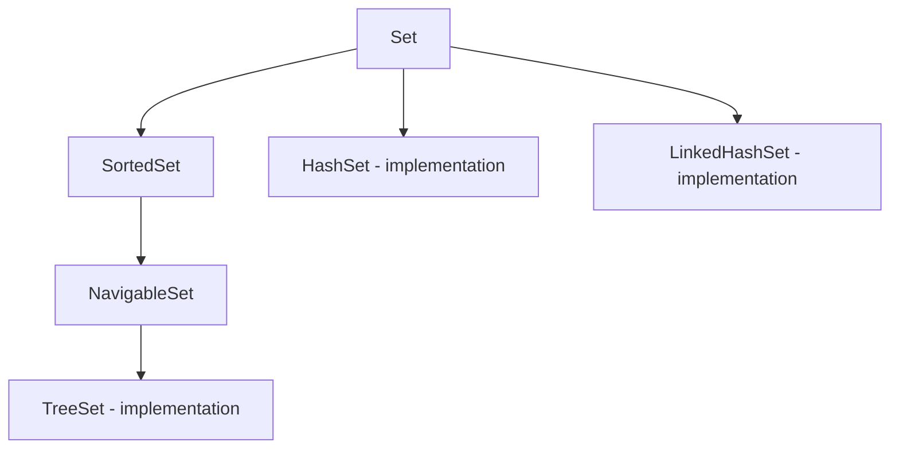

`TreeSet` is the standard implementation of `NavigableSet` (and therefore also of `SortedSet` and `Set`).

---

### 148. What is the difference between Set and sortedSet interfaces?

A plain `Set` makes no promises about the order in which elements come back to you when you iterate over it. A `SortedSet`, on the other hand, **guarantees elements are kept in ascending sorted order** at all times.

```java
import java.util.HashSet;
import java.util.TreeSet;
import java.util.Set;
import java.util.SortedSet;

public class SetVsSortedSet {
    public static void main(String[] args) {
        Set<Integer> plainSet = new HashSet<>();
        plainSet.add(30);
        plainSet.add(10);
        plainSet.add(20);
        System.out.println("HashSet (Set): " + plainSet); // order not guaranteed

        SortedSet<Integer> sortedSet = new TreeSet<>();
        sortedSet.add(30);
        sortedSet.add(10);
        sortedSet.add(20);
        System.out.println("TreeSet (SortedSet): " + sortedSet); // [10, 20, 30] always
        System.out.println("First: " + sortedSet.first()); // 10
        System.out.println("Last: " + sortedSet.last());   // 30
    }
}
```

`SortedSet` also adds extra methods that only make sense when order is guaranteed, like `first()`, `last()`, `headSet()`, and `tailSet()`.

---

### 149. Can you give examples of classes that implement the Set interface?

The three most common `Set` implementations you'll encounter:

1. **`HashSet`** — fastest, no ordering guarantee. Backed by a hash table.
2. **`LinkedHashSet`** — keeps insertion order, slightly more overhead than `HashSet`.
3. **`TreeSet`** — keeps elements sorted, backed by a tree structure.

```java
import java.util.*;

public class SetImplementations {
    public static void main(String[] args) {
        Set<String> hashSet = new HashSet<>(Arrays.asList("C", "A", "B"));
        Set<String> linkedHashSet = new LinkedHashSet<>(Arrays.asList("C", "A", "B"));
        Set<String> treeSet = new TreeSet<>(Arrays.asList("C", "A", "B"));

        System.out.println("HashSet: " + hashSet);             // order varies
        System.out.println("LinkedHashSet: " + linkedHashSet); // [C, A, B] insertion order
        System.out.println("TreeSet: " + treeSet);             // [A, B, C] sorted order
    }
}
```

---

### 150. What is a HashSet?

`HashSet` is the most commonly used `Set` implementation. It stores elements using a technique called **hashing**, which allows for very fast add, remove, and "does this exist?" checks — typically constant time, O(1), on average.

Important things to know:

- It does **not** guarantee any particular order of elements.
- It allows one `null` element.
- It relies on `hashCode()` and `equals()` to determine uniqueness, so if you store custom objects, make sure you've properly overridden those two methods.

```java
import java.util.HashSet;

public class HashSetDemo {
    public static void main(String[] args) {
        HashSet<String> colors = new HashSet<>();
        colors.add("Red");
        colors.add("Green");
        colors.add("Blue");
        colors.add("Red"); // ignored, duplicate

        System.out.println(colors);              // order not guaranteed
        System.out.println(colors.contains("Green")); // true — very fast check
    }
}
```

---

### 151. What is a linkedHashSet? How is different from a HashSet?

`LinkedHashSet` is basically a `HashSet` with a bonus: it **remembers the order in which you inserted elements** by maintaining a linked list alongside the hash table. So when you iterate over it, you get elements back in the same order you added them.

```java
import java.util.HashSet;
import java.util.LinkedHashSet;

public class LinkedHashSetDemo {
    public static void main(String[] args) {
        LinkedHashSet<String> visited = new LinkedHashSet<>();
        visited.add("Home");
        visited.add("About");
        visited.add("Contact");
        visited.add("Home"); // duplicate, ignored

        System.out.println(visited); // [Home, About, Contact] — insertion order preserved
    }
}
```

**HashSet vs LinkedHashSet**:

| Feature      | HashSet                                                  | LinkedHashSet                                            |
| ------------ | -------------------------------------------------------- | -------------------------------------------------------- |
| Order        | No guarantee                                             | Preserves insertion order                                |
| Performance  | Slightly faster                                          | Slightly slower (extra bookkeeping)                      |
| Memory usage | Lower                                                    | Slightly higher (stores links too)                       |
| When to use  | You don't care about order, just need uniqueness + speed | You want uniqueness but also predictable iteration order |

---

### 152. What is a TreeSet? How is different from a HashSet?

`TreeSet` stores its elements in **sorted (ascending) order** at all times, using a data structure called a red-black tree internally. Every time you add an element, it's automatically placed in the correct sorted position.

```java
import java.util.TreeSet;

public class TreeSetDemo {
    public static void main(String[] args) {
        TreeSet<Integer> scores = new TreeSet<>();
        scores.add(85);
        scores.add(42);
        scores.add(99);
        scores.add(67);

        System.out.println(scores);       // [42, 67, 85, 99] — always sorted
        System.out.println(scores.first()); // 42 (smallest)
        System.out.println(scores.last());  // 99 (largest)
    }
}
```

**HashSet vs TreeSet**:

| Feature                           | HashSet                               | TreeSet                                                               |
| --------------------------------- | ------------------------------------- | --------------------------------------------------------------------- |
| Ordering                          | None guaranteed                       | Always sorted (ascending)                                             |
| Underlying structure              | Hash table                            | Red-black tree                                                        |
| Performance (add/remove/contains) | O(1) average                          | O(log n)                                                              |
| Allows`null`?                     | Yes, one`null`                        | No (throws`NullPointerException`)                                     |
| Extra features                    | None                                  | `first()`, `last()`, `headSet()`, `tailSet()`, `ceiling()`, `floor()` |
| When to use                       | Fastest lookups, order doesn't matter | Need elements sorted automatically                                    |

**HashSet vs LinkedHashSet vs TreeSet** (all three together):

| Feature     | HashSet       | LinkedHashSet                | TreeSet                    |
| ----------- | ------------- | ---------------------------- | -------------------------- |
| Order       | Unpredictable | Insertion order              | Sorted order               |
| Speed       | Fastest       | Slightly slower than HashSet | Slowest (log n operations) |
| Allows null | Yes (one)     | Yes (one)                    | No                         |
| Backed by   | Hash table    | Hash table + linked list     | Red-black tree             |

---

### 153. Can you give examples of implementations of navigableSet?

`NavigableSet` adds handy "find nearby elements" methods on top of `SortedSet` — like asking "what's the closest value above/below this number?" The main (and really only commonly used) implementation is **`TreeSet`**.

```java
import java.util.NavigableSet;
import java.util.TreeSet;

public class NavigableSetDemo {
    public static void main(String[] args) {
        NavigableSet<Integer> numbers = new TreeSet<>();
        numbers.add(10);
        numbers.add(20);
        numbers.add(30);
        numbers.add(40);

        System.out.println(numbers.lower(30));  // 20 — strictly less than 30
        System.out.println(numbers.higher(30)); // 40 — strictly greater than 30
        System.out.println(numbers.floor(25));  // 20 — less than or equal to 25
        System.out.println(numbers.ceiling(25)); // 30 — greater than or equal to 25
        System.out.println(numbers.descendingSet()); // [40, 30, 20, 10]
    }
}
```

Another example is `ConcurrentSkipListSet` from `java.util.concurrent`, which is a thread-safe `NavigableSet` implementation useful in multi-threaded programs.

---

### 154. Explain briefly about Queue interface?

A `Queue` models a waiting line — just like people lining up at a movie ticket counter. Normally it follows **FIFO** (First-In-First-Out): whoever joins first gets served first.

Key methods:

- `offer(e)` / `add(e)` — add an element to the back of the queue.
- `poll()` / `remove()` — remove and return the element at the front.
- `peek()` / `element()` — look at the front element without removing it.

```java
import java.util.LinkedList;
import java.util.Queue;

public class QueueDemo {
    public static void main(String[] args) {
        Queue<String> ticketLine = new LinkedList<>();
        ticketLine.offer("Person A");
        ticketLine.offer("Person B");
        ticketLine.offer("Person C");

        System.out.println("Now serving: " + ticketLine.poll()); // Person A
        System.out.println("Next in line (peek): " + ticketLine.peek()); // Person B
        System.out.println("Remaining: " + ticketLine); // [Person B, Person C]
    }
}
```

The `poll()`/`peek()` methods return `null` if the queue is empty, while `remove()`/`element()` throw an exception — useful to know depending on how you want to handle an empty queue.

---

### 155. What are the important interfaces related to the Queue interface?

The `Queue` family branches into a few useful specializations:

- **`Queue`** — the base FIFO interface.
- **`Deque`** ("deck") — a double-ended queue; you can add/remove from both the front and the back.
- **`BlockingQueue`** — a thread-safe queue used in concurrent programming, where threads can "wait" (block) for space or for items to appear.

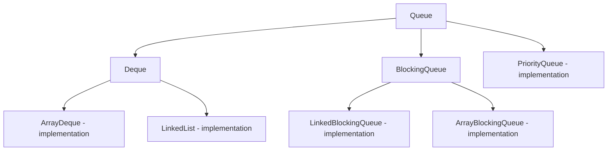

---

### 156. Explain about the Deque interface?

`Deque` stands for "Double-Ended Queue" (pronounced "deck"). It allows you to add and remove elements from **both ends** — the front and the back — making it flexible enough to act as a queue, a stack, or both at once.

```java
import java.util.ArrayDeque;
import java.util.Deque;

public class DequeDemo {
    public static void main(String[] args) {
        Deque<String> deque = new ArrayDeque<>();

        // Using it like a queue (FIFO)
        deque.addLast("Task 1");
        deque.addLast("Task 2");
        System.out.println(deque.pollFirst()); // Task 1

        // Using it like a stack (LIFO)
        deque.addFirst("Urgent Task");
        System.out.println(deque.pollFirst()); // Urgent Task (processed first, like a stack)

        System.out.println(deque); // [Task 2]
    }
}
```

`ArrayDeque` is usually the fastest general-purpose `Deque` implementation, and it's often recommended over the old `Stack` class when you need stack-like behavior.

---

### 157. Explain the BlockingQueue interface?

`BlockingQueue` is a special queue designed for **multi-threaded producer-consumer scenarios** — imagine one group of workers (producers) adding items to the queue and another group (consumers) taking items off it. Its superpower is that it can "block" (make a thread wait) automatically:

- If the queue is **full**, a thread trying to `put()` an item will wait until there's space.
- If the queue is **empty**, a thread trying to `take()` an item will wait until something arrives.

This eliminates a lot of manual thread-coordination code you'd otherwise have to write yourself.

```java
import java.util.concurrent.BlockingQueue;
import java.util.concurrent.LinkedBlockingQueue;

public class BlockingQueueDemo {
    public static void main(String[] args) throws InterruptedException {
        BlockingQueue<String> queue = new LinkedBlockingQueue<>(2); // capacity of 2

        Runnable producer = () -> {
            try {
                queue.put("Order 1");
                System.out.println("Produced Order 1");
                queue.put("Order 2");
                System.out.println("Produced Order 2");
                queue.put("Order 3"); // will wait here until space is free
                System.out.println("Produced Order 3");
            } catch (InterruptedException e) { }
        };

        Runnable consumer = () -> {
            try {
                Thread.sleep(1000);
                System.out.println("Consumed: " + queue.take());
            } catch (InterruptedException e) { }
        };

        new Thread(producer).start();
        new Thread(consumer).start();
    }
}
```

---

### 158. What is a priorityQueue?

`PriorityQueue` is a queue where elements are **not** served in the order they were added — instead, they come out based on **priority**. By default, the "smallest" element (natural ordering) is always served first, like a hospital emergency room that treats the most critical patient first, regardless of arrival time.

```java
import java.util.PriorityQueue;

public class PriorityQueueDemo {
    public static void main(String[] args) {
        PriorityQueue<Integer> pq = new PriorityQueue<>();
        pq.offer(50);
        pq.offer(10);
        pq.offer(30);
        pq.offer(20);

        // Elements come out smallest-first, not in insertion order
        while (!pq.isEmpty()) {
            System.out.println(pq.poll()); // 10, 20, 30, 50
        }
    }
}
```

You can customize the priority using a `Comparator`, for example to always serve the largest number first, or to prioritize custom objects by a specific field (like "urgent" support tickets).

---

### 159. Can you give example implementations of the BlockingQueue interface?

The `java.util.concurrent` package offers several ready-made `BlockingQueue` implementations, each suited to different needs:

- **`ArrayBlockingQueue`** — a fixed-capacity queue backed by an array. You must specify the max size up front.
- **`LinkedBlockingQueue`** — backed by linked nodes; can be bounded or (optionally) unbounded.
- **`PriorityBlockingQueue`** — like `PriorityQueue`, but thread-safe and unbounded.
- **`SynchronousQueue`** — a queue with **zero capacity**; every `put()` must wait for a matching `take()` — it's used to hand off items directly between threads.
- **`DelayQueue`** — elements can only be taken once their individual "delay" has expired (useful for scheduling tasks).

```java
import java.util.concurrent.ArrayBlockingQueue;
import java.util.concurrent.BlockingQueue;

public class BlockingQueueImplDemo {
    public static void main(String[] args) throws InterruptedException {
        BlockingQueue<String> queue = new ArrayBlockingQueue<>(3);
        queue.put("A");
        queue.put("B");
        queue.put("C");
        System.out.println(queue); // [A, B, C]
        System.out.println(queue.take()); // A
    }
}
```

---

### 160. Can you briefly explain about the Map interface?

A `Map` stores data as **key-value pairs** — just like a real dictionary where you look up a word (the key) to find its meaning (the value). Unlike `List` or `Set`, `Map` is not a subtype of `Collection` — it lives in its own hierarchy because it deals with pairs rather than single elements.

Key rules:

- **Keys must be unique** — each key maps to exactly one value.
- **Values can be duplicated** — different keys can point to the same value.

```java
import java.util.HashMap;
import java.util.Map;

public class MapDemo {
    public static void main(String[] args) {
        Map<String, Integer> ages = new HashMap<>();
        ages.put("Alice", 30);
        ages.put("Bob", 25);
        ages.put("Alice", 31); // overwrites the previous value for "Alice"

        System.out.println(ages);              // {Alice=31, Bob=25} (order may vary)
        System.out.println(ages.get("Bob"));    // 25
        System.out.println(ages.containsKey("Alice")); // true
    }
}
```

---

### 161. What is difference between Map and sortedMap?

Just like `Set` vs `SortedSet`, a plain `Map` makes no promise about the order of its keys, while a `SortedMap` **guarantees keys are kept in ascending sorted order**.

```java
import java.util.HashMap;
import java.util.Map;
import java.util.SortedMap;
import java.util.TreeMap;

public class MapVsSortedMap {
    public static void main(String[] args) {
        Map<String, Integer> hashMap = new HashMap<>();
        hashMap.put("Banana", 2);
        hashMap.put("Apple", 5);
        hashMap.put("Cherry", 1);
        System.out.println("HashMap: " + hashMap); // order not guaranteed

        SortedMap<String, Integer> sortedMap = new TreeMap<>();
        sortedMap.put("Banana", 2);
        sortedMap.put("Apple", 5);
        sortedMap.put("Cherry", 1);
        System.out.println("TreeMap: " + sortedMap); // {Apple=5, Banana=2, Cherry=1}
        System.out.println("First key: " + sortedMap.firstKey()); // Apple
        System.out.println("Last key: " + sortedMap.lastKey());   // Cherry
    }
}
```

---

### 162. What is a HashMap?

`HashMap` is the most widely used `Map` implementation. It uses hashing to store and retrieve key-value pairs extremely quickly — typically O(1) on average for `get()`, `put()`, and `remove()`.

Important points:

- Order of keys is **not guaranteed**.
- Allows **one `null` key** and multiple `null` values.
- Not thread-safe (use `ConcurrentHashMap` if multiple threads will access it).

```java
import java.util.HashMap;

public class HashMapDemo {
    public static void main(String[] args) {
        HashMap<String, String> capitals = new HashMap<>();
        capitals.put("India", "New Delhi");
        capitals.put("Japan", "Tokyo");
        capitals.put("France", "Paris");

        System.out.println(capitals.get("Japan")); // Tokyo
        capitals.remove("France");
        System.out.println(capitals); // {India=New Delhi, Japan=Tokyo} (order may vary)
    }
}
```

---

### 163. What are the different methods in a Hash Map?

Here are the most frequently used `HashMap` methods:

| Method                        | What it does                                                        |
| ----------------------------- | ------------------------------------------------------------------- |
| `put(key, value)`             | Adds or updates a key-value pair                                    |
| `get(key)`                    | Retrieves the value for a key (returns`null` if not found)          |
| `getOrDefault(key, default)`  | Retrieves the value, or a default if the key isn't present          |
| `remove(key)`                 | Removes a key-value pair                                            |
| `containsKey(key)`            | Checks if a key exists                                              |
| `containsValue(value)`        | Checks if a value exists anywhere in the map                        |
| `keySet()`                    | Returns a`Set` of all keys                                          |
| `values()`                    | Returns a`Collection` of all values                                 |
| `entrySet()`                  | Returns a`Set` of key-value pairs (`Map.Entry`), useful for looping |
| `size()`                      | Number of key-value pairs                                           |
| `putIfAbsent(key, value)`     | Adds the pair only if the key doesn't already exist                 |
| `merge(key, value, function)` | Combines an existing value with a new one using custom logic        |

```java
import java.util.HashMap;
import java.util.Map;

public class HashMapMethodsDemo {
    public static void main(String[] args) {
        HashMap<String, Integer> stock = new HashMap<>();
        stock.put("Pens", 100);
        stock.put("Notebooks", 50);

        System.out.println(stock.getOrDefault("Erasers", 0)); // 0, key doesn't exist

        // Loop through all entries
        for (Map.Entry<String, Integer> entry : stock.entrySet()) {
            System.out.println(entry.getKey() + " -> " + entry.getValue());
        }

        // Increase Pens count by 20 using merge
        stock.merge("Pens", 20, Integer::sum);
        System.out.println(stock.get("Pens")); // 120
    }
}
```

---

### 164. What is a TreeMap? How is different from a HashMap?

`TreeMap` stores its key-value pairs **sorted by key** (ascending order), using a red-black tree internally — similar to how `TreeSet` relates to `HashSet`.

```java
import java.util.TreeMap;

public class TreeMapDemo {
    public static void main(String[] args) {
        TreeMap<String, Integer> scores = new TreeMap<>();
        scores.put("Zara", 88);
        scores.put("Amir", 95);
        scores.put("Meena", 72);

        System.out.println(scores); // {Amir=95, Meena=72, Zara=88} — sorted by key
        System.out.println(scores.firstKey()); // Amir
        System.out.println(scores.lastKey());  // Zara
    }
}
```

**HashMap vs TreeMap**:

| Feature              | HashMap                               | TreeMap                                                                           |
| -------------------- | ------------------------------------- | --------------------------------------------------------------------------------- |
| Ordering             | No guarantee                          | Sorted by key (ascending)                                                         |
| Underlying structure | Hash table                            | Red-black tree                                                                    |
| Performance          | O(1) average                          | O(log n)                                                                          |
| Allows`null` key?    | Yes, one                              | No (throws`NullPointerException`)                                                 |
| Extra features       | None                                  | `firstKey()`, `lastKey()`, `headMap()`, `tailMap()`, `ceilingKey()`, `floorKey()` |
| When to use          | Fastest lookups, order doesn't matter | Need keys sorted automatically                                                    |

---

### 165. Can you give an example of implementation of navigableMap interface?

`NavigableMap` extends `SortedMap` with extra "find nearby key" navigation methods. The standard implementation is **`TreeMap`**.

```java
import java.util.NavigableMap;
import java.util.TreeMap;

public class NavigableMapDemo {
    public static void main(String[] args) {
        NavigableMap<Integer, String> map = new TreeMap<>();
        map.put(10, "Ten");
        map.put(20, "Twenty");
        map.put(30, "Thirty");

        System.out.println(map.lowerKey(20));   // 10 — strictly less than 20
        System.out.println(map.higherKey(20));  // 30 — strictly greater than 20
        System.out.println(map.floorKey(25));   // 20 — less than or equal to 25
        System.out.println(map.ceilingKey(25)); // 30 — greater than or equal to 25
        System.out.println(map.descendingMap()); // {30=Thirty, 20=Twenty, 10=Ten}
    }
}
```

Another implementation is `ConcurrentSkipListMap` from `java.util.concurrent`, a thread-safe `NavigableMap`.

---

### 166. What are the static methods present in the collections class?

The `Collections` class (note: singular vs. `Collection` the interface — easy to mix up!) is a utility class full of handy **static** helper methods that operate on collections.

Some of the most useful ones:

| Method                                   | What it does                                       |
| ---------------------------------------- | -------------------------------------------------- |
| `Collections.sort(list)`                 | Sorts a list in natural order                      |
| `Collections.sort(list, comparator)`     | Sorts using a custom comparator                    |
| `Collections.reverse(list)`              | Reverses the order of elements                     |
| `Collections.shuffle(list)`              | Randomly shuffles elements                         |
| `Collections.max(collection)`            | Finds the largest element                          |
| `Collections.min(collection)`            | Finds the smallest element                         |
| `Collections.unmodifiableList(list)`     | Returns a read-only view of a list                 |
| `Collections.synchronizedList(list)`     | Returns a thread-safe wrapper around a list        |
| `Collections.emptyList()`                | Returns an immutable empty list                    |
| `Collections.frequency(collection, obj)` | Counts occurrences of an element                   |
| `Collections.singletonList(obj)`         | Creates an immutable list with exactly one element |

```java
import java.util.*;

public class CollectionsUtilDemo {
    public static void main(String[] args) {
        List<Integer> nums = new ArrayList<>(Arrays.asList(5, 2, 8, 2, 9));

        System.out.println("Max: " + Collections.max(nums)); // 9
        System.out.println("Min: " + Collections.min(nums)); // 2
        System.out.println("Frequency of 2: " + Collections.frequency(nums, 2)); // 2

        Collections.sort(nums);
        System.out.println("Sorted: " + nums); // [2, 2, 5, 8, 9]

        Collections.reverse(nums);
        System.out.println("Reversed: " + nums); // [9, 8, 5, 2, 2]

        List<Integer> readOnly = Collections.unmodifiableList(nums);
        try {
            readOnly.add(100); // throws UnsupportedOperationException
        } catch (UnsupportedOperationException e) {
            System.out.println("Cannot modify a read-only list!");
        }
    }
}
```

## Advanced Collections

### 167. What is the difference between synchronized and concurrent collections in Java?

Both are ways of making collections safe for multiple threads to use at once, but they take very different approaches — like comparing a single-lane bridge with a strict toll gate (synchronized) versus a smart multi-lane highway with smart traffic management (concurrent).

**Synchronized collections** (e.g., `Collections.synchronizedList(...)`, `Vector`, `Hashtable`) work by wrapping **every single method** with a lock. Only one thread can touch the collection at a time — even for read operations — which can create a bottleneck when many threads want access simultaneously.

**Concurrent collections** (from `java.util.concurrent`, e.g., `ConcurrentHashMap`, `CopyOnWriteArrayList`) are specially engineered to allow **multiple threads to read and even write at the same time** in many cases, using smarter techniques like splitting the data into segments, or lock-free algorithms — giving much better performance under heavy multi-threaded use.

```java
import java.util.*;
import java.util.concurrent.*;

public class SyncVsConcurrentDemo {
    public static void main(String[] args) {
        // Synchronized collection — locks the whole list for every operation
        List<Integer> syncList = Collections.synchronizedList(new ArrayList<>());

        // Concurrent collection — designed for high-performance concurrent access
        Map<String, Integer> concurrentMap = new ConcurrentHashMap<>();
        concurrentMap.put("visits", 1);
        concurrentMap.computeIfPresent("visits", (k, v) -> v + 1);
        System.out.println(concurrentMap); // {visits=2}
    }
}
```

| Feature                            | Synchronized Collections                                | Concurrent Collections                                               |
| ---------------------------------- | ------------------------------------------------------- | -------------------------------------------------------------------- |
| Example classes                    | `Vector`, `Hashtable`, `Collections.synchronizedList()` | `ConcurrentHashMap`, `CopyOnWriteArrayList`, `ConcurrentLinkedQueue` |
| Locking style                      | Locks the entire object for each operation              | Fine-grained locking or lock-free techniques                         |
| Performance under high concurrency | Poor (threads queue up and wait)                        | Much better (multiple threads work simultaneously)                   |
| Package                            | `java.util`                                             | `java.util.concurrent`                                               |

---

### 168. Explain about the new concurrent collections in Java?

Java's `java.util.concurrent` package (introduced in Java 5, expanded since) provides purpose-built, high-performance thread-safe collections. Some important ones:

- **`ConcurrentHashMap`** — a thread-safe `Map` that allows multiple threads to read and write concurrently without locking the whole map (it divides the map internally so different threads can work on different parts at once).
- **`CopyOnWriteArrayList`** — a thread-safe `List` where every write creates a fresh copy of the underlying array (great for cases with many reads, few writes).
- **`CopyOnWriteArraySet`** — same idea, but for `Set`.
- **`ConcurrentLinkedQueue`** — a lock-free, thread-safe `Queue`.
- **`BlockingQueue` implementations** (`ArrayBlockingQueue`, `LinkedBlockingQueue`, etc.) — for producer-consumer patterns.
- **`ConcurrentSkipListMap` / `ConcurrentSkipListSet`** — thread-safe sorted `Map`/`Set`.

```java
import java.util.concurrent.ConcurrentHashMap;

public class ConcurrentCollectionsDemo {
    public static void main(String[] args) {
        ConcurrentHashMap<String, Integer> inventory = new ConcurrentHashMap<>();
        inventory.put("Widgets", 100);

        // Safe to call from multiple threads at once
        inventory.merge("Widgets", -1, Integer::sum); // simulate selling one
        System.out.println(inventory); // {Widgets=99}
    }
}
```

These collections were designed specifically to avoid the performance bottlenecks of older synchronized classes, and are the recommended choice for modern multi-threaded Java applications.

---

### 169. Explain about copyonwrite concurrent collections approach?

`CopyOnWriteArrayList` (and `CopyOnWriteArraySet`) use a clever trick: whenever you **modify** the collection (add, remove, set), it creates a **brand-new copy** of the entire underlying array with the change applied, and then swaps it in. The old array stays untouched until nobody needs it anymore.

Why this helps: any thread currently **reading** the collection just keeps reading from the old, unchanged array — so reads never need to wait for a lock, and are never disrupted by concurrent writes. This makes `CopyOnWriteArrayList` an excellent choice when reads vastly outnumber writes (e.g., a list of event listeners that rarely changes but gets read constantly).

The downside: every write is expensive (O(n), because it copies the whole array), so it's a poor choice if you write frequently.

```java
import java.util.List;
import java.util.concurrent.CopyOnWriteArrayList;

public class CopyOnWriteDemo {
    public static void main(String[] args) {
        List<String> listeners = new CopyOnWriteArrayList<>();
        listeners.add("Logger");
        listeners.add("EmailAlert");

        // Even while another thread might be iterating over 'listeners',
        // this add() is safe — it works on a fresh copy internally
        listeners.add("SmsAlert");

        for (String listener : listeners) {
            System.out.println("Notifying: " + listener);
        }
    }
}
```

---

### 170. What is compareandswap approach?

**Compare-And-Swap (CAS)** is a low-level, lock-free technique the CPU provides for safely updating a shared value across multiple threads — without ever needing a traditional lock.

Here's the idea in plain English: "I _think_ the current value is X. If it's still X, change it to Y. If someone else already changed it, don't touch it — tell me it failed, and I'll try again with the new current value." This all happens as a single, uninterruptible (atomic) hardware instruction.

This "optimistic" approach avoids the overhead of locking (no thread ever has to sleep and wait for a lock to be released) — it just retries quickly if there's a conflict, which in practice is fast because conflicts are usually rare.

Java exposes CAS through classes like `AtomicInteger`, `AtomicLong`, and `AtomicReference` in `java.util.concurrent.atomic`.

```java
import java.util.concurrent.atomic.AtomicInteger;

public class CompareAndSwapDemo {
    public static void main(String[] args) {
        AtomicInteger counter = new AtomicInteger(10);

        // compareAndSet(expectedValue, newValue) — this IS compare-and-swap
        boolean success = counter.compareAndSet(10, 20);
        System.out.println("Update succeeded? " + success); // true, since it was 10
        System.out.println("New value: " + counter.get());  // 20

        boolean failed = counter.compareAndSet(10, 99); // 10 is no longer the current value
        System.out.println("Update succeeded? " + failed); // false
        System.out.println("Value stays: " + counter.get()); // still 20
    }
}
```

Many concurrent collections (like `ConcurrentHashMap`) use CAS internally instead of locks wherever possible, for better performance.

---

### 171. What is a lock? How is it different from using synchronized approach?

A **`Lock`** (from `java.util.concurrent.locks`, e.g., `ReentrantLock`) is an object you explicitly acquire and release to control access to a piece of code — like a more flexible, more powerful cousin of the `synchronized` keyword.

With `synchronized`, Java handles locking/unlocking automatically around a block of code or method — simple, but rigid: you can't try to acquire the lock and give up if it's busy, you can't set a timeout, and the lock always releases in the same block where it was acquired.

With an explicit `Lock`, **you** control exactly when to lock and unlock, giving you much more flexibility:

- `tryLock()` — attempt to grab the lock, but don't block forever if it's busy.
- `tryLock(timeout)` — wait only up to a certain time.
- `lockInterruptibly()` — allow the waiting thread to be interrupted.
- You can lock in one method and unlock in a completely different one.

```java
import java.util.concurrent.locks.Lock;
import java.util.concurrent.locks.ReentrantLock;

public class LockDemo {
    private final Lock lock = new ReentrantLock();
    private int counter = 0;

    public void increment() {
        lock.lock(); // must always unlock in a finally block!
        try {
            counter++;
        } finally {
            lock.unlock();
        }
    }

    public static void main(String[] args) {
        LockDemo demo = new LockDemo();
        demo.increment();
        System.out.println("Counter: " + demo.counter); // 1
    }
}
```

| Feature                            | `synchronized`                           | `Lock` (e.g., `ReentrantLock`)           |
| ---------------------------------- | ---------------------------------------- | ---------------------------------------- |
| Acquire/release                    | Automatic (by the JVM)                   | Manual — you call`lock()` and `unlock()` |
| Try without waiting                | Not possible                             | `tryLock()` supported                    |
| Timeout support                    | No                                       | Yes,`tryLock(timeout, unit)`             |
| Interruptible waiting              | No                                       | Yes,`lockInterruptibly()`                |
| Fairness (first-come-first-served) | No control                               | Can configure a "fair" lock              |
| Risk if you forget to release      | None (JVM always releases automatically) | Real risk — always use`try/finally`      |
| Simplicity                         | Very simple to use                       | More powerful but more code required     |

---

### 172. What is initial capacity of a Java collection?

**Initial capacity** is the number of "slots" or "buckets" a collection (usually a hash-based one like `HashMap`, `HashSet`, or an array-based one like `ArrayList`) is created with, before it needs to resize. Think of it like choosing how many chairs to set up before a party even starts — if you guess right, you avoid the hassle of bringing in more chairs mid-party (resizing), which takes extra time.

For a `HashMap`, the default initial capacity is 16 buckets. For an `ArrayList`, the default initial capacity is 10.

```java
import java.util.ArrayList;
import java.util.HashMap;

public class InitialCapacityDemo {
    public static void main(String[] args) {
        // Default initial capacity
        ArrayList<String> defaultList = new ArrayList<>();

        // Custom initial capacity — useful if you know roughly how many items you'll store
        ArrayList<String> bigList = new ArrayList<>(1000);

        // HashMap with custom initial capacity
        HashMap<String, Integer> map = new HashMap<>(32);

        System.out.println("Lists and maps created with different starting capacities.");
    }
}
```

If you know in advance you'll be storing a large number of elements, specifying an appropriate initial capacity upfront can improve performance by avoiding repeated resizing.

---

### 173. What is load factor?

**Load factor** applies to hash-based collections (`HashMap`, `HashSet`) and controls **when** the collection decides to resize (grow bigger). It's a number between 0 and 1 that represents "how full" the collection is allowed to get before it automatically expands.

The default load factor is **0.75**, meaning: when the collection is 75% full, it automatically resizes (typically doubling its capacity) to keep operations fast. This is a balance between:

- **Memory usage** — a lower load factor wastes more space (resizes sooner, stays emptier).
- **Speed** — a higher load factor packs more items into fewer buckets, which can slow down lookups due to more "collisions" (multiple items landing in the same bucket).

```java
import java.util.HashMap;

public class LoadFactorDemo {
    public static void main(String[] args) {
        // Initial capacity = 16, load factor = 0.75 (defaults)
        // Resize is triggered once size > 16 * 0.75 = 12 elements
        HashMap<Integer, String> map = new HashMap<>();

        // Custom initial capacity and load factor
        HashMap<Integer, String> customMap = new HashMap<>(16, 0.9f);
        // This map will resize later (at 90% full) — packs tighter, but may have more collisions
    }
}
```

For most everyday use, the default load factor of 0.75 works well and rarely needs to be changed.

---

### 174. When does a Java collection throw UnsupportedOperationException?

`UnsupportedOperationException` is thrown when you try to perform an operation (like `add()`, `remove()`, or `set()`) on a collection that **doesn't support modification** — usually because it's meant to be read-only/immutable.

Common situations where this happens:

1. **Collections created with `List.of()`, `Set.of()`, `Map.of()`** (Java 9+) — these are fully immutable.
2. **Lists returned by `Arrays.asList()`** — fixed-size; you can `set()` elements but can't `add()` or `remove()`.
3. **Collections wrapped with `Collections.unmodifiableList()` / `unmodifiableSet()` / `unmodifiableMap()`**.

```java
import java.util.*;

public class UnsupportedOperationDemo {
    public static void main(String[] args) {
        List<String> immutableList = List.of("A", "B", "C");
        try {
            immutableList.add("D"); // boom!
        } catch (UnsupportedOperationException e) {
            System.out.println("Can't add to an immutable list!");
        }

        List<String> fixedSizeList = Arrays.asList("X", "Y", "Z");
        fixedSizeList.set(0, "New X"); // OK, this is allowed
        try {
            fixedSizeList.add("W"); // not allowed — fixed size
        } catch (UnsupportedOperationException e) {
            System.out.println("Can't add to Arrays.asList() — it's fixed size!");
        }
    }
}
```

The takeaway: always check whether a collection is meant to be modifiable before you try to change it — especially ones returned from library methods, which are very often read-only by design.

---

### 175. What is difference between fail-safe and fail-fast iterators?

This question is about what happens when you modify a collection **while** you're iterating over it with a loop.

**Fail-fast iterators** (used by most standard collections like `ArrayList`, `HashMap`, `HashSet`) detect if the collection was structurally modified (elements added/removed) during iteration by another thread — or even accidentally by your own code — and immediately throw a `ConcurrentModificationException` rather than risk giving you incorrect/corrupted results.

**Fail-safe iterators** (used by concurrent collections like `CopyOnWriteArrayList`, `ConcurrentHashMap`) work on a separate snapshot/copy of the data, so modifications made during iteration don't cause an exception — the iterator simply keeps working with the version of the data it started with (and won't see the new changes).

```java
import java.util.*;
import java.util.concurrent.CopyOnWriteArrayList;

public class FailFastVsFailSafeDemo {
    public static void main(String[] args) {
        // Fail-fast example
        List<String> arrayList = new ArrayList<>(Arrays.asList("A", "B", "C"));
        try {
            for (String item : arrayList) {
                if (item.equals("B")) {
                    arrayList.remove(item); // modifying while iterating!
                }
            }
        } catch (ConcurrentModificationException e) {
            System.out.println("Fail-fast: ConcurrentModificationException thrown!");
        }

        // Fail-safe example
        List<String> copyOnWriteList = new CopyOnWriteArrayList<>(Arrays.asList("A", "B", "C"));
        for (String item : copyOnWriteList) {
            if (item.equals("B")) {
                copyOnWriteList.remove(item); // safe, no exception
            }
        }
        System.out.println("Fail-safe result: " + copyOnWriteList); // [A, C]
    }
}
```

**Fail-fast vs fail-safe iterators**:

| Feature                                   | Fail-Fast                                     | Fail-Safe                                   |
| ----------------------------------------- | --------------------------------------------- | ------------------------------------------- |
| Example collections                       | `ArrayList`, `HashMap`, `HashSet`, `Vector`   | `CopyOnWriteArrayList`, `ConcurrentHashMap` |
| Behavior on modification during iteration | Throws`ConcurrentModificationException`       | No exception — works on a snapshot copy     |
| Sees changes made during iteration?       | N/A — it throws before you'd see anything odd | No, it iterates the old snapshot            |
| Memory overhead                           | Low (no extra copy)                           | Higher (may create copies)                  |
| How it detects changes                    | Internal "modCount" counter                   | Doesn't need to — works on its own copy     |

---

### 176. What are atomic operations in Java?

An **atomic operation** is one that completes as a single, indivisible step — no other thread can ever see it "half-done." This matters because many operations that look simple, like `counter++`, are actually **three separate steps** internally (read the value, add 1, write it back) — and if two threads do this at the same time without protection, updates can get lost.

Java's `java.util.concurrent.atomic` package provides classes like `AtomicInteger`, `AtomicLong`, `AtomicBoolean`, and `AtomicReference` that perform common operations (increment, add, compare-and-swap) atomically, using efficient low-level CPU instructions — without needing traditional locks.

```java
public class AtomicVsNonAtomicDemo {
    private static int unsafeCounter = 0;
    private static java.util.concurrent.atomic.AtomicInteger safeCounter =
            new java.util.concurrent.atomic.AtomicInteger(0);

    public static void main(String[] args) throws InterruptedException {
        Runnable task = () -> {
            for (int i = 0; i < 1000; i++) {
                unsafeCounter++;          // NOT atomic — can lose updates under multiple threads
                safeCounter.incrementAndGet(); // atomic — always correct
            }
        };

        Thread t1 = new Thread(task);
        Thread t2 = new Thread(task);
        t1.start(); t2.start();
        t1.join(); t2.join();

        System.out.println("Unsafe counter (may be less than 2000): " + unsafeCounter);
        System.out.println("Safe counter (always exactly 2000): " + safeCounter.get());
    }
}
```

Atomic classes are a lightweight alternative to `synchronized` or explicit `Lock`s when you just need to safely update a single value (like a counter or a flag) across multiple threads.

---

### 177. What is BlockingQueue in Java?

(Building on question 157) `BlockingQueue` is a thread-safe queue from `java.util.concurrent` designed specifically for **producer-consumer** patterns, where one or more threads produce data and one or more threads consume it.

What makes it special is the "blocking" behavior:

- `put(item)` — if the queue is full, the calling thread automatically **waits** (blocks) until space frees up.
- `take()` — if the queue is empty, the calling thread automatically **waits** until an item becomes available.

This means you don't have to write manual "wait and check again" loops yourself — the queue handles all that thread coordination internally, safely.

```java
import java.util.concurrent.BlockingQueue;
import java.util.concurrent.LinkedBlockingQueue;

public class BlockingQueueSummaryDemo {
    public static void main(String[] args) throws InterruptedException {
        BlockingQueue<Integer> orders = new LinkedBlockingQueue<>(5);

        // Producer thread
        Thread producer = new Thread(() -> {
            for (int i = 1; i <= 3; i++) {
                try {
                    orders.put(i);
                    System.out.println("Produced order #" + i);
                } catch (InterruptedException e) { }
            }
        });

        // Consumer thread
        Thread consumer = new Thread(() -> {
            for (int i = 1; i <= 3; i++) {
                try {
                    int order = orders.take();
                    System.out.println("Consumed order #" + order);
                } catch (InterruptedException e) { }
            }
        });

        producer.start();
        consumer.start();
        producer.join();
        consumer.join();
    }
}
```

Common implementations include `ArrayBlockingQueue` (fixed capacity), `LinkedBlockingQueue` (optionally bounded), `PriorityBlockingQueue` (priority-ordered), and `SynchronousQueue` (zero capacity, direct hand-off between threads).

## Generics

### 178. What are Generics?

Generics let you write classes, interfaces, and methods that work with **any type you choose**, while still catching type mistakes at compile time instead of at runtime. Think of a generic class as a "template" with a placeholder for a type — you fill in the actual type (like `String` or `Integer`) when you use it.

```java
// A "box" that can hold any type
public class Box<T> {
    private T value;
    public void set(T value) { this.value = value; }
    public T get() { return value; }
}

Box<String> stringBox = new Box<>();
stringBox.set("Hello");
String s = stringBox.get(); // no casting needed!
```

Here `T` is a placeholder for "the type this box holds."

### 179. Why do we need Generics? Can you give an example of how Generics make a program more flexible?

Before generics (pre Java 5), collections like `ArrayList` stored everything as `Object`. That meant:

- You had to manually cast objects back to their real type.
- You could accidentally put the wrong type in, and only find out when the program crashed at runtime.

Generics fix both problems: the compiler checks types for you, and you don't need to cast.

```java
// Without generics (old, unsafe style)
List oldList = new ArrayList();
oldList.add("Hello");
oldList.add(42); // no error here, but this is a mix of types!
String text = (String) oldList.get(1); // crashes at runtime: ClassCastException

// With generics (safe and flexible)
List<String> newList = new ArrayList<>();
newList.add("Hello");
// newList.add(42); // compile-time error, caught immediately
String safeText = newList.get(0); // no cast needed
```

The same `Box<T>` class from question 178 can hold a `String`, an `Integer`, or your own custom class — one class definition, many uses. That's the flexibility generics give you.

### 180. How do you declare a generic class?

You add a type parameter (commonly a single letter like `T`, `E`, `K`, `V`) in angle brackets right after the class name.

```java
public class Pair<K, V> {
    private K key;
    private V value;

    public Pair(K key, V value) {
        this.key = key;
        this.value = value;
    }

    public K getKey()   { return key; }
    public V getValue() { return value; }
}

// Usage
Pair<String, Integer> ageEntry = new Pair<>("Alice", 30);
System.out.println(ageEntry.getKey() + " is " + ageEntry.getValue());
```

Common naming conventions: `T` = Type, `E` = Element, `K` = Key, `V` = Value, `N` = Number.

### 181. What are the restrictions in using generic type that is declared in a class declaration?

A few important rules to remember as a beginner:

1. **You cannot create an instance of the type parameter directly.**
   ```java
   T obj = new T(); // Compile error! Java doesn't know what T actually is at runtime.
   ```
2. **You cannot create an array of the generic type parameter.**
   ```java
   T[] arr = new T[10]; // Compile error!
   ```
3. **You cannot use primitive types as type arguments** — only objects.
   ```java
   Box<int> b = new Box<>(); // Error! Use Box<Integer> instead.
   ```
4. **Static members cannot use the class's type parameter**, because `T` belongs to an instance, but static members belong to the class itself.
   ```java
   public class Box<T> {
       static T value; // Compile error!
   }
   ```
5. **Generic type information is erased at runtime** (this is called "type erasure"), so you can't do things like `if (obj instanceof T)`.

These restrictions exist because Java generics are implemented via _type erasure_ — the generic type info is mostly used only at compile time.

### 182. How can we restrict Generics to a subclass of particular class?

Use an **upper bound** with the `extends` keyword. This means "T must be this class or a subclass of it."

```java
// Only accepts Number or its subclasses (Integer, Double, Long, etc.)
public class NumberBox<T extends Number> {
    private T value;
    public void set(T value) { this.value = value; }
    public double doubleValue() { return value.doubleValue(); }
}

NumberBox<Integer> intBox = new NumberBox<>(); // OK, Integer extends Number
intBox.set(10);

// NumberBox<String> strBox = new NumberBox<>(); // Compile error! String is not a Number
```

This is useful when you need to call methods that only exist on that class or its subclasses (like `doubleValue()` on `Number`).

### 183. How can we restrict Generics to a super class of particular class?

Use a **lower bound** with the `super` keyword, typically on method parameters using wildcards (`? super Type`). This means "accept this type or any of its parent/ancestor types."

```java
import java.util.*;

public class Utils {
    // This method can add Integers into a List of Integer, Number, or Object
    public static void addNumbers(List<? super Integer> list) {
        list.add(1);
        list.add(2);
        list.add(3);
    }
}

List<Number> numbers = new ArrayList<>();
Utils.addNumbers(numbers); // works, because Number is a super type of Integer

List<Object> objects = new ArrayList<>();
Utils.addNumbers(objects); // also works
```

This pattern (`? super Integer`) is common when you want to **write/add** items into a collection safely — it's part of the well-known "PECS" rule: **P**roducer **E**xtends, **C**onsumer **S**uper.

### 184. Can you give an example of a generic method?

Yes — a generic method has its own type parameter, declared before the return type, independent of the class it lives in. This lets even a non-generic class have generic methods.

```java
public class GenericMethodDemo {

    // <T> declares the type parameter for this method only
    public static <T> void printArray(T[] array) {
        for (T element : array) {
            System.out.print(element + " ");
        }
        System.out.println();
    }

    public static void main(String[] args) {
        Integer[] intArray = {1, 2, 3};
        String[] strArray = {"A", "B", "C"};

        printArray(intArray); // 1 2 3
        printArray(strArray); // A B C
    }
}
```

Java figures out what `T` is from the argument you pass, so you rarely need to specify it explicitly.

---

## Multithreading

### 185. What is the need for threads in Java?

A **thread** is a lightweight, independent path of execution within a program. Normally a Java program runs on a single thread (the "main" thread), doing one thing at a time from start to finish.

Threads let a program do **multiple things seemingly at the same time** — for example:

- Keeping a user interface responsive while a file downloads in the background.
- Handling many client requests on a server simultaneously.
- Speeding up work by splitting a big task across multiple CPU cores.

Without threads, a slow operation (like reading a large file) would freeze your entire application until it finished.

### 186. How do you create a thread?

There are two main ways in core Java:

1. **Extend the `Thread` class** and override `run()`.
2. **Implement the `Runnable` interface** and pass it to a `Thread`.

(A third modern option is using `ExecutorService`, covered later.) Implementing `Runnable` is generally preferred because Java doesn't support multiple inheritance — if you extend `Thread`, you can't extend anything else.

### 187. How do you create a thread by extending thread class?

```java
class MyThread extends Thread {
    @Override
    public void run() {
        System.out.println("Thread running: " + Thread.currentThread().getName());
    }
}

public class ExtendThreadDemo {
    public static void main(String[] args) {
        MyThread t1 = new MyThread();
        t1.start(); // starts a new thread and calls run() on it
    }
}
```

### 188. How do you create a thread by implementing runnable interface?

```java
class MyRunnable implements Runnable {
    @Override
    public void run() {
        System.out.println("Runnable running: " + Thread.currentThread().getName());
    }
}

public class ImplementRunnableDemo {
    public static void main(String[] args) {
        Runnable task = new MyRunnable();
        Thread t1 = new Thread(task); // wrap the Runnable in a Thread
        t1.start();

        // Or using a lambda expression (since Java 8), because Runnable is a functional interface
        Thread t2 = new Thread(() -> System.out.println("Lambda thread running"));
        t2.start();
    }
}
```

### 189. How do you run a thread in Java?

You call the `start()` method — **never call `run()` directly** if you want real multithreading.

- `thread.start()` — creates a new operating-system-backed thread and then Java calls `run()` on it. This runs concurrently with other threads.
- `thread.run()` — just calls the method like a normal method call on the _current_ thread. No new thread is created!

```java
Thread t = new Thread(() -> System.out.println("Hi from " + Thread.currentThread().getName()));
t.start(); // correct way — runs in a new thread
// t.run();  // wrong way if you want concurrency — runs on the main thread instead
```

### 190. What are the different states of a thread?

A Java thread moves through several states during its life, represented by the `Thread.State` enum:

- **NEW** — thread object created, but `start()` not yet called.
- **RUNNABLE** — eligible to run; may be actually running or waiting for CPU time (Java doesn't separate these two into different enum states, but conceptually "waiting for CPU" and "actually running" are different).
- **BLOCKED** — waiting to acquire a lock (e.g., to enter a `synchronized` block).
- **WAITING** — waiting indefinitely for another thread to signal it (e.g., `wait()` with no timeout, `join()` with no timeout).
- **TIMED_WAITING** — waiting for a specified amount of time (e.g., `sleep(1000)`, `wait(1000)`).
- **TERMINATED** — the thread has finished running (its `run()` method completed, or it died from an exception).

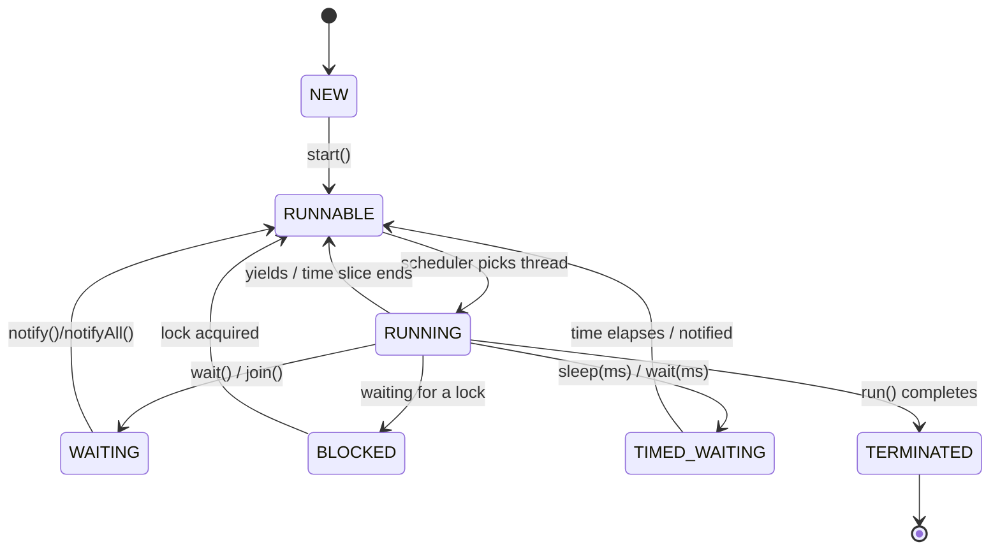

### 191. What is priority of a thread? How do you change the priority of a thread?

Thread priority is a hint to the thread scheduler about how important a thread is relative to others — it ranges from `Thread.MIN_PRIORITY` (1) to `Thread.MAX_PRIORITY` (10), with `Thread.NORM_PRIORITY` (5) as the default. Higher priority _suggests_ the thread should get more CPU time, but this is **not guaranteed** — it depends on the OS and JVM.

```java
Thread t = new Thread(() -> System.out.println("Running"));
t.setPriority(Thread.MAX_PRIORITY); // set priority to 10
System.out.println(t.getPriority()); // read current priority
t.start();
```

Beginner tip: don't rely on thread priority to control program correctness — use it only as a performance hint, not as a guarantee of execution order.

### 192. What is executorservice?

`ExecutorService` is a higher-level, easier, and safer way to manage threads compared to creating `Thread` objects yourself. Instead of manually creating and starting threads, you submit tasks to a **thread pool**, and the `ExecutorService` handles creating, reusing, and cleaning up threads for you.

Benefits:

- Reuses threads instead of creating a new one every time (much better performance).
- Lets you control how many threads run at once.
- Gives you a `Future` object so you can get results back or check task status.

### 193. Can you give an example for executorservice?

```java
import java.util.concurrent.ExecutorService;
import java.util.concurrent.Executors;

public class ExecutorServiceDemo {
    public static void main(String[] args) throws InterruptedException {
        ExecutorService executor = Executors.newFixedThreadPool(2);

        for (int i = 1; i <= 4; i++) {
            int taskId = i;
            executor.submit(() -> {
                System.out.println("Task " + taskId + " running on " + Thread.currentThread().getName());
            });
        }

        executor.shutdown(); // no new tasks accepted; lets existing tasks finish
    }
}
```

### 194. Explain different ways of creating executor services.

The `Executors` factory class provides several convenient ways to create an `ExecutorService`:

```java
import java.util.concurrent.*;

// 1. Fixed thread pool: a set number of reusable threads
ExecutorService fixedPool = Executors.newFixedThreadPool(4);

// 2. Cached thread pool: creates threads as needed, reuses idle ones, good for many short tasks
ExecutorService cachedPool = Executors.newCachedThreadPool();

// 3. Single thread executor: only one thread, tasks run one at a time, in order
ExecutorService singleThread = Executors.newSingleThreadExecutor();

// 4. Scheduled thread pool: for running tasks after a delay, or repeatedly
ScheduledExecutorService scheduled = Executors.newScheduledThreadPool(2);

// 5. Work-stealing pool (Java 8+): uses available CPU cores, ideal for parallel tasks
ExecutorService workStealing = Executors.newWorkStealingPool();
```

Always remember to call `shutdown()` when you're done, so the application doesn't hang waiting on live threads.

### 195. How do you check whether an executionservice task executed successfully?

When you submit a task with `submit()`, you get back a `Future` object. You can use it to check status and retrieve results (or exceptions).

```java
import java.util.concurrent.*;

public class FutureDemo {
    public static void main(String[] args) throws Exception {
        ExecutorService executor = Executors.newSingleThreadExecutor();

        Future<Integer> future = executor.submit(() -> {
            Thread.sleep(500);
            return 42; // this is the task's result
        });

        System.out.println("isDone right away? " + future.isDone()); // likely false

        Integer result = future.get(); // blocks until task finishes, then returns result
        System.out.println("Result: " + result);
        System.out.println("isDone now? " + future.isDone()); // true

        executor.shutdown();
    }
}
```

If the task threw an exception, calling `future.get()` throws an `ExecutionException` wrapping the original error — that's how you find out something went wrong.

### 196. What is callable? How do you execute a callable from executionservice?

`Callable<V>` is similar to `Runnable`, but with two key differences:

- Its method is `call()` instead of `run()`.
- `call()` **can return a value** and **can throw a checked exception** — `Runnable.run()` can do neither.

```java
import java.util.concurrent.*;

public class CallableDemo {
    public static void main(String[] args) throws Exception {
        ExecutorService executor = Executors.newSingleThreadExecutor();

        Callable<Integer> task = () -> {
            int sum = 0;
            for (int i = 1; i <= 5; i++) sum += i;
            return sum; // returns a value, unlike Runnable
        };

        Future<Integer> future = executor.submit(task);
        System.out.println("Sum = " + future.get()); // Sum = 15

        executor.shutdown();
    }
}
```

### 197. What is synchronization of threads?

When multiple threads access shared data (like a shared counter or a shared list) at the same time, you can get **race conditions** — unpredictable, incorrect results because threads interfere with each other.

**Synchronization** is Java's mechanism to ensure only one thread at a time can execute a critical piece of code (or access a shared resource), using a **lock** (also called a "monitor"). This keeps shared data consistent.

```java
class Counter {
    private int count = 0;

    // synchronized ensures only one thread executes this method at a time
    public synchronized void increment() {
        count++;
    }

    public int getCount() {
        return count;
    }
}
```

### 198. Can you give an example of a synchronized block?

A synchronized **block** locks only a specific section of code (rather than the whole method), which is often more efficient because it holds the lock for less time.

```java
class BankAccount {
    private double balance = 1000;
    private final Object lock = new Object(); // dedicated lock object

    public void withdraw(double amount) {
        synchronized (lock) { // only one thread can be inside this block at a time
            if (balance >= amount) {
                balance -= amount;
                System.out.println("Withdrew: " + amount + ", Balance: " + balance);
            } else {
                System.out.println("Insufficient balance");
            }
        }
    }
}
```

### 199. Can a static method be synchronized?

Yes! A `synchronized` static method locks on the **class object** (`ClassName.class`), not on an instance (`this`). This means it's a _separate_ lock from instance-level synchronized methods.

```java
class Counter {
    private static int total = 0;

    // Locks on Counter.class, shared across ALL instances
    public static synchronized void increment() {
        total++;
    }
}
```

This matters because it locks all threads out of _any_ call to that static synchronized method, regardless of which object (or no object) is calling it.

### 200. What is the use of join method in threads?

`join()` makes the calling thread **wait until the target thread finishes** before continuing. It's how you say "don't move on until this other thread is done."

```java
public class JoinDemo {
    public static void main(String[] args) throws InterruptedException {
        Thread worker = new Thread(() -> {
            System.out.println("Worker starting...");
            try { Thread.sleep(1000); } catch (InterruptedException e) {}
            System.out.println("Worker finished!");
        });

        worker.start();
        worker.join(); // main thread waits here until worker completes

        System.out.println("Main thread continues after worker is done.");
    }
}
```

Without `join()`, "Main thread continues..." might print _before_ "Worker finished!" because the main thread wouldn't wait.

### 201. Describe a few other important methods in threads?

- **`sleep(long millis)`** — pauses the current thread for a given time, without releasing any locks it holds.
- **`start()`** — begins a new thread and calls its `run()` method.
- **`interrupt()`** — signals a thread that it should stop what it's doing (commonly used to cancel a sleeping/waiting thread).
- **`isAlive()`** — returns `true` if the thread has started but not yet terminated.
- **`setDaemon(true)`** — marks a thread as a "daemon" (background) thread; the JVM can exit even if daemon threads are still running.
- **`currentThread()`** — static method that returns a reference to the thread currently executing.
- **`getName()` / `setName()`** — get or set a human-readable name for the thread, useful for debugging.
- **`yield()`** — a hint to the scheduler that the current thread is willing to let other threads run.

```java
Thread t = new Thread(() -> System.out.println("Working"));
t.setName("Worker-1");
t.setDaemon(true);
System.out.println(t.isAlive()); // false, hasn't started yet
t.start();
```

### 202. What is a deadlock?

A **deadlock** happens when two (or more) threads are each waiting for a lock that the other thread holds — so neither can ever proceed. It's like two people trying to pass through a narrow door, each insisting the other go first, forever.

```java
public class DeadlockDemo {
    static final Object lockA = new Object();
    static final Object lockB = new Object();

    public static void main(String[] args) {
        Thread t1 = new Thread(() -> {
            synchronized (lockA) {
                System.out.println("Thread 1: locked A, waiting for B");
                try { Thread.sleep(100); } catch (InterruptedException e) {}
                synchronized (lockB) {
                    System.out.println("Thread 1: got both locks");
                }
            }
        });

        Thread t2 = new Thread(() -> {
            synchronized (lockB) {
                System.out.println("Thread 2: locked B, waiting for A");
                try { Thread.sleep(100); } catch (InterruptedException e) {}
                synchronized (lockA) {
                    System.out.println("Thread 2: got both locks");
                }
            }
        });

        t1.start();
        t2.start();
        // This program will hang forever — classic deadlock!
    }
}
```

To avoid deadlocks: always acquire locks in the **same, consistent order** across all threads.

### 203. What are the important methods in Java for inter-thread communication?

These methods, defined on `Object` (because every object can act as a monitor/lock), let threads coordinate and communicate with each other:

- **`wait()`** — makes the current thread give up the lock and wait until another thread calls `notify()`/`notifyAll()` on the same object.
- **`notify()`** — wakes up **one** waiting thread on this object's monitor.
- **`notifyAll()`** — wakes up **all** waiting threads on this object's monitor.

These must always be called from **inside a `synchronized` block/method** on the object being waited on, otherwise Java throws `IllegalMonitorStateException`.

### 204. What is the use of wait method?

`wait()` tells the current thread: "release the lock you're holding, and pause here until someone notifies you." It's used when a thread needs to wait for some condition to become true (e.g., "wait until there's data available to process").

```java
synchronized (sharedObject) {
    while (!conditionIsTrue) {
        sharedObject.wait(); // releases lock, waits to be notified
    }
    // proceed once condition becomes true
}
```

Using `wait()` (instead of just looping and checking repeatedly) is far more efficient — the thread truly sleeps instead of wasting CPU cycles.

### 205. What is the use of notify method?

`notify()` wakes up **one** thread that is currently waiting on the same object's monitor (if multiple threads are waiting, the JVM picks one — you don't control which). The woken thread still needs to re-acquire the lock before it can continue, so it doesn't resume immediately, only when the notifying thread releases the lock.

```java
synchronized (sharedObject) {
    // prepare some data...
    sharedObject.notify(); // wake up one waiting thread
}
```

### 206. What is the use of notifyall method?

`notifyAll()` wakes up **all** threads waiting on that object's monitor, instead of just one. Each woken thread competes to reacquire the lock, and each re-checks its waiting condition before proceeding. It's generally the **safer choice** when multiple threads might be waiting for different reasons — using plain `notify()` in that case could accidentally wake the "wrong" thread and leave others waiting forever.

```java
synchronized (sharedObject) {
    sharedObject.notifyAll(); // wake up ALL waiting threads
}
```

### 207. Can you write a synchronized program with wait and notify methods?

Here's a classic producer-consumer example using a shared buffer of size 1:

```java
import java.util.LinkedList;
import java.util.Queue;

class SharedBuffer {
    private final Queue<Integer> buffer = new LinkedList<>();
    private final int capacity = 1;

    public synchronized void produce(int value) throws InterruptedException {
        while (buffer.size() == capacity) {
            wait(); // buffer full, wait for consumer to take something
        }
        buffer.add(value);
        System.out.println("Produced: " + value);
        notifyAll(); // let the consumer know something is available
    }

    public synchronized int consume() throws InterruptedException {
        while (buffer.isEmpty()) {
            wait(); // buffer empty, wait for producer to add something
        }
        int value = buffer.poll();
        System.out.println("Consumed: " + value);
        notifyAll(); // let the producer know there's room now
        return value;
    }
}

public class ProducerConsumerDemo {
    public static void main(String[] args) {
        SharedBuffer buffer = new SharedBuffer();

        Thread producer = new Thread(() -> {
            for (int i = 1; i <= 5; i++) {
                try { buffer.produce(i); } catch (InterruptedException e) {}
            }
        });

        Thread consumer = new Thread(() -> {
            for (int i = 1; i <= 5; i++) {
                try { buffer.consume(); } catch (InterruptedException e) {}
            }
        });

        producer.start();
        consumer.start();
    }
}
```

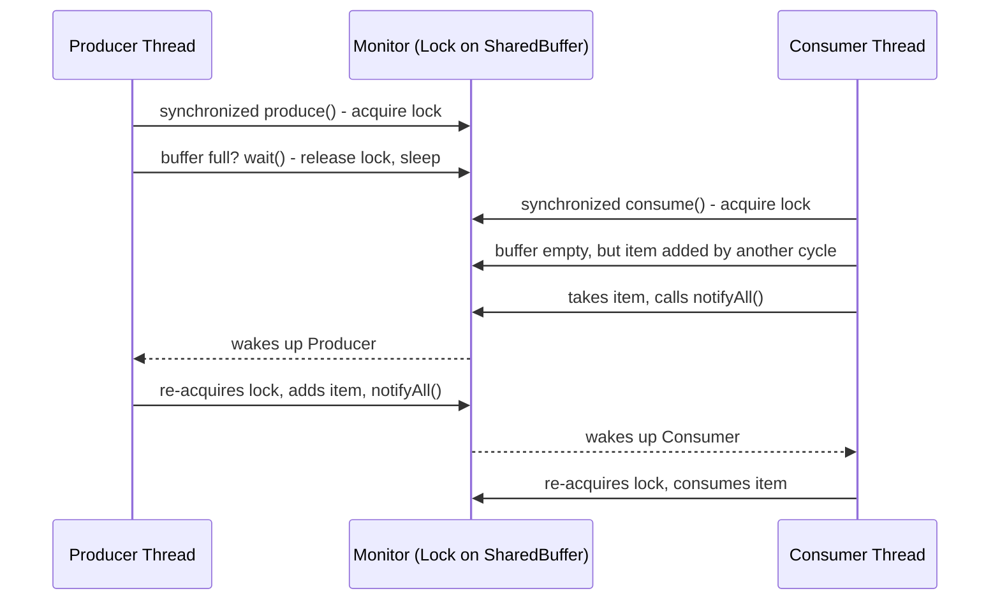

### Runnable vs Callable (quick comparison)

| Feature                       | `Runnable`                                       | `Callable<V>`                                               |
| ----------------------------- | ------------------------------------------------ | ----------------------------------------------------------- |
| Method name                   | `run()`                                          | `call()`                                                    |
| Can return a value?           | No (`void`)                                      | Yes, returns`V`                                             |
| Can throw checked exceptions? | No                                               | Yes                                                         |
| Introduced in                 | Java 1.0                                         | Java 5 (with`java.util.concurrent`)                         |
| Typical use                   | Simple`Thread` tasks                             | Tasks submitted to`ExecutorService` where you need a result |
| Used with                     | `Thread`, `ExecutorService.execute()`/`submit()` | `ExecutorService.submit()` returning a `Future<V>`          |

---

## Functional Programming (Lambda & Streams)

### 208. What is functional programming?

Functional programming is a style of writing code where you focus on **what to compute** (using functions, especially small reusable ones) rather than **how to compute it step-by-step** with loops and mutable variables. Key ideas:

- Functions are treated like values — you can pass them around, store them in variables, and return them from other functions.
- Prefer **immutability** (not changing existing data, instead creating new results).
- Avoid side effects when possible (a function's output should depend only on its input).

Java isn't a purely functional language, but Java 8 added strong functional-programming support through **lambda expressions** and the **Streams API**.

### 209. Can you give an example of functional programming?

```java
import java.util.*;
import java.util.stream.*;

public class FunctionalExample {
    public static void main(String[] args) {
        List<Integer> numbers = List.of(1, 2, 3, 4, 5, 6);

        // Functional style: describe WHAT you want (even numbers, doubled, summed)
        int sumOfDoubledEvens = numbers.stream()
                .filter(n -> n % 2 == 0)   // keep even numbers
                .map(n -> n * 2)           // double each one
                .reduce(0, Integer::sum);  // add them all up

        System.out.println(sumOfDoubledEvens); // (2*2)+(4*2)+(6*2) = 24
    }
}
```

Compare this to the traditional "imperative" style, which would use a `for` loop, an `if` check, and a mutable running total variable — the functional version reads more like a description of the goal.

### 210. What is a stream?

A **Stream** (`java.util.stream.Stream`) is a sequence of elements that supports functional-style operations like filtering, transforming, and combining data — **without changing the original source** (e.g., a `List` or array). A stream isn't a data structure itself; it doesn't store elements, it just processes them, often lazily, one pipeline step at a time.

Key characteristics:

- Streams don't modify the underlying collection.
- Many stream operations are **lazy** — nothing happens until a terminal operation is called.
- A stream can be consumed (used) **only once**.

### 211. Explain about streams with an example?

```java
import java.util.*;
import java.util.stream.*;

public class StreamExample {
    public static void main(String[] args) {
        List<String> names = List.of("Alice", "Bob", "Charlie", "Dave", "Eve");

        List<String> result = names.stream()          // 1. create a stream from the list
                .filter(name -> name.length() > 3)     // 2. intermediate op: keep names longer than 3 chars
                .map(String::toUpperCase)              // 3. intermediate op: convert to uppercase
                .sorted()                              // 4. intermediate op: sort alphabetically
                .collect(Collectors.toList());          // 5. terminal op: gather results into a List

        System.out.println(result); // [ALICE, CHARLIE, DAVE]
    }
}
```

### 212. What are intermediate operations in streams?

Intermediate operations transform a stream into **another stream**, so you can chain several of them together. They are **lazy** — they don't actually run until a terminal operation is invoked.

Common intermediate operations:

- **`filter(Predicate)`** — keeps elements matching a condition.
- **`map(Function)`** — transforms each element into something else.
- **`sorted()`** — sorts the elements.
- **`distinct()`** — removes duplicates.
- **`limit(n)`** — keeps only the first `n` elements.
- **`skip(n)`** — skips the first `n` elements.

```java
stream.filter(x -> x > 0).map(x -> x * 2).sorted(); // all intermediate, nothing executes yet!
```

### 213. What are terminal operations in streams?

Terminal operations **trigger** the actual processing of the stream and produce a final result (or a side effect). After a terminal operation runs, the stream is "used up" and can't be reused.

Common terminal operations:

- **`collect(Collector)`** — gathers elements into a `List`, `Set`, `Map`, etc.
- **`forEach(Consumer)`** — performs an action on each element.
- **`reduce(...)`** — combines elements into a single result (like a sum).
- **`count()`** — counts the elements.
- **`anyMatch()` / `allMatch()` / `noneMatch()`** — check conditions.
- **`min()` / `max()`** — find smallest/largest element.

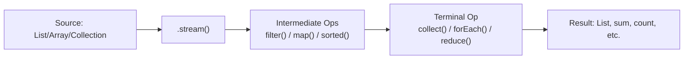

### 214. What are method references?

A method reference is a **shorthand for a lambda expression** that just calls an existing method. It uses the `::` syntax and makes code more readable when the lambda would only do one thing: call a method.

```java
import java.util.*;
import java.util.function.*;

public class MethodReferenceDemo {
    public static void main(String[] args) {
        List<String> names = new ArrayList<>(List.of("Charlie", "Alice", "Bob"));

        // Lambda version
        names.forEach(name -> System.out.println(name));

        // Method reference version (shorter, same effect)
        names.forEach(System.out::println);

        // Static method reference
        Function<String, Integer> parser = Integer::parseInt;
        System.out.println(parser.apply("123")); // 123

        // Constructor reference
        Supplier<ArrayList<String>> listMaker = ArrayList::new;
        List<String> newList = listMaker.get();
    }
}
```

There are four kinds: static method (`ClassName::staticMethod`), instance method of a particular object (`obj::instanceMethod`), instance method of an arbitrary object (`ClassName::instanceMethod`), and constructor references (`ClassName::new`).

### 215. What are lambda expressions?

A lambda expression is a compact way to write an **anonymous function** — a block of code you can pass around, without needing a full named method or class. Introduced in Java 8, lambdas make it much easier to work with functional interfaces (interfaces with exactly one abstract method).

Basic syntax: `(parameters) -> expression` or `(parameters) -> { statements; }`

```java
// Traditional anonymous class
Runnable r1 = new Runnable() {
    @Override
    public void run() {
        System.out.println("Running (old way)");
    }
};

// Lambda expression — much shorter, same effect
Runnable r2 = () -> System.out.println("Running (lambda way)");
```

### 216. Can you give an example of lambda expression?

```java
import java.util.*;

public class LambdaExample {
    public static void main(String[] args) {
        List<Integer> numbers = new ArrayList<>(List.of(5, 3, 8, 1, 9));

        // Lambda used to define custom sorting logic
        numbers.sort((a, b) -> a - b); // ascending order
        System.out.println(numbers); // [1, 3, 5, 8, 9]

        // Lambda with a code block and multiple statements
        Runnable task = () -> {
            System.out.println("Step 1");
            System.out.println("Step 2");
        };
        task.run();

        // Lambda with one parameter (parentheses optional)
        List<String> words = List.of("apple", "banana", "kiwi");
        words.forEach(word -> System.out.println(word.toUpperCase()));
    }
}
```

### 217. Can you explain the relationship between lambda expression and functional interfaces?

A **functional interface** is an interface with exactly **one abstract method** (it can have other default/static methods too). A lambda expression is essentially shorthand for creating an implementation of a functional interface's single method.

```java
@FunctionalInterface
interface Greeter {
    void greet(String name); // exactly one abstract method
}

public class RelationshipDemo {
    public static void main(String[] args) {
        // The lambda's body becomes the implementation of greet()
        Greeter greeter = name -> System.out.println("Hello, " + name + "!");
        greeter.greet("World"); // Hello, World!
    }
}
```

Without a matching functional interface, a lambda has nowhere to "attach" — the compiler needs to know what single method the lambda's code is implementing. That's why lambdas only work in contexts expecting a functional interface (like `Runnable`, `Comparator`, `Predicate`, or your own custom one, ideally marked with `@FunctionalInterface`).

### 218. What is a predicate?

`Predicate<T>` is a built-in functional interface (in `java.util.function`) representing a function that takes one argument and returns a `boolean`. It's used for tests/conditions — "does this value match some rule?"

```java
import java.util.function.Predicate;

public class PredicateDemo {
    public static void main(String[] args) {
        Predicate<Integer> isEven = n -> n % 2 == 0;

        System.out.println(isEven.test(4)); // true
        System.out.println(isEven.test(7)); // false

        // Commonly used with streams
        java.util.List.of(1, 2, 3, 4, 5, 6).stream()
                .filter(isEven)
                .forEach(System.out::println); // 2, 4, 6
    }
}
```

### 219. What is the functional interface - function?

`Function<T, R>` is a built-in functional interface representing a function that takes an input of type `T` and produces an output of type `R`. Its abstract method is `R apply(T t)`.

```java
import java.util.function.Function;

public class FunctionDemo {
    public static void main(String[] args) {
        Function<String, Integer> stringLength = str -> str.length();

        System.out.println(stringLength.apply("Hello")); // 5

        // Functions can be chained
        Function<Integer, Integer> square = n -> n * n;
        Function<String, Integer> lengthThenSquare = stringLength.andThen(square);
        System.out.println(lengthThenSquare.apply("Hello")); // length 5, squared = 25
    }
}
```

### 220. What is a consumer?

`Consumer<T>` is a built-in functional interface representing an operation that takes one argument and returns **nothing** — it's meant purely for a side effect, like printing or saving data. Its abstract method is `void accept(T t)`.

```java
import java.util.function.Consumer;
import java.util.List;

public class ConsumerDemo {
    public static void main(String[] args) {
        Consumer<String> printer = message -> System.out.println("Message: " + message);
        printer.accept("Hello!"); // Message: Hello!

        // Commonly used with forEach, which expects a Consumer
        List<String> names = List.of("Alice", "Bob");
        names.forEach(printer);
    }
}
```

### 221. Can you give examples of functional interfaces with multiple arguments?

Some built-in functional interfaces accept two arguments instead of one — they're named with a `Bi` prefix:

```java
import java.util.function.*;

public class MultiArgDemo {
    public static void main(String[] args) {
        // BiFunction<T, U, R>: takes two inputs, returns a result
        BiFunction<Integer, Integer, Integer> add = (a, b) -> a + b;
        System.out.println(add.apply(3, 5)); // 8

        // BiPredicate<T, U>: takes two inputs, returns boolean
        BiPredicate<String, String> areEqualIgnoreCase = (s1, s2) -> s1.equalsIgnoreCase(s2);
        System.out.println(areEqualIgnoreCase.test("Java", "JAVA")); // true

        // BiConsumer<T, U>: takes two inputs, returns nothing
        BiConsumer<String, Integer> printPair = (name, age) ->
                System.out.println(name + " is " + age + " years old");
        printPair.accept("Alice", 30);
    }
}
```

For more than two arguments, Java has no built-in interface — you'd write your own custom functional interface.

---

## New Features by Java Version

### 222. What are the new features in Java 5?

Java 5 (2004) was a huge release that modernized the language significantly:

- **Generics** — type-safe collections (e.g., `List<String>`), see the Generics section above.
- **Enhanced for-loop (for-each)** — simpler iteration over arrays/collections.
- **Autoboxing / Unboxing** — automatic conversion between primitives and their wrapper classes (e.g., `int` <-> `Integer`).
- **Enums (`enum`)** — a proper type for representing a fixed set of constants.
- **Varargs** — methods that accept a variable number of arguments (`String... args`).
- **Annotations** — metadata like `@Override`, `@Deprecated`, and custom annotations.
- **`java.util.concurrent` package** — proper concurrency utilities including `ExecutorService`.
- **Static imports** — `import static` for using static members without qualifying the class name.

```java
// for-each loop + autoboxing + enum, all Java 5 features
enum Day { MON, TUE, WED }

List<Integer> nums = List.of(1, 2, 3); // autoboxing: int -> Integer
for (int n : nums) { // enhanced for-loop
    System.out.println(n);
}
```

### 223. What are the new features in Java 6?

Java 6 (2006) was mostly about performance, tooling, and library improvements rather than language syntax:

- **Scripting API (`javax.script`)** — run scripting languages like JavaScript from within Java.
- **JDBC 4.0** — improvements to database connectivity (auto-loading drivers, better exception handling).
- **Improvements to Java Compiler API** — programmatic access to the compiler.
- **Pluggable annotations processing API**.
- **Performance and monitoring/management improvements** (JVM and desktop performance).
- **Web services support improvements** (JAX-WS).

### 224. What are the new features in Java 7?

Java 7 (2011) introduced several handy language-level conveniences:

- **Try-with-resources** — automatically closes resources like files/streams without manual `finally` blocks.
- **Diamond operator (`<>`)** — lets you skip repeating generic type info on the right-hand side.
- **Multi-catch** — catch multiple exception types in a single `catch` block using `|`.
- **Strings in switch statements** — `switch` can now work on `String` values.
- **NIO.2 (`java.nio.file`)** — a much better file I/O API (`Path`, `Files`, `Paths`).
- **Underscores in numeric literals** — e.g., `1_000_000` for readability.
- **Binary literals** — e.g., `0b1010`.

```java
// try-with-resources + diamond operator + multi-catch
Map<String, List<Integer>> map = new HashMap<>(); // diamond operator: no need for <String, List<Integer>> again

try (BufferedReader reader = new BufferedReader(new FileReader("file.txt"))) {
    String line = reader.readLine();
} catch (IOException | NullPointerException e) { // multi-catch
    System.out.println("Error: " + e.getMessage());
}
```

### 225. What are the new features in Java 8?

Java 8 (2014) is one of the most important releases, adding strong functional-programming capabilities:

- **Lambda expressions** — anonymous functions, see questions 215-217 above.
- **Streams API** — functional-style processing of collections, see questions 210-213 above.
- **Default and static methods in interfaces** — interfaces can now have method bodies.
- **`Optional<T>`** — a container object to help avoid `NullPointerException`.
- **New Date and Time API (`java.time`)** — `LocalDate`, `LocalTime`, `LocalDateTime`, replacing the old error-prone `Date`/`Calendar` classes.
- **Method references** — shorthand for lambdas, see question 214 above.
- **`java.util.function` package** — `Predicate`, `Function`, `Consumer`, `Supplier`, and more.
- **Nashorn JavaScript engine** — a faster JavaScript engine for the JVM.

```java
// default method in an interface
interface Greetable {
    default void greet() {
        System.out.println("Hello!");
    }
}

// Optional avoids null checks
Optional<String> maybeName = Optional.ofNullable(null);
System.out.println(maybeName.orElse("Default Name")); // Default Name

// new Date-Time API
java.time.LocalDate today = java.time.LocalDate.now();
System.out.println(today);
```

### Java 5 vs 6 vs 7 vs 8 — major features at a glance

| Version | Year | Major Features                                                                                                                   |
| ------- | ---- | -------------------------------------------------------------------------------------------------------------------------------- |
| Java 5  | 2004 | Generics, enhanced for-loop, autoboxing/unboxing, enums, varargs, annotations,`java.util.concurrent`                             |
| Java 6  | 2006 | Scripting API, JDBC 4.0, compiler API improvements, pluggable annotation processing, performance/monitoring upgrades             |
| Java 7  | 2011 | Try-with-resources, diamond operator (`<>`), multi-catch, strings in switch, NIO.2 file API, numeric literal underscores         |
| Java 8  | 2014 | Lambda expressions, Streams API, default/static interface methods,`Optional`, new Date-Time API (`java.time`), method references |
