# Python Interview Questions & Answers — The Beginner-Friendly Guide

A complete walkthrough of the Python interview questions from `python interview questions.txt`, answered from scratch — no prior Python knowledge assumed. Every question includes a plain-English explanation, most include a small runnable code example, and diagrams (Mermaid) are used wherever a picture explains a concept faster than words: the interpreter pipeline, the MRO/class hierarchy, reference counting and cycle collection, the GIL, generator state machines, and the asyncio event loop.

This guide covers core language mechanics, the full data model (strings, lists, dicts, sets), Object-Oriented Programming (classes, inheritance, dunder methods, metaclasses), functions and closures, decorators, iterators and generators, exception handling, memory management, concurrency (threading, multiprocessing, asyncio), the standard library's most-used modules (`collections`, `itertools`, `functools`, `re`), type hints, and packaging.

**How to use this guide:** read it top to bottom if you're studying from scratch, or jump to a topic using the table of contents below. Questions are numbered to match `python interview questions.txt`.

---

## Built-in Types — Quick Reference

| Type | Mutable? | Ordered? | Hashable? | Typical use | Q# |
|---|---|---|---|---|---|
| `int`, `float`, `complex` | No | N/A | Yes | Numbers | [Q11](#11-what-are-the-built-in-data-types-in-python) |
| `bool` | No | N/A | Yes | True/False (subclass of `int`) | [Q11](#11-what-are-the-built-in-data-types-in-python) |
| `str` | No | Yes | Yes | Text | [Q28](#28-are-strings-mutable-or-immutable-in-python) |
| `tuple` | No | Yes | Yes (if elements are) | Fixed-size records, dict keys | [Q38](#38-what-is-the-difference-between-a-list-and-a-tuple) |
| `frozenset` | No | No | Yes | Immutable set, dict keys | [Q54](#54-what-is-a-frozenset) |
| `bytes` | No | Yes | Yes | Immutable binary data | [Q31](#31-what-is-the-difference-between-a-str-object-and-a-bytes-object) |
| `list` | Yes | Yes | No | General-purpose sequence | [Q38](#38-what-is-the-difference-between-a-list-and-a-tuple) |
| `dict` | Yes | Yes (insertion, 3.7+) | No | Key → value mapping | [Q49](#49-how-does-a-python-dictionary-work-internally-hash-table) |
| `set` | Yes | No | No | Unique unordered elements | [Q53](#53-what-is-a-set-and-how-is-it-different-from-a-list) |
| `bytearray` | Yes | Yes | No | Mutable binary data | [Q31](#31-what-is-the-difference-between-a-str-object-and-a-bytes-object) |

**Rule of thumb:** immutable types are hashable (safe as dict keys / set members) and safe to share across threads without locking; mutable types are not hashable by default and must never be used as a mutable default argument ([Q48](#48-what-is-the-danger-of-using-a-mutable-default-argument-like-a-list)).

## Concurrency Model — Quick Reference

| Model | Best for | Parallel CPU work? | Concurrency primitive | Q# |
|---|---|---|---|---|
| `threading` | I/O-bound (network, disk, DB calls) | No (GIL-limited) | `Thread`, `Lock` | [Q166](#166-what-is-the-global-interpreter-lock-gil-and-why-does-it-exist) |
| `multiprocessing` | CPU-bound (heavy computation) | Yes (separate processes, separate GILs) | `Process`, `Pool`, `Queue` | [Q168](#168-what-is-the-difference-between-multithreading-and-multiprocessing-in-python) |
| `asyncio` | Massive numbers of I/O-bound tasks in one thread | No | `async`/`await`, event loop | [Q174](#174-what-is-asyncio-and-what-problem-does-it-solve) |
| `concurrent.futures` | A simple pool-based wrapper over threads or processes | Depends on executor | `ThreadPoolExecutor`, `ProcessPoolExecutor` | [Q173](#173-what-is-the-concurrentfutures-module) |

**Rule of thumb:** I/O-bound + few tasks → `threading`. I/O-bound + thousands of tasks → `asyncio`. CPU-bound → `multiprocessing`. See [Q169](#169-when-would-you-use-threading-vs-multiprocessing-vs-asyncio) for the full decision tree.

---

- **[Python Platform & Interpreter Basics](#python-platform-interpreter-basics)**
  - [1. What is Python and what are its key features?](#1-what-is-python-and-what-are-its-key-features)
  - [2. What is the difference between Python 2 and Python 3?](#2-what-is-the-difference-between-python-2-and-python-3)
  - [3. What is CPython, and how does it differ from other implementations (PyPy, Jython, IronPython)?](#3-what-is-cpython-and-how-does-it-differ-from-other-implementations-pypy-jython-ironpython)
  - [4. What is the difference between a Python script and a compiled bytecode file (.pyc)?](#4-what-is-the-difference-between-a-python-script-and-a-compiled-bytecode-file-pyc)
  - [5. What is the Python interpreter's execution model? (source -> bytecode -> PVM)](#5-what-is-the-python-interpreters-execution-model-source---bytecode---pvm)
  - [6. What is PEP 8, and why does it matter?](#6-what-is-pep-8-and-why-does-it-matter)
  - [7. What is PEP 20 (The Zen of Python)?](#7-what-is-pep-20-the-zen-of-python)
  - [8. Is Python interpreted or compiled?](#8-is-python-interpreted-or-compiled)
  - [9. What is the difference between CPython, a JIT compiler, and an AOT compiler?](#9-what-is-the-difference-between-cpython-a-jit-compiler-and-an-aot-compiler)
  - [10. What are the important differences between Python and Java/C++?](#10-what-are-the-important-differences-between-python-and-javac)
- **[Data Types & Variables](#data-types-variables)**
  - [11. What are the built-in data types in Python?](#11-what-are-the-built-in-data-types-in-python)
  - [12. What is dynamic typing, and how is it different from static typing?](#12-what-is-dynamic-typing-and-how-is-it-different-from-static-typing)
  - [13. What is duck typing?](#13-what-is-duck-typing)
  - [14. What is the difference between mutable and immutable types?](#14-what-is-the-difference-between-mutable-and-immutable-types)
  - [15. How does variable assignment work in Python (names vs references)?](#15-how-does-variable-assignment-work-in-python-names-vs-references)
  - [16. What is the difference between is and ==?](#16-what-is-the-difference-between-is-and)
  - [17. What is object identity, and what does id() return?](#17-what-is-object-identity-and-what-does-id-return)
  - [18. What is None, and how is it different from null in other languages?](#18-what-is-none-and-how-is-it-different-from-null-in-other-languages)
  - [19. What is type casting/conversion in Python?](#19-what-is-type-castingconversion-in-python)
  - [20. What is the difference between implicit and explicit type conversion?](#20-what-is-the-difference-between-implicit-and-explicit-type-conversion)
- **[Numbers & Operators](#numbers-operators)**
  - [21. How does Python handle integer overflow?](#21-how-does-python-handle-integer-overflow)
  - [22. What is the difference between the / and // operators?](#22-what-is-the-difference-between-the-and-operators)
  - [23. Why does is sometimes return True for small integers but not for large ones?](#23-why-does-is-sometimes-return-true-for-small-integers-but-not-for-large-ones)
  - [24. What is the decimal module used for, and why not always use float?](#24-what-is-the-decimal-module-used-for-and-why-not-always-use-float)
  - [25. What is complex number support in Python?](#25-what-is-complex-number-support-in-python)
  - [26. What are Python's operator precedence rules for common operators?](#26-what-are-pythons-operator-precedence-rules-for-common-operators)
  - [27. What is the walrus operator := and when was it introduced?](#27-what-is-the-walrus-operator-and-when-was-it-introduced)
- **[Strings](#strings)**
  - [28. Are strings mutable or immutable in Python?](#28-are-strings-mutable-or-immutable-in-python)
  - [29. What is string interning?](#29-what-is-string-interning)
  - [30. What are the different ways to format strings in Python (%-formatting, .format(), f-strings)?](#30-what-are-the-different-ways-to-format-strings-in-python--formatting-format-f-strings)
  - [31. What is the difference between a str object and a bytes object?](#31-what-is-the-difference-between-a-str-object-and-a-bytes-object)
  - [32. How do you encode and decode strings?](#32-how-do-you-encode-and-decode-strings)
  - [33. What are some string methods you use frequently?](#33-what-are-some-string-methods-you-use-frequently)
  - [34. Why should you avoid string concatenation with + in a loop?](#34-why-should-you-avoid-string-concatenation-with-in-a-loop)
  - [35. What is the difference between join() and + for concatenation?](#35-what-is-the-difference-between-join-and-for-concatenation)
  - [36. What are raw strings, and when do you use them?](#36-what-are-raw-strings-and-when-do-you-use-them)
  - [37. How do you reverse a string in Python?](#37-how-do-you-reverse-a-string-in-python)
- **[Lists & Tuples](#lists-tuples)**
  - [38. What is the difference between a list and a tuple?](#38-what-is-the-difference-between-a-list-and-a-tuple)
  - [39. Why are tuples generally faster than lists?](#39-why-are-tuples-generally-faster-than-lists)
  - [40. What is the difference between a shallow copy and a deep copy?](#40-what-is-the-difference-between-a-shallow-copy-and-a-deep-copy)
  - [41. How do list slicing operations work?](#41-how-do-list-slicing-operations-work)
  - [42. What is the time complexity of common list operations?](#42-what-is-the-time-complexity-of-common-list-operations)
  - [43. How does Python implement dynamic list resizing internally?](#43-how-does-python-implement-dynamic-list-resizing-internally)
  - [44. What is a named tuple, and why use one?](#44-what-is-a-named-tuple-and-why-use-one)
  - [45. What is list comprehension, and how is it different from map/filter?](#45-what-is-list-comprehension-and-how-is-it-different-from-mapfilter)
  - [46. What is the difference between append() and extend()?](#46-what-is-the-difference-between-append-and-extend)
  - [47. How do you remove duplicates from a list while preserving order?](#47-how-do-you-remove-duplicates-from-a-list-while-preserving-order)
  - [48. What is the danger of using a mutable default argument like a list?](#48-what-is-the-danger-of-using-a-mutable-default-argument-like-a-list)
- **[Dictionaries & Sets](#dictionaries-sets)**
  - [49. How does a Python dictionary work internally (hash table)?](#49-how-does-a-python-dictionary-work-internally-hash-table)
  - [50. What are the requirements for an object to be used as a dictionary key?](#50-what-are-the-requirements-for-an-object-to-be-used-as-a-dictionary-key)
  - [51. What is the difference between dict.get() and dict[key]?](#51-what-is-the-difference-between-dictget-and-dictkey)
  - [52. How has dictionary ordering changed across Python versions?](#52-how-has-dictionary-ordering-changed-across-python-versions)
  - [53. What is a set, and how is it different from a list?](#53-what-is-a-set-and-how-is-it-different-from-a-list)
  - [54. What is a frozenset?](#54-what-is-a-frozenset)
  - [55. How do you merge two dictionaries?](#55-how-do-you-merge-two-dictionaries)
  - [56. What is a defaultdict, and when do you use it?](#56-what-is-a-defaultdict-and-when-do-you-use-it)
  - [57. What is the time complexity of dict/set lookups, and why?](#57-what-is-the-time-complexity-of-dictset-lookups-and-why)
  - [58. How do dictionaries handle hash collisions?](#58-how-do-dictionaries-handle-hash-collisions)
- **[Object Oriented Programming Basics](#object-oriented-programming-basics)**
  - [59. What is a class and an object in Python?](#59-what-is-a-class-and-an-object-in-python)
  - [60. How do you define a class and create an instance?](#60-how-do-you-define-a-class-and-create-an-instance)
  - [61. What is self, and why is it explicitly passed?](#61-what-is-self-and-why-is-it-explicitly-passed)
  - [62. What is the __init__ method?](#62-what-is-the-__init__-method)
  - [63. What is the difference between class variables and instance variables?](#63-what-is-the-difference-between-class-variables-and-instance-variables)
  - [64. What is encapsulation in Python, and how is it achieved (name mangling)?](#64-what-is-encapsulation-in-python-and-how-is-it-achieved-name-mangling)
  - [65. What is inheritance, and how do you implement it in Python?](#65-what-is-inheritance-and-how-do-you-implement-it-in-python)
  - [66. What is method overriding?](#66-what-is-method-overriding)
  - [67. Does Python support method overloading?](#67-does-python-support-method-overloading)
  - [68. What is multiple inheritance, and how does Python handle it?](#68-what-is-multiple-inheritance-and-how-does-python-handle-it)
  - [69. What is the Method Resolution Order (MRO), and what algorithm does Python use?](#69-what-is-the-method-resolution-order-mro-and-what-algorithm-does-python-use)
  - [70. What is super(), and how does it work with the MRO?](#70-what-is-super-and-how-does-it-work-with-the-mro)
- **[Advanced OOP Concepts](#advanced-oop-concepts)**
  - [71. What is polymorphism in Python?](#71-what-is-polymorphism-in-python)
  - [72. What is an abstract class, and how do you create one using the abc module?](#72-what-is-an-abstract-class-and-how-do-you-create-one-using-the-abc-module)
  - [73. What is an interface in Python, and how is it simulated?](#73-what-is-an-interface-in-python-and-how-is-it-simulated)
  - [74. What is the difference between a static method, a class method, and an instance method?](#74-what-is-the-difference-between-a-static-method-a-class-method-and-an-instance-method)
  - [75. What is a property, and how do you use @property?](#75-what-is-a-property-and-how-do-you-use-property)
  - [76. What are getters and setters in Python, and why are they usually unnecessary?](#76-what-are-getters-and-setters-in-python-and-why-are-they-usually-unnecessary)
  - [77. What is composition vs inheritance?](#77-what-is-composition-vs-inheritance)
  - [78. What is a mixin class?](#78-what-is-a-mixin-class)
  - [79. What is a metaclass, and how does type relate to classes?](#79-what-is-a-metaclass-and-how-does-type-relate-to-classes)
  - [80. What is the difference between __new__ and __init__?](#80-what-is-the-difference-between-__new__-and-__init__)
  - [81. What is monkey patching, and what are its risks?](#81-what-is-monkey-patching-and-what-are-its-risks)
  - [82. What are __slots__, and why would you use them?](#82-what-are-__slots__-and-why-would-you-use-them)
- **[Magic / Dunder Methods](#magic-dunder-methods)**
  - [83. What are dunder (magic) methods, and why are they useful?](#83-what-are-dunder-magic-methods-and-why-are-they-useful)
  - [84. What is the difference between __str__ and __repr__?](#84-what-is-the-difference-between-__str__-and-__repr__)
  - [85. How do you make a custom object comparable with ==, <, etc.?](#85-how-do-you-make-a-custom-object-comparable-with-etc)
  - [86. How do you overload operators like + in Python?](#86-how-do-you-overload-operators-like-in-python)
  - [87. What is __len__, and when is it used?](#87-what-is-__len__-and-when-is-it-used)
  - [88. What are __getitem__ and __setitem__, and how do they enable indexing?](#88-what-are-__getitem__-and-__setitem__-and-how-do-they-enable-indexing)
  - [89. What are __iter__ and __next__, and how do they make an object iterable?](#89-what-are-__iter__-and-__next__-and-how-do-they-make-an-object-iterable)
  - [90. What is __call__, and what does it mean for an object to be callable?](#90-what-is-__call__-and-what-does-it-mean-for-an-object-to-be-callable)
  - [91. What are __enter__ and __exit__, and how do they relate to context managers?](#91-what-are-__enter__-and-__exit__-and-how-do-they-relate-to-context-managers)
  - [92. What is __hash__, and why must it be consistent with __eq__?](#92-what-is-__hash__-and-why-must-it-be-consistent-with-__eq__)
- **[Functions](#functions)**
  - [93. How do you define a function with default arguments in Python?](#93-how-do-you-define-a-function-with-default-arguments-in-python)
  - [94. What is the difference between positional and keyword arguments?](#94-what-is-the-difference-between-positional-and-keyword-arguments)
  - [95. What are *args and **kwargs?](#95-what-are-args-and-kwargs)
  - [96. What is a lambda function, and when should you use one?](#96-what-is-a-lambda-function-and-when-should-you-use-one)
  - [97. What is variable scope, and what is the LEGB rule?](#97-what-is-variable-scope-and-what-is-the-legb-rule)
  - [98. What is a closure, and how does it work?](#98-what-is-a-closure-and-how-does-it-work)
  - [99. What is the nonlocal keyword used for?](#99-what-is-the-nonlocal-keyword-used-for)
  - [100. What is the global keyword used for?](#100-what-is-the-global-keyword-used-for)
  - [101. What are first-class functions?](#101-what-are-first-class-functions)
  - [102. What is function annotation / type hinting for parameters?](#102-what-is-function-annotation-type-hinting-for-parameters)
  - [103. What is recursion, and what is Python's recursion limit?](#103-what-is-recursion-and-what-is-pythons-recursion-limit)
  - [104. Why doesn't Python optimize tail recursion?](#104-why-doesnt-python-optimize-tail-recursion)
- **[Decorators](#decorators)**
  - [105. What is a decorator, and how does it work?](#105-what-is-a-decorator-and-how-does-it-work)
  - [106. How do you write a simple function decorator?](#106-how-do-you-write-a-simple-function-decorator)
  - [107. How do you write a decorator that accepts arguments?](#107-how-do-you-write-a-decorator-that-accepts-arguments)
  - [108. What is functools.wraps, and why is it important?](#108-what-is-functoolswraps-and-why-is-it-important)
  - [109. How do you chain multiple decorators?](#109-how-do-you-chain-multiple-decorators)
  - [110. What are class-based decorators?](#110-what-are-class-based-decorators)
  - [111. What are some common built-in decorators?](#111-what-are-some-common-built-in-decorators)
- **[Iterators & Generators](#iterators-generators)**
  - [112. What is the difference between an iterable and an iterator?](#112-what-is-the-difference-between-an-iterable-and-an-iterator)
  - [113. What is the iterator protocol?](#113-what-is-the-iterator-protocol)
  - [114. What is a generator function, and how does yield work?](#114-what-is-a-generator-function-and-how-does-yield-work)
  - [115. What is the difference between return and yield?](#115-what-is-the-difference-between-return-and-yield)
  - [116. What are generator expressions, and how are they different from list comprehensions?](#116-what-are-generator-expressions-and-how-are-they-different-from-list-comprehensions)
  - [117. What is yield from, and when do you use it?](#117-what-is-yield-from-and-when-do-you-use-it)
  - [118. How do generators help with memory efficiency?](#118-how-do-generators-help-with-memory-efficiency)
  - [119. What is a coroutine, and how does it relate to generators?](#119-what-is-a-coroutine-and-how-does-it-relate-to-generators)
  - [120. How do you send a value into a generator using .send()?](#120-how-do-you-send-a-value-into-a-generator-using-send)
- **[Exception Handling](#exception-handling)**
  - [121. Why is exception handling important?](#121-why-is-exception-handling-important)
  - [122. What is the exception hierarchy in Python (BaseException, Exception)?](#122-what-is-the-exception-hierarchy-in-python-baseexception-exception)
  - [123. What is the difference between except Exception and a bare except:?](#123-what-is-the-difference-between-except-exception-and-a-bare-except)
  - [124. How do you handle multiple exception types in one block?](#124-how-do-you-handle-multiple-exception-types-in-one-block)
  - [125. What is the purpose of the finally block?](#125-what-is-the-purpose-of-the-finally-block)
  - [126. What is the else clause in a try statement used for?](#126-what-is-the-else-clause-in-a-try-statement-used-for)
  - [127. How do you create a custom exception class?](#127-how-do-you-create-a-custom-exception-class)
  - [128. What is exception chaining (raise ... from ...)?](#128-what-is-exception-chaining-raise-from)
  - [129. What is the difference between raise and raise Exception()?](#129-what-is-the-difference-between-raise-and-raise-exception)
  - [130. What are some Python exception handling best practices?](#130-what-are-some-python-exception-handling-best-practices)
- **[File Handling](#file-handling)**
  - [131. How do you read and write files in Python?](#131-how-do-you-read-and-write-files-in-python)
  - [132. What is the difference between opening a file in 'r', 'w', 'a', and 'rb' modes?](#132-what-is-the-difference-between-opening-a-file-in-r-w-a-and-rb-modes)
  - [133. Why is it recommended to use with open(...) instead of manual open/close?](#133-why-is-it-recommended-to-use-with-open-instead-of-manual-openclose)
  - [134. How do you read a large file efficiently without loading it entirely into memory?](#134-how-do-you-read-a-large-file-efficiently-without-loading-it-entirely-into-memory)
  - [135. What is the difference between readline(), readlines(), and iterating over a file object?](#135-what-is-the-difference-between-readline-readlines-and-iterating-over-a-file-object)
- **[Context Managers](#context-managers)**
  - [136. What is a context manager, and what problem does it solve?](#136-what-is-a-context-manager-and-what-problem-does-it-solve)
  - [137. How do you implement a context manager using a class?](#137-how-do-you-implement-a-context-manager-using-a-class)
  - [138. How do you implement a context manager using contextlib.contextmanager?](#138-how-do-you-implement-a-context-manager-using-contextlibcontextmanager)
  - [139. What is contextlib.suppress used for?](#139-what-is-contextlibsuppress-used-for)
  - [140. Can you use multiple context managers in a single with statement?](#140-can-you-use-multiple-context-managers-in-a-single-with-statement)
- **[Comprehensions](#comprehensions)**
  - [141. What are list, dict, and set comprehensions?](#141-what-are-list-dict-and-set-comprehensions)
  - [142. When should you avoid using a comprehension?](#142-when-should-you-avoid-using-a-comprehension)
  - [143. What is a nested comprehension?](#143-what-is-a-nested-comprehension)
  - [144. How do comprehensions compare to map()/filter() in performance and readability?](#144-how-do-comprehensions-compare-to-mapfilter-in-performance-and-readability)
- **[Functional Programming](#functional-programming)**
  - [145. What is functional programming, and how does Python support it?](#145-what-is-functional-programming-and-how-does-python-support-it)
  - [146. What is map(), and how do you use it?](#146-what-is-map-and-how-do-you-use-it)
  - [147. What is filter(), and how do you use it?](#147-what-is-filter-and-how-do-you-use-it)
  - [148. What is functools.reduce(), and how do you use it?](#148-what-is-functoolsreduce-and-how-do-you-use-it)
  - [149. What is functools.partial()?](#149-what-is-functoolspartial)
  - [150. What is functools.lru_cache, and how does memoization work?](#150-what-is-functoolslru_cache-and-how-does-memoization-work)
  - [151. What are pure functions, and why do they matter?](#151-what-are-pure-functions-and-why-do-they-matter)
- **[Modules & Packages](#modules-packages)**
  - [152. What is the difference between a module and a package?](#152-what-is-the-difference-between-a-module-and-a-package)
  - [153. What is __init__.py used for?](#153-what-is-__init__py-used-for)
  - [154. What is the difference between absolute and relative imports?](#154-what-is-the-difference-between-absolute-and-relative-imports)
  - [155. What does if __name__ == "__main__": do?](#155-what-does-if-__name__-__main__-do)
  - [156. What is sys.path, and how does Python find modules?](#156-what-is-syspath-and-how-does-python-find-modules)
  - [157. What is a namespace package?](#157-what-is-a-namespace-package)
  - [158. What is the difference between import module and from module import x?](#158-what-is-the-difference-between-import-module-and-from-module-import-x)
- **[Memory Management & Garbage Collection](#memory-management-garbage-collection)**
  - [159. How does Python manage memory?](#159-how-does-python-manage-memory)
  - [160. What is reference counting, and how does CPython use it?](#160-what-is-reference-counting-and-how-does-cpython-use-it)
  - [161. What causes a reference cycle, and how does Python's garbage collector handle it?](#161-what-causes-a-reference-cycle-and-how-does-pythons-garbage-collector-handle-it)
  - [162. What is the gc module used for?](#162-what-is-the-gc-module-used-for)
  - [163. What are weak references, and when would you use them?](#163-what-are-weak-references-and-when-would-you-use-them)
  - [164. What is the relationship between id(), memory addresses, and object lifetime in CPython?](#164-what-is-the-relationship-between-id-memory-addresses-and-object-lifetime-in-cpython)
  - [165. How does Python's small integer/string caching (interning) affect memory?](#165-how-does-pythons-small-integerstring-caching-interning-affect-memory)
- **[Multithreading, Multiprocessing & Concurrency](#multithreading-multiprocessing-concurrency)**
  - [166. What is the Global Interpreter Lock (GIL), and why does it exist?](#166-what-is-the-global-interpreter-lock-gil-and-why-does-it-exist)
  - [167. Does the GIL mean Python can't do parallel work at all?](#167-does-the-gil-mean-python-cant-do-parallel-work-at-all)
  - [168. What is the difference between multithreading and multiprocessing in Python?](#168-what-is-the-difference-between-multithreading-and-multiprocessing-in-python)
  - [169. When would you use threading vs multiprocessing vs asyncio?](#169-when-would-you-use-threading-vs-multiprocessing-vs-asyncio)
  - [170. What is a race condition, and how do you prevent one in Python?](#170-what-is-a-race-condition-and-how-do-you-prevent-one-in-python)
  - [171. What is a Lock in the threading module?](#171-what-is-a-lock-in-the-threading-module)
  - [172. What is a deadlock?](#172-what-is-a-deadlock)
  - [173. What is the concurrent.futures module?](#173-what-is-the-concurrentfutures-module)
  - [174. What is asyncio, and what problem does it solve?](#174-what-is-asyncio-and-what-problem-does-it-solve)
  - [175. What is the difference between a coroutine defined with async def and a generator?](#175-what-is-the-difference-between-a-coroutine-defined-with-async-def-and-a-generator)
  - [176. What is an event loop?](#176-what-is-an-event-loop)
  - [177. What is the difference between await and calling a coroutine directly?](#177-what-is-the-difference-between-await-and-calling-a-coroutine-directly)
  - [178. How do you run blocking code inside an asyncio application?](#178-how-do-you-run-blocking-code-inside-an-asyncio-application)
- **[Collections Module](#collections-module)**
  - [179. What is collections.Counter, and how is it used?](#179-what-is-collectionscounter-and-how-is-it-used)
  - [180. What is collections.OrderedDict, and is it still needed in modern Python?](#180-what-is-collectionsordereddict-and-is-it-still-needed-in-modern-python)
  - [181. What is collections.deque, and why is it faster than a list for queue operations?](#181-what-is-collectionsdeque-and-why-is-it-faster-than-a-list-for-queue-operations)
  - [182. What is collections.namedtuple?](#182-what-is-collectionsnamedtuple)
  - [183. What is collections.ChainMap?](#183-what-is-collectionschainmap)
- **[Itertools & Additional Tools](#itertools-additional-tools)**
  - [184. What is the itertools module, and what are some commonly used functions in it?](#184-what-is-the-itertools-module-and-what-are-some-commonly-used-functions-in-it)
  - [185. What is itertools.chain used for?](#185-what-is-itertoolschain-used-for)
  - [186. What is itertools.groupby, and what is a common pitfall with it?](#186-what-is-itertoolsgroupby-and-what-is-a-common-pitfall-with-it)
  - [187. What is the difference between zip() and itertools.zip_longest()?](#187-what-is-the-difference-between-zip-and-itertoolszip_longest)
  - [188. What is enumerate(), and why is it preferred over manual index tracking?](#188-what-is-enumerate-and-why-is-it-preferred-over-manual-index-tracking)
- **[Regular Expressions](#regular-expressions)**
  - [189. What module does Python use for regular expressions?](#189-what-module-does-python-use-for-regular-expressions)
  - [190. What is the difference between re.match(), re.search(), and re.findall()?](#190-what-is-the-difference-between-rematch-research-and-refindall)
  - [191. What is the difference between greedy and non-greedy matching?](#191-what-is-the-difference-between-greedy-and-non-greedy-matching)
  - [192. Why should you compile a regex with re.compile() when reusing it?](#192-why-should-you-compile-a-regex-with-recompile-when-reusing-it)
- **[Testing & Debugging](#testing-debugging)**
  - [193. What is the unittest module, and how do you write a basic test case?](#193-what-is-the-unittest-module-and-how-do-you-write-a-basic-test-case)
  - [194. What is the difference between unittest and pytest?](#194-what-is-the-difference-between-unittest-and-pytest)
  - [195. What are fixtures in pytest?](#195-what-are-fixtures-in-pytest)
  - [196. What is mocking, and how do you use unittest.mock?](#196-what-is-mocking-and-how-do-you-use-unittestmock)
  - [197. How do you debug Python code (pdb, breakpoint())?](#197-how-do-you-debug-python-code-pdb-breakpoint)
  - [198. What is an assert statement, and when is it disabled?](#198-what-is-an-assert-statement-and-when-is-it-disabled)
- **[Type Hints & Static Typing](#type-hints-static-typing)**
  - [199. What are type hints, and why were they introduced?](#199-what-are-type-hints-and-why-were-they-introduced)
  - [200. Does Python enforce type hints at runtime?](#200-does-python-enforce-type-hints-at-runtime)
  - [201. What is mypy, and what does it do?](#201-what-is-mypy-and-what-does-it-do)
  - [202. What are Optional and Union, and what does the newer | syntax for types mean?](#202-what-are-optional-and-union-and-what-does-the-newer-syntax-for-types-mean)
  - [203. What is TypeVar, and how is it used for generics?](#203-what-is-typevar-and-how-is-it-used-for-generics)
  - [204. What is a Protocol in the typing module, and how does it relate to duck typing?](#204-what-is-a-protocol-in-the-typing-module-and-how-does-it-relate-to-duck-typing)
- **[Packaging, Virtual Environments & Tooling](#packaging-virtual-environments-tooling)**
  - [205. What is a virtual environment, and why is it important?](#205-what-is-a-virtual-environment-and-why-is-it-important)
  - [206. What is the difference between venv, virtualenv, and conda?](#206-what-is-the-difference-between-venv-virtualenv-and-conda)
  - [207. What is pip, and what is a requirements.txt file?](#207-what-is-pip-and-what-is-a-requirementstxt-file)
  - [208. What is pyproject.toml, and how does it relate to setup.py?](#208-what-is-pyprojecttoml-and-how-does-it-relate-to-setuppy)
  - [209. What is the difference between an editable install and a regular install?](#209-what-is-the-difference-between-an-editable-install-and-a-regular-install)
- **[New Features by Version](#new-features-by-version)**
  - [210. What are the major new features introduced in Python 3.6?](#210-what-are-the-major-new-features-introduced-in-python-36)
  - [211. What are the major new features introduced in Python 3.8?](#211-what-are-the-major-new-features-introduced-in-python-38)
  - [212. What are the major new features introduced in Python 3.9?](#212-what-are-the-major-new-features-introduced-in-python-39)
  - [213. What are the major new features introduced in Python 3.10?](#213-what-are-the-major-new-features-introduced-in-python-310)
  - [214. What are the major new features introduced in Python 3.11?](#214-what-are-the-major-new-features-introduced-in-python-311)
  - [215. What are the major new features introduced in Python 3.12?](#215-what-are-the-major-new-features-introduced-in-python-312)
  - [216. What is structural pattern matching (match/case), introduced in Python 3.10?](#216-what-is-structural-pattern-matching-matchcase-introduced-in-python-310)
- **[Miscellaneous](#miscellaneous)**
  - [217. What is the difference between copy.copy() and copy.deepcopy()?](#217-what-is-the-difference-between-copycopy-and-copydeepcopy)
  - [218. What is the difference between __init__.py and running a module as __main__?](#218-what-is-the-difference-between-__init__py-and-running-a-module-as-__main__)
  - [219. What is the difference between a script and a module?](#219-what-is-the-difference-between-a-script-and-a-module)
  - [220. What is PYTHONPATH?](#220-what-is-pythonpath)
  - [221. What is memoization, and how do you implement it manually vs with lru_cache?](#221-what-is-memoization-and-how-do-you-implement-it-manually-vs-with-lru_cache)
  - [222. What is the difference between shallow equality and deep equality for custom objects?](#222-what-is-the-difference-between-shallow-equality-and-deep-equality-for-custom-objects)
  - [223. What is the difference between CPU-bound and I/O-bound tasks, and how does that affect your concurrency choice in Python?](#223-what-is-the-difference-between-cpu-bound-and-io-bound-tasks-and-how-does-that-affect-your-concurrency-choice-in-python)

---

## Python Platform & Interpreter Basics

### 1. What is Python and what are its key features?

Python is a high-level, general-purpose, interpreted programming language created by Guido van Rossum, first released in 1991. It emphasizes code readability through significant indentation and a clean, minimal syntax.

Key features:

- **Interpreted & dynamically typed** — no separate compile step for the developer; variable types are determined at runtime.
- **Multi-paradigm** — supports procedural, object-oriented, and functional programming styles.
- **Batteries included** — a huge standard library (`os`, `json`, `re`, `collections`, `asyncio`, ...) ships with every install.
- **Automatic memory management** — reference counting plus a cyclic garbage collector ([Q159](#159-how-does-python-manage-memory)).
- **Huge ecosystem** — PyPI hosts hundreds of thousands of third-party packages (NumPy, Django, FastAPI, PyTorch, ...).
- **Portable** — CPython runs on Windows, Linux, macOS, and more, with the same source code.

### 2. What is the difference between Python 2 and Python 3?

Python 3 (released 2008) is a deliberately backward-incompatible redesign of Python 2 that fixed long-standing warts. Python 2 reached end-of-life on **January 1, 2020**, and all modern development targets Python 3.

| | Python 2 | Python 3 |
|---|---|---|
| `print` | Statement (`print "hi"`) | Function (`print("hi")`) |
| String type | `str` = bytes, separate `unicode` type | `str` = Unicode text, separate `bytes` type |
| Division | `/` on ints does floor division | `/` always does true division (`//` for floor) |
| Iterators | `range()`, `dict.keys()` return lists | Return lazy iterator/view objects |
| Exception syntax | `except Exception, e:` | `except Exception as e:` |
| Integer types | Separate `int` and `long` | Single unified `int` |
| Comparisons | Mixed types comparable (`1 < "a"`) | Raises `TypeError` |

### 3. What is CPython, and how does it differ from other implementations (PyPy, Jython, IronPython)?

**CPython** is the reference implementation of Python, written in C — it's what you get when you download Python from python.org, and what "the GIL" refers to. "Python the language" is a specification; CPython is one implementation of it, and it is by far the most widely used.

| Implementation | Written in | Notable trait |
|---|---|---|
| **CPython** | C | The reference implementation; has the GIL |
| **PyPy** | RPython | JIT-compiled — often 4-10x faster for long-running pure-Python code |
| **Jython** | Java | Compiles to JVM bytecode; can import Java classes directly |
| **IronPython** | C# | Targets .NET/CLR |
| **MicroPython** | C | Stripped-down for microcontrollers |

### 4. What is the difference between a Python script and a compiled bytecode file (.pyc)?

A `.py` file is human-readable source code. When you run or import it, CPython compiles it into **bytecode** — a lower-level, platform-independent instruction set for the Python Virtual Machine (PVM) — and caches that bytecode in a `.pyc` file (under `__pycache__/`) so future imports skip re-parsing the source. This is an internal optimization, not "real" compilation to native machine code: the `.pyc` is still executed by the PVM, not directly by the CPU.

```
my_module.py --(compile)--> __pycache__/my_module.cpython-312.pyc --(PVM)--> runs
```

If the source file's modification time or hash changes, Python recompiles it automatically — you never manage `.pyc` files by hand.

### 5. What is the Python interpreter's execution model? (source -> bytecode -> PVM)

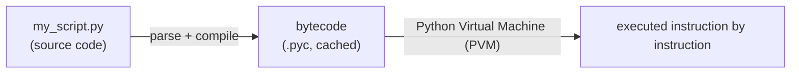

1. **Lexing/Parsing** — source text is turned into an Abstract Syntax Tree (AST).
2. **Compilation** — the AST is compiled into bytecode (viewable with the `dis` module).
3. **Execution** — the PVM, a stack-based interpreter loop inside CPython, executes the bytecode instruction by instruction.

```python
import dis
def add(a, b):
    return a + b
dis.dis(add)
```

Unlike Java's JIT-heavy JVM, CPython's PVM is a straightforward bytecode interpreter with no JIT by default (though projects like PyPy and the newer per-function "specializing adaptive interpreter" in 3.11+ speed this up).

### 6. What is PEP 8, and why does it matter?

**PEP 8** is Python's official style guide (Python Enhancement Proposal #8). It defines conventions for naming (`snake_case` for functions/variables, `PascalCase` for classes, `UPPER_CASE` for constants), indentation (4 spaces, never tabs), line length (79-99 chars depending on team convention), import ordering, and whitespace rules. It matters because Python code is read far more often than it's written, and a shared style eliminates bikeshedding and makes any Python codebase feel familiar. Tools like `black`, `flake8`, and `ruff` enforce it automatically.

### 7. What is PEP 20 (The Zen of Python)?

**PEP 20** is a short list of 19 guiding aphorisms for designing Python and Python code, viewable by running `import this`. Famous lines include "Beautiful is better than ugly," "Explicit is better than implicit," "Simple is better than complex," and "There should be one — and preferably only one — obvious way to do it." It captures the design philosophy behind Python's syntax choices and is often cited in code review to justify preferring clarity over cleverness.

### 8. Is Python interpreted or compiled?

Both, in a sense — this is a common point of confusion. Python source is **compiled to bytecode** (a real compilation step), but that bytecode is then **interpreted** by the PVM rather than compiled to native machine code ahead of time. This puts CPython in the same broad category as the JVM (bytecode + virtual machine), just without a JIT by default. So: "compiled to bytecode, then interpreted" is the precise answer; "interpreted" is the common shorthand because there's no separate build step exposed to the developer the way there is in C++ or Java.

### 9. What is the difference between CPython, a JIT compiler, and an AOT compiler?

- **CPython (interpreter)** — executes bytecode instruction-by-instruction at runtime, recompiling nothing to native code (by default).
- **JIT (Just-In-Time) compiler** — compiles (parts of) the program to native machine code *while the program runs*, often specializing hot code paths based on observed types. PyPy and, partially, CPython 3.13+'s experimental JIT work this way; so does the JVM's HotSpot.
- **AOT (Ahead-Of-Time) compiler** — compiles the entire program to native machine code *before* it runs, as a separate build step. C and C++ compilers (`gcc`, `clang`) work this way.

JIT compilation gives you the flexibility of a dynamic language with speed closer to AOT-compiled code for long-running programs, at the cost of warm-up time and complexity.

### 10. What are the important differences between Python and Java/C++?

| | Python | Java | C++ |
|---|---|---|---|
| Typing | Dynamic | Static | Static |
| Memory management | Automatic (refcount + GC) | Automatic (GC) | Manual (or RAII/smart pointers) |
| Execution | Bytecode + interpreter (PVM) | Bytecode + JVM (JIT) | Compiled to native machine code |
| Concurrency | GIL limits true thread parallelism | True parallel threads | True parallel threads |
| Syntax | Indentation-defined blocks | Braces `{}` | Braces `{}` |
| Compile-time type checking | No (optional via `mypy`) | Yes | Yes |

Python trades raw execution speed and compile-time safety for development speed, readability, and flexibility — which is why it dominates scripting, data science, and rapid prototyping, while Java and C++ remain common in performance-critical or large statically-typed enterprise systems.

---

## Data Types & Variables

### 11. What are the built-in data types in Python?

| Category | Types |
|---|---|
| Numeric | `int`, `float`, `complex`, `bool` |
| Sequence | `str`, `list`, `tuple`, `range` |
| Mapping | `dict` |
| Set | `set`, `frozenset` |
| Binary | `bytes`, `bytearray`, `memoryview` |
| None | `NoneType` (the single value `None`) |

Everything in Python — including functions, classes, and modules — is an **object**, so this list is really "the built-in object types Python provides literal syntax for."

### 12. What is dynamic typing, and how is it different from static typing?

In a **dynamically typed** language like Python, a variable's type is checked at runtime and can change: `x = 5` then `x = "hello"` is perfectly legal — `x` is just a name that currently points to whatever object it was last assigned. In a **statically typed** language like Java or C++, a variable is declared with a fixed type and the compiler rejects assigning an incompatible type before the program ever runs.

```python
x = 5        # x refers to an int
x = "hello"  # now x refers to a str — no error
```

Dynamic typing trades compile-time safety for flexibility; tools like `mypy` and type hints ([Q199](#199-what-are-type-hints-and-why-were-they-introduced)) let you opt into static-style checking without changing the runtime semantics.

### 13. What is duck typing?

"If it walks like a duck and quacks like a duck, it's a duck." Duck typing means Python cares about **what an object can do** (which methods/attributes it has), not **what class it inherits from**. A function that calls `.read()` on its argument will happily accept a file, a `io.StringIO`, or any custom object with a `.read()` method — no shared base class or interface is required.

```python
def process(readable):
    return readable.read()

process(open("file.txt"))       # works
process(io.StringIO("hello"))   # also works — same "shape"
```

This is the philosophical foundation for Python's `Protocol` typing construct ([Q204](#204-what-is-a-protocol-in-the-typing-module-and-how-does-it-relate-to-duck-typing)), which lets you type-check duck typing statically.

### 14. What is the difference between mutable and immutable types?

A **mutable** object's contents can change after creation without changing its identity (`id()`); an **immutable** object's value can never change once created — any "modification" actually creates a new object.

```python
# Immutable
s = "hello"
s += " world"   # creates a NEW string object; s now points to it

# Mutable
lst = [1, 2, 3]
lst.append(4)   # modifies the SAME list object in place
```

Immutable built-ins: `int`, `float`, `str`, `tuple`, `frozenset`, `bytes`. Mutable built-ins: `list`, `dict`, `set`, `bytearray`. This distinction drives hashability ([Q50](#50-what-are-the-requirements-for-an-object-to-be-used-as-a-dictionary-key)), safe default arguments ([Q48](#48-what-is-the-danger-of-using-a-mutable-default-argument-like-a-list)), and thread-safety.

### 15. How does variable assignment work in Python (names vs references)?

Python variables are **names bound to objects**, not boxes that hold values (unlike C/Java primitives). `x = 5` doesn't put `5` "inside" `x` — it makes the name `x` point to an `int` object `5` living somewhere in memory. Assignment (`y = x`) copies the *reference*, not the object.

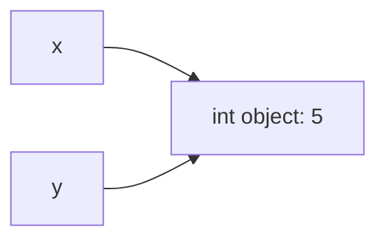

```python
a = [1, 2, 3]
b = a          # b points to the SAME list object as a
b.append(4)
print(a)       # [1, 2, 3, 4] — a sees the change too!
```

This is why copying mutable objects requires an explicit `copy()`/`deepcopy()` ([Q217](#217-what-is-the-difference-between-copycopy-and-copydeepcopy)) rather than plain `=`.

### 16. What is the difference between is and ==?

- **`==`** calls `__eq__` and checks **value equality** — "do these objects represent the same value?"
- **`is`** checks **identity** — "are these literally the same object in memory?" (equivalent to `id(a) == id(b)`)

```python
a = [1, 2, 3]
b = [1, 2, 3]
a == b   # True  — same contents
a is b   # False — two different list objects

c = a
c is a   # True — c and a are the same object
```

Rule of thumb: use `==` for value comparison (the vast majority of the time), and `is` only for identity checks — most idiomatically `x is None`, `x is True`, or comparing against sentinel objects.

### 17. What is object identity, and what does id() return?

Every object in Python has an **identity** — a unique, unchanging value for its lifetime that distinguishes it from all other live objects. `id(obj)` returns that identity as an integer; in CPython specifically, `id()` returns the object's **memory address**, though that's an implementation detail, not a language guarantee. Once an object is garbage collected, its `id()` may be reused by a new object.

```python
x = object()
print(id(x))       # e.g. 140234581920368
print(x is x)       # True — same identity
```

### 18. What is None, and how is it different from null in other languages?

`None` is a singleton object — the sole instance of the `NoneType` class — that represents "no value" or "nothing here." It plays the same conceptual role as `null` in Java or `nullptr` in C++, but with an important difference: **`None` is a real, first-class object**, not a special pointer value. It has an identity, can be checked with `is None`, and can be passed around like any other value.

```python
def find_user(id):
    return None  # explicit "not found"

user = find_user(42)
if user is None:
    print("no user found")
```

Because `None` is a singleton, `is None` (not `== None`) is the idiomatic and PEP 8-recommended check — it's both faster and avoids relying on a custom `__eq__` that might misbehave.

### 19. What is type casting/conversion in Python?

Type casting converts a value from one type to another using built-in constructor functions: `int()`, `float()`, `str()`, `list()`, `tuple()`, `set()`, `bool()`, etc.

```python
int("42")        # 42
float("3.14")     # 3.14
str(100)          # "100"
list("abc")       # ['a', 'b', 'c']
bool(0)           # False
```

Unlike C-style casting, Python's conversion functions actually construct a new object of the target type by calling its constructor — there's no reinterpretation of raw bits.

### 20. What is the difference between implicit and explicit type conversion?

- **Implicit conversion (coercion)** — Python automatically converts one type to another when it's unambiguous and lossless, most commonly promoting `int` to `float` in mixed arithmetic.
- **Explicit conversion (casting)** — you call a conversion function yourself.

```python
# Implicit
result = 5 + 2.0     # int automatically promoted to float -> 7.0

# Explicit
age = int(input("Age: "))   # str -> int, you asked for it
```

Python is deliberately conservative about implicit conversion compared to JavaScript — it will *not* implicitly convert `"5" + 5` (raises `TypeError`), forcing you to be explicit about intent.

---

## Numbers & Operators

### 21. How does Python handle integer overflow?

It doesn't — Python's `int` type has **arbitrary precision**. Unlike C++'s fixed-width `int`/`long` or Java's 32/64-bit integers, Python integers automatically grow to accommodate however large a value becomes, limited only by available memory.

```python
x = 2 ** 1000  # a 302-digit number — no overflow, no error
```

Under the hood, CPython represents large ints as arrays of 30-bit "digits," transparently switching from a fast small-int fast path to this arbitrary-precision representation as numbers grow.

### 22. What is the difference between the / and // operators?

- **`/`** — **true division**, always returns a `float`.
- **`//`** — **floor division**, rounds the result down (toward negative infinity) and returns an `int` if both operands are `int` (a `float` otherwise).

```python
7 / 2    # 3.5
7 // 2   # 3
-7 // 2  # -4  (rounds toward negative infinity, not toward zero!)
```

The `-7 // 2 == -4` behavior (not `-3`) trips up people coming from C/Java, where integer division truncates toward zero.

### 23. Why does is sometimes return True for small integers but not for large ones?

CPython **caches and reuses** integer objects in the range **-5 to 256** at startup (an implementation detail called "small integer caching"). Any two references to a number in that range point to the *same* cached object, so `is` happens to return `True`. Outside that range, each literal typically creates a fresh object.

```python
a = 100
b = 100
a is b        # True — both point to the cached int object for 100

x = 1000
y = 1000
x is y        # False (usually) — two separate objects
```

This is a CPython implementation detail, not a language guarantee — **never rely on `is` for numeric comparison**; always use `==`.

### 24. What is the decimal module used for, and why not always use float?

`float` is a binary floating-point type (IEEE 754 double precision) that **cannot exactly represent most decimal fractions**, causing small rounding errors — a classic gotcha:

```python
0.1 + 0.2          # 0.30000000000000004
```

The `decimal` module provides `Decimal`, an arbitrary-precision decimal type that represents numbers exactly the way humans write them, which matters for **money and financial calculations** where every cent must be exact.

```python
from decimal import Decimal
Decimal("0.1") + Decimal("0.2")   # Decimal('0.3') — exact
```

The tradeoff is performance — `Decimal` arithmetic is significantly slower than native `float` arithmetic.

### 25. What is complex number support in Python?

Python has a built-in `complex` type with literal syntax using `j` for the imaginary unit, plus `.real` and `.imag` attributes and the `cmath` module for complex-specific math functions.

```python
z = 3 + 4j
z.real       # 3.0
z.imag       # 4.0
abs(z)       # 5.0 — magnitude
```

This is niche but occasionally comes up in scientific/engineering interview questions, since not all languages have complex numbers as a first-class built-in type.

### 26. What are Python's operator precedence rules for common operators?

From highest to lowest precedence (abbreviated, most commonly asked about):

1. `()` — parentheses / grouping
2. `**` — exponentiation (right-associative: `2 ** 3 ** 2` is `2 ** (3 ** 2)` = 512)
3. Unary `+x`, `-x`, `~x`
4. `*`, `/`, `//`, `%`
5. `+`, `-` (binary)
6. Comparisons: `<`, `<=`, `>`, `>=`, `!=`, `==`
7. `not`
8. `and`
9. `or`

```python
2 + 3 * 4        # 14, not 20
(2 + 3) * 4      # 20
not True and False   # False -> not binds tighter than and
```

When in doubt, use parentheses for clarity — interviewers often ask this specifically to test whether you'd reach for them.

### 27. What is the walrus operator := and when was it introduced?

The **walrus operator** `:=`, introduced in **Python 3.8** (PEP 572), performs **assignment as part of an expression** — letting you assign and use a value in the same statement, most commonly in a `while` or `if` condition or inside a comprehension.

```python
# Before: read, then check, in two steps
line = input()
while line != "quit":
    process(line)
    line = input()

# With the walrus: assign inside the condition itself
while (line := input()) != "quit":
    process(line)

# Inside a comprehension, avoiding a repeated expensive call
results = [y for x in data if (y := expensive(x)) is not None]
```

It's purely a convenience for avoiding redundant computation or repeated code — it doesn't add new capability, just conciseness.

---

## Strings

### 28. Are strings mutable or immutable in Python?

Strings are **immutable** — once created, a `str` object's contents can never change. Every operation that looks like it "modifies" a string (`.upper()`, `.replace()`, `+=`, slicing) actually **creates and returns a new string object**, leaving the original untouched.

```python
s = "hello"
s.upper()      # returns "HELLO" — a NEW string
print(s)       # still "hello" — unchanged
s = s.upper()  # now s is rebound to the new string
```

Immutability makes strings hashable (usable as dict keys), safe to share across threads, and enables interning ([Q29](#29-what-is-string-interning)).

### 29. What is string interning?

**Interning** is an optimization where CPython stores only **one copy** of certain string objects and reuses it everywhere that string appears, instead of allocating a new object each time. CPython automatically interns string literals that look like identifiers (letters, digits, underscores) and short strings created at compile time; you can force it manually with `sys.intern()`.

```python
a = "hello"
b = "hello"
a is b          # True — usually interned, same object

c = "hello world!"   # contains a space and punctuation
d = "hello world!"
c is d          # not guaranteed — may or may not be interned

import sys
e = sys.intern("hello world!")
f = sys.intern("hello world!")
e is f          # True — explicitly interned
```

Like small-int caching ([Q23](#23-why-does-is-sometimes-return-true-for-small-integers-but-not-for-large-ones)), this is a CPython implementation detail — always compare string *values* with `==`, never rely on `is`.

### 30. What are the different ways to format strings in Python (%-formatting, .format(), f-strings)?

| Method | Syntax | Introduced | Notes |
|---|---|---|---|
| %-formatting | `"Hi %s, you are %d" % (name, age)` | Python 1.x | C-style, legacy, still used for logging |
| `.format()` | `"Hi {}, you are {}".format(name, age)` | Python 2.6 | More flexible, verbose |
| f-strings | `f"Hi {name}, you are {age}"` | Python 3.6 (PEP 498) | Fastest, most readable — the modern default |

```python
name, age = "Ana", 30
f"Hi {name}, you are {age}"          # "Hi Ana, you are 30"
f"{age * 2 = }"                      # "age * 2 = 60"  (debug syntax, 3.8+)
f"{3.14159:.2f}"                     # "3.14" — format spec inline
```

f-strings are preferred in modern code: they're evaluated at parse time (fast), support arbitrary expressions inline, and have a built-in `=` debug specifier since 3.8.

### 31. What is the difference between a str object and a bytes object?

- **`str`** — a sequence of **Unicode code points** (text). Immutable.
- **`bytes`** — a sequence of raw **8-bit integers (0-255)** (binary data). Immutable. (`bytearray` is its mutable counterpart.)

```python
text = "café"                 # str — Unicode text
data = text.encode("utf-8")   # b'caf\xc3\xa9' — bytes, UTF-8 encoded
data.decode("utf-8")          # 'café' — back to str
```

You cannot mix `str` and `bytes` in most operations (`"a" + b"b"` raises `TypeError`) — this strictness is precisely what Python 3 fixed relative to Python 2's ambiguous single `str` type ([Q2](#2-what-is-the-difference-between-python-2-and-python-3)).

### 32. How do you encode and decode strings?

**Encoding** converts a `str` (text) to `bytes` using a specified character encoding; **decoding** does the reverse.

```python
s = "hello 世界"
b = s.encode("utf-8")     # str -> bytes
s2 = b.decode("utf-8")    # bytes -> str
assert s == s2
```

If the bytes don't match the encoding you decode with, you get a `UnicodeDecodeError`. UTF-8 is the near-universal default for text interchange (web, files, APIs) because it's a superset of ASCII and can represent every Unicode character.

### 33. What are some string methods you use frequently?

| Method | Purpose |
|---|---|
| `.strip()` / `.lstrip()` / `.rstrip()` | Remove leading/trailing whitespace (or given chars) |
| `.split(sep)` / `.rsplit()` | Split into a list on a separator |
| `.join(iterable)` | Join an iterable of strings with this string as separator |
| `.replace(old, new)` | Replace all occurrences |
| `.lower()` / `.upper()` / `.title()` | Case conversion |
| `.startswith()` / `.endswith()` | Prefix/suffix checks |
| `.find()` / `.index()` | Locate a substring (`find` returns -1, `index` raises) |
| `.format()` / f-strings | Templating |
| `.isdigit()` / `.isalpha()` / `.isalnum()` | Content checks |

```python
"  hello world  ".strip().title().split()   # ['Hello', 'World']
```

### 34. Why should you avoid string concatenation with + in a loop?

Because strings are **immutable**, `result += chunk` inside a loop creates a **brand-new string object on every iteration**, copying all previously accumulated characters each time — turning an O(n) task into O(n²) overall.

```python
# Bad: O(n^2) — a new string object built every iteration
result = ""
for chunk in parts:
    result += chunk

# Good: O(n) — build a list, join once at the end
result = "".join(parts)
```

`str.join()` computes the total length up front and allocates the final buffer exactly once, which is why it's the idiomatic and dramatically faster approach for accumulating many pieces.

### 35. What is the difference between join() and + for concatenation?

- **`+`** creates a new string for *each* concatenation — fine for a couple of strings, wasteful in a loop ([Q34](#34-why-should-you-avoid-string-concatenation-with-in-a-loop)).
- **`"".join(iterable)`** builds the final string in a single pass, computing the total size once — the idiomatic way to combine many strings.

```python
"-".join(["2024", "01", "15"])   # "2024-01-15"
"a" + "-" + "b" + "-" + "c"      # fine for a handful of literals
```

Rule of thumb: use `+`/f-strings for a small, fixed number of pieces; use `.join()` whenever you're combining strings from a loop or a collection.

### 36. What are raw strings, and when do you use them?

A **raw string**, prefixed with `r`, tells Python to treat backslashes as literal characters instead of escape-sequence introducers. It's essential for regular expressions and Windows file paths, where backslashes are common and you don't want `\n`, `\t`, etc. accidentally interpreted.

```python
path = r"C:\Users\name\notes.txt"     # backslashes stay literal
pattern = r"\d+\.\d+"                 # regex: digits, dot, digits — no need to double-escape
```

Without the `r` prefix, `"C:\Users\name"` would misinterpret `\U` and `\n` as escape sequences and either raise an error or produce a mangled string.

### 37. How do you reverse a string in Python?

The idiomatic way is **extended slicing** with a step of `-1`:

```python
s = "hello"
s[::-1]           # "olleh"

"".join(reversed(s))   # also "olleh" — reversed() returns an iterator
```

`s[::-1]` is preferred for readability and speed (it's implemented in C and creates the reversed string directly), while `reversed()` is more general — it works on any sequence, not just strings, and returns a lazy iterator rather than a new string.

---

## Lists & Tuples

### 38. What is the difference between a list and a tuple?

| | `list` | `tuple` |
|---|---|---|
| Mutability | Mutable | Immutable |
| Syntax | `[1, 2, 3]` | `(1, 2, 3)` |
| Use case | Homogeneous collections that change | Fixed-size records, function returns |
| Hashable | No | Yes (if all elements are hashable) |
| Performance | Slightly slower to create | Slightly faster, less memory overhead |

```python
point_list = [3, 4]     # could accidentally be mutated
point_tuple = (3, 4)    # signals "this is a fixed pair, don't touch it"
```

A good mental model: use a **tuple** for a fixed-shape record (like a database row or a coordinate pair) where each position has a distinct meaning, and a **list** for a variable-length collection of similar items.

### 39. Why are tuples generally faster than lists?

Tuples are immutable, so CPython can:

- **Allocate exactly the memory needed** at creation time — no extra capacity reserved for future growth (unlike lists, see [Q43](#43-how-does-python-implement-dynamic-list-resizing-internally)).
- **Cache small tuples** — CPython reuses some tuple objects internally, similar to small-int caching.
- **Skip mutation bookkeeping** — no need to support `.append()`, `.remove()`, resizing, etc.

The practical difference is modest for most workloads, but it compounds when creating millions of small fixed-size records — which is also why tuples are the more memory-efficient choice as dictionary keys or in tight loops.

### 40. What is the difference between a shallow copy and a deep copy?

- **Shallow copy** — creates a new outer container, but the elements inside still **reference the same nested objects** as the original.
- **Deep copy** — recursively copies the outer container **and every nested object**, so the two structures share nothing.

```python
import copy
original = [[1, 2], [3, 4]]

shallow = copy.copy(original)
shallow[0].append(99)
print(original)   # [[1, 2, 99], [3, 4]] — inner list was shared!

deep = copy.deepcopy(original)
deep[0].append(100)
print(original)   # unaffected — deep copy owns its own nested lists
```

Full details and a diagram are in [Q217](#217-what-is-the-difference-between-copycopy-and-copydeepcopy).

### 41. How do list slicing operations work?

Slicing uses `list[start:stop:step]`, all optional, and never raises `IndexError` even with out-of-range indices — it just clamps to the list's bounds.

```python
nums = [0, 1, 2, 3, 4, 5, 6, 7, 8, 9]
nums[2:5]      # [2, 3, 4]      — indices 2, 3, 4 (stop excluded)
nums[:3]       # [0, 1, 2]      — start defaults to 0
nums[7:]       # [7, 8, 9]      — stop defaults to len(list)
nums[::2]      # [0, 2, 4, 6, 8] — every other element
nums[::-1]     # reversed list
nums[100:200]  # []             — out of range, no error
```

Slicing always returns a **new list** (a shallow copy of the selected range) — the original is never modified unless you assign to the slice: `nums[1:3] = [10, 20]`.

### 42. What is the time complexity of common list operations?

| Operation | Complexity | Why |
|---|---|---|
| `lst[i]` (index) | O(1) | Contiguous array, direct offset |
| `lst.append(x)` | O(1) amortized | Over-allocated capacity ([Q43](#43-how-does-python-implement-dynamic-list-resizing-internally)) |
| `lst.pop()` (from end) | O(1) | No shifting needed |
| `lst.pop(0)` / `lst.insert(0, x)` | O(n) | Every element must shift |
| `x in lst` | O(n) | Linear scan |
| `lst.sort()` | O(n log n) | Timsort |
| `len(lst)` | O(1) | Length is cached, not counted |

The key takeaway: lists are great for appends/pops at the **end** and for indexed access, but bad for insert/remove at the **front** — use `collections.deque` ([Q181](#181-what-is-collectionsdeque-and-why-is-it-faster-than-a-list-for-queue-operations)) if you need that.

### 43. How does Python implement dynamic list resizing internally?

A CPython list is a dynamic array: it stores a pointer to a block of memory that's often **larger than currently needed**. When `.append()` exceeds the current capacity, CPython allocates a new, larger block (roughly 1.125x the old size, plus a small constant) and copies every existing pointer over.

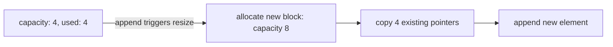

Because over-allocation means most appends **don't** trigger a resize, `.append()` is **O(1) amortized** — occasional expensive O(n) resizes are averaged out over many cheap O(1) appends.

### 44. What is a named tuple, and why use one?

`collections.namedtuple` (or `typing.NamedTuple`) creates a tuple subclass where fields can be accessed **by name** as well as by index — giving you the memory efficiency and immutability of a tuple with the readability of a class.

```python
from collections import namedtuple
Point = namedtuple("Point", ["x", "y"])
p = Point(3, 4)
p.x, p.y      # 3, 4 — readable
p[0], p[1]    # 3, 4 — still works as a regular tuple

# Modern alternative with type hints:
from typing import NamedTuple
class Point(NamedTuple):
    x: int
    y: int
```

Use it instead of a plain tuple whenever field meaning isn't obvious from position alone, and instead of a full class when you just need an immutable, lightweight record with no behavior.

### 45. What is list comprehension, and how is it different from map/filter?

A **list comprehension** is concise syntax for building a list by applying an expression to each item of an iterable, optionally filtering:

```python
squares = [x**2 for x in range(10)]
evens = [x for x in range(20) if x % 2 == 0]

# Equivalent using map/filter:
squares = list(map(lambda x: x**2, range(10)))
evens = list(filter(lambda x: x % 2 == 0, range(20)))
```

Comprehensions are generally preferred in Python because they read left-to-right like natural language and avoid the overhead of a `lambda` call for simple expressions; `map`/`filter` remain useful when you already have a named function to pass, or when working lazily (see [Q144](#144-how-do-comprehensions-compare-to-mapfilter-in-performance-and-readability)).

### 46. What is the difference between append() and extend()?

- **`.append(x)`** adds `x` as a **single element** to the end of the list — even if `x` is itself a list.
- **`.extend(iterable)`** adds **each element** of the iterable to the end of the list individually.

```python
a = [1, 2]
a.append([3, 4])
print(a)   # [1, 2, [3, 4]] — the whole list added as ONE element

b = [1, 2]
b.extend([3, 4])
print(b)   # [1, 2, 3, 4] — each element added separately
```

A very common interview gotcha: using `.append()` when you meant `.extend()` silently produces a nested list instead of a flat one.

### 47. How do you remove duplicates from a list while preserving order?

The most common approach uses `dict.fromkeys()`, which relies on dicts preserving insertion order since Python 3.7 ([Q52](#52-how-has-dictionary-ordering-changed-across-python-versions)):

```python
items = [3, 1, 2, 3, 1, 4]
unique = list(dict.fromkeys(items))
print(unique)   # [3, 1, 2, 4] — order preserved
```

If order doesn't matter, `list(set(items))` is simpler but does not guarantee any particular ordering. For custom objects that aren't hashable, you'd track "seen" items manually with a list and an `in` check (O(n²)) or make the objects hashable first.

### 48. What is the danger of using a mutable default argument like a list?

Default argument values are evaluated **once**, when the function is *defined* — not each time it's called. If the default is a mutable object like a list, **every call that doesn't pass its own argument shares the same object**, and mutations persist across calls.

```python
def add_item(item, bucket=[]):   # DANGER: shared across all calls!
    bucket.append(item)
    return bucket

add_item("a")   # ['a']
add_item("b")   # ['a', 'b']  <- unexpected! same list reused
```

**Fix:** use `None` as the sentinel default and create a fresh mutable object inside the function body:

```python
def add_item(item, bucket=None):
    if bucket is None:
        bucket = []
    bucket.append(item)
    return bucket
```

This is one of the most commonly asked Python "gotcha" interview questions.

---

## Dictionaries & Sets

### 49. How does a Python dictionary work internally (hash table)?

A `dict` is a **hash table**. Each key is passed through `hash()` to get an integer, which is used (modulo the table size) to pick a slot for storing the key-value pair. Looking up a key re-hashes it and jumps directly to that slot, avoiding a linear scan through every entry.

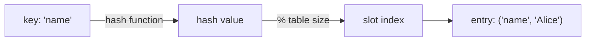

Since CPython 3.6 (guaranteed in 3.7+), dicts also maintain a **separate compact array** recording insertion order, which is why iterating a dict yields keys in the order they were inserted ([Q52](#52-how-has-dictionary-ordering-changed-across-python-versions)).

### 50. What are the requirements for an object to be used as a dictionary key?

A dictionary key must be **hashable**, which in practice means:

1. It implements `__hash__()` (returning the same hash value for its entire lifetime).
2. It implements `__eq__()` consistently with `__hash__()` — equal objects must have equal hashes ([Q92](#92-what-is-__hash__-and-why-must-it-be-consistent-with-__eq__)).
3. It's effectively **immutable** — mutable built-ins (`list`, `dict`, `set`) explicitly disable `__hash__` to prevent using an object as a key and then changing it (which would corrupt the hash table).

```python
d = {}
d[(1, 2)] = "ok"        # tuple — hashable, works
d["key"] = "ok"          # str — hashable, works
d[[1, 2]] = "fail"       # TypeError: unhashable type: 'list'
```

### 51. What is the difference between dict.get() and dict[key]?

- **`dict[key]`** raises a `KeyError` if the key doesn't exist.
- **`dict.get(key, default)`** returns `default` (or `None` if unspecified) instead of raising.

```python
d = {"a": 1}
d["b"]           # KeyError!
d.get("b")        # None
d.get("b", 0)     # 0
```

Use `[]` when a missing key genuinely represents a bug you want surfaced immediately; use `.get()` when a missing key is an expected, normal case.

### 52. How has dictionary ordering changed across Python versions?

- **Python < 3.6:** dict order was **unspecified** — effectively arbitrary and could vary between runs.
- **Python 3.6:** insertion-order preservation became true as a side effect of a memory-optimization to the dict implementation, but was officially an **implementation detail**, not guaranteed.
- **Python 3.7+:** insertion-order preservation became a **guaranteed language feature** (documented in the language spec), meaning `for k in d` always yields keys in the order they were first inserted.

```python
d = {}
d["z"] = 1
d["a"] = 2
list(d.keys())   # ['z', 'a'] — insertion order, guaranteed since 3.7
```

Note: this is **insertion order**, not sorted order — if you need sorted keys, use `sorted(d)` or a `SortedDict` from a third-party library.

### 53. What is a set, and how is it different from a list?

A `set` is an **unordered collection of unique, hashable elements**, backed by a hash table (like a dict with only keys, no values). Unlike a list, sets don't support indexing or duplicate elements, but membership testing and deduplication are much faster.

```python
s = {1, 2, 3, 2, 1}
print(s)          # {1, 2, 3} — duplicates automatically removed

3 in s            # O(1) average — vs O(n) for `3 in some_list`
```

| | `list` | `set` |
|---|---|---|
| Order | Preserved | Not preserved |
| Duplicates | Allowed | Not allowed |
| Membership test | O(n) | O(1) average |
| Indexing (`s[0]`) | Yes | No |

### 54. What is a frozenset?

`frozenset` is the **immutable counterpart to set** — same hash-table-backed unique-elements behavior, but once created it cannot be modified, which makes it **hashable** and therefore usable as a dictionary key or as an element inside another set (a regular `set` cannot contain itself in another set, since `set` is unhashable).

```python
fs = frozenset([1, 2, 3])
fs.add(4)          # AttributeError — frozensets have no mutating methods

cache = {frozenset([1, 2]): "pair"}   # valid — frozenset as a dict key
```

### 55. How do you merge two dictionaries?

Several approaches, depending on Python version and whether you want a new dict or to mutate one in place:

```python
a = {"x": 1, "y": 2}
b = {"y": 20, "z": 3}

merged = {**a, **b}          # unpacking — b's values win on key conflicts
merged = a | b                 # PEP 584, Python 3.9+ — merge operator
a |= b                         # in-place merge, Python 3.9+
merged = dict(a, **b)          # older idiom
a.update(b)                    # mutates a in place
```

In every case, when the same key exists in both dicts, the value from the **second** (or right-hand / later-applied) dict wins.

### 56. What is a defaultdict, and when do you use it?

`collections.defaultdict` is a dict subclass that **auto-creates a default value** for any missing key the first time it's accessed, using a factory function you supply — eliminating repetitive `if key not in d` checks.

```python
from collections import defaultdict

# Without defaultdict
counts = {}
for word in words:
    counts[word] = counts.get(word, 0) + 1

# With defaultdict
counts = defaultdict(int)
for word in words:
    counts[word] += 1     # missing key auto-initialized to int() == 0

groups = defaultdict(list)
groups["fruit"].append("apple")   # no need to check if "fruit" exists first
```

Common factories: `int` (counting), `list` (grouping), `set` (grouping unique values).

### 57. What is the time complexity of dict/set lookups, and why?

**O(1) average case**, **O(n) worst case**, for lookup, insert, and delete. The average case comes from the hash table structure: `hash(key)` computes a slot directly, so lookup doesn't need to scan every entry the way a list search does. The worst case only shows up under pathological hash collisions (many different keys hashing to the same slot), which is rare in practice and actively defended against — CPython randomizes string hashing per-process (`PYTHONHASHSEED`) specifically to prevent an attacker from engineering collisions (hash-flooding denial-of-service attacks).

### 58. How do dictionaries handle hash collisions?

CPython dicts use **open addressing**: when two keys hash to the same slot, the table computes an alternate ("probe") slot using a pseudo-random probing sequence derived from the hash, and keeps probing until it finds an empty slot (for insertion) or the matching key (for lookup).

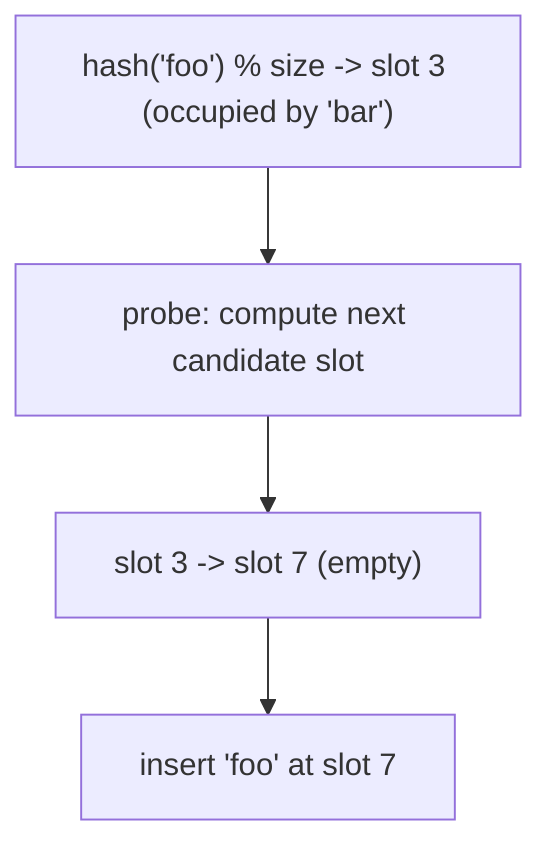

This differs from **chaining** (used by, e.g., Java's `HashMap`), where each slot holds a linked list of all entries that hash there. Open addressing keeps everything in one contiguous array, which is more cache-friendly — one reason CPython dicts are fast in practice.

---

## Object Oriented Programming Basics

### 59. What is a class and an object in Python?

A **class** is a blueprint that defines attributes (data) and methods (behavior) shared by all its instances. An **object** (instance) is a concrete realization of that blueprint, with its own independent copy of the instance attributes. In Python, *everything* is an object — including classes themselves, which are instances of `type` ([Q79](#79-what-is-a-metaclass-and-how-does-type-relate-to-classes)).

```python
class Dog:
    def __init__(self, name):
        self.name = name

    def bark(self):
        return f"{self.name} says Woof!"

rex = Dog("Rex")   # rex is an object/instance of class Dog
rex.bark()          # "Rex says Woof!"
```

### 60. How do you define a class and create an instance?

Use the `class` keyword, define `__init__` for setup, and call the class like a function to create instances:

```python
class Car:
    wheels = 4                     # class variable, shared

    def __init__(self, make, model):
        self.make = make            # instance variable, per-object
        self.model = model

    def describe(self):
        return f"{self.make} {self.model}"

my_car = Car("Toyota", "Corolla")   # instantiation
print(my_car.describe())             # "Toyota Corolla"
```

Calling `Car(...)` triggers `Car.__new__` (allocates the object) then `Car.__init__` (initializes it) — see [Q80](#80-what-is-the-difference-between-__new__-and-__init__).

### 61. What is self, and why is it explicitly passed?

`self` is the **conventional name** (not a keyword) for the first parameter of every instance method — it refers to the specific instance the method was called on. Python requires it explicitly (unlike Java/C++'s implicit `this`) because of how method calls are implemented: `obj.method(arg)` is syntactic sugar for `ClassName.method(obj, arg)` — the instance is just the first positional argument, made automatically by the attribute-lookup-and-bind machinery.

```python
class Counter:
    def __init__(self):
        self.count = 0
    def increment(self):
        self.count += 1     # self refers to whichever instance called this

c = Counter()
c.increment()        # really: Counter.increment(c)
```

This explicitness is a deliberate design choice ("explicit is better than implicit" — [Q7](#7-what-is-pep-20-the-zen-of-python)) that makes it unambiguous which object's attributes a method is reading or modifying.

### 62. What is the __init__ method?

`__init__` is the **initializer** — a dunder method automatically called right after a new instance is created, used to set up the instance's starting state (typically assigning arguments to `self` attributes). It's often loosely called "the constructor," but technically `__new__` is what constructs the object; `__init__` just initializes it ([Q80](#80-what-is-the-difference-between-__new__-and-__init__)).

```python
class Point:
    def __init__(self, x=0, y=0):
        self.x = x
        self.y = y

p = Point(3, 4)   # __init__ runs automatically, setting p.x=3, p.y=4
```

`__init__` should not `return` anything other than `None` — Python raises a `TypeError` if it does.

### 63. What is the difference between class variables and instance variables?

- **Class variables** are defined directly in the class body and **shared by all instances** — there's one copy, attached to the class object itself.
- **Instance variables** are defined inside methods (typically `__init__`) via `self.attr = value` and are **unique to each instance**.

```python
class Employee:
    company = "Acme"          # class variable — shared

    def __init__(self, name):
        self.name = name       # instance variable — per-object

e1 = Employee("Alice")
e2 = Employee("Bob")
e1.company                     # "Acme"
Employee.company = "NewCo"     # changes it for ALL instances
e1.company                     # "NewCo"
e1.name                        # "Alice" — unaffected, it's instance-level
```

**Gotcha:** `e1.company = "X"` does **not** modify the class variable — it creates a new *instance* attribute on `e1` that shadows the class variable, leaving `e2.company` unaffected. This is the same underlying mechanism as the mutable-default-argument trap ([Q48](#48-what-is-the-danger-of-using-a-mutable-default-argument-like-a-list)) when the class variable itself is mutable (e.g. a shared list).

### 64. What is encapsulation in Python, and how is it achieved (name mangling)?

Encapsulation means bundling data and the methods that operate on it, and restricting direct access to internal state. Python doesn't have true `private`/`protected` access modifiers like Java/C++ — it relies on **naming conventions** instead:

| Prefix | Convention | Enforcement |
|---|---|---|
| `name` | Public | None — freely accessible |
| `_name` | "Protected" — internal use, please don't touch | None — just a hint to other developers |
| `__name` | "Private" — triggers **name mangling** | Renamed to `_ClassName__name` to avoid accidental override in subclasses |

```python
class Account:
    def __init__(self, balance):
        self.__balance = balance   # becomes self._Account__balance

    def get_balance(self):
        return self.__balance

a = Account(100)
a.__balance           # AttributeError — not found under this name
a._Account__balance   # 100 — still technically accessible!
```

Name mangling prevents accidental collisions in inheritance hierarchies, but "we're all consenting adults here" is a common Python philosophy — nothing is truly unreachable, it's convention-enforced, not compiler-enforced.

### 65. What is inheritance, and how do you implement it in Python?

Inheritance lets a class (the **subclass**/**derived class**) reuse and extend the attributes and methods of another class (the **superclass**/**base class**), expressed by listing the parent class in parentheses after the class name.

```python
class Animal:
    def __init__(self, name):
        self.name = name
    def speak(self):
        return "..."

class Dog(Animal):              # Dog inherits from Animal
    def speak(self):             # overrides Animal.speak
        return f"{self.name} says Woof!"

d = Dog("Rex")
d.speak()          # "Rex says Woof!" — Dog's own version
isinstance(d, Animal)   # True — a Dog IS an Animal
```

### 66. What is method overriding?

Method overriding is when a subclass defines a method with the **same name** as one in its parent class, replacing the parent's behavior when called on an instance of the subclass. It's the mechanism behind runtime polymorphism ([Q71](#71-what-is-polymorphism-in-python)).

```python
class Shape:
    def area(self):
        raise NotImplementedError

class Circle(Shape):
    def __init__(self, r):
        self.r = r
    def area(self):              # overrides Shape.area
        return 3.14159 * self.r ** 2
```

You can still call the parent's version explicitly with `super().area()` if you want to extend rather than fully replace the behavior.

### 67. Does Python support method overloading?

**Not in the traditional C++/Java sense** — Python does not let you define multiple methods with the same name but different parameter signatures; the *last* definition simply overwrites earlier ones in the class namespace.

```python
class Example:
    def greet(self, name):
        return f"Hello {name}"
    def greet(self, name, greeting):    # this REPLACES the one above
        return f"{greeting} {name}"

Example().greet("Bob")   # TypeError — the first greet() no longer exists
```

Python achieves overloading-like flexibility through **default arguments**, `*args`/`**kwargs`, or the `functools.singledispatch` decorator (which dispatches based on the type of the first argument) instead.

### 68. What is multiple inheritance, and how does Python handle it?

Multiple inheritance lets a class inherit from **more than one** base class simultaneously — something Java and C++ (for classes) don't support directly. Python resolves method/attribute lookups across multiple parents using the **Method Resolution Order** ([Q69](#69-what-is-the-method-resolution-order-mro-and-what-algorithm-does-python-use)).

```python
class Flyer:
    def move(self):
        return "flies"

class Swimmer:
    def move(self):
        return "swims"

class Duck(Flyer, Swimmer):    # inherits from BOTH
    pass

Duck().move()   # "flies" — Flyer comes first in the MRO
```

This is powerful for **mixins** ([Q78](#78-what-is-a-mixin-class)) but can get confusing fast if base classes define conflicting methods — always check `ClassName.__mro__` when in doubt.

### 69. What is the Method Resolution Order (MRO), and what algorithm does Python use?

The **MRO** is the linear order in which Python searches base classes when resolving an attribute or method, used whenever there's ambiguity from (multiple) inheritance. Python uses the **C3 linearization** algorithm, which guarantees: a class always appears before its parents, and the relative order of parents (as listed in the class definition) is preserved.

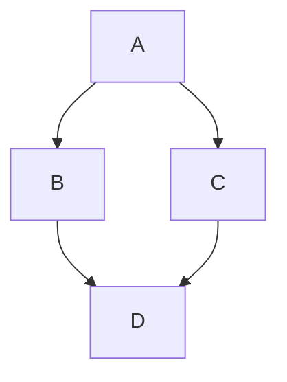

```python
class A: pass
class B(A): pass
class C(A): pass
class D(B, C): pass

D.__mro__
# (D, B, C, A, object) — C3 linearization of the "diamond"
```

This solves the classic **diamond problem**: `D` sees `B`'s version of a method before `C`'s, and both before `A`'s, in a single well-defined, consistent order — unlike C++, which requires you to manually disambiguate with virtual inheritance.

### 70. What is super(), and how does it work with the MRO?

`super()` returns a **proxy object** that delegates method calls to the *next* class in the current instance's MRO — not necessarily the "parent class" in a naive sense, but whichever class comes next in the linearized order. This is what makes cooperative multiple inheritance work correctly.

```python
class Base:
    def greet(self):
        print("Base greet")

class Mixin:
    def greet(self):
        print("Mixin greet")

class Child(Base, Mixin):
    def greet(self):
        super().greet()   # calls Base.greet (next in MRO), not necessarily "the parent"
        print("Child greet")

Child().greet()
# Base greet
# Child greet
```

Using `super()` instead of hardcoding `Base.greet(self)` means the call correctly follows the MRO even in complex multi-inheritance hierarchies, and lets a whole chain of classes cooperatively call each other's overridden methods in sequence.

---

## Advanced OOP Concepts

### 71. What is polymorphism in Python?

Polymorphism ("many forms") means the same operation (method name, function, or operator) behaves differently depending on the object it's applied to. Python supports this very naturally through duck typing ([Q13](#13-what-is-duck-typing)) — no shared base class is even required, unlike statically typed languages where polymorphism usually flows through inheritance/interfaces.

```python
class Cat:
    def speak(self): return "Meow"
class Dog:
    def speak(self): return "Woof"

for animal in [Cat(), Dog()]:
    print(animal.speak())   # works for both — same call, different behavior
```

`len()` is a built-in example: it calls `__len__` under the hood, so it works polymorphically on `str`, `list`, `dict`, or any custom object that defines `__len__` ([Q87](#87-what-is-__len__-and-when-is-it-used)).

### 72. What is an abstract class, and how do you create one using the abc module?

An **abstract class** cannot be instantiated directly — it exists to define a required interface that subclasses must implement. Python provides this via the `abc` module: inherit from `ABC` and mark methods with `@abstractmethod`.

```python
from abc import ABC, abstractmethod

class Shape(ABC):
    @abstractmethod
    def area(self):
        ...

class Circle(Shape):
    def __init__(self, r):
        self.r = r
    def area(self):
        return 3.14159 * self.r ** 2

Shape()      # TypeError — Can't instantiate abstract class Shape
Circle(2)     # works — implements the required area() method
```

If a subclass fails to override every `@abstractmethod`, instantiating it also raises `TypeError` — this enforces the contract at instantiation time.

### 73. What is an interface in Python, and how is it simulated?

Python has no dedicated `interface` keyword. The concept is simulated two ways:

1. **Abstract base classes** ([Q72](#72-what-is-an-abstract-class-and-how-do-you-create-one-using-the-abc-module)) — a class with only abstract methods, defining a contract subclasses must fulfill (nominal typing — you must explicitly inherit).
2. **`typing.Protocol`** ([Q204](#204-what-is-a-protocol-in-the-typing-module-and-how-does-it-relate-to-duck-typing)) — defines a shape (structural typing) that any class satisfies just by having matching methods, with no explicit inheritance required, closer to duck typing.

```python
from abc import ABC, abstractmethod
class Drawable(ABC):
    @abstractmethod
    def draw(self): ...
```

Choose ABCs when you want to *enforce* a contract at runtime; choose `Protocol` when you want static type checking without forcing unrelated classes into an inheritance hierarchy.

### 74. What is the difference between a static method, a class method, and an instance method?

| | Decorator | First parameter | Can access instance state? | Can access class state? |
|---|---|---|---|---|
| Instance method | (none) | `self` | Yes | Yes (via `self.__class__` or `type(self)`) |
| Class method | `@classmethod` | `cls` | No | Yes |
| Static method | `@staticmethod` | (none) | No | No |

```python
class Pizza:
    total_made = 0

    def __init__(self, size):
        self.size = size
        Pizza.total_made += 1

    def describe(self):                    # instance method
        return f"A {self.size} pizza"

    @classmethod
    def from_string(cls, s):                # class method — alternate constructor
        size = s.split(":")[1]
        return cls(size)

    @staticmethod
    def is_valid_size(size):                 # static method — pure utility
        return size in ("small", "medium", "large")
```

Use `@classmethod` for alternate constructors (like `dict.fromkeys`); use `@staticmethod` for a utility function that's logically grouped with the class but needs neither `self` nor `cls`.

### 75. What is a property, and how do you use @property?

`@property` turns a method into something that's **accessed like an attribute** (no parentheses), letting you run code on attribute access while keeping a clean, attribute-style API — no need to change every caller if you later add validation.

```python
class Temperature:
    def __init__(self, celsius):
        self._celsius = celsius

    @property
    def fahrenheit(self):
        return self._celsius * 9/5 + 32

    @fahrenheit.setter
    def fahrenheit(self, value):
        self._celsius = (value - 32) * 5/9

t = Temperature(25)
t.fahrenheit          # 77.0 — looks like an attribute, runs a computation
t.fahrenheit = 100     # invokes the setter, updates self._celsius
```

This lets you start with plain attributes and later add validation/computed logic **without breaking the public API** — callers never notice the switch from a plain attribute to a property.

### 76. What are getters and setters in Python, and why are they usually unnecessary?

Getters/setters are methods (`get_x()`/`set_x()`) used in languages like Java to control attribute access, because Java can't retrofit validation onto a plain public field without breaking every caller. In Python, you start with a **plain public attribute** and only introduce `@property` getters/setters *later*, if and when you actually need validation or computed behavior — because `@property` is syntactically identical to a plain attribute from the caller's side ([Q75](#75-what-is-a-property-and-how-do-you-use-property)).

```python
# Pythonic — start simple
class Point:
    def __init__(self, x):
        self.x = x   # plain attribute, no boilerplate getter/setter needed

# Only add @property later if validation becomes necessary — callers don't change
```

Writing `get_x()`/`set_x()` boilerplate upfront "just in case" is considered un-Pythonic — YAGNI ("You Aren't Gonna Need It") applies directly here.

### 77. What is composition vs inheritance?

- **Inheritance** ("is-a") — a subclass extends a superclass, inheriting its interface and implementation.
- **Composition** ("has-a") — a class contains an instance of another class as an attribute and delegates work to it, rather than inheriting from it.

```python
# Inheritance: a Car IS-A Vehicle
class Vehicle: ...
class Car(Vehicle): ...

# Composition: a Car HAS-A Engine
class Engine:
    def start(self): return "vroom"

class Car:
    def __init__(self):
        self.engine = Engine()     # composition
    def start(self):
        return self.engine.start()
```

The common guidance "favor composition over inheritance" reflects that composition is more flexible (swap the `Engine` at runtime, no fragile deep hierarchies) and avoids tightly coupling unrelated behaviors just because they happen to share a superclass.

### 78. What is a mixin class?

A **mixin** is a small class designed to be combined with others via multiple inheritance ([Q68](#68-what-is-multiple-inheritance-and-how-does-python-handle-it)) to add a specific, reusable chunk of behavior — it's never meant to be instantiated on its own.

```python
class JSONMixin:
    def to_json(self):
        import json
        return json.dumps(self.__dict__)

class LoggingMixin:
    def log(self, msg):
        print(f"[{self.__class__.__name__}] {msg}")

class User(JSONMixin, LoggingMixin):
    def __init__(self, name):
        self.name = name

u = User("Alice")
u.to_json()          # '{"name": "Alice"}'
u.log("created")      # "[User] created"
```

Mixins let you compose orthogonal capabilities (serialization, logging, comparison) into a class without building a deep, rigid inheritance tree for each combination.

### 79. What is a metaclass, and how does type relate to classes?

A **metaclass** is "the class of a class" — it controls how classes themselves are created, the same way a class controls how its instances are created. The default metaclass for every class is `type`.


```python
class MyClass:
    pass

type(MyClass)          # <class 'type'> — MyClass is itself an instance of type
isinstance(MyClass, type)  # True

# type() can also DEFINE a class dynamically:
MyClass2 = type("MyClass2", (), {"x": 1})

# A custom metaclass hooks into class creation:
class Meta(type):
    def __new__(mcs, name, bases, ns):
        print(f"Creating class {name}")
        return super().__new__(mcs, name, bases, ns)

class Foo(metaclass=Meta):     # prints "Creating class Foo" at DEFINITION time
    pass
```

Metaclasses are an advanced, rarely-needed tool used mostly by frameworks (Django's ORM, `ABCMeta`, `dataclasses`-like libraries) to auto-register classes, validate class definitions, or inject behavior at class-creation time.

### 80. What is the difference between __new__ and __init__?

- **`__new__(cls, ...)`** — a **static method** (implicitly) that actually **creates and returns** the new instance. Called first.
- **`__init__(self, ...)`** — called on the already-created instance to **initialize its state**. Returns `None`.

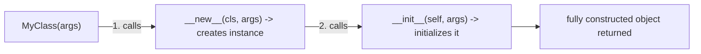

```python
class Singleton:
    _instance = None
    def __new__(cls):
        if cls._instance is None:
            cls._instance = super().__new__(cls)   # controls INSTANCE CREATION
        return cls._instance
```

You almost never need to override `__new__` — it's reserved for rare cases like implementing singletons, or subclassing immutable types (`str`, `tuple`, `int`) where the value must be set at creation time, before `__init__` would normally run.

### 81. What is monkey patching, and what are its risks?

**Monkey patching** is modifying or extending a class or module **at runtime**, from outside its original definition — Python allows this freely because classes and modules are just mutable objects.

```python
class Dog:
    def bark(self):
        return "Woof"

def silent_bark(self):
    return "..."

Dog.bark = silent_bark    # monkey patch — replaces the method on the class itself
Dog().bark()               # "..." — even for objects defined before the patch
```

**Risks:** it's implicit and non-local — a patch applied in one file silently changes behavior everywhere else that class is used, making bugs very hard to trace. It's commonly used (carefully) in testing to substitute real dependencies with fakes, but is generally discouraged in production code in favor of explicit composition or dependency injection.

### 82. What are __slots__, and why would you use them?

By default, every instance carries a `__dict__` for storing arbitrary attributes, which is flexible but has real memory overhead — especially when you create millions of small objects. `__slots__` declares a **fixed set of allowed attribute names**, telling Python to skip creating a `__dict__` per instance and use a more compact fixed-size storage layout instead.

```python
class Point:
    __slots__ = ("x", "y")     # only x and y are allowed
    def __init__(self, x, y):
        self.x = x
        self.y = y

p = Point(1, 2)
p.z = 3        # AttributeError — z is not in __slots__
```

Benefits: significantly lower memory usage per instance and slightly faster attribute access. Tradeoffs: no dynamic attributes, no default `__weakref__` support (unless explicitly added to `__slots__`), and multiple inheritance with slotted classes gets tricky. Use it when you'll be creating large numbers of instances of a simple, fixed-shape class.

---

## Magic / Dunder Methods

### 83. What are dunder (magic) methods, and why are they useful?

**Dunder** ("double underscore") methods like `__init__`, `__str__`, `__len__`, and `__add__` are special hooks that let your custom classes integrate with Python's built-in syntax and functions — operators, `len()`, `for` loops, `with` statements, and more. They're the mechanism behind Python's **data model**: instead of every type needing special-cased support in the interpreter, any object that implements the right dunder methods gets to participate in the same generic syntax.

```python
class Vector:
    def __init__(self, x, y):
        self.x, self.y = x, y
    def __add__(self, other):        # enables the + operator
        return Vector(self.x + other.x, self.y + other.y)
    def __repr__(self):               # enables print()/repr()
        return f"Vector({self.x}, {self.y})"

Vector(1, 2) + Vector(3, 4)   # Vector(4, 6) — + just works
```

### 84. What is the difference between __str__ and __repr__?

- **`__repr__`** — an unambiguous, ideally **developer-facing** representation; the goal is that `eval(repr(obj))` could recreate the object, or at minimum it's precise enough for debugging. Used by the REPL, `repr()`, and as the fallback for `print()` if `__str__` isn't defined.
- **`__str__`** — a readable, **user-facing** representation. Used by `print()`, `str()`, and f-string interpolation, when defined.

```python
class Point:
    def __init__(self, x, y):
        self.x, self.y = x, y
    def __repr__(self):
        return f"Point(x={self.x}, y={self.y})"   # precise, debug-friendly
    def __str__(self):
        return f"({self.x}, {self.y})"             # friendly display

p = Point(1, 2)
print(p)        # (1, 2)              -> uses __str__
p                # Point(x=1, y=2)    -> uses __repr__ (in REPL)
repr(p)          # "Point(x=1, y=2)"
```

Rule of thumb: **always** define `__repr__` (it makes debugging and logging vastly easier); define `__str__` only if you need a different, friendlier display than `__repr__`.

### 85. How do you make a custom object comparable with ==, <, etc.?

Implement the relevant **rich comparison** dunder methods: `__eq__`, `__lt__`, `__le__`, `__gt__`, `__ge__`, `__ne__` (Python auto-derives `__ne__` from `__eq__` if you don't define it). For a full ordering, `functools.total_ordering` lets you define just `__eq__` and one of the others and get the rest generated for you.

```python
from functools import total_ordering

@total_ordering
class Money:
    def __init__(self, cents):
        self.cents = cents
    def __eq__(self, other):
        return self.cents == other.cents
    def __lt__(self, other):
        return self.cents < other.cents

Money(100) < Money(200)     # True
Money(100) == Money(100)    # True
Money(300) >= Money(100)    # True — derived by total_ordering
```

If you define `__eq__`, remember its interaction with `__hash__` — see [Q92](#92-what-is-__hash__-and-why-must-it-be-consistent-with-__eq__).

### 86. How do you overload operators like + in Python?

Implement the corresponding **arithmetic dunder methods** — `__add__` for `+`, `__sub__` for `-`, `__mul__` for `*`, and so on. Python also supports right-hand versions (`__radd__`) for when your object is on the right side of the operator with an incompatible left operand.

```python
class Vector:
    def __init__(self, x, y):
        self.x, self.y = x, y
    def __add__(self, other):
        return Vector(self.x + other.x, self.y + other.y)
    def __mul__(self, scalar):          # Vector * scalar
        return Vector(self.x * scalar, self.y * scalar)
    def __rmul__(self, scalar):          # scalar * Vector (reflected)
        return self.__mul__(scalar)
    def __repr__(self):
        return f"Vector({self.x}, {self.y})"

v = Vector(1, 2)
v * 3      # Vector(3, 6) -> __mul__
3 * v      # Vector(3, 6) -> __rmul__, since int doesn't know how to multiply a Vector
```

### 87. What is __len__, and when is it used?

`__len__` is the hook that powers the built-in `len()` function — implement it on a custom class and `len(obj)` works exactly like it does for lists and strings. It must return a non-negative integer.

```python
class Playlist:
    def __init__(self, songs):
        self.songs = songs
    def __len__(self):
        return len(self.songs)

p = Playlist(["a", "b", "c"])
len(p)     # 3
```

As a side effect, defining `__len__` also makes an object **falsy when its length is 0** in boolean contexts (`if not playlist:`), unless `__bool__` is defined separately.

### 88. What are __getitem__ and __setitem__, and how do they enable indexing?

- **`__getitem__(self, key)`** — implements `obj[key]` for reading.
- **`__setitem__(self, key, value)`** — implements `obj[key] = value` for writing.

```python
class ReadOnlyDict:
    def __init__(self, data):
        self._data = data
    def __getitem__(self, key):
        return self._data[key]

rd = ReadOnlyDict({"a": 1})
rd["a"]          # 1 — calls __getitem__

class Grid:
    def __init__(self):
        self._cells = {}
    def __getitem__(self, pos):
        return self._cells.get(pos, 0)
    def __setitem__(self, pos, value):
        self._cells[pos] = value

g = Grid()
g[(0, 0)] = 5      # __setitem__
g[(0, 0)]          # 5, via __getitem__
```

If `__getitem__` also handles slice objects and `__iter__` isn't defined, Python will even let you `for x in obj:` by repeatedly calling `__getitem__(0)`, `__getitem__(1)`, etc. — the classic pre-iterator-protocol fallback.

### 89. What are __iter__ and __next__, and how do they make an object iterable?

- **`__iter__(self)`** — returns an **iterator** object (often `self`, if the class implements the protocol itself). Called once, when `iter(obj)` or a `for` loop starts.
- **`__next__(self)`** — returns the **next value**, raising `StopIteration` when exhausted. Called repeatedly by the `for` loop machinery.

```python
class Countdown:
    def __init__(self, start):
        self.current = start
    def __iter__(self):
        return self
    def __next__(self):
        if self.current <= 0:
            raise StopIteration
        self.current -= 1
        return self.current + 1

for n in Countdown(3):
    print(n)     # 3, 2, 1
```

This is the full iterator protocol — see [Q112](#112-what-is-the-difference-between-an-iterable-and-an-iterator) and [Q113](#113-what-is-the-iterator-protocol) for the iterable-vs-iterator distinction it underpins.

### 90. What is __call__, and what does it mean for an object to be callable?

`__call__` lets an instance be **invoked like a function**, using `()` syntax. Any object that defines `__call__` is considered **callable**, checkable with `callable(obj)`. This is the mechanism behind class-based decorators ([Q110](#110-what-are-class-based-decorators)) and stateful "function objects."

```python
class Multiplier:
    def __init__(self, factor):
        self.factor = factor
    def __call__(self, x):
        return x * self.factor

double = Multiplier(2)
double(5)          # 10 — double() is called like a function
callable(double)   # True
```

Useful whenever you want a "function" that also carries persistent state between calls, without the boilerplate of a global variable or a `functools.partial`.

### 91. What are __enter__ and __exit__, and how do they relate to context managers?

`__enter__` and `__exit__` are the two dunder methods that make an object usable in a `with` statement — together, they *are* the context manager protocol ([Q136](#136-what-is-a-context-manager-and-what-problem-does-it-solve)).

```python
class Timer:
    def __enter__(self):
        import time
        self.start = time.time()
        return self                    # bound to the `as` variable
    def __exit__(self, exc_type, exc_val, exc_tb):
        import time
        print(f"Elapsed: {time.time() - self.start:.2f}s")
        return False                    # False = don't suppress exceptions

with Timer() as t:
    do_work()
# __exit__ runs automatically here, even if do_work() raised
```

`__enter__`'s return value becomes the `as` variable; `__exit__` receives exception info (all `None` if no exception occurred) and can return `True` to swallow the exception or `False`/`None` to let it propagate.

### 92. What is __hash__, and why must it be consistent with __eq__?

`__hash__(self)` returns the integer hash value used when an object is placed in a `dict` or `set` ([Q49](#49-how-does-a-python-dictionary-work-internally-hash-table)). Python's data model requires: **if `a == b`, then `hash(a) == hash(b)`** — because a hash table uses the hash to find the *bucket*, then `__eq__` to confirm the *exact match* within that bucket. If two equal objects had different hashes, the hash table could put them in different buckets and never realize they're "the same" for lookup purposes.

```python
class BadPoint:
    def __init__(self, x, y):
        self.x, self.y = x, y
    def __eq__(self, other):
        return self.x == other.x and self.y == other.y
    # No __hash__ override -> Python sets __hash__ to None automatically
    # because a custom __eq__ was defined -> BadPoint becomes UNHASHABLE

class GoodPoint:
    def __init__(self, x, y):
        self.x, self.y = x, y
    def __eq__(self, other):
        return self.x == other.x and self.y == other.y
    def __hash__(self):
        return hash((self.x, self.y))   # consistent with __eq__

{GoodPoint(1, 2): "ok"}   # works fine
```

**Key rule:** defining `__eq__` without `__hash__` makes instances **unhashable** by default (Python's safety net, since the inherited identity-based hash would now be inconsistent with your new equality logic) — you must define both together if you want the object usable as a dict key or set member.

---

## Functions

### 93. How do you define a function with default arguments in Python?

Assign a default value in the parameter list; any caller who omits that argument gets the default.

```python
def greet(name, greeting="Hello"):
    return f"{greeting}, {name}!"

greet("Alice")               # "Hello, Alice!"
greet("Bob", "Hi")            # "Hi, Bob!"
greet("Eve", greeting="Yo")   # "Yo, Eve!"
```

Default values are evaluated **once**, at function-definition time — which is exactly why mutable defaults are dangerous ([Q48](#48-what-is-the-danger-of-using-a-mutable-default-argument-like-a-list)).

### 94. What is the difference between positional and keyword arguments?

- **Positional** — matched to parameters by their **order** in the call.
- **Keyword** — matched to parameters by **explicit name**, in any order.

```python
def describe(name, age):
    return f"{name} is {age}"

describe("Alice", 30)              # positional
describe(age=30, name="Alice")      # keyword — order doesn't matter
describe("Alice", age=30)           # mixed — positional must come first
```

Python 3 also lets you **force** a parameter to be positional-only (`def f(x, /):`) or keyword-only (`def f(*, x):`), giving API designers explicit control over the calling convention (PEP 570, Python 3.8+).

### 95. What are *args and **kwargs?

`*args` collects any extra **positional** arguments into a tuple; `**kwargs` collects any extra **keyword** arguments into a dict — letting a function accept a variable, unknown-in-advance number of arguments.

```python
def summary(*args, **kwargs):
    print(args)     # tuple, e.g. (1, 2, 3)
    print(kwargs)   # dict, e.g. {'name': 'Alice'}

summary(1, 2, 3, name="Alice", age=30)
# (1, 2, 3)
# {'name': 'Alice', 'age': 30}
```

The names `args`/`kwargs` are convention, not syntax — what matters is the `*`/`**` prefix. This is also how you forward arguments through a wrapper untouched: `def wrapper(*args, **kwargs): return original(*args, **kwargs)` — the exact mechanism decorators rely on ([Q105](#105-what-is-a-decorator-and-how-does-it-work)).

### 96. What is a lambda function, and when should you use one?

A `lambda` is an **anonymous, single-expression function** — syntactic sugar for a tiny function you don't need (or want) to give a name to. It can take arguments but its body is restricted to a single expression (no statements, no multiple lines).

```python
square = lambda x: x ** 2
square(5)     # 25

# Most common use: as a short "key" for sorting
people = [("Bob", 25), ("Alice", 30)]
people.sort(key=lambda person: person[1])   # sort by age
```

Use a `lambda` only for small, throwaway logic passed inline (usually as a `key=` or callback argument); if the logic needs a name, a docstring, or spans multiple statements, write a regular `def` function instead — PEP 8 explicitly discourages assigning a lambda to a variable (`f = lambda: ...`) since a `def` is just as concise there and more debuggable.

### 97. What is variable scope, and what is the LEGB rule?

**Scope** determines where in your code a variable name is visible/accessible. Python resolves a name by checking four scopes in order — the **LEGB rule**:

1. **L**ocal — inside the current function
2. **E**nclosing — any enclosing function (for nested functions/closures)
3. **G**lobal — the top level of the current module
4. **B**uiltin — Python's built-in names (`len`, `print`, `str`, ...)

```python
x = "global"

def outer():
    x = "enclosing"
    def inner():
        x = "local"
        print(x)        # "local" — found at the Local scope first
    inner()

outer()
```

If a name isn't found in any of the four scopes, Python raises `NameError`.

### 98. What is a closure, and how does it work?

A **closure** is an inner function that "remembers" and can access variables from its enclosing (outer) function's scope, even after the outer function has finished executing. Python implements this by having the inner function carry a reference to those variables (stored in `__closure__`) rather than copying their values.

```python
def make_multiplier(factor):
    def multiply(x):
        return x * factor      # `factor` is captured from the enclosing scope
    return multiply

double = make_multiplier(2)
triple = make_multiplier(3)
double(5)    # 10 — remembers factor=2, even though make_multiplier already returned
triple(5)    # 15 — remembers factor=3, a SEPARATE captured value
```

Closures are the foundation of decorators ([Q105](#105-what-is-a-decorator-and-how-does-it-work)) and a common way to create simple factory functions without writing a full class.

### 99. What is the nonlocal keyword used for?

`nonlocal` tells Python that an assignment inside a nested function should modify a variable in the **nearest enclosing (non-global) scope**, instead of creating a new local variable — necessary because, by default, any assignment inside a function creates a *new* local variable, even if a same-named variable exists in an outer scope.

```python
def counter():
    count = 0
    def increment():
        nonlocal count      # without this, count += 1 raises UnboundLocalError
        count += 1
        return count
    return increment

c = counter()
c()   # 1
c()   # 2 — genuinely mutating the enclosing `count`, not shadowing it
```

Without `nonlocal`, `count += 1` inside `increment` would try to read a local `count` before it's assigned, raising `UnboundLocalError`.

### 100. What is the global keyword used for?

`global` tells Python that an assignment inside a function should modify a variable at the **module (global) level**, rather than creating a new local variable that shadows it.

```python
counter = 0

def increment():
    global counter
    counter += 1     # modifies the module-level `counter`

increment()
increment()
print(counter)   # 2
```

Like `nonlocal`, this is only needed for **assignment** — merely *reading* a global variable inside a function works without any declaration. Heavy use of `global` is generally discouraged (it makes data flow implicit and hard to trace) in favor of passing values as arguments and returning results explicitly.

### 101. What are first-class functions?

A language has **first-class functions** when functions can be treated like any other value: assigned to variables, passed as arguments, returned from other functions, and stored in data structures. Python functions are fully first-class.

```python
def greet():
    return "Hello"

say_hi = greet           # assign to a variable (no parens — not calling it)
say_hi()                  # "Hello"

def apply(func, value):   # pass as an argument
    return func(value)
apply(str.upper, "hi")     # "HI"

def make_adder(n):        # return from a function
    return lambda x: x + n
add5 = make_adder(5)
add5(10)                   # 15
```

This is what makes decorators, callbacks, `map`/`filter`/`sorted(key=...)`, and functional-programming patterns ([Q145](#145-what-is-functional-programming-and-how-does-python-support-it)) possible in Python.

### 102. What is function annotation / type hinting for parameters?

**Annotations** attach optional type information to function parameters and return values, using `:` after the parameter name and `->` before the return type. They're stored in `__annotations__` but are **not enforced at runtime** — Python still runs the function even if you pass the "wrong" type (see [Q200](#200-does-python-enforce-type-hints-at-runtime)).

```python
def greet(name: str, times: int = 1) -> str:
    return (f"Hello, {name}! " * times).strip()

greet.__annotations__
# {'name': <class 'str'>, 'times': <class 'int'>, 'return': <class 'str'>}
```

Their value comes from **static analysis** (editors, `mypy`) catching type mistakes before runtime, and from documenting intent directly in the signature. Full coverage in [Q199](#199-what-are-type-hints-and-why-were-they-introduced).

### 103. What is recursion, and what is Python's recursion limit?

**Recursion** is a function calling itself to solve a smaller instance of the same problem, with a base case that stops the recursion.

```python
def factorial(n):
    if n <= 1:            # base case
        return 1
    return n * factorial(n - 1)   # recursive case

factorial(5)   # 120
```

CPython enforces a **maximum recursion depth**, default **1000** frames, to prevent an infinite/runaway recursion from crashing the process by exhausting the C call stack. Exceeding it raises `RecursionError`. It's adjustable with `sys.setrecursionlimit(n)`, though raising it carelessly risks an actual C-level stack overflow (a real crash, not a catchable Python exception) rather than a clean error.

### 104. Why doesn't Python optimize tail recursion?

**Tail-call optimization (TCO)** would let a recursive call in "tail position" (the very last operation, with no pending work after it returns) reuse the current stack frame instead of pushing a new one — turning deep recursion into constant stack space. CPython **deliberately does not implement this**, primarily because Guido van Rossum decided the tradeoff wasn't worth it: TCO makes tracebacks harder to read (intermediate frames vanish, obscuring the call history) and Python's philosophy favors explicit, debuggable stack traces over this particular optimization.

```python
def sum_to(n, acc=0):
    if n == 0:
        return acc
    return sum_to(n - 1, acc + n)   # tail call — but Python still pushes a new frame

sum_to(2000)   # RecursionError — no TCO to save it
```

**Practical consequence:** for deep recursive algorithms, Python code typically needs to be rewritten iteratively (with an explicit loop and stack/accumulator) rather than relying on the compiler to optimize tail recursion away, unlike languages such as Scheme or (in some cases) functional languages with guaranteed TCO.

---

## Decorators

### 105. What is a decorator, and how does it work?

A **decorator** is a function that takes another function (or class) as input and returns a modified/wrapped version of it — a clean, reusable way to add behavior (logging, timing, access control, caching) around a function without changing its own source code. The `@decorator` syntax is pure sugar for `func = decorator(func)`.

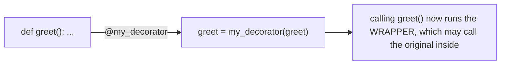

```python
def shout(func):
    def wrapper(*args, **kwargs):
        result = func(*args, **kwargs)
        return result.upper()
    return wrapper

@shout
def greet(name):
    return f"hello, {name}"

greet("world")   # "HELLO, WORLD" — @shout transparently wrapped greet
```

### 106. How do you write a simple function decorator?

The pattern is always: outer function takes `func`, defines an inner `wrapper` that calls `func` (typically with `*args, **kwargs` to stay generic), and returns `wrapper`.

```python
import time

def timer(func):
    def wrapper(*args, **kwargs):
        start = time.perf_counter()
        result = func(*args, **kwargs)
        elapsed = time.perf_counter() - start
        print(f"{func.__name__} took {elapsed:.4f}s")
        return result
    return wrapper

@timer
def slow_square(n):
    time.sleep(0.1)
    return n ** 2

slow_square(5)   # prints timing, returns 25
```

### 107. How do you write a decorator that accepts arguments?

Add an **extra outer layer** — a function that takes the decorator's own arguments and returns the actual decorator, which in turn returns the wrapper. Three levels of nesting total.

```python
def repeat(times):                    # 1. takes the decorator's own argument
    def decorator(func):               # 2. the actual decorator
        def wrapper(*args, **kwargs):  # 3. the wrapper
            results = []
            for _ in range(times):
                results.append(func(*args, **kwargs))
            return results
        return wrapper
    return decorator

@repeat(times=3)
def say_hi():
    return "hi"

say_hi()   # ['hi', 'hi', 'hi']
```

`@repeat(times=3)` first calls `repeat(times=3)`, which returns `decorator`; `decorator` is then applied to `say_hi`, exactly as in a plain decorator.

### 108. What is functools.wraps, and why is it important?

Without it, a decorator's wrapper function **silently replaces** the original function's metadata — `__name__`, `__doc__`, `__module__` — with the wrapper's own, making debugging, introspection, and documentation tools show misleading information. `functools.wraps` is itself a decorator (applied to `wrapper`) that copies the original function's metadata onto the wrapper.

```python
from functools import wraps

def logged(func):
    @wraps(func)                    # preserves func's identity
    def wrapper(*args, **kwargs):
        print(f"Calling {func.__name__}")
        return func(*args, **kwargs)
    return wrapper

@logged
def add(a, b):
    """Add two numbers."""
    return a + b

add.__name__   # "add"        (would be "wrapper" without @wraps)
add.__doc__    # "Add two numbers."  (would be None without @wraps)
```

**Always use `functools.wraps`** in any decorator you write — omitting it is a very common code-review flag.

### 109. How do you chain multiple decorators?

Stack `@decorator` lines above a function; they apply **bottom-up** (closest to the function first) but **execute outside-in** when the function is called.

```python
def bold(func):
    def wrapper(*a, **kw):
        return f"<b>{func(*a, **kw)}</b>"
    return wrapper

def italic(func):
    def wrapper(*a, **kw):
        return f"<i>{func(*a, **kw)}</i>"
    return wrapper

@bold
@italic
def text():
    return "hi"

text()   # "<b><i>hi</i></b>"
# Equivalent to: text = bold(italic(text))
```

Reading order matters: `@bold` above `@italic` means `italic` wraps the original function first, then `bold` wraps that result — so the *innermost* decorator (`italic`, closest to the function) runs its logic first, and its output flows outward through `bold`.

### 110. What are class-based decorators?

Instead of a function, you can use a **class with `__call__`** ([Q90](#90-what-is-__call__-and-what-does-it-mean-for-an-object-to-be-callable)) as a decorator — useful when the decorator needs to maintain state across calls (like a call counter) in a more structured way than closures allow.

```python
class CountCalls:
    def __init__(self, func):
        self.func = func
        self.calls = 0
    def __call__(self, *args, **kwargs):
        self.calls += 1
        print(f"Call #{self.calls} to {self.func.__name__}")
        return self.func(*args, **kwargs)

@CountCalls
def say_hi():
    return "hi"

say_hi()   # "Call #1 to say_hi"
say_hi()   # "Call #2 to say_hi"
say_hi.calls   # 2 — state persists naturally as an instance attribute
```

`@CountCalls` here is equivalent to `say_hi = CountCalls(say_hi)` — the class's `__init__` plays the role of the outer decorator function, and `__call__` plays the role of the wrapper.

### 111. What are some common built-in decorators?

| Decorator | Purpose | Q# |
|---|---|---|
| `@staticmethod` | Method needing neither `self` nor `cls` | [Q74](#74-what-is-the-difference-between-a-static-method-a-class-method-and-an-instance-method) |
| `@classmethod` | Method that receives the class (`cls`), not an instance | [Q74](#74-what-is-the-difference-between-a-static-method-a-class-method-and-an-instance-method) |
| `@property` | Turns a method into a computed, attribute-style access | [Q75](#75-what-is-a-property-and-how-do-you-use-property) |
| `@functools.wraps` | Preserves metadata when writing your own decorator | [Q108](#108-what-is-functoolswraps-and-why-is-it-important) |
| `@functools.lru_cache` | Automatic memoization of a function's results | [Q150](#150-what-is-functoolslru_cache-and-how-does-memoization-work) |
| `@functools.total_ordering` | Fills in comparison methods from `__eq__` + one other | [Q85](#85-how-do-you-make-a-custom-object-comparable-with-etc) |
| `@abc.abstractmethod` | Marks a method that subclasses must override | [Q72](#72-what-is-an-abstract-class-and-how-do-you-create-one-using-the-abc-module) |
| `@dataclasses.dataclass` | Auto-generates `__init__`, `__repr__`, `__eq__` for a class | — |
| `@contextlib.contextmanager` | Turns a generator function into a context manager | [Q138](#138-how-do-you-implement-a-context-manager-using-contextlibcontextmanager) |

---

## Iterators & Generators

### 112. What is the difference between an iterable and an iterator?

- **Iterable** — any object you can loop over; it implements `__iter__`, which returns an **iterator**. Examples: `list`, `str`, `dict`, `range`.
- **Iterator** — the object that actually produces values one at a time; it implements `__next__` (and `__iter__`, returning itself), and keeps track of where it is.

```python
nums = [1, 2, 3]           # nums is ITERABLE
it = iter(nums)              # it is an ITERATOR — created by calling iter()
next(it)                     # 1
next(it)                     # 2
next(it)                     # 3
next(it)                     # StopIteration!
```

Key distinction: a `list` can be iterated over **multiple times** from the start (each `for` loop calls `iter()` again, getting a fresh iterator), while an **iterator is exhausted after one pass** and cannot be reset.

### 113. What is the iterator protocol?

The iterator protocol is the pair of dunder methods an object must implement to work with `for` loops, `next()`, and unpacking: `__iter__(self)` (returns the iterator itself, or another iterator) and `__next__(self)` (returns the next value, or raises `StopIteration` when done). See [Q89](#89-what-are-__iter__-and-__next__-and-how-do-they-make-an-object-iterable) for a full worked example. Under the hood, a `for` loop is essentially:

```python
it = iter(iterable)
while True:
    try:
        value = next(it)
    except StopIteration:
        break
    # ... loop body with `value` ...
```

### 114. What is a generator function, and how does yield work?

A **generator function** is any function containing at least one `yield` statement. Calling it doesn't run the body immediately — it returns a **generator object** (which is itself an iterator). Each call to `next()` runs the function until it hits `yield`, **pauses execution there** (preserving all local state), and returns the yielded value; the next `next()` call resumes right after that `yield`.

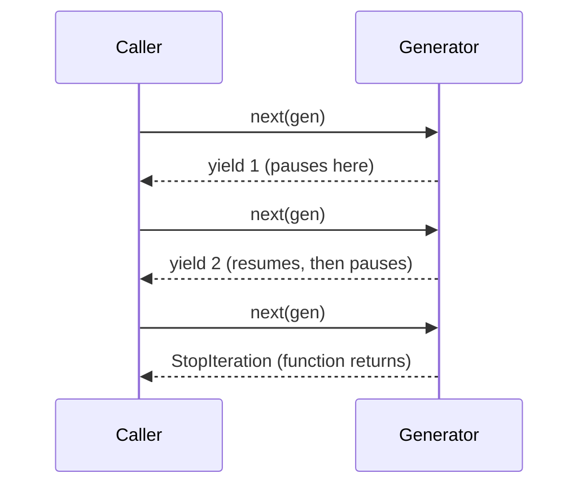

```python
def count_up_to(n):
    i = 1
    while i <= n:
        yield i        # pauses here, remembers i
        i += 1

gen = count_up_to(3)
next(gen)   # 1
next(gen)   # 2
next(gen)   # 3
next(gen)   # StopIteration
```

### 115. What is the difference between return and yield?

- **`return`** exits the function immediately and permanently, sending back a single value (or `None`).
- **`yield`** pauses the function, sends back a value, and **preserves all local state** so execution can resume exactly where it left off on the next call. A function with any `yield` becomes a generator function — calling it never runs the body directly, it just returns a generator object.

```python
def normal_function():
    return 1
    return 2   # unreachable — return 1 already exited

def generator_function():
    yield 1
    yield 2    # reachable — yield just pauses, doesn't exit

list(generator_function())   # [1, 2]
normal_function()              # 1
```

### 116. What are generator expressions, and how are they different from list comprehensions?

A **generator expression** uses the same syntax as a list comprehension but with `()` instead of `[]`, and produces values **lazily, one at a time**, instead of building the entire list in memory up front.

```python
squares_list = [x**2 for x in range(1000000)]   # builds a list of 1M ints NOW
squares_gen = (x**2 for x in range(1000000))     # builds NOTHING yet — lazy

next(squares_gen)   # 0 — computed on demand
sum(x**2 for x in range(1000000))   # memory-efficient — never materializes the full list
```

Use a generator expression whenever you're going to consume the values once, in order (e.g., feeding into `sum()`, `any()`, a `for` loop) — it avoids allocating memory for the entire sequence. Use a list comprehension when you need random access, multiple passes, or `len()`.

### 117. What is yield from, and when do you use it?

`yield from` delegates iteration to a **sub-generator (or any iterable)**, yielding all of its values as if they came from the outer generator directly — avoiding a manual `for x in sub: yield x` loop, and also correctly forwarding `.send()`/`.throw()`/`.close()` calls to the sub-generator.

```python
def inner():
    yield 1
    yield 2

def outer():
    yield "start"
    yield from inner()     # equivalent to: for x in inner(): yield x
    yield "end"

list(outer())   # ['start', 1, 2, 'end']
```

It's especially useful for flattening nested/recursive generators, such as recursively walking a tree structure.

### 118. How do generators help with memory efficiency?

Generators produce values **lazily, one at a time, on demand** — instead of computing and holding an entire sequence in memory. For large or even infinite sequences, this is the difference between a program that works and one that runs out of memory.

```python
def read_large_file(path):
    with open(path) as f:
        for line in f:
            yield line.strip()      # one line in memory at a time

# vs. a list-based version that loads the ENTIRE file into memory:
def read_large_file_list(path):
    with open(path) as f:
        return [line.strip() for line in f.readlines()]
```

A generator's memory footprint stays constant regardless of the underlying sequence's size — only the current value (and a small amount of paused-frame state) needs to exist at once.

### 119. What is a coroutine, and how does it relate to generators?

Historically, Python coroutines were built directly on top of generators — a generator that primarily *receives* values via `.send()` rather than primarily producing them is used as a coroutine. Since Python 3.5, **native coroutines** defined with `async def` are a distinct (but conceptually related) construct, purpose-built for `asyncio` ([Q174](#174-what-is-asyncio-and-what-problem-does-it-solve)), while `yield`-based generator-coroutines are now considered a legacy technique for the same purpose.

```python
# Legacy generator-based coroutine
def echo():
    while True:
        received = yield
        print(f"Got: {received}")

c = echo()
next(c)          # "prime" the coroutine — advance to the first yield
c.send("hi")      # "Got: hi"

# Modern native coroutine
async def echo_async():
    return "hi"
```

Both share the same underlying capability — a function that can pause and resume — but modern async code should use `async def`/`await`, not generator-based coroutines.

### 120. How do you send a value into a generator using .send()?

`.send(value)` resumes a paused generator and makes `value` become the **result of the `yield` expression** that it was paused on — turning `yield` from a one-way (produce-only) channel into a two-way communication channel.

```python
def running_total():
    total = 0
    while True:
        x = yield total     # pauses here; x becomes whatever .send() provides
        total += x

gen = running_total()
next(gen)          # 0 — must "prime" the generator to the first yield first
gen.send(10)        # 10 — total is now 10
gen.send(5)         # 15 — total is now 15
```

You must always call `next(gen)` (or `gen.send(None)`) once first to advance the generator to its first `yield` before you can meaningfully `.send()` a value into it — sending a non-`None` value to a brand-new, un-started generator raises `TypeError`.

---

## Exception Handling

### 121. Why is exception handling important?

Exception handling lets a program respond to unexpected or erroneous conditions (bad input, a missing file, a network failure) **gracefully**, instead of crashing outright — separating "normal path" logic from error-recovery logic, so both stay readable. Without it, any runtime error would immediately terminate the program with a traceback, which is unacceptable for anything user-facing or long-running (a web server, a batch job).

```python
try:
    result = 10 / user_input
except ZeroDivisionError:
    result = 0
    print("Can't divide by zero — using 0 instead")
```

### 122. What is the exception hierarchy in Python (BaseException, Exception)?

All exceptions inherit from `BaseException`. Almost everything you catch or raise should derive from its direct subclass, `Exception` — the small set of things that inherit directly from `BaseException` but *not* `Exception` (`SystemExit`, `KeyboardInterrupt`, `GeneratorExit`) are deliberately excluded from a bare `except Exception:` so that Ctrl+C and `sys.exit()` aren't accidentally swallowed.

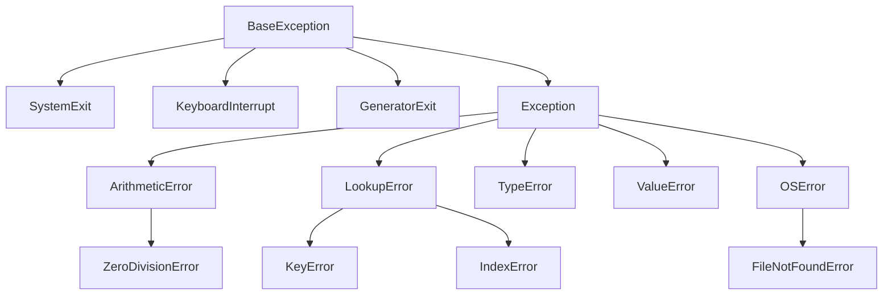

Custom exceptions should almost always inherit from `Exception` (directly or via a more specific built-in like `ValueError`), never from `BaseException` directly.

### 123. What is the difference between except Exception and a bare except:?

- **`except Exception:`** catches everything derived from `Exception` — essentially all "normal" runtime errors — but deliberately **not** `SystemExit`, `KeyboardInterrupt`, or `GeneratorExit`.
- **A bare `except:`** catches **literally everything**, including those three, meaning it will swallow `Ctrl+C` and `sys.exit()` calls too — almost always a bug.

```python
try:
    risky_operation()
except Exception as e:      # preferred — still lets Ctrl+C interrupt the program
    log_error(e)

try:
    risky_operation()
except:                       # AVOID — also catches KeyboardInterrupt, SystemExit
    log_error("something failed")
```

**Best practice:** always catch specific exception types when you can predict them, `Exception` as a broad safety net, and reserve a bare `except:` for extremely rare cases (and even then, usually re-raise after logging).

### 124. How do you handle multiple exception types in one block?

Pass a **tuple** of exception types to a single `except` clause, or stack multiple `except` clauses if you need different handling logic per type.

```python
try:
    value = int(input("Enter a number: "))
    result = 100 / value
except (ValueError, ZeroDivisionError) as e:
    print(f"Invalid input: {e}")

# Different handling per exception type:
try:
    do_something()
except ValueError as e:
    print(f"Bad value: {e}")
except KeyError as e:
    print(f"Missing key: {e}")
```

`except` clauses are checked **in order**, top to bottom, and only the first matching one runs — so put more specific exception types before more general ones (a subclass before its parent).

### 125. What is the purpose of the finally block?

Code in `finally` **always runs**, whether the `try` block succeeded, raised an exception (caught or not), or hit a `return`/`break`/`continue` — making it the right place for cleanup that must happen no matter what (closing a file, releasing a lock, disconnecting from a database).

```python
def read_config():
    f = open("config.txt")
    try:
        return f.read()
    finally:
        f.close()      # ALWAYS runs, even if f.read() raised or the try returned
```

In modern code, `with` statements ([Q136](#136-what-is-a-context-manager-and-what-problem-does-it-solve)) usually replace this manual pattern for resource cleanup, since `__exit__` guarantees the same "always runs" behavior with less boilerplate.

### 126. What is the else clause in a try statement used for?

The `else` block runs **only if the `try` block completed with no exception** — it's a place to put code that should run on success, but that you don't want the `except` block to accidentally catch errors *from*.

```python
try:
    value = int(user_input)
except ValueError:
    print("Not a valid number")
else:
    print(f"Got a valid number: {value}")    # only runs if int() succeeded
finally:
    print("Done processing input")            # always runs
```

Without `else`, putting the success code directly inside `try` risks the `except` block silently catching an unrelated error that occurs in that "success" code too — `else` keeps the risky operation and the success-path logic clearly separated.

### 127. How do you create a custom exception class?

Subclass `Exception` (or a more specific built-in exception), and optionally add custom attributes/behavior via `__init__`.

```python
class InsufficientFundsError(Exception):
    def __init__(self, balance, amount):
        self.balance = balance
        self.amount = amount
        super().__init__(f"Cannot withdraw {amount}, balance is only {balance}")

def withdraw(balance, amount):
    if amount > balance:
        raise InsufficientFundsError(balance, amount)
    return balance - amount

try:
    withdraw(100, 150)
except InsufficientFundsError as e:
    print(e)                 # "Cannot withdraw 150, balance is only 100"
    print(e.amount)           # 150 — custom attribute, useful for programmatic handling
```

Custom exceptions make error handling **specific and self-documenting** — callers can catch exactly the failure mode they care about instead of parsing a generic error message.

### 128. What is exception chaining (raise ... from ...)?

`raise NewException(...) from original_exception` explicitly links a new exception to the one that caused it, preserving the **full causal chain** in the traceback (shown as "The above exception was the direct cause of the following exception") — instead of losing the original error's context, which happens implicitly anyway but `from` makes it explicit and lets you deliberately set the cause.

```python
def load_config(path):
    try:
        with open(path) as f:
            return json.loads(f.read())
    except FileNotFoundError as e:
        raise ConfigError(f"Could not load config from {path}") from e

# Traceback shows BOTH exceptions, clearly linked:
# FileNotFoundError: [Errno 2] No such file or directory: 'config.json'
# The above exception was the direct cause of the following exception:
# ConfigError: Could not load config from config.json
```

`raise NewException(...) from None` explicitly **suppresses** the chained context when the original exception's traceback would just be noise.

### 129. What is the difference between raise and raise Exception()?

- **`raise`** (no argument) — inside an `except` block, **re-raises the currently-handled exception**, preserving its original traceback. Outside an `except` block, it's a `RuntimeError` (nothing to re-raise).
- **`raise Exception()`** — raises a **brand-new** exception instance.

```python
try:
    risky()
except ValueError:
    log_error()
    raise                    # re-raise the SAME ValueError, unmodified — common in logging wrappers

try:
    risky()
except ValueError:
    raise RuntimeError("wrapped failure")   # raises a DIFFERENT, new exception
```

Bare `raise` is the idiomatic way to "log and re-throw" — you get to observe/log the exception without altering it or losing its original traceback.

### 130. What are some Python exception handling best practices?

- **Catch specific exceptions**, not bare `except:` ([Q123](#123-what-is-the-difference-between-except-exception-and-a-bare-except)).
- **Don't silently swallow exceptions** — an empty `except: pass` hides bugs; at minimum, log the error.
- **Use `finally` or `with`** for guaranteed cleanup ([Q125](#125-what-is-the-purpose-of-the-finally-block), [Q136](#136-what-is-a-context-manager-and-what-problem-does-it-solve)).
- **Raise specific, meaningful exceptions**, not generic `Exception("error")`.
- **Use `raise ... from ...`** to preserve the causal chain when wrapping exceptions ([Q128](#128-what-is-exception-chaining-raise-from)).
- **Don't use exceptions for routine control flow** where a normal conditional would do — reserve them for genuinely exceptional situations.
- **Keep `try` blocks small** — wrap only the specific call that can fail, not large blocks of unrelated code, so you know exactly what triggered the `except`.

```python
# Good: narrow try, specific exception, meaningful message
try:
    data = json.loads(raw_text)
except json.JSONDecodeError as e:
    raise ConfigError(f"Invalid JSON in config: {e}") from e
```

---

## File Handling

### 131. How do you read and write files in Python?

Use the built-in `open()` function, which returns a file object; read with `.read()`/`.readline()`/`.readlines()` or by iterating, write with `.write()`/`.writelines()`.

```python
# Writing
with open("notes.txt", "w") as f:
    f.write("Hello, file!\n")

# Reading
with open("notes.txt", "r") as f:
    content = f.read()
    print(content)     # "Hello, file!\n"

# Appending
with open("notes.txt", "a") as f:
    f.write("Another line\n")
```

Always prefer the `with` form ([Q133](#133-why-is-it-recommended-to-use-with-open-instead-of-manual-openclose)) over manual `open()`/`close()`.

### 132. What is the difference between opening a file in 'r', 'w', 'a', and 'rb' modes?

| Mode | Meaning | If file doesn't exist | If file exists |
|---|---|---|---|
| `'r'` | Read (text) | Raises `FileNotFoundError` | Reads from start |
| `'w'` | Write (text) | Creates it | **Truncates it to empty first** |
| `'a'` | Append (text) | Creates it | Writes are added at the end |
| `'x'` | Exclusive create | Creates it | Raises `FileExistsError` |
| `'rb'`, `'wb'`, `'ab'` | Same as above, but **binary** mode | — | — |

```python
open("data.bin", "rb")   # read raw bytes, no text decoding — for images, executables, etc.
open("log.txt", "a")      # append — never destroys existing content
```

The `'w'` mode's silent truncation is a common accidental-data-loss gotcha — double-check you don't want `'a'` before writing.

### 133. Why is it recommended to use with open(...) instead of manual open/close?

`with open(...) as f:` uses the file object as a **context manager** ([Q136](#136-what-is-a-context-manager-and-what-problem-does-it-solve)), guaranteeing `f.close()` is called automatically when the block exits — **even if an exception is raised inside it**. Manual `open()`/`close()` requires a `try`/`finally` to get the same guarantee, and it's easy to forget, leaking open file handles.

```python
# Risky — if something raises before close(), the file stays open (leaked handle)
f = open("data.txt")
data = f.read()
f.close()

# Safe — close() is guaranteed, no matter what happens inside the block
with open("data.txt") as f:
    data = f.read()
```

### 134. How do you read a large file efficiently without loading it entirely into memory?

**Iterate over the file object line by line** rather than calling `.read()` or `.readlines()`, which load the entire file into memory at once. A file object is itself a lazy iterator over its lines.

```python
with open("huge_log.txt") as f:
    for line in f:              # reads one line at a time — constant memory
        process(line)

# For non-line-delimited data, read in fixed-size chunks:
with open("huge.bin", "rb") as f:
    while chunk := f.read(8192):    # 8 KB at a time (walrus operator, Q27)
        process(chunk)
```

This mirrors the memory-efficiency argument for generators ([Q118](#118-how-do-generators-help-with-memory-efficiency)) — the file object is, in effect, a built-in generator over lines.

### 135. What is the difference between readline(), readlines(), and iterating over a file object?

- **`f.readline()`** — reads **one line** at a time, returns `""` at end-of-file. Manual, step-by-step control.
- **`f.readlines()`** — reads **the entire file** and returns a `list` of all lines — simple, but loads everything into memory at once.
- **Iterating directly (`for line in f:`)** — lazily yields one line at a time **without** building a full list — the most memory-efficient option for large files.

```python
with open("file.txt") as f:
    line = f.readline()          # "First line\n"

with open("file.txt") as f:
    all_lines = f.readlines()     # ['First line\n', 'Second line\n', ...]

with open("file.txt") as f:
    for line in f:                 # lazy, one at a time — preferred for large files
        print(line.strip())
```

---

## Context Managers

### 136. What is a context manager, and what problem does it solve?

A context manager guarantees that **setup and teardown code run in pairs**, with the teardown guaranteed to run even if an exception occurs in between — used via the `with` statement. It solves the recurring "acquire a resource, do something, always release it" pattern (files, locks, database connections, network sockets) without repetitive `try`/`finally` boilerplate at every call site.

```python
with open("file.txt") as f:    # __enter__ acquires (opens the file)
    data = f.read()
# __exit__ releases (closes the file) automatically here — even on exception
```

Under the hood, any object implementing `__enter__`/`__exit__` ([Q91](#91-what-are-__enter__-and-__exit__-and-how-do-they-relate-to-context-managers)) works with `with`.

### 137. How do you implement a context manager using a class?

Define `__enter__` (setup, returns the value bound by `as`) and `__exit__` (teardown, receives exception info if one occurred).

```python
class DatabaseConnection:
    def __enter__(self):
        print("Opening connection")
        self.conn = connect_to_db()
        return self.conn
    def __exit__(self, exc_type, exc_val, exc_tb):
        print("Closing connection")
        self.conn.close()
        return False     # don't suppress exceptions

with DatabaseConnection() as conn:
    conn.execute("SELECT * FROM users")
# "Closing connection" always prints, even if execute() raised
```

### 138. How do you implement a context manager using contextlib.contextmanager?

`@contextlib.contextmanager` lets you write a context manager as a **generator function** — code before the single `yield` is `__enter__`, the yielded value is what `as` binds to, and code after `yield` (typically in a `finally`) is `__exit__`. Much less boilerplate than a full class for simple cases.

```python
from contextlib import contextmanager

@contextmanager
def database_connection():
    print("Opening connection")
    conn = connect_to_db()
    try:
        yield conn              # this becomes the `as` value
    finally:
        print("Closing connection")
        conn.close()            # guaranteed to run, even on exception

with database_connection() as conn:
    conn.execute("SELECT * FROM users")
```

The `try`/`finally` around the `yield` is essential — without it, an exception raised inside the `with` block would skip the cleanup code entirely.

### 139. What is contextlib.suppress used for?

`contextlib.suppress(*exceptions)` is a context manager that **silently ignores** the specified exception type(s) if they occur inside the `with` block — a cleaner alternative to a `try/except: pass` when you genuinely want to ignore a specific, expected failure.

```python
from contextlib import suppress

# Instead of:
try:
    os.remove("temp_file.txt")
except FileNotFoundError:
    pass

# Write:
with suppress(FileNotFoundError):
    os.remove("temp_file.txt")
```

Use it sparingly and only for exceptions you've deliberately decided are safe to ignore — it should never be a substitute for actually handling an error you don't understand.

### 140. Can you use multiple context managers in a single with statement?

Yes — separate them with commas (Python 3.10+ also allows parenthesized multi-line grouping), and they're entered left-to-right, exited right-to-left (like nested `with` blocks, but flatter and more readable).

```python
with open("input.txt") as infile, open("output.txt", "w") as outfile:
    outfile.write(infile.read().upper())

# Python 3.10+ — parenthesized form for readability with many managers
with (
    open("a.txt") as a,
    open("b.txt") as b,
    open("c.txt", "w") as c,
):
    ...
```

This is equivalent to nesting `with open("input.txt") as infile: with open("output.txt", "w") as outfile: ...`, just without the extra indentation level.

---

## Comprehensions

### 141. What are list, dict, and set comprehensions?

Concise syntax for building a `list`, `dict`, or `set` from an iterable in a single expression, optionally filtering with `if`.

```python
# List comprehension
squares = [x**2 for x in range(5)]                  # [0, 1, 4, 9, 16]

# Dict comprehension
lengths = {word: len(word) for word in ["a", "bb", "ccc"]}   # {'a': 1, 'bb': 2, 'ccc': 3}

# Set comprehension
unique_lengths = {len(word) for word in ["a", "bb", "cc"]}   # {1, 2}

# With a filter
evens = [x for x in range(20) if x % 2 == 0]
```

All three share the same `for ... in ... [if ...]` structure — only the surrounding brackets (`[]`, `{key: value}`, `{}`) and the expression differ.

### 142. When should you avoid using a comprehension?

- **When the logic requires multiple statements or complex branching** — a comprehension is restricted to a single expression; forcing complex logic into one hurts readability more than it helps.
- **When you're not actually building a collection** — e.g. just running side effects in a loop; using a comprehension purely for its side effects (and throwing away the resulting list) is considered an anti-pattern.
- **When the nesting gets deep** — more than two levels of nested `for`/`if` inside a comprehension usually reads worse than an explicit loop.
- **When you need to reuse the loop variable or intermediate values afterward.**

```python
# Bad: comprehension used only for its side effect, result thrown away
[print(x) for x in items]     # confusing — looks like it builds something, but doesn't

# Better: plain loop, since we don't want a list back
for x in items:
    print(x)
```

### 143. What is a nested comprehension?

A comprehension containing another comprehension (or multiple `for` clauses) — used for flattening nested structures or building 2D structures like a matrix.

```python
# Flatten a list of lists
matrix = [[1, 2, 3], [4, 5, 6]]
flat = [num for row in matrix for num in row]     # [1, 2, 3, 4, 5, 6]

# Build a 3x3 matrix
grid = [[r * 3 + c for c in range(3)] for r in range(3)]
# [[0, 1, 2], [3, 4, 5], [6, 7, 8]]
```

Read multi-`for` comprehensions **left to right, in the same order as equivalent nested loops**: `[num for row in matrix for num in row]` is `for row in matrix: for num in row: collect num`.

### 144. How do comprehensions compare to map()/filter() in performance and readability?

**Performance** is roughly comparable for simple cases — both are implemented in C and avoid Python-level loop overhead — though comprehensions are often marginally faster because they avoid the overhead of a separate function call (especially a `lambda`) per element.

**Readability** generally favors comprehensions in idiomatic Python: they read left-to-right like natural language and don't require wrapping the result in `list()` (since `map`/`filter` return lazy iterators in Python 3).

```python
# map/filter — requires lambda, requires list() to materialize
result = list(map(lambda x: x * 2, filter(lambda x: x > 0, numbers)))

# comprehension — single, readable expression
result = [x * 2 for x in numbers if x > 0]
```

`map`/`filter` remain preferable when you already have a **named function** (no `lambda` needed) or when you want to stay **lazy** without switching to a generator expression syntax — `map(str.upper, words)` is arguably cleaner than `(w.upper() for w in words)`.

---

## Functional Programming

### 145. What is functional programming, and how does Python support it?

Functional programming treats computation as the evaluation of pure functions and avoids mutable state and side effects, favoring composing small functions over step-by-step imperative instructions. Python is **multi-paradigm** — not purely functional (it has no functional-only enforcement, and mutation/statements are everywhere) — but it borrows several functional tools:

- **First-class functions** ([Q101](#101-what-are-first-class-functions)) — pass functions around like values.
- **`lambda`** ([Q96](#96-what-is-a-lambda-function-and-when-should-you-use-one)) — anonymous inline functions.
- **`map()`, `filter()`, `functools.reduce()`** ([Q146](#146-what-is-map-and-how-do-you-use-it)-[Q148](#148-what-is-functoolsreduce-and-how-do-you-use-it)) — transform/select/fold over iterables.
- **Comprehensions & generator expressions** — declarative alternatives to explicit loops.
- **`functools.partial`, `functools.lru_cache`** — function composition and memoization.

```python
from functools import reduce
total = reduce(lambda acc, x: acc + x, [1, 2, 3, 4], 0)   # 10
```

### 146. What is map(), and how do you use it?

`map(func, iterable)` applies `func` to **every element** of `iterable` and returns a **lazy iterator** of the results (not a list, in Python 3 — wrap in `list()` to materialize it).

```python
nums = [1, 2, 3, 4]
doubled = map(lambda x: x * 2, nums)
list(doubled)      # [2, 4, 6, 8]

# Often cleaner with a named function, no lambda needed:
list(map(str, nums))    # ['1', '2', '3', '4']
```

`map` can also take **multiple iterables**, applying `func` element-wise across all of them (stopping at the shortest, like `zip`): `map(lambda a, b: a + b, [1, 2], [10, 20])` → `[11, 22]`.

### 147. What is filter(), and how do you use it?

`filter(func, iterable)` returns a **lazy iterator** containing only the elements of `iterable` for which `func(element)` is truthy. Passing `None` as `func` filters out all falsy values.

```python
nums = [-3, -2, -1, 0, 1, 2, 3]
positives = filter(lambda x: x > 0, nums)
list(positives)      # [1, 2, 3]

filter(None, [0, 1, "", "a", None, [1]])    # keeps only truthy values
list(filter(None, [0, 1, "", "a", None, [1]]))   # [1, 'a', [1]]
```

Like `map`, the result is lazy — nothing is actually computed until you iterate over it or wrap it in `list()`.

### 148. What is functools.reduce(), and how do you use it?

`functools.reduce(func, iterable, initial=...)` **folds** an iterable down to a single value by repeatedly applying a two-argument function to an accumulator and the next element. Unlike `map`/`filter` (built-ins), `reduce` moved to the `functools` module in Python 3 — a deliberate signal that explicit loops are usually clearer for this pattern.

```python
from functools import reduce

nums = [1, 2, 3, 4]
total = reduce(lambda acc, x: acc + x, nums, 0)       # 10
maximum = reduce(lambda acc, x: acc if acc > x else x, nums)   # 4 (no initial -> uses first element)

# Equivalent, often clearer, imperative version:
total = 0
for x in nums:
    total += x
```

Guido van Rossum has commented that `reduce()` is often less readable than an explicit `for` loop with an accumulator — use it sparingly, and prefer built-ins like `sum()`, `max()`, `min()` when they already do exactly what you need.

### 149. What is functools.partial()?

`functools.partial(func, *args, **kwargs)` creates a **new callable** with some of `func`'s arguments already "filled in" (bound), so callers only need to supply the rest — a lightweight way to specialize a general function without writing a wrapper `def` or `lambda`.

```python
from functools import partial

def power(base, exponent):
    return base ** exponent

square = partial(power, exponent=2)
cube = partial(power, exponent=3)

square(5)   # 25
cube(5)     # 125
```

This is commonly used to adapt a general-purpose function's signature to fit an API that expects a callable with fewer arguments — e.g., pre-binding a `logger` or `connection` argument before passing the function as a callback.

### 150. What is functools.lru_cache, and how does memoization work?

**Memoization** caches a (typically expensive, pure) function's results keyed by its arguments, so repeated calls with the same arguments return the cached result instantly instead of recomputing. `@functools.lru_cache(maxsize=...)` adds this automatically, using an **LRU (Least Recently Used)** eviction policy once the cache reaches `maxsize` (default 128; `maxsize=None` means unbounded).

```python
from functools import lru_cache

@lru_cache(maxsize=None)
def fibonacci(n):
    if n < 2:
        return n
    return fibonacci(n - 1) + fibonacci(n - 2)

fibonacci(35)   # fast — each unique n computed only once, ever
fibonacci.cache_info()   # CacheInfo(hits=..., misses=..., maxsize=None, currsize=...)
```

Arguments must be **hashable** (they become the cache's dict key), and the function should be **pure** (same arguments always produce the same result) — caching a function with side effects or non-deterministic output would return stale or wrong results. See also [Q221](#221-what-is-memoization-and-how-do-you-implement-it-manually-vs-with-lru_cache) for a manual implementation.

### 151. What are pure functions, and why do they matter?

A **pure function** always returns the same output for the same input, and has **no observable side effects** (no mutating external state, no I/O, no relying on/modifying global variables). Impure functions are harder to reason about, test, and parallelize, because their behavior depends on — or affects — things outside their own arguments.

```python
# Pure — output depends only on input, no external state touched
def add(a, b):
    return a + b

# Impure — depends on and mutates external/global state
total = 0
def add_to_total(x):
    global total
    total += x     # side effect
    return total    # depends on external state, not just x
```

Pure functions are trivially safe to cache ([Q150](#150-what-is-functoolslru_cache-and-how-does-memoization-work)), test in isolation (no setup/mocking needed), and run in parallel without synchronization — which is why functional-style code tends to be easier to reason about in concurrent contexts.

---

## Modules & Packages

### 152. What is the difference between a module and a package?

- **Module** — a single `.py` file; its contents (functions, classes, variables) become accessible via `import module_name`.
- **Package** — a **directory** of modules, marked (traditionally) by an `__init__.py` file, allowing dotted access like `package.subpackage.module`.

```
myapp/
├── __init__.py        # makes myapp a package
├── utils.py            # a module: myapp.utils
└── models/
    ├── __init__.py     # makes models a sub-package
    └── user.py          # a module: myapp.models.user
```

```python
import myapp.utils
from myapp.models.user import User
```

### 153. What is __init__.py used for?

`__init__.py` marks a directory as a **regular package** and runs automatically whenever that package (or anything inside it) is first imported — commonly used to define the package's public API (via imports that re-export names), run package-level setup code, or simply mark the directory as a package (it's allowed to be empty).

```python
# myapp/__init__.py
from .utils import helper_function     # re-export so callers can do:
from .models.user import User            # `from myapp import User` instead of the full path

__version__ = "1.0.0"
```

Since Python 3.3, packages *can* work without `__init__.py` at all (as "namespace packages," [Q157](#157-what-is-a-namespace-package)), but an explicit `__init__.py` remains the standard, unambiguous way to define a package.

### 154. What is the difference between absolute and relative imports?

- **Absolute import** — specifies the full path from the project's top-level package/module: `from myapp.utils import helper`.
- **Relative import** — specifies the path **relative to the current module's location** using leading dots: `.` for the current package, `..` for the parent package.

```python
# Inside myapp/models/user.py

# Absolute
from myapp.utils import helper

# Relative
from . import helper           # from the current package (myapp.models)
from ..utils import helper      # from the parent package (myapp)
```

**PEP 8 recommends absolute imports** for clarity in most cases; relative imports are handy for reorganizing/renaming an internal package without rewriting every import inside it, but only work within a package (not in a standalone script run directly).

### 155. What does if __name__ == "__main__": do?

Every module has a built-in `__name__` variable: it's set to `"__main__"` when the file is run **directly** (`python script.py`), and set to the module's actual name when it's **imported** by another file. This idiom lets a file define reusable functions/classes *and* provide "run this as a script" behavior, without the script-only code executing on import.

```python
# mymodule.py
def helper():
    return "I'm reusable"

if __name__ == "__main__":
    # Only runs when executed directly: `python mymodule.py`
    # Does NOT run when this file is imported elsewhere: `import mymodule`
    print(helper())
    print("Running as a script!")
```

This is the standard way to write a file that's both a **library** (safely importable) and a **CLI entry point** (runnable on its own), and is near-universal in Python scripts.

### 156. What is sys.path, and how does Python find modules?

`sys.path` is a **list of directory paths** that Python searches, in order, whenever you `import` something. It's populated at startup from: the directory of the script being run (or the current directory in interactive mode), the `PYTHONPATH` environment variable ([Q220](#220-what-is-pythonpath)), and the standard library's installation directories (including `site-packages`, where `pip`-installed packages live).

```python
import sys
print(sys.path)
# ['', '/usr/lib/python3.12', '/usr/lib/python3.12/site-packages', ...]

sys.path.append("/my/custom/module/dir")   # can be extended at runtime
```

Import resolution simply walks `sys.path` in order and uses the **first** matching module/package found — which is also the classic cause of "wrong version imported" bugs when two same-named modules exist in different `sys.path` entries.

### 157. What is a namespace package?

A **namespace package** (PEP 420, Python 3.3+) is a package **without** an `__init__.py` — Python still recognizes the directory as a package, but it's an *implicit* one, and multiple separate directories (even in different locations on `sys.path`) with the same package name can be merged together into a single logical namespace at import time.

```
# Two separately-installed distributions can both contribute to "myapp":
site-packages/myapp/plugin_a/   (no __init__.py)
site-packages/myapp/plugin_b/   (no __init__.py)
# `import myapp.plugin_a` and `import myapp.plugin_b` both work
```

This is primarily useful for **plugin systems** and splitting a large package across multiple independently-distributed pieces — for most everyday projects, a regular package with `__init__.py` remains simpler and more explicit.

### 158. What is the difference between import module and from module import x?

- **`import module`** — imports the whole module as an object; you access its contents with the `module.` prefix. Keeps the module's namespace intact, avoiding name collisions.
- **`from module import x`** — imports a specific name (`x`) directly into the current namespace, letting you use `x` without the `module.` prefix.

```python
import math
math.sqrt(16)          # must prefix with math.

from math import sqrt
sqrt(16)                 # used directly, no prefix

from math import *       # imports EVERYTHING — generally discouraged
```

`from module import *` is discouraged because it pollutes the current namespace unpredictably and makes it unclear, when reading code later, which module a given name actually came from — `import module` (or `from module import specific_name`) keeps provenance explicit.

---

## Memory Management & Garbage Collection

### 159. How does Python manage memory?

CPython manages memory through a combination of:

1. **Reference counting** ([Q160](#160-what-is-reference-counting-and-how-does-cpython-use-it)) — every object tracks how many references point to it; when it hits zero, the object is immediately deallocated.
2. **A cyclic garbage collector** ([Q161](#161-what-causes-a-reference-cycle-and-how-does-pythons-garbage-collector-handle-it)) — periodically scans for and cleans up groups of objects that reference each other in a cycle, which reference counting alone can't free.
3. **A private heap** — all Python objects live in memory managed internally by CPython's memory allocator (`pymalloc`), which the developer never directly touches (unlike C's `malloc`/`free`).

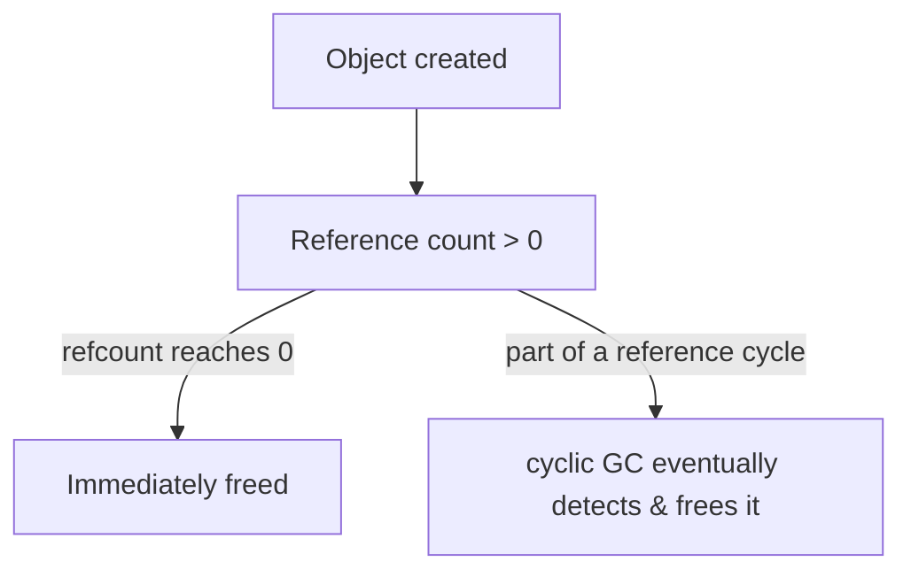

This combination gives Python fully automatic memory management — no manual `free()`/`delete` calls, unlike C++ ([Q159 vs C++ manual memory](#10-what-are-the-important-differences-between-python-and-javac)).

### 160. What is reference counting, and how does CPython use it?

Every object in CPython has a hidden **reference count** field tracking how many references currently point to it. The count increments whenever a new reference is created (assignment, passing as an argument, storing in a container) and decrements when a reference goes out of scope, is reassigned, or is explicitly deleted. When the count reaches **zero**, CPython deallocates the object **immediately** — no waiting for a garbage collection pass.

```python
import sys

x = [1, 2, 3]
sys.getrefcount(x)    # 2 (one for x, one for the getrefcount() argument itself)

y = x                  # refcount += 1
sys.getrefcount(x)     # 3

del y                  # refcount -= 1
sys.getrefcount(x)      # back to 2
```

This is why memory is typically freed **deterministically and promptly** in Python (unlike, say, Java's GC, which frees on its own schedule) — the major exception being **reference cycles**, which reference counting alone cannot detect ([Q161](#161-what-causes-a-reference-cycle-and-how-does-pythons-garbage-collector-handle-it)).

### 161. What causes a reference cycle, and how does Python's garbage collector handle it?

A **reference cycle** occurs when two or more objects reference each other, directly or indirectly, forming a loop — even if nothing *outside* the cycle references any of them, each object inside the cycle still has a reference count greater than zero (from the other object in the cycle), so pure reference counting can never bring it to zero.

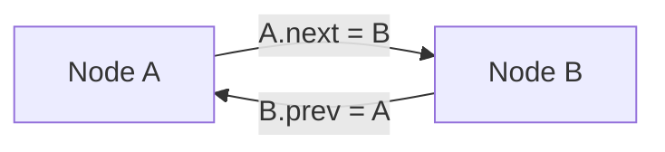

```python
class Node:
    def __init__(self):
        self.next = None

a = Node()
b = Node()
a.next = b
b.next = a       # cycle! a references b, b references a

del a
del b
# Neither refcount ever reaches 0 on its own — the cyclic GC is needed to reclaim them
```

CPython's **generational cyclic garbage collector** (the `gc` module) periodically scans for groups of objects that are only reachable from within their own cycle (unreachable from any live "root" reference outside the group) and frees the entire group together. This runs automatically and periodically, separate from — and in addition to — reference counting.

### 162. What is the gc module used for?

The `gc` module gives you visibility into and control over CPython's **cyclic garbage collector**: forcing a collection pass, inspecting/tuning its generational thresholds, temporarily disabling it, or debugging memory leaks caused by uncollectable cycles.

```python
import gc

gc.collect()          # force an immediate collection pass, returns count of objects collected
gc.disable()           # turn off automatic cyclic collection (rarely needed — perf tuning)
gc.enable()             # turn it back on
gc.get_threshold()      # (700, 10, 10) — generational collection thresholds
gc.get_objects()        # list every object currently tracked by the collector
```

Most application code never touches `gc` directly — it's mainly useful for diagnosing memory leaks (objects that should have been freed but are stuck in an unreachable cycle involving a `__del__` method, historically) or squeezing out GC-pause latency in performance-critical services.

### 163. What are weak references, and when would you use them?

A **weak reference** (from the `weakref` module) points to an object **without increasing its reference count** — meaning it doesn't keep the object alive on its own. If the object's only remaining references are weak ones, it's freed normally, and the weak reference then reports the object as gone.

```python
import weakref

class Data:
    pass

obj = Data()
weak = weakref.ref(obj)
weak()             # <Data object> — call it like a function to get the referent

del obj
weak()             # None — the real object is gone; the weak ref doesn't keep it alive
```

Common uses: **caches** (you want the cache to hold entries without preventing them from being garbage collected when nothing else needs them) and breaking **parent-child reference cycles** deliberately — e.g., a child object holding a `weakref` back to its parent instead of a strong reference, so the pair doesn't form an uncollectable-until-GC-runs cycle.

### 164. What is the relationship between id(), memory addresses, and object lifetime in CPython?

In **CPython specifically**, `id(obj)` returns the object's memory address — but this is an implementation detail, not a language guarantee (other implementations like PyPy may compute `id()` differently). Because IDs are only guaranteed unique **for an object's lifetime**, once an object is garbage collected, its memory can be reused, and a *completely different* object can end up with the same `id()` afterward.

```python
class Foo: pass

a = Foo()
id_a = id(a)
del a                 # refcount hits 0, memory freed, address available for reuse

b = Foo()
id(b) == id_a          # can be True! b might get the SAME memory address a used to have
```

This is a classic footgun: never compare two `id()` values across time without also keeping the objects alive (e.g., via a variable) — an apparent "same identity" match might just be coincidental memory reuse.

### 165. How does Python's small integer/string caching (interning) affect memory?

By caching and reusing objects for very common values — small integers -5 to 256 ([Q23](#23-why-does-is-sometimes-return-true-for-small-integers-but-not-for-large-ones)) and certain string literals ([Q29](#29-what-is-string-interning)) — CPython avoids allocating a brand-new object every time your code happens to use, say, the number `1` or the string `"key"`, which occur constantly in real programs (loop counters, dict keys, flags). This is a genuine, measurable memory and allocation-time optimization, not just an `is`-comparison quirk — programs routinely create the value `1` or the string `"name"` thousands of times, and reusing one cached object instead of allocating thousands of identical ones reduces both memory footprint and allocator overhead. The behavior is invisible to correct code (which always compares values with `==`) and only becomes observable — and a common source of confusion — when someone mistakenly relies on `is` for value comparison.

---

## Multithreading, Multiprocessing & Concurrency

### 166. What is the Global Interpreter Lock (GIL), and why does it exist?

The **GIL** is a mutex in **CPython** that allows only **one thread at a time** to execute Python bytecode, even on a multi-core machine — regardless of how many OS threads your program spins up. It exists because CPython's memory management (specifically, reference counting — [Q160](#160-what-is-reference-counting-and-how-does-cpython-use-it)) is **not thread-safe** by design; without a global lock, two threads simultaneously incrementing/decrementing the same object's reference count could corrupt it, causing memory leaks or premature frees/crashes. The GIL was a pragmatic simplification that made CPython's internals (and easy C-extension writing) much simpler at the cost of true multi-core parallelism for pure-Python code.

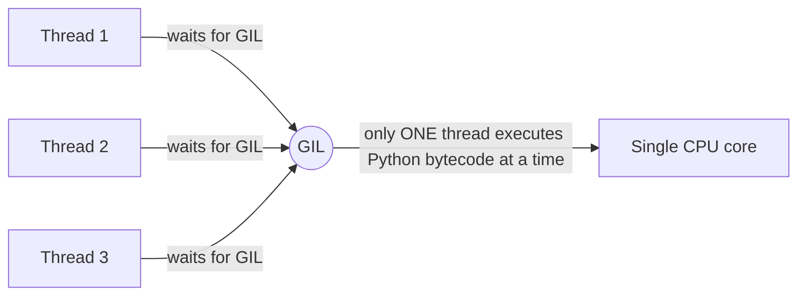

Note: this is a **CPython** implementation detail, not a Python language requirement — Jython and IronPython have no GIL, and a "no-GIL" build of CPython itself (PEP 703) became officially supported starting in **Python 3.13**.

### 167. Does the GIL mean Python can't do parallel work at all?

No — the GIL only blocks **parallel execution of Python bytecode within a single process**. Several things still achieve real parallelism:

- **I/O-bound work** — the GIL is **released** while a thread waits on I/O (network, disk, `time.sleep`), so multiple threads can overlap their *waiting* time effectively, even though only one runs Python code at any instant ([Q168](#168-what-is-the-difference-between-multithreading-and-multiprocessing-in-python)).
- **`multiprocessing`** — spawns separate OS **processes**, each with its own Python interpreter and its own GIL, achieving true CPU parallelism across cores ([Q168](#168-what-is-the-difference-between-multithreading-and-multiprocessing-in-python)).
- **C extensions** (NumPy, Pandas, TensorFlow) — many release the GIL internally while doing the heavy numeric computation in C, so CPU-bound work done through them can genuinely run in parallel even from Python threads.

```python
# I/O-bound: threads DO help, GIL is released during the actual wait
import threading, requests
threads = [threading.Thread(target=requests.get, args=(url,)) for url in urls]
```

### 168. What is the difference between multithreading and multiprocessing in Python?

| | `threading` | `multiprocessing` |
|---|---|---|
| Unit of concurrency | OS thread, within one process | Separate OS process |
| Memory | Shared address space | Separate memory (must explicitly share/pass data) |
| GIL | One shared GIL — limits CPU parallelism | Each process has its OWN GIL — true parallelism |
| Best for | I/O-bound tasks | CPU-bound tasks |
| Overhead | Low (cheap to create) | Higher (process startup, IPC overhead) |
| Communication | Shared variables (with locking) | `Queue`, `Pipe`, shared memory |

```python
import threading, multiprocessing

# I/O-bound -> threading (GIL released during I/O wait)
t = threading.Thread(target=download_file, args=(url,))

# CPU-bound -> multiprocessing (separate GIL per process = real parallelism)
p = multiprocessing.Process(target=crunch_numbers, args=(data,))
```

### 169. When would you use threading vs multiprocessing vs asyncio?

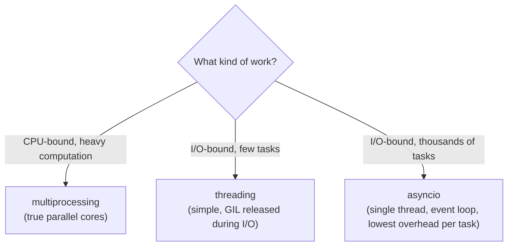

- **CPU-bound** (image processing, number crunching, ML training): use **`multiprocessing`** — you need genuine multi-core parallelism, and the GIL blocks that for threads.
- **I/O-bound, moderate concurrency** (a handful of file/network operations): use **`threading`** — simple mental model, the GIL isn't a bottleneck since threads spend most of their time waiting, not computing.
- **I/O-bound, massive concurrency** (thousands of simultaneous network connections, e.g. a high-throughput web server or scraper): use **`asyncio`** — a single thread with an event loop scales to far more concurrent tasks than OS threads can, since each task has near-zero overhead compared to a full thread.

Full quick-reference table at the [top of this guide](#concurrency-model-quick-reference).

### 170. What is a race condition, and how do you prevent one in Python?

A **race condition** occurs when multiple threads access and modify **shared, mutable state** without synchronization, and the final outcome depends unpredictably on the timing/interleaving of their execution — producing bugs that appear intermittently and are notoriously hard to reproduce.

```python
import threading

counter = 0
def increment():
    global counter
    for _ in range(100000):
        counter += 1     # NOT atomic! read-modify-write can interleave between threads

threads = [threading.Thread(target=increment) for _ in range(2)]
[t.start() for t in threads]
[t.join() for t in threads]
print(counter)   # often LESS than 200000 — lost updates from interleaving
```

**Prevention:** use a `threading.Lock` ([Q171](#171-what-is-a-lock-in-the-threading-module)) to make the critical section atomic, or avoid shared mutable state entirely by using thread-safe data structures (`queue.Queue`) or process isolation (`multiprocessing`, where memory isn't shared by default).

### 171. What is a Lock in the threading module?

`threading.Lock` is a mutex — only one thread can hold it at a time; any other thread calling `.acquire()` blocks until the holder releases it. It's the standard tool for protecting a **critical section** (code that touches shared, mutable state) from race conditions.

```python
import threading

counter = 0
lock = threading.Lock()

def increment():
    global counter
    for _ in range(100000):
        with lock:              # only one thread inside this block at a time
            counter += 1

threads = [threading.Thread(target=increment) for _ in range(2)]
[t.start() for t in threads]
[t.join() for t in threads]
print(counter)   # reliably 200000
```

Using `with lock:` (instead of manual `.acquire()`/`.release()`) guarantees the lock is released even if an exception occurs inside the block — `Lock` is itself a context manager.

### 172. What is a deadlock?

A **deadlock** occurs when two or more threads are each waiting for a resource the other holds, so neither can ever proceed — the program hangs indefinitely with no error raised. The classic cause is acquiring multiple locks **in inconsistent order** across different threads.

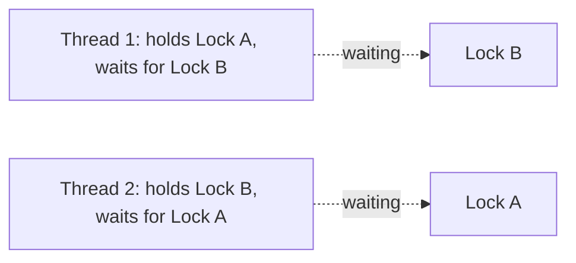

```python
lock_a = threading.Lock()
lock_b = threading.Lock()

def thread1():
    with lock_a:
        with lock_b:      # thread1 wants B while holding A
            ...

def thread2():
    with lock_b:
        with lock_a:      # thread2 wants A while holding B -> DEADLOCK if timed right
            ...
```

**Prevention:** always acquire multiple locks in a **consistent, global order** across every thread, use lock timeouts (`lock.acquire(timeout=5)`), or avoid holding more than one lock at a time altogether.

### 173. What is the concurrent.futures module?

`concurrent.futures` provides a **high-level, uniform interface** for running work asynchronously via a pool of workers — `ThreadPoolExecutor` (threads, for I/O-bound work) and `ProcessPoolExecutor` (processes, for CPU-bound work) share the same API, so switching between them is often a one-line change.

```python
from concurrent.futures import ThreadPoolExecutor, ProcessPoolExecutor

# I/O-bound — thread pool
with ThreadPoolExecutor(max_workers=5) as executor:
    results = list(executor.map(download_url, urls))

# CPU-bound — process pool
with ProcessPoolExecutor(max_workers=4) as executor:
    results = list(executor.map(crunch_numbers, datasets))

# Submitting individual tasks and getting a Future back:
future = executor.submit(some_function, arg)
result = future.result()      # blocks until done
```

This is generally the recommended, higher-level entry point for parallel work over raw `threading.Thread`/`multiprocessing.Process`, since it handles pooling, task queuing, and result collection for you.

### 174. What is asyncio, and what problem does it solve?

`asyncio` is Python's standard library framework for **single-threaded concurrency** using coroutines and an event loop — it lets one thread juggle thousands of I/O-bound tasks by switching between them whenever one is waiting (e.g., on a network response), rather than actually blocking. It solves the scalability problem that `threading` hits at high task counts: OS threads are relatively heavyweight (memory per thread, OS scheduling overhead), so tens of thousands of concurrent threads isn't practical, while tens of thousands of `asyncio` coroutines is routine.

```python
import asyncio

async def fetch(url):
    await asyncio.sleep(1)     # simulates a non-blocking I/O wait
    return f"data from {url}"

async def main():
    results = await asyncio.gather(*(fetch(url) for url in urls))
    print(results)

asyncio.run(main())
```

Crucially, `asyncio` gives you **concurrency, not parallelism** — it's still bound by a single thread (and the GIL), so it's the right tool for I/O-bound workloads, not CPU-bound ones ([Q223](#223-what-is-the-difference-between-cpu-bound-and-io-bound-tasks-and-how-does-that-affect-your-concurrency-choice-in-python)).

### 175. What is the difference between a coroutine defined with async def and a generator?

They share deep implementation roots (both are pause/resume-able functions built on the same underlying frame-suspension machinery), but serve different purposes and have different rules:

| | Generator (`def` + `yield`) | Coroutine (`async def`) |
|---|---|---|
| Purpose | Produce a **sequence of values** lazily | Represent a **single asynchronous operation** |
| Pause keyword | `yield` | `await` |
| Consumed by | `for` loop, `next()` | `await`, `asyncio.gather()`, event loop |
| Return value | Yields many values over time | Ultimately resolves to ONE final result |

```python
def gen():              # generator — produces a SEQUENCE
    yield 1
    yield 2

async def coro():        # coroutine — represents ONE eventual result
    await asyncio.sleep(1)
    return "done"
```

You cannot `for x in coro():` a coroutine the way you can a generator — a coroutine must be driven by `await` or the event loop, not by the iterator protocol directly (though `async for` exists for the related concept of **async generators**, `async def` functions containing `yield`).

### 176. What is an event loop?

The **event loop** is the core of `asyncio` — a single-threaded scheduler that keeps a queue of pending coroutines/callbacks and, whenever the currently-running one hits an `await` on something not yet ready (a network response, a timer), switches to run another ready task instead, cycling continuously until all tasks complete.

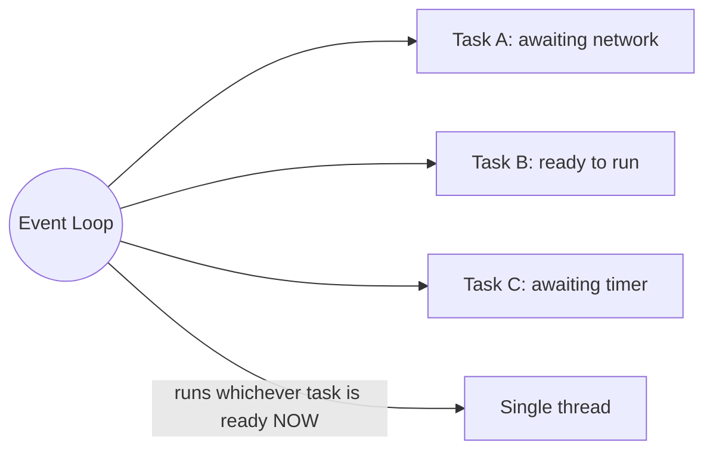

```python
async def main():
    task1 = asyncio.create_task(fetch("url1"))   # scheduled, doesn't block yet
    task2 = asyncio.create_task(fetch("url2"))   # also scheduled — runs "concurrently"
    results = await asyncio.gather(task1, task2)  # now wait for both

asyncio.run(main())   # asyncio.run() creates and manages the event loop for you
```

You almost never need to manage the event loop directly in modern `asyncio` code — `asyncio.run()` creates it, runs your top-level coroutine, and cleans up afterward.

### 177. What is the difference between await and calling a coroutine directly?

**Calling a coroutine function** (`coro()`) does **not** run its body — it just creates a coroutine *object*, exactly like calling a generator function creates a generator object without running it ([Q114](#114-what-is-a-generator-function-and-how-does-yield-work)). You must `await` that object (or otherwise schedule it, e.g. via `asyncio.create_task`) to actually execute it.

```python
async def fetch():
    return "data"

result = fetch()          # NOT the result — a coroutine object, still unexecuted!
print(result)               # <coroutine object fetch at 0x...>

async def main():
    result = await fetch()   # NOW it actually runs, and pauses main() until it completes
    print(result)              # "data"

asyncio.run(main())
```

Forgetting `await` is an extremely common `asyncio` bug — Python even emits a `RuntimeWarning: coroutine 'fetch' was never awaited` to help catch it, since the code runs without error but silently does nothing.

### 178. How do you run blocking code inside an asyncio application?

Calling regular **blocking/synchronous** code (a CPU-heavy computation, or a library that doesn't support `async`) directly inside a coroutine **freezes the entire event loop** — since everything runs on one thread, nothing else can make progress while that blocking call runs. The fix is to offload it to a separate thread or process via `loop.run_in_executor()`.

```python
import asyncio

def blocking_cpu_work(n):
    return sum(i * i for i in range(n))    # CPU-heavy, blocking

async def main():
    loop = asyncio.get_running_loop()
    # Runs blocking_cpu_work in a background thread, doesn't freeze the event loop
    result = await loop.run_in_executor(None, blocking_cpu_work, 10_000_000)
    print(result)

asyncio.run(main())
```

For genuinely CPU-bound work, `run_in_executor` with a `ProcessPoolExecutor` (rather than the default thread pool) achieves real parallelism, sidestepping the GIL the same way plain `multiprocessing` does ([Q167](#167-does-the-gil-mean-python-cant-do-parallel-work-at-all)).

---

## Collections Module

### 179. What is collections.Counter, and how is it used?

`Counter` is a `dict` subclass specialized for **counting hashable objects** — it takes an iterable and produces a mapping from each distinct element to its count, with convenient extras like `.most_common()`.

```python
from collections import Counter

words = ["apple", "banana", "apple", "cherry", "banana", "apple"]
counts = Counter(words)
print(counts)                     # Counter({'apple': 3, 'banana': 2, 'cherry': 1})
counts.most_common(2)              # [('apple', 3), ('banana', 2)]
counts["apple"]                     # 3
counts["missing"]                   # 0 — missing keys default to 0, no KeyError
```

`Counter` objects also support arithmetic (`counter1 + counter2` merges counts, `counter1 - counter2` subtracts) — handy for comparing or combining frequency distributions.

### 180. What is collections.OrderedDict, and is it still needed in modern Python?

`OrderedDict` is a `dict` subclass that explicitly guarantees insertion-order preservation and adds order-sensitive methods (`move_to_end()`) and order-sensitive equality (two `OrderedDict`s are only `==` if they have the same order, not just the same key/value pairs — unlike regular `dict`).

Since **Python 3.7**, plain `dict` also guarantees insertion order ([Q52](#52-how-has-dictionary-ordering-changed-across-python-versions)), so `OrderedDict` is **largely legacy** for basic ordering needs. It's still worth reaching for when you specifically need:

```python
from collections import OrderedDict

od = OrderedDict()
od["a"] = 1
od["b"] = 2
od.move_to_end("a")           # regular dict has no equivalent built-in method
print(od)                      # OrderedDict([('b', 2), ('a', 1)])
```

- `move_to_end()` — no plain-`dict` equivalent (useful for implementing an LRU cache manually).
- Order-sensitive `==` comparison.

### 181. What is collections.deque, and why is it faster than a list for queue operations?

`deque` ("double-ended queue") is a sequence optimized for **fast appends and pops from both ends**, implemented internally as a doubly-linked list of fixed-size blocks — unlike a `list`, where `.insert(0, x)`/`.pop(0)` are O(n) because every remaining element must shift ([Q42](#42-what-is-the-time-complexity-of-common-list-operations)).

```python
from collections import deque

d = deque([1, 2, 3])
d.appendleft(0)        # O(1) — vs list.insert(0, 0), which is O(n)
d.append(4)              # O(1)
d.popleft()               # O(1) — vs list.pop(0), which is O(n)
print(d)                   # deque([0, 1, 2, 3, 4]) minus whatever was popped

d = deque(maxlen=3)       # bounded deque — auto-discards oldest when full
```

Use `deque` whenever you need queue (FIFO) or stack-with-both-ends behavior — indexed random access (`d[100]`) is O(n) on a deque, unlike a list, so it's not a drop-in replacement for every use case.

### 182. What is collections.namedtuple?

Covered in detail in [Q44](#44-what-is-a-named-tuple-and-why-use-one) — briefly: it creates a lightweight, immutable, tuple-based class whose fields can be accessed by name (`p.x`) as well as by index (`p[0]`), giving you readable, self-documenting records without the overhead of a full class.

```python
from collections import namedtuple
Point = namedtuple("Point", "x y")
p = Point(1, 2)
p.x, p[0]     # (1, 1) — same value, two access styles
```

### 183. What is collections.ChainMap?

`ChainMap` groups **multiple dictionaries into a single, updatable view** — lookups search each underlying dict in order and return the first match, without actually copying or merging their contents. It's commonly used to layer configuration sources (command-line overrides > environment variables > defaults) with clear precedence.

```python
from collections import ChainMap

defaults = {"color": "blue", "size": "medium"}
user_overrides = {"color": "red"}

settings = ChainMap(user_overrides, defaults)
settings["color"]     # "red"  — found in the first dict (higher precedence)
settings["size"]       # "medium" — falls through to the second dict

settings["theme"] = "dark"   # writes go to the FIRST dict only
print(user_overrides)          # {'color': 'red', 'theme': 'dark'}
print(defaults)                  # unchanged
```

Unlike `{**defaults, **user_overrides}` (which creates a brand-new merged dict), `ChainMap` stays **live** — if `defaults` changes later, `settings` immediately reflects that change too, since it's just a view over the originals.

---

## Itertools & Additional Tools

### 184. What is the itertools module, and what are some commonly used functions in it?

`itertools` provides fast, memory-efficient (all **lazy**) building blocks for working with iterators, inspired by functional-programming iterator libraries. Commonly used functions:

| Function | Purpose |
|---|---|
| `itertools.chain(*iterables)` | Concatenate multiple iterables into one stream ([Q185](#185-what-is-itertoolschain-used-for)) |
| `itertools.count(start, step)` | Infinite counter, like `range()` with no end |
| `itertools.cycle(iterable)` | Repeat an iterable forever |
| `itertools.repeat(x, n)` | Repeat a value `n` times (or forever) |
| `itertools.combinations(iterable, r)` | All r-length combinations, order doesn't matter |
| `itertools.permutations(iterable, r)` | All r-length orderings, order matters |
| `itertools.product(*iterables)` | Cartesian product — nested-loop equivalent |
| `itertools.groupby(iterable, key)` | Group consecutive elements sharing a key ([Q186](#186-what-is-itertoolsgroupby-and-what-is-a-common-pitfall-with-it)) |
| `itertools.islice(iterable, n)` | Slice a lazy iterator without consuming it all |

```python
import itertools
list(itertools.combinations([1, 2, 3], 2))   # [(1, 2), (1, 3), (2, 3)]
list(itertools.product([0, 1], repeat=3))      # all 8 binary triples
```

### 185. What is itertools.chain used for?

`itertools.chain(*iterables)` lazily concatenates multiple iterables into a **single continuous stream**, without first combining them into one physical list — more efficient than `list1 + list2 + list3` when the inputs are large or already lazy.

```python
from itertools import chain

a = [1, 2, 3]
b = (4, 5)
c = range(6, 8)

for x in chain(a, b, c):
    print(x)     # 1 2 3 4 5 6 7 — iterates through all three seamlessly

list(chain(a, b, c))   # [1, 2, 3, 4, 5, 6, 7]
```

`chain.from_iterable(iterable_of_iterables)` is a variant for when you have a single iterable containing other iterables (e.g., a list of lists) rather than separate arguments.

### 186. What is itertools.groupby, and what is a common pitfall with it?

`itertools.groupby(iterable, key=...)` groups **consecutive** elements that share the same key into sub-iterators — critically, it only groups *runs of adjacent* matching elements, **not** all matching elements across the whole iterable, the way a SQL `GROUP BY` does.

```python
from itertools import groupby

data = [1, 1, 2, 2, 1, 3]     # note: 1 appears again after 2s — NOT globally grouped
for key, group in groupby(data):
    print(key, list(group))
# 1 [1, 1]
# 2 [2, 2]
# 1 [1]      <- a SEPARATE group, because it wasn't consecutive with the first 1s!
# 3 [3]
```

**Common pitfall #1:** forgetting to **sort first** if you want true "all elements with this key together" grouping — `groupby` alone only catches consecutive runs. **Common pitfall #2:** each `group` sub-iterator is lazy and tied to the parent iterator's position — if you don't consume it (e.g., with `list(group)`) before advancing to the next `key, group` pair, its values become unavailable.

### 187. What is the difference between zip() and itertools.zip_longest()?

- **`zip(*iterables)`** stops as soon as the **shortest** iterable is exhausted — any extra elements in longer iterables are silently dropped.
- **`itertools.zip_longest(*iterables, fillvalue=None)`** continues until the **longest** iterable is exhausted, filling in missing values from shorter ones with `fillvalue`.

```python
from itertools import zip_longest

names = ["Alice", "Bob", "Carol"]
ages = [30, 25]

list(zip(names, ages))
# [('Alice', 30), ('Bob', 25)]  — Carol silently dropped!

list(zip_longest(names, ages, fillvalue="?"))
# [('Alice', 30), ('Bob', 25), ('Carol', '?')]  — nothing lost
```

Use `zip_longest` whenever mismatched lengths would represent a bug you want visible (a missing value shown as `fillvalue`) rather than silently truncated data.

### 188. What is enumerate(), and why is it preferred over manual index tracking?

`enumerate(iterable, start=0)` returns an iterator of `(index, value)` pairs, letting you get both the index and the item in a `for` loop without manually maintaining a counter variable.

```python
items = ["a", "b", "c"]

# Manual — error-prone, extra state to maintain
i = 0
for item in items:
    print(i, item)
    i += 1

# Idiomatic
for i, item in enumerate(items):
    print(i, item)

for i, item in enumerate(items, start=1):   # start counting from 1 instead of 0
    print(i, item)
```

`enumerate()` is preferred because it's less error-prone (no manual increment to forget), more readable, and — being lazy — works on any iterable, not just sequences that support indexing.

---

## Regular Expressions

### 189. What module does Python use for regular expressions?

The built-in `re` module provides regex support, based on Perl-style regular expression syntax. Core functions: `re.match()`, `re.search()`, `re.findall()`, `re.finditer()`, `re.sub()`, `re.split()`, and `re.compile()` for pre-compiling a pattern for reuse ([Q192](#192-why-should-you-compile-a-regex-with-recompile-when-reusing-it)).

```python
import re

re.findall(r"\d+", "I have 3 cats and 12 dogs")   # ['3', '12']
re.sub(r"\s+", " ", "too    many   spaces")          # "too many spaces"
```

### 190. What is the difference between re.match(), re.search(), and re.findall()?

- **`re.match(pattern, string)`** — checks for a match **only at the start** of the string.
- **`re.search(pattern, string)`** — scans the **entire string** for the first location where the pattern matches, anywhere.
- **`re.findall(pattern, string)`** — returns a **list of all non-overlapping matches** in the string.

```python
import re

text = "The price is $50, tax is $5"

re.match(r"\$\d+", text)      # None — "$50" isn't at the very start of the string
re.search(r"\$\d+", text)     # <Match object: '$50'> — finds the first one anywhere
re.findall(r"\$\d+", text)    # ['$50', '$5'] — ALL matches, as plain strings
```

A common gotcha: people expect `re.match` to search anywhere in the string like most other languages' regex "match" function does — in Python, that behavior is `re.search`, not `re.match`.

### 191. What is the difference between greedy and non-greedy matching?

By default, quantifiers (`*`, `+`, `?`, `{m,n}`) are **greedy** — they match **as much text as possible** while still allowing the overall pattern to succeed. Appending `?` after a quantifier makes it **non-greedy (lazy)** — it matches **as little text as possible**.

```python
import re

text = "<b>bold</b> and <i>italic</i>"

re.findall(r"<.+>", text)      # ['<b>bold</b> and <i>italic</i>']  — greedy: one giant match!
re.findall(r"<.+?>", text)     # ['<b>', '</b>', '<i>', '</i>']      — non-greedy: each tag separately
```

The greedy version's `.+` tries to consume the *entire rest of the string* first, then backtracks only as much as necessary — since `>` also appears later in the string, it ends up spanning from the first `<` all the way to the very last `>`. Non-greedy matching is essential whenever you're parsing repeated delimited structures like HTML/XML tags.

### 192. Why should you compile a regex with re.compile() when reusing it?

`re.compile(pattern)` parses the pattern once into a reusable **pattern object**, which you can then call `.match()`/`.search()`/`.findall()` on repeatedly without CPython re-parsing the regex string every time. Calling `re.search(pattern, text)` directly still benefits from an internal small cache of recently-used compiled patterns, but that cache has limited size and gets invalidated — explicit `re.compile()` guarantees the pattern is parsed exactly once and gives you a clear, self-documenting reference to reuse.

```python
import re

# Less efficient if used in a hot loop — relies on the internal cache
for line in huge_file:
    if re.search(r"^\d{3}-\d{4}$", line):
        ...

# Explicit, clear, and guaranteed to only compile once
phone_pattern = re.compile(r"^\d{3}-\d{4}$")
for line in huge_file:
    if phone_pattern.match(line):
        ...
```

The performance difference matters most when a pattern is used **many times in a loop** — for a one-off `re.search()` call, compiling explicitly first makes little practical difference.

---

## Testing & Debugging

### 193. What is the unittest module, and how do you write a basic test case?

`unittest` is Python's built-in testing framework, modeled on Java's JUnit (xUnit-style). Tests are written as methods on a class that subclasses `unittest.TestCase`, using `self.assert*` methods to check expectations; any method starting with `test_` is auto-discovered and run.

```python
import unittest

def add(a, b):
    return a + b

class TestAdd(unittest.TestCase):
    def test_add_positive(self):
        self.assertEqual(add(2, 3), 5)

    def test_add_negative(self):
        self.assertEqual(add(-1, -1), -2)

    def setUp(self):        # runs before EACH test method
        self.data = [1, 2, 3]

if __name__ == "__main__":
    unittest.main()
```

Run with `python -m unittest` (auto-discovers `test_*.py` files) or `python test_module.py`.

### 194. What is the difference between unittest and pytest?

| | `unittest` | `pytest` |
|---|---|---|
| In standard library? | Yes | No — third-party (`pip install pytest`) |
| Test style | Class-based, `TestCase` subclass required | Plain functions — no class needed |
| Assertions | `self.assertEqual(a, b)`, etc. | Plain `assert a == b` — pytest rewrites it for rich failure messages |
| Fixtures | `setUp`/`tearDown` methods | `@pytest.fixture` — more flexible, composable ([Q195](#195-what-are-fixtures-in-pytest)) |
| Plugin ecosystem | Minimal | Huge (coverage, parallel runs, mocking helpers, etc.) |

```python
# unittest style
class TestMath(unittest.TestCase):
    def test_add(self):
        self.assertEqual(1 + 1, 2)

# pytest style — no class, no boilerplate, plain assert
def test_add():
    assert 1 + 1 == 2
```

`pytest` has become the de facto standard in most modern Python projects for its lower boilerplate, better failure output, and fixture system, while still being able to run existing `unittest`-based test suites unmodified.

### 195. What are fixtures in pytest?

A **fixture** is a reusable function that provides setup (and optional teardown) for tests — pytest automatically detects which fixtures a test function needs by matching its parameter names, and injects the fixture's return value.

```python
import pytest

@pytest.fixture
def sample_data():
    return {"name": "Alice", "age": 30}

def test_name(sample_data):        # pytest auto-injects sample_data here
    assert sample_data["name"] == "Alice"

@pytest.fixture
def db_connection():
    conn = connect_to_test_db()
    yield conn              # everything before yield = setup
    conn.close()             # everything after yield = teardown
```

Fixtures can depend on other fixtures, be scoped (`scope="function"` (default), `"module"`, `"session"`) to control how often they're recreated, and are pytest's answer to `unittest`'s more rigid `setUp`/`tearDown`.

### 196. What is mocking, and how do you use unittest.mock?

**Mocking** replaces a real object/function (typically an external dependency — a database, an API call, the filesystem) with a fake stand-in during a test, so the test can run fast, deterministically, and without needing the real dependency to actually be available. `unittest.mock` provides `Mock`, `MagicMock`, and the `patch()` decorator/context manager for temporarily substituting objects.

```python
from unittest.mock import patch, MagicMock

def get_weather(api_client, city):
    return api_client.fetch(city)["temp"]

def test_get_weather():
    mock_client = MagicMock()
    mock_client.fetch.return_value = {"temp": 72}
    assert get_weather(mock_client, "NYC") == 72
    mock_client.fetch.assert_called_once_with("NYC")   # verify the call happened correctly

@patch("mymodule.requests.get")     # temporarily replaces requests.get during this test
def test_api_call(mock_get):
    mock_get.return_value.json.return_value = {"status": "ok"}
    result = call_external_api()
    assert result["status"] == "ok"
```

Mocking is essential for **unit** tests (isolating just the code under test) as opposed to **integration** tests (which deliberately exercise real dependencies).

### 197. How do you debug Python code (pdb, breakpoint())?

Python ships with `pdb`, an interactive command-line debugger. The modern, idiomatic way to drop into it is the built-in `breakpoint()` function (Python 3.7+), which pauses execution at that exact line and opens a `pdb` prompt.

```python
def calculate(x, y):
    result = x + y
    breakpoint()      # execution pauses here; drops into interactive pdb
    return result * 2

calculate(3, 4)
```

Common `pdb` commands once paused: `n` (next line), `s` (step into a function call), `c` (continue running), `l` (list surrounding code), `p variable_name` (print a value), `q` (quit). IDEs (VS Code, PyCharm) also provide graphical debuggers (breakpoints, variable inspection, call stacks) built on the same underlying mechanism.

### 198. What is an assert statement, and when is it disabled?

`assert condition, "message"` checks that `condition` is truthy, raising `AssertionError(message)` if not — intended for catching **programmer errors and invariant violations** during development (things that should be logically impossible if the code is correct), not for validating untrusted user input.

```python
def set_age(age):
    assert age >= 0, "Age cannot be negative"
    self.age = age
```

**Critically:** `assert` statements are **stripped out entirely** when Python is run with the `-O` (optimize) flag, or when `PYTHONOPTIMIZE` is set — meaning any code depending on an assertion's side effects, or using `assert` for actual security/validation checks, silently stops working in that mode. **Never use `assert` to validate user input or enforce security checks** — use explicit `if`/`raise` for anything that must always run.

---

## Type Hints & Static Typing

### 199. What are type hints, and why were they introduced?

**Type hints** (PEP 484, Python 3.5+) are optional annotations that document the expected types of function parameters, return values, and variables, without changing Python's fundamentally dynamic runtime behavior. They were introduced to bring the **tooling benefits of static typing** — IDE autocomplete, catching type errors before running the code, self-documenting signatures — to a dynamically typed language, without sacrificing Python's flexibility or requiring a breaking change to the language itself.

```python
def greet(name: str, times: int = 1) -> str:
    return (f"Hello, {name}! " * times).strip()

age: int = 30
scores: list[int] = [90, 85, 77]
```

They're purely optional and additive — existing untyped code continues to run exactly as before.

### 200. Does Python enforce type hints at runtime?

**No** — type hints are **not checked by the Python interpreter at runtime** by default. You can annotate a parameter as `int` and pass a `str`, and the function runs without complaint unless the code itself does something that fails with that type.

```python
def add(a: int, b: int) -> int:
    return a + b

add("hello", "world")   # runs fine! Returns "helloworld" — no TypeError from the hints
```

Enforcement comes entirely from **external static type checkers** (`mypy`, `pyright`, `pyre`) run separately as a linting step ([Q201](#201-what-is-mypy-and-what-does-it-do)), or from libraries that explicitly validate annotations at runtime themselves (e.g., `pydantic`, `dataclasses` with custom validation) — the core language treats annotations as inert metadata, stored in `__annotations__`.

### 201. What is mypy, and what does it do?

`mypy` is the original and most widely used **static type checker** for Python — a separate command-line tool (not part of running your program) that reads your type-hinted code and reports type inconsistencies **before** you ever run it, similar to how a compiler catches type errors in Java or C++.

```python
# mymodule.py
def add(a: int, b: int) -> int:
    return a + b

add("hello", "world")   # mymodule.py:4: error: Argument 1 to "add" has incompatible type "str"; expected "int"
```

```bash
mypy mymodule.py
```

Running `mypy` in CI catches an entire category of bugs (wrong types passed, `None` where a value was expected, mismatched return types) at review time rather than at runtime — increasingly standard practice in production Python codebases, alongside newer alternatives like `pyright` (used by VS Code's Pylance) and the Rust-based `ruff`'s emerging type-checking features.

### 202. What are Optional and Union, and what does the newer | syntax for types mean?

- **`Union[X, Y]`** — a value that could be **either type X or type Y**.
- **`Optional[X]`** — shorthand for `Union[X, None]` — a value that's either type `X` or `None`.
- **`X | Y`** (Python 3.10+, PEP 604) — a cleaner, built-in syntax replacing `Union[X, Y]`; `X | None` replaces `Optional[X]`.

```python
from typing import Union, Optional

# Older syntax
def find_user(id: int) -> Optional[str]:      # returns a str OR None
    ...

def parse(value: Union[int, str]) -> int:       # accepts int OR str
    ...

# Python 3.10+ syntax — no import needed, reads more naturally
def find_user(id: int) -> str | None:
    ...

def parse(value: int | str) -> int:
    ...
```

`Optional[X]` is one of the most common type hints in real code, since a function returning "the item, or nothing if not found" is an extremely common pattern.

### 203. What is TypeVar, and how is it used for generics?

`TypeVar` creates a **placeholder type** that lets you write a **generic** function or class — one whose exact type varies per call/instantiation but stays **consistent within that single usage**, letting a type checker verify relationships between the types of different arguments/return values.

```python
from typing import TypeVar, Sequence

T = TypeVar("T")

def first(items: Sequence[T]) -> T:
    return items[0]

first([1, 2, 3])        # type checker infers T = int, so return type is int
first(["a", "b"])        # type checker infers T = str, so return type is str

# Generic class:
class Box(Generic[T]):
    def __init__(self, item: T):
        self.item = item

int_box: Box[int] = Box(5)
```

Without `TypeVar`, `first`'s signature would have to say `Sequence[Any] -> Any`, losing the useful guarantee that "the return type matches whatever was inside the input sequence."

### 204. What is a Protocol in the typing module, and how does it relate to duck typing?

`typing.Protocol` (PEP 544, Python 3.8+) defines a type by its **shape** — the methods/attributes it must have — rather than by explicit inheritance, giving you **structural typing** that mirrors Python's runtime **duck typing** ([Q13](#13-what-is-duck-typing)) but checkable statically by `mypy`.

```python
from typing import Protocol

class Readable(Protocol):
    def read(self) -> str: ...

def process(source: Readable) -> str:
    return source.read().upper()

class MyFile:                       # no inheritance from Readable needed!
    def read(self) -> str:
        return "file contents"

process(MyFile())    # type-checks successfully — MyFile just HAS a matching read() method
```

This is the key difference from an ABC ([Q72](#72-what-is-an-abstract-class-and-how-do-you-create-one-using-the-abc-module)): an ABC requires **explicit inheritance** (nominal typing — "I declare that I am a Readable"), while a `Protocol` is satisfied by **any class with matching methods**, with zero coupling to the `Protocol` definition itself — exactly capturing "if it walks like a duck," but now enforceable by a static type checker.

---

## Packaging, Virtual Environments & Tooling

### 205. What is a virtual environment, and why is it important?

A **virtual environment** is an isolated Python installation with its own independent set of installed packages, separate from the system-wide Python and from other projects' environments. It's essential because different projects often need **different, conflicting versions** of the same dependency (Project A needs `Django 3.x`, Project B needs `Django 5.x`) — without isolation, installing one would break the other.

```bash
python -m venv .venv          # create a virtual environment in ./.venv
source .venv/bin/activate      # activate it (Linux/macOS)
.venv\Scripts\activate          # activate it (Windows)

pip install requests            # installs ONLY into this environment
deactivate                       # exit back to the system Python
```

Virtual environments also keep the **system Python clean** (avoiding permission issues and conflicts with OS-level tools that depend on the system Python) and make dependency lists ([Q207](#207-what-is-pip-and-what-is-a-requirementstxt-file)) reproducible across machines.

### 206. What is the difference between venv, virtualenv, and conda?

| | `venv` | `virtualenv` | `conda` |
|---|---|---|---|
| Included with Python? | Yes (standard library, 3.3+) | No — third-party | No — separate installer (Anaconda/Miniconda) |
| Manages Python version itself? | No — uses whatever Python created it | No | Yes — can install and switch Python versions |
| Manages non-Python dependencies? | No | No | Yes — C libraries, R packages, etc. |
| Speed | Fast | Faster than `venv` for some operations | Slower environment creation |
| Typical use case | General-purpose Python projects | Legacy/pre-3.3 projects, some CI setups | Data science / scientific computing with heavy native dependencies (NumPy, CUDA, etc.) |

```bash
python -m venv .venv                 # stdlib, most common default choice today
virtualenv .venv                       # third-party, similar purpose
conda create -n myenv python=3.11     # manages the Python interpreter itself too
```

For most modern, pure-Python projects, `venv` (built in, no extra install) is the default recommendation; `conda` earns its extra complexity specifically when you need compiled scientific libraries with tricky native dependencies.

### 207. What is pip, and what is a requirements.txt file?

`pip` ("Pip Installs Packages") is Python's standard package installer, used to install packages from PyPI (the Python Package Index) or other sources into the active environment. `requirements.txt` is a plain-text file listing a project's dependencies (and often their pinned versions), letting anyone recreate the exact same environment.

```bash
pip install requests              # install a single package
pip install requests==2.31.0       # install a specific version
pip freeze > requirements.txt       # snapshot ALL currently installed packages + versions
pip install -r requirements.txt      # install everything listed in the file
```

```
# requirements.txt
requests==2.31.0
flask>=3.0,<4.0
```

Pinning exact versions (`==`) maximizes reproducibility; version ranges (`>=`, `<`) allow some flexibility for patch/minor updates — the right choice depends on whether you're building an application (pin tightly) or a library (keep ranges loose, to avoid conflicting with what consumers of your library need).

### 208. What is pyproject.toml, and how does it relate to setup.py?

`pyproject.toml` is the **modern, standardized** configuration file (PEP 518/517/621) for a Python project — build system requirements, project metadata (name, version, dependencies), and tool configuration (for `black`, `mypy`, `pytest`, etc.) all live in one declarative TOML file, replacing the older pattern of an **imperative** `setup.py` script that had to be *executed* just to learn a package's metadata.

```toml
# pyproject.toml
[project]
name = "myapp"
version = "1.0.0"
dependencies = ["requests>=2.31", "click>=8.0"]

[build-system]
requires = ["setuptools>=61.0"]
build-backend = "setuptools.build_meta"

[tool.mypy]
strict = true
```

```python
# setup.py (older, imperative style)
from setuptools import setup
setup(name="myapp", version="1.0.0", install_requires=["requests>=2.31"])
```

`pyproject.toml` is now the recommended standard for new projects — it's tool-agnostic, declarative (readable without executing arbitrary Python), and consolidates what used to be scattered across `setup.py`, `setup.cfg`, and tool-specific config files.

### 209. What is the difference between an editable install and a regular install?

- **Regular install** (`pip install mypackage`) — **copies** the package's files into the environment's `site-packages` directory. Changes to the original source code afterward have **no effect** on the installed copy.
- **Editable install** (`pip install -e .`) — installs a **link/pointer** back to your local source directory instead of copying files; changes you make to the source are **immediately visible** the next time you import the package, with no reinstall needed.

```bash
pip install .                # regular install — a frozen snapshot copy
pip install -e .              # editable install — linked to your working source tree

# Now edit mypackage/core.py...
python -c "import mypackage; mypackage.core.some_function()"
# reflects your edit immediately, with -e; would need reinstalling without it
```

Editable installs are essential during **active development** of a package (you're both writing and using it), especially in projects that also depend on that package internally — without `-e`, you'd have to reinstall after every single code change just to test it.

---

## New Features by Version

### 210. What are the major new features introduced in Python 3.6?

- **f-strings** (PEP 498) — the modern string-formatting syntax ([Q30](#30-what-are-the-different-ways-to-format-strings-in-python--formatting-format-f-strings)).
- **Underscores in numeric literals** — `1_000_000` for readability.
- **Variable type annotations** (PEP 526) — `age: int = 30`, without needing a function signature.
- **`dict` insertion-order preservation** — as a CPython implementation detail (made official language guarantee in 3.7, [Q52](#52-how-has-dictionary-ordering-changed-across-python-versions)).
- **`secrets` module** — for cryptographically strong random numbers (passwords, tokens).

### 211. What are the major new features introduced in Python 3.8?

- **The walrus operator `:=`** (PEP 572) — assignment expressions ([Q27](#27-what-is-the-walrus-operator-and-when-was-it-introduced)).
- **Positional-only parameters** (`def f(x, /):`) — force certain arguments to be passed positionally, not by keyword.
- **f-string `=` debug specifier** — `f"{x=}"` prints both the expression and its value.
- **`functools.cached_property`** — a property computed once and cached on the instance.
- **`importlib.metadata`** — read installed package metadata without importing the package.

### 212. What are the major new features introduced in Python 3.9?

- **Built-in generic types** (PEP 585) — `list[int]` and `dict[str, int]` work directly, without importing `List`/`Dict` from `typing`.
- **Dictionary merge operators `|` and `|=`** (PEP 584) — `dict1 | dict2` ([Q55](#55-how-do-you-merge-two-dictionaries)).
- **`str.removeprefix()` and `str.removesuffix()`** — cleaner than manual slicing for stripping known prefixes/suffixes.
- **New parser (PEG-based)** — replaced the old LL(1) parser, enabling more flexible future grammar changes.

### 213. What are the major new features introduced in Python 3.10?

- **Structural pattern matching** — the `match`/`case` statement (PEP 634) ([Q216](#216-what-is-structural-pattern-matching-matchcase-introduced-in-python-310)).
- **Union types with `|`** (PEP 604) — `int | str` instead of `Union[int, str]` ([Q202](#202-what-are-optional-and-union-and-what-does-the-newer-syntax-for-types-mean)).
- **Parenthesized context managers** — multiple `with` items across multiple lines ([Q140](#140-can-you-use-multiple-context-managers-in-a-single-with-statement)).
- **Much better error messages** — more precise tracebacks pointing at the exact sub-expression that failed.

### 214. What are the major new features introduced in Python 3.11?

- **Major performance improvements** — 10-60% faster than 3.10 for many workloads, from the "Faster CPython" project (specializing adaptive interpreter).
- **Exception groups & `except*`** (PEP 654) — handling multiple simultaneous, unrelated exceptions (e.g., from concurrent tasks).
- **`tomllib`** — built-in TOML parsing in the standard library.
- **Fine-grained error locations in tracebacks** — pinpoints the exact sub-expression on a line that raised, not just the line.
- **`Self` type** in `typing` — for methods that return an instance of their own class.

### 215. What are the major new features introduced in Python 3.12?

- **PEP 695 generic syntax** — `def first[T](items: list[T]) -> T:` — cleaner generics without manually declaring `TypeVar`.
- **Further interpreter performance improvements**, continuing the 3.11 trend.
- **f-strings became more flexible** (PEP 701) — nested quotes of the same type, multi-line expressions, and backslashes now allowed inside f-string expressions.
- **`type` statement** — `type Alias = int | str` for cleaner type aliases.
- **Per-interpreter GIL groundwork** (PEP 684) — laying infrastructure toward eventually running multiple independent interpreters (each with its own GIL) in one process.

### 216. What is structural pattern matching (match/case), introduced in Python 3.10?

`match`/`case` (PEP 634) is Python's version of a **switch statement**, but far more powerful — it supports **destructuring** (unpacking values while matching), type checks, and guard conditions, similar to pattern matching in Rust, Scala, or Haskell rather than a plain C-style `switch`.

```python
def handle(command):
    match command.split():
        case ["go", direction]:
            return f"Moving {direction}"
        case ["attack", target] if target != "self":     # guard condition
            return f"Attacking {target}"
        case ["quit"]:
            return "Goodbye"
        case _:                                            # wildcard, like `default`
            return "Unknown command"

handle("go north")      # "Moving north"
handle("attack dragon")  # "Attacking dragon"
handle("xyz")             # "Unknown command"
```

```python
# Structural matching on shape/type — not just values
match value:
    case {"type": "circle", "radius": r}:
        area = 3.14159 * r ** 2
    case [x, y]:                        # matches any 2-element sequence
        print(f"Point at ({x}, {y})")
    case int() | float():                # matches by TYPE
        print("It's a number")
```

Unlike a traditional `switch`, cases don't fall through to the next one, and the ability to destructure lists/dicts/objects directly in the `case` pattern (rather than needing separate unpacking code) is what makes it genuinely more expressive than a chain of `if`/`elif`.

---

## Miscellaneous

### 217. What is the difference between copy.copy() and copy.deepcopy()?

- **`copy.copy(obj)`** — a **shallow copy**: creates a new outer object, but nested/child objects are still **shared references** with the original.
- **`copy.deepcopy(obj)`** — a **deep copy**: recursively copies the outer object **and every object nested inside it**, so the copy shares nothing with the original.

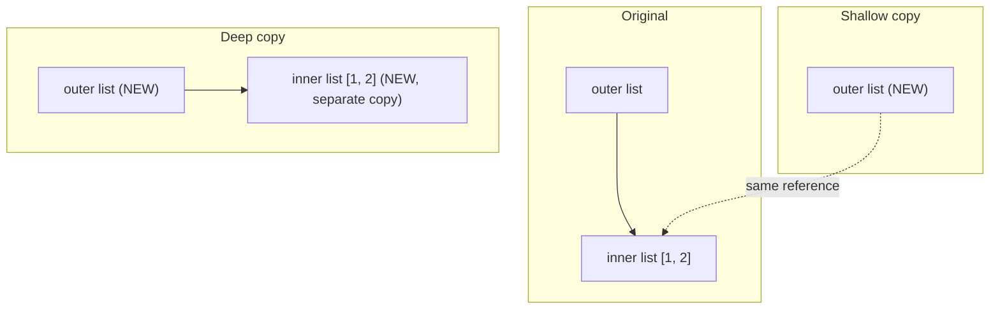

```python
import copy

original = [[1, 2], [3, 4]]

shallow = copy.copy(original)
shallow[0][0] = 99
print(original)          # [[99, 2], [3, 4]] — inner list was SHARED, original affected!

deep = copy.deepcopy(original)
deep[0][0] = 100
print(original)           # unaffected — deepcopy made fully independent nested copies
```

For a "flat" collection with no nested mutable objects (e.g. `[1, 2, 3]`), shallow and deep copies behave identically — the distinction only matters once you have containers nested inside containers.

### 218. What is the difference between __init__.py and running a module as __main__?

These are two unrelated mechanisms that happen to share the "special file/name" pattern:

- **`__init__.py`** — marks a **directory as a package** and runs once, automatically, whenever that package is first imported ([Q153](#153-what-is-__init__py-used-for)).
- **Running a module as `__main__`** — happens when a `.py` file is executed **directly** (not imported); Python sets that specific module's `__name__` to the string `"__main__"`, which is what `if __name__ == "__main__":` checks for ([Q155](#155-what-does-if-__name__-__main__-do)).

```python
# mypackage/__init__.py — runs on `import mypackage`
print("Package initialized")

# mypackage/cli.py — runs its top-level code, and __name__ == "__main__" only if run directly
if __name__ == "__main__":
    print("Running as a script")
```

A package can also define a `__main__.py` file specifically, which lets you run the *package itself* as a script with `python -m mypackage` — a third, related-but-distinct convention.

### 219. What is the difference between a script and a module?

The distinction is about **intent and usage**, not file syntax — any `.py` file can serve as either:

- **Script** — a file meant to be **run directly** to perform some action (`python backup.py`), typically containing top-level, sequential logic.
- **Module** — a file meant to be **imported** and reused by other code, typically containing reusable functions/classes with minimal (or guarded) top-level execution.

```python
# utils.py — designed as a MODULE: mostly definitions, no top-level side effects
def parse_date(s):
    ...

# backup.py — designed as a SCRIPT: runs actions immediately when executed
import utils
print("Starting backup...")
files = collect_files()
```

Well-designed Python files often serve **both** roles simultaneously via the `if __name__ == "__main__":` guard ([Q155](#155-what-does-if-__name__-__main__-do)) — importable as a module, but also runnable directly as a script.

### 220. What is PYTHONPATH?

`PYTHONPATH` is an **environment variable** listing extra directories that Python should add to `sys.path` ([Q156](#156-what-is-syspath-and-how-does-python-find-modules)) at startup, before the standard library and installed-package locations — letting you make local, non-installed code importable from anywhere without a proper `pip install`.

```bash
export PYTHONPATH="/home/user/my_shared_libs:$PYTHONPATH"
python my_script.py         # can now `import` anything under my_shared_libs
```

```python
import os
print(os.environ.get("PYTHONPATH"))
```

It's mostly a convenience for local development, quick scripts, or CI setups — for real projects, an editable install ([Q209](#209-what-is-the-difference-between-an-editable-install-and-a-regular-install)) or a proper virtual environment ([Q205](#205-what-is-a-virtual-environment-and-why-is-it-important)) is the more maintainable, less error-prone approach.

### 221. What is memoization, and how do you implement it manually vs with lru_cache?

**Memoization** caches the results of expensive function calls, keyed by their arguments, so repeated calls with the same inputs return instantly from the cache instead of recomputing ([Q150](#150-what-is-functoolslru_cache-and-how-does-memoization-work)).

```python
# Manual implementation — a dict cache
def memoize(func):
    cache = {}
    def wrapper(*args):
        if args not in cache:
            cache[args] = func(*args)
        return cache[args]
    return wrapper

@memoize
def fibonacci(n):
    if n < 2:
        return n
    return fibonacci(n - 1) + fibonacci(n - 2)

# Built-in equivalent — same idea, more features (LRU eviction, cache_info(), thread-safety)
from functools import lru_cache

@lru_cache(maxsize=None)
def fibonacci(n):
    if n < 2:
        return n
    return fibonacci(n - 1) + fibonacci(n - 2)
```

The manual version is a useful exercise for understanding *how* memoization works (it's just a decorator wrapping a dict cache), but `lru_cache` is strictly better for real code: it handles unbounded-growth eviction via an LRU policy, keyword arguments, and provides introspection (`.cache_info()`) for free.

### 222. What is the difference between shallow equality and deep equality for custom objects?

By default, a plain custom class's `==` compares **identity** (inherited from `object.__eq__`, effectively the same as `is`) — two instances with identical attribute values are still considered unequal unless you explicitly define `__eq__` to compare their contents ("deep"/value equality).

```python
class Point:
    def __init__(self, x, y):
        self.x, self.y = x, y

p1 = Point(1, 2)
p2 = Point(1, 2)
p1 == p2       # False by default! Compares identity, not values

class Point:
    def __init__(self, x, y):
        self.x, self.y = x, y
    def __eq__(self, other):                       # explicit value equality
        return self.x == other.x and self.y == other.y

p1 = Point(1, 2)
p2 = Point(1, 2)
p1 == p2        # True — now compares field values
```

For **nested** custom objects, `__eq__` needs to recursively compare nested attributes too (or delegate to *their* `__eq__`) if you want genuinely deep equality rather than comparing nested objects' identities — a common bug is a "deep-looking" `__eq__` that actually only compares one level and silently falls back to identity for anything nested further in. This mirrors the shallow-vs-deep-copy distinction ([Q217](#217-what-is-the-difference-between-copycopy-and-copydeepcopy)) but for comparison instead of duplication.

### 223. What is the difference between CPU-bound and I/O-bound tasks, and how does that affect your concurrency choice in Python?

- **CPU-bound** — the bottleneck is raw computation (number crunching, image processing, parsing huge datasets); the CPU is constantly busy, and more CPU cores directly speeds things up.
- **I/O-bound** — the bottleneck is **waiting** (network requests, disk reads, database queries); the CPU is mostly idle, just waiting for something external to respond.

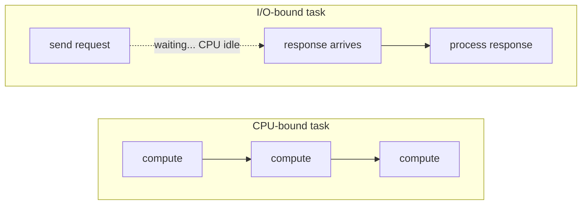

This distinction directly drives Python's concurrency choice ([Q169](#169-when-would-you-use-threading-vs-multiprocessing-vs-asyncio)):

- **CPU-bound → `multiprocessing`** — the GIL prevents parallel Python bytecode execution within one process, so you need separate processes (each with their own GIL) to actually use multiple cores.
- **I/O-bound → `threading` or `asyncio`** — the GIL is released during I/O waits ([Q167](#167-does-the-gil-mean-python-cant-do-parallel-work-at-all)), so a program spends most of its time waiting anyway; you don't need separate processes just to overlap waiting time. `asyncio` scales better than `threading` when the number of concurrent I/O operations is very large (thousands+), since coroutines are far cheaper than OS threads.

Misidentifying which category a workload falls into is a very common real-world performance mistake — e.g., reaching for `multiprocessing` to speed up a task that's actually spending 95% of its time waiting on network calls, when `asyncio` or `threading` would have been simpler and just as fast.

---

*This concludes the Python Interview Questions & Answers guide, covering all 223 questions from `python interview questions.txt`. For related material, see the companion guides: `java-interview-questions-answers.md` and `c++-interview-questions-answers.md`.*